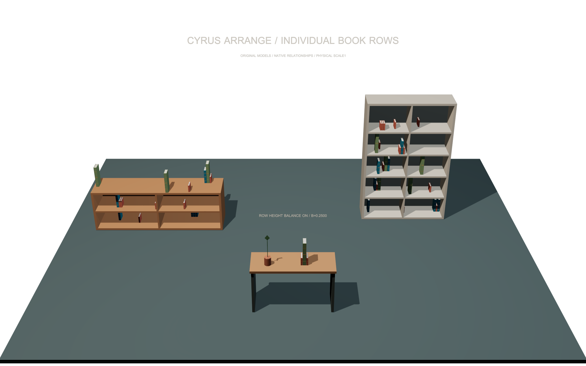
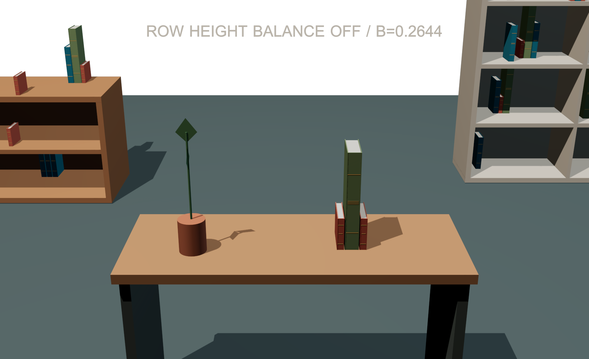
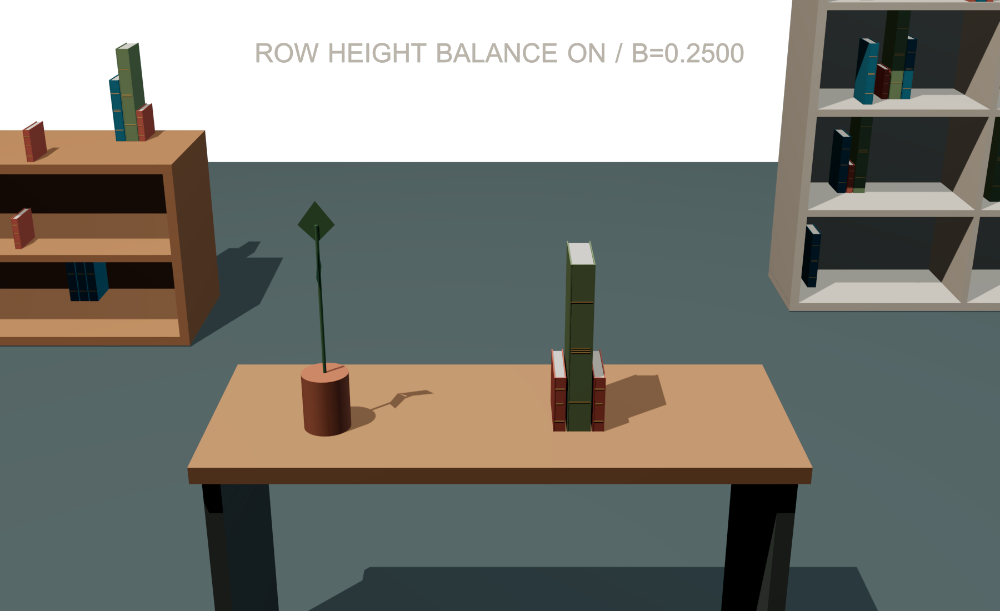

# Individual book-row examples — 0.1.2

These original **3ds Max 2027** scenes demonstrate separately generated books,
saved row relationships and optional row height balancing. The exact native28
render run passed **35 checks with zero failures**. **0.1.2 is qualified**, with
43 installer and 12 automatic-startup checks recorded in its
[external receipt](../dist/CyrusArrange-0.1.2/qualification-receipt.json).
The preserved 0.1.1-r3 baseline does not contain these controls. See
[release validation](RELEASE_VALIDATION_0.1.2.md); working 0.1.3 cache changes
have separate acceptance requirements.

## Open and explore

The scenes and CSV are supplied in the matching **Source-and-Examples** archive
beside the MZP. The plugin installer does not contain these scene assets.

Open a working copy with the matching **0.1.2 native modules and UI** available:

| File | Saved state |
| --- | --- |
| [Balance-Off.max](../examples/book-rows-0.1.2/CyrusArrange-BookRows-Balance-Off.max) | All three setups; comparison row balance is 0 |
| [Balance-On.max](../examples/book-rows-0.1.2/CyrusArrange-BookRows-Balance-On.max) | Same furniture and models; comparison row balance is 1 |
| [Performance CSV](../examples/book-rows-0.1.2/book-row-performance.csv) | Single-run generation and process-memory observations |

Select a setup helper, open **Cyrus Arrange** and press **Use selected setup**.
The scenes use Manual mode; opening them does not regenerate their outputs.

| Setup name | Furniture | Seed / density | Actual output |
| --- | --- | --- | --- |
| `CA_BV_SETUP_TV` | 1,800 × 450 × 600 mm TV console | 181 / 0.04 | 16 books; 3 rows of 3, plus 7 individual books |
| `CA_BV_SETUP_SHELF` | 1,200 × 350 × 1,800 mm open shelf | 282 / 0.08 | 25 books; 5 rows of 3, plus 10 individual books |
| `CA_BV_SETUP_BALANCE` | 1,000 × 400 × 600 mm console | 5 / 0.06372379 | 1 row of 3 books and 1 locked tall plant |

Controls use physical millimetres. The three Book sources have heights
100/200/300 mm, thicknesses 20/30/40 mm and depth 120 mm. Both scale limits are
1, allowed yaw is 0°, and each explicit spine profile faces captured −Y, matching
the surfaces' front. The hidden, nonrenderable source layer is
`CA_BV_99_ORIGINAL_SOURCE_LIBRARY`; unhide it to inspect the originals.

All setups use Balanced style, spacing 20 mm, edge gap 10 mm, sample spacing
25 mm, Grouping 0 and Scale variation 0. **Book rows / height balance...** uses
three books per row and a 3 mm internal gap. TV/shelf balance stays 0 in both
scenes; only the comparison setup changes. The open shelf's upper exterior top
and unwanted supports are excluded. The horizontal approach requirement is disabled here;
physical support and collision checks remain active.

Use **Refresh saved settings**, select a row and **Select all members of this
row**. Locking/unlocking any member affects its complete row. Generate can
replace actual output nodes while retaining protected placement records.
Follow the [book-row guide](BOOK_ROWS.md) before changing sources or profiles.

## What changed in the balance comparison

The independent sixteen-bin height-profile metric changes from
**0.26442307 to 0.25** at seed 5. The same three book identities, models, scales,
yaws and internal gap are retained; native generation translates their row.
The generated 80 × 80 × 400 mm plant was locked and remains fixed. No generated
pose was hand-adjusted, and no image was edited. This bounded height-profile
improvement does not establish physical stability or a generally better interior.

| Balance off | Balance on |
| --- | --- |
|  |  |

## Images and evidence limits

Six actual **Default Scanline Renderer** images accompany the saved states:

| View | Pixels |
| --- | --- |
| [Overview off](images/book-rows-0.1.2/CyrusArrange-BookRows-Overview-Off.png) / [on](images/book-rows-0.1.2/CyrusArrange-BookRows-Overview-On.png) | 2,400 × 1,500 each |
| [Balance off](images/book-rows-0.1.2/CyrusArrange-BookRows-Balance-Off.png) / [on](images/book-rows-0.1.2/CyrusArrange-BookRows-Balance-On.png) | 1,800 × 1,100 each |
| [TV rows](images/book-rows-0.1.2/CyrusArrange-BookRows-TV-Rows.png) | 1,800 × 1,100 |
| [Shelf rows](images/book-rows-0.1.2/CyrusArrange-BookRows-Shelf-Rows.png) | 1,500 × 1,500 |

The scene cameras are `CA_BV_CAMERA_OVERVIEW`, `CA_BV_CAMERA_BALANCE`,
`CA_BV_CAMERA_TV` and `CA_BV_CAMERA_SHELF`. Combined visual review found no
obvious floating, overlap, wall/divider penetration or framing defect. Overhead
boards partly hide tall books, so some upper clearances remain visually
inconclusive. Numerical checks separately cover actual world bounds, row
membership, spacing, facing, repeatability and the balance change. These sparse
examples do not demonstrate leaning, bookends, finished styling or other renderers.

## Observed timings and provenance

The copied CSV records TV Generate/repeat at **188.64/200.37 ms**, shelf at
**235.15/224.49 ms**, and final balance off/on at **169.23/164.08 ms**. These are
single-run observations, **not a controlled benchmark** or evidence that balance
is faster. Commands include source capture, query construction, solving,
materials, node publication and Undo. Process memory includes Max, scenes and
history. See [performance scope](PERFORMANCE.md) for controlled measurements.

[The manifest](../examples/manifest-0.1.2.json) binds each byte-identical copy to
its original path/hash, native28 module hashes and render receipt under
`build/host-final-28-book-rows-render`. The `.max` files, CSV and images all come
from that same passed run. The [0.1.1 examples](EXAMPLES.md) remain unchanged.
The manifest and immutable archives retain their pre-installer status text;
the external qualification receipt records the later successful installer gate.
Factories/tests reset disposable scenes; never run their qualification scripts
inside an artist scene.
