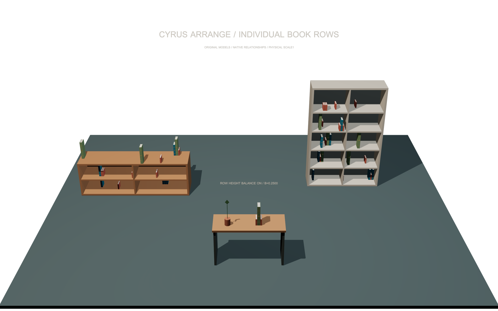
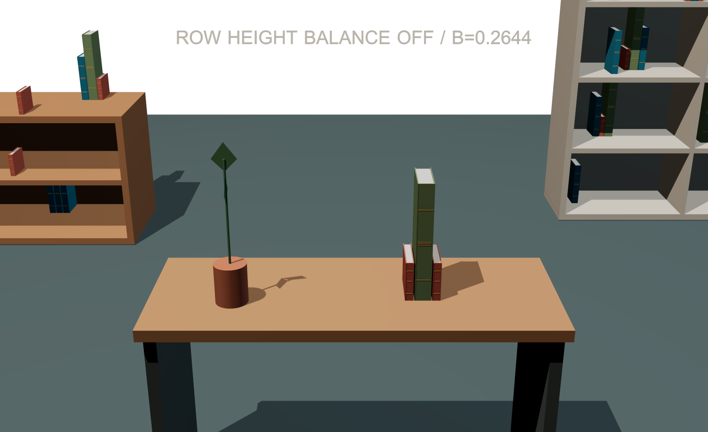
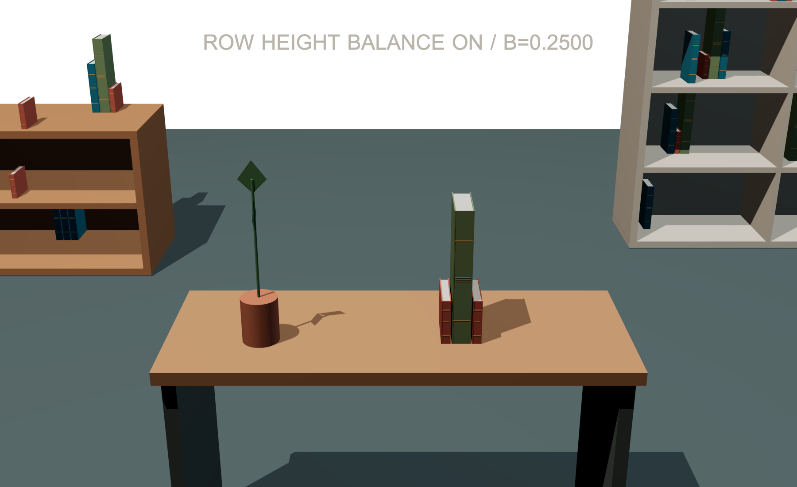

# Individual book-row examples — 0.1.3

These fresh **Max 2027 / native46** scenes demonstrate separate upright books,
saved three-member rows and a bounded row-height balance comparison. The exact
gallery run passes **35 checks with zero failures**, with six actual Default
Scanline renders. This is separate from package qualification: use the matched
**0.1.3 package** identified by the [release report](RELEASE_VALIDATION_0.1.3.md)
after its installer/startup gates pass. Keep that package's native modules and
UI together.

The [0.1.2 examples](BOOK_ROW_EXAMPLES.md) remain preserved with their original
native28 evidence. The files and observations below come from the fresh native46
run rather than inheriting the older images or measurements.

## Open and explore

Extract the matching **Source-and-Examples ZIP** and copy
`examples/book-rows-0.1.3/` to a working location. The MZP installs the plugin;
it does not contain these `.max` scene assets. The examples use original
procedural geometry and scene-created Standard materials, so no external bitmap
relinking or asset download is required.

| File | Saved state |
| --- | --- |
| [Balance-Off.max](../examples/book-rows-0.1.3/CyrusArrange-BookRows-Balance-Off.max) | All three setups; comparison height balance 0 |
| [Balance-On.max](../examples/book-rows-0.1.3/CyrusArrange-BookRows-Balance-On.max) | Same furniture/models; comparison height balance 1 |
| [Gallery CSV](../examples/book-rows-0.1.3/book-row-performance.csv) | Single-run generation and process-memory observations |

Open a working copy and use **Save As** to preserve the supplied originals.
Select a setup helper, open **Cyrus Arrange**, then press **Use selected setup**.
The scenes use Manual mode: opening them does not regenerate their output.

| Setup | Furniture, XYZ mm | Seed / density | Actual output |
| --- | --- | --- | --- |
| `CA_BV_SETUP_TV` | 1800×450×600 console | 181 / 0.04 | 16 books: 3 rows of 3 and 7 individual books |
| `CA_BV_SETUP_SHELF` | 1200×350×1800 open shelf | 282 / 0.08 | 25 books: 5 rows of 3 and 10 individual books |
| `CA_BV_SETUP_BALANCE` | 1000×400×600 console | 5 / 0.06372379 | 1 row of 3 books and 1 locked tall plant |

All distances are millimetres. The three original Book sources have heights
**100 / 200 / 300 mm**, thicknesses **20 / 30 / 40 mm** and depth **120 mm**. Both
scale limits are 1, allowed yaw is 0°, and their explicit spine profiles face
captured −Y, matching the surface fronts. The source groups are in the hidden,
nonrenderable `CA_BV_99_ORIGINAL_SOURCE_LIBRARY` layer. Unhide it to inspect the
originals, and retain the source bindings when regenerating.

The setups use Balanced style, Spacing **20 mm**, Edge gap **10 mm**, Sample grid
**25 mm**, Grouping **0** and Scale variation **0**. **Book rows / height balance...**
uses Minimum/Maximum books **3 / 3** and Gap within a row **3 mm**. The TV/shelf
height balance remains 0 in both scenes; only the comparison setup changes.
The shelf's exterior top and unwanted supports are excluded. Horizontal
approach is disabled in this fixture; support and collision checks remain active.

Open **Book rows / height balance...**, press **Refresh saved settings**, select
a row, then **Select all members of this row**. **Lock selected outputs** and
**Unlock selected outputs** affect the whole row when any member is selected.
To reposition a row manually, translate all members together before locking.
A successful Generate can replace the actual Max output nodes while preserving
logical placement IDs; refresh selection from the current output/row list.
See the [book-row guide](BOOK_ROWS.md) for captured spine axes and profile rules.

## Compare height balance

Choose `CA_BV_SETUP_BALANCE` in each saved state. The plant stays locked and the
same three books retain their IDs, models, scales, yaw and internal gap. Native
generation translates the row; no generated pose was adjusted for the images.
The independent sixteen-bin height-profile metric changes from
**0.26442307 to 0.25** at seed 5. The visible shift is small and does not prove a
more attractive room, gravity/stability or a global arrangement optimum.

| Balance off | Balance on |
| --- | --- |
|  |  |

To experiment in a working copy, change **Row height balance**, press **Apply
composition settings**, then Preview/Commit or Generate. For new sources,
register each individual Book and apply **Upright book row profile...** with a
compatible spine side and allowed yaw. A source group containing several books
remains one asset; the plugin does not split it into independent row members.

## Images and what they establish

The saved cameras are `CA_BV_CAMERA_OVERVIEW`, `CA_BV_CAMERA_BALANCE`,
`CA_BV_CAMERA_TV` and `CA_BV_CAMERA_SHELF`.

| View | Pixels |
| --- | --- |
| [Overview off](images/book-rows-0.1.3/CyrusArrange-BookRows-Overview-Off.png) / [on](images/book-rows-0.1.3/CyrusArrange-BookRows-Overview-On.png) | 2400×1500 each |
| [Balance off](images/book-rows-0.1.3/CyrusArrange-BookRows-Balance-Off.png) / [on](images/book-rows-0.1.3/CyrusArrange-BookRows-Balance-On.png) | 1800×1100 each |
| [TV rows](images/book-rows-0.1.3/CyrusArrange-BookRows-TV-Rows.png) | 1800×1100 |
| [Shelf rows](images/book-rows-0.1.3/CyrusArrange-BookRows-Shelf-Rows.png) | 1500×1500 |

Visual review found no obvious gross floating, overlap or divider penetration
in exposed areas. Overhead boards hide some book tops and contacts. The balance
close-ups retain all comparison props, while cropping lower table legs and
neighboring background furniture. Simple forms, sparse placement and hard
shadows show the procedural demonstration's limits. The images do not establish
hidden clearances, stability, leaning books, bookends or other renderer support.
Numerical assertions separately check real world bounds, spacing, facing,
membership, repeatability and the measured balance change.

## Observed times and provenance

The copied CSV records TV Generate/repeat **146.70 / 172.52 ms**, shelf
**191.27 / 197.45 ms**, and final comparison Off/On **169.89 / 130.86 ms**. These
are single whole-command observations, **not a controlled cache benchmark**
or evidence that enabling height balance makes generation faster. Process
memory includes Max, render state, scenes and history.

The preserved result log uses older blanket recapture/query-rebuild wording.
With reuse enabled, a valid cache hit can skip furniture capture/inspection and
query construction; current asset capture, solving, appearance publication and
Undo still contribute. This gallery CSV does not record cache dispositions and
cannot label its rows cold/hit or isolate solver memory. Controlled cache
measurements have their own [performance scope](PERFORMANCE.md).

[The manifest](../examples/book-rows-0.1.3/example-manifest.json) binds the
unchanged scenes, CSV, receipts and six images to
`build/host-final-46-book-rows` and the native46 pair. The
[visual review](../examples/book-rows-0.1.3/bookrows46-visual-review-01.md)
records exact image hashes and its limits. This example evidence does not
replace final release qualification. Factories/tests reset disposable scenes;
never run their qualification scripts inside an artist scene.
