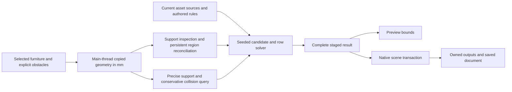

# Cyrus Arrange implementation map

For the 0.3.2 development implementation, start with the [fourteen-item ledger](GEOMETRY_WORKFLOW_0.3.2.md), [geometry core](GEOMETRY_PLACEMENT_CORE_0.3.2.md) and [single Modify interface](UNIFIED_MODIFY_0.3.2.md). The implementation map below retains the 0.3.1 baseline.

Qualified implementation: **0.3.1**, C++20 core and 3ds Max 2027 adapter with MAXScript artist controls. It adds a native Modify entry and selectable arrangement icon over the existing document; see [native presentation](NATIVE_PRESENTATION.md) and [current acceptance](REAL_WORLD_0.3.1.md). Start with the [workflow improvements](WORKFLOW_IMPROVEMENTS_0.3.0.md) for bulk intake, copied reusable groups, ownership and Undo, and the [technical overview](TECHNICAL_OVERVIEW.md) for the retained placement pipeline. The [0.3.0 release ledger](RELEASE_VALIDATION_0.3.0.md) remains the preserved prior qualification. Historical reports and immutable archives remain preserved.

## Current components and flow

| Component | Owns |
| --- | --- |
| `geometry.cpp` / `geometry.h` | Copied millimetre triangles, sampled support/clearance, connected regions and admission limits |
| `assets.cpp` / `assets.h` | Physical accessory geometry, orientation/contact/stack metadata, explicit book intent and portable library codec |
| `region_registry.cpp` | Persistent support identities and artist policy reconciliation after fresh analysis |
| `placement_queries.cpp` | Quantized support polygons, furniture/obstacle triangle BVH, full-footprint containment, conservative OBB collision and front approach |
| `geometry_cache.cpp` / `geometry_cache.h` | Bounded immutable numerical inspection/query retention, exact same-time keys, leases and accounted retained storage; no Max references or saved state |
| `arrangement.cpp` / `composition_types.h` | Seeded targets and candidates, category/region rules, protected placements, stacks, atomic book rows and bounded height-profile improvement |
| `document_state.cpp` / `arrange_document.cpp` | Pure persistence codec, immutable authored states, Max references, Undo/Redo, non-restored dependency epochs and bounded transient expanded-input observation |
| `arrange_bridge.cpp` | Main-thread capture, atomic bulk intake and copied decor groups, current settings/registry binding, solve, visual/material staging and complete scene publication |
| `preview_service.cpp` | Bounded transient preview boxes and staged registry, with state/dependency/time/unit checks before staging and Commit |
| `storage_plugin.cpp` | Saved native custom-attribute classes; document format4, supported reader3/4 |
| `max_bridge.cpp` | Independent geometry inspector API, snapshot overlay and JSON export |
| Six files in `scripts/` | Inspector, arrangement, asset, surface, collision and native-hosted Modify controls; bounded authored commands and passive summary reads |

MAXScript does not solve geometry or store placement-sized authoritative state. Host access stays on Max's main thread; numerical routines consume owned values without SDK pointers. Distances use millimetres in a translated near-origin frame; the adapter maps the results back into scene coordinates. Generation stages the entire successor and retains the previous complete result on failure.

Working 0.1.3 implements same-time reuse of one immutable raw furniture-inspection result and furniture/obstacle query per eligible setup, with at most four retained entries globally. An exact current key and native dependency observation guard lookup and publication. Commands bind a copy of raw regions against the current registry, and recapture source-backed assets independently even on a hit. Generate still stages current visual meshes/materials and publishes the complete successor. Analyze remains a cold furniture-only operation. The saved document, Preview and numerical cache have separate lifetimes; the cache is not serialized or restored by Undo.

Reuse is enabled by default. Historical native46 passed twelve CTest executables / 117 cases and all sixteen final functional host suites / 3,034 assertions. That exact campaign includes general cache **685/0**, publication callbacks **233/0**, boundaries **1182/0** and appearance/WSM **156/0**; the original-model workflow/render trial separately passes **612/0**. These counts cover different scopes. See the [runtime contract](CACHE_RUNTIME.md), [implementation plan](CACHE_IMPLEMENTATION_PLAN.md) and [release ledger](RELEASE_VALIDATION_0.1.3.md) for invalidation, ownership, measurements, final packaging and limits.

## Detailed contracts

- [Geometry and resolution](GEOMETRY.md), [placement mathematics](PLACEMENT.md), and [composition](COMPOSITION_DESIGN.md).
- [Assets and source frames](ASSET_LIBRARY.md), [surface identity](REGION_REGISTRY.md), and [scene ownership](SCENE_OWNERSHIP.md).
- [Native inspector API](NATIVE_API.md) and [arrangement API](ARRANGEMENT_API.md).
- [Command measurements](PERFORMANCE.md), [measurement protocol](PERFORMANCE_PROTOCOL.md), and [qualification scopes](QUALIFICATION_SCOPES.md).

## Historical 0.1.0 inspector implementation

The following contract describes the preserved inspector-only milestone. Its session snapshot is distinct from the persistent arrangement documents introduced in 0.1.1.

Authorized scope: new independent product, C++ geometry/Max adapter and MAXScript UI, TV consoles and open shelves, procedural fixtures and Max 2027 qualification. Scatter, Surface Analyzer, Physics Lab and their versions are unchanged.

## Ownership and boundaries

The Max adapter evaluates selected nodes on the host thread and copies triangles into native owned memory. The pure C++20 core accepts millimetres in a translated near-origin, Z-up frame. Transform parity is handled in the adapter. No Max pointers reach numerical code. Inspection is explicit and synchronous, with hard triangle, cell, region and work limits. The historical 0.1.0 inspector path has no automatic calculations or background callbacks; current arrangement dependency and Manual/Live services are separate.

Native inspection stages a complete successor before replacing the previous result. Invalid geometry/settings, unsupported inputs or budget exhaustion return a useful error and retain the previous snapshot. This inspector milestone is session-only and introduced no custom saved scene class or schema. IDs are stable only within an unchanged snapshot. Source edits require Inspect again. Export and overlay describe the captured snapshot, never a promise of current scene freshness.

The core extracts sampled horizontal support regions and upward clearance from the captured triangles. Cell resolution is explicit; sampled area and bounds do not certify exact polygon area, accessibility, cavities, watertightness or object fit. Vertical/recess walls influence clearance where rays intersect but this milestone does not recognize doors, drawers or styles. Geometry outside the selected assembly is not considered.

The UI sends bounded commands and displays summaries. Bulk mesh analysis, result storage, JSON serialization and overlay construction remain native. An overlay is an explicitly created regular scene mesh, tagged as generated and excluded from future inspection; creation/deletion must participate in Undo. Source nodes are never modified. Results and overlays are snapshots; reinspection is required after source edits.

One result is retained per session. Snapshot, next result and previous result coexist during successful publication; budget limits bound work but are not precise Max process memory guarantees. Clear releases the cached result. Overlay geometry is separately scene/Undo-owned. No result pointer is persisted.

## Acceptance gates

- Native core: known surface heights, shelf clearance, separated supports, gaps/holes at supported resolution, transforms, invalid inputs, deterministic results and bounded rejection.
- Max 2027: selected multi-node assemblies and groups, units, mirrors/nonuniform transforms, source preservation, failed-result retention, real UI handlers, overlay Undo/Redo, export and scene save/reopen.
- Delivery: independent CMake build, reproducible private host runner, procedural fixtures, documented API/limits and matched native/UI MZP with hashes. No normal-profile installation or changes to existing artist sessions.

0.1.0 was the first independently versioned inspector milestone. Persistent arrangement followed in 0.1.1, and book-row composition followed in 0.1.2. The historical inspector receipts identify its exact sources and binaries.

These scoped acceptance gates passed on the final native/UI pair. See [qualification](QUALIFICATION.md) for evidence, installer execution limits and remaining production coverage.
