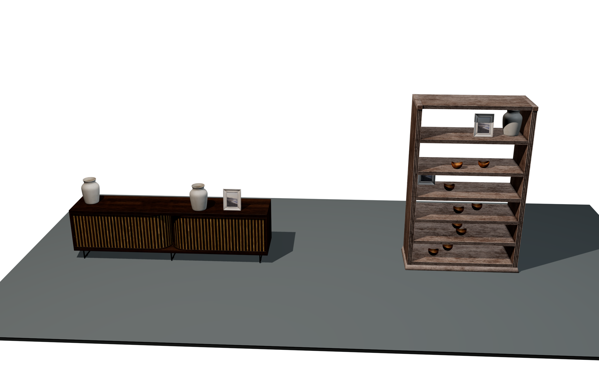
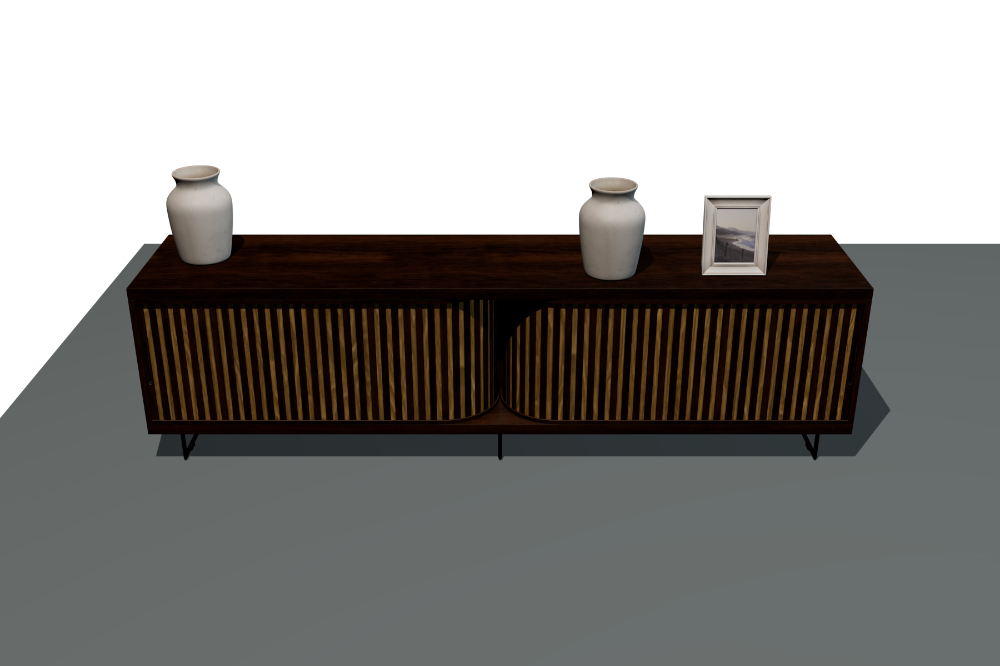
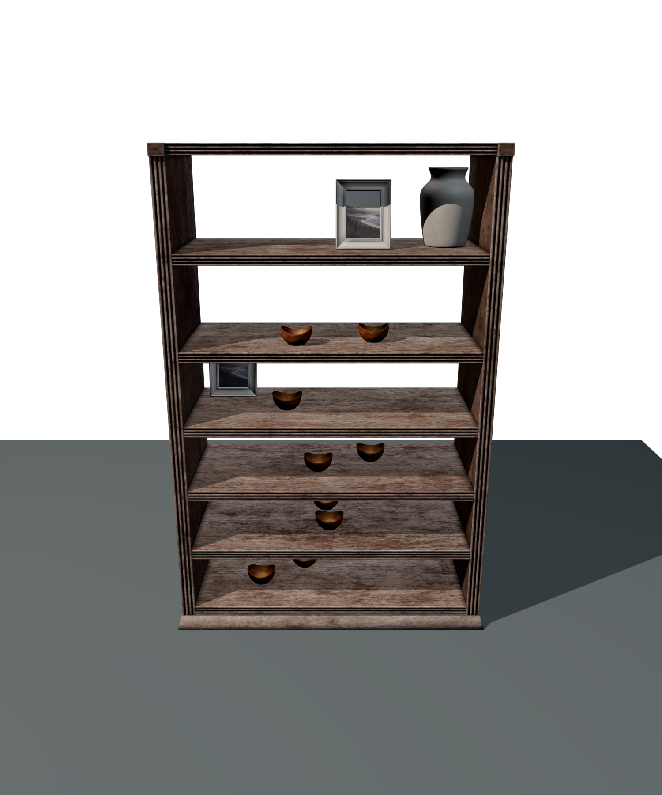
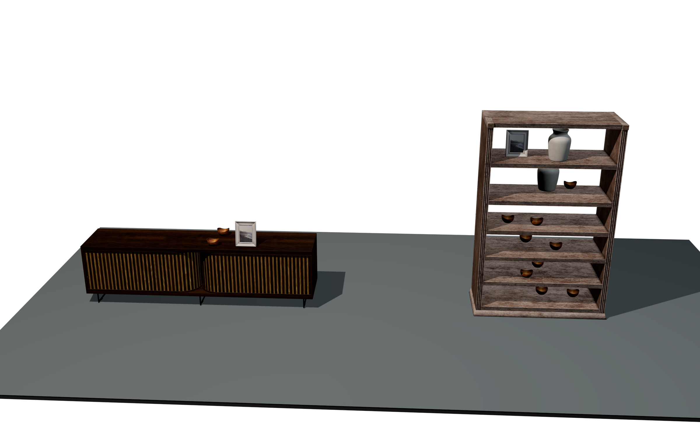

# Imported furniture examples — 0.1.3

These Max 2027 examples use original-size Poly Haven furniture and accessories
with **Standard diffuse materials / Default Scanline Renderer**. They include a
TV console, an open shelf, a standing frame, a ceramic vase and a wooden bowl.
The models were grouped and translated without resizing or topology repair.

Use the exact **0.1.3 package** identified by the
[release report](RELEASE_VALIDATION_0.1.3.md) after its installer/startup
qualification. A passed example trial is separate from package qualification.
Keep the native modules and UI from that same package; the older qualified
0.1.2 release does not establish this imported-model acceptance.



## Copy and open the example

The scenes are in the matching **Source-and-Examples ZIP**, not the MZP plugin
installer. Extract it and copy the whole `examples/imported-0.1.3/` folder to a
working location. Keep `inputs/assets/`, its six maps, the original FBX files
and `Relocate-Imported-Textures.ms` together. The relative scene links below
work in the extracted source/examples tree.

| Scene | Saved state |
| --- | --- |
| [Workflow.max](../examples/imported-0.1.3/CyrusArrange-Imported-Workflow.max) | Later lock, selective regeneration and Preview/Commit result; one protected placement per setup |
| [SeedA.max](../examples/imported-0.1.3/CyrusArrange-Imported-SeedA.max) | Initial unlocked arrangement: TV seed 11, shelf seed 21; the close-up images below use this scene |
| [SeedB.max](../examples/imported-0.1.3/CyrusArrange-Imported-SeedB.max) | Unlocked reroll: TV seed 12, shelf seed 22 |

Open a **working copy** with the matching plugin installed. The scenes use
millimetres and Manual mode; opening them preserves the saved generated output.
Moving the example folder does not rewrite the saved bitmap paths. Relocate
them explicitly before generating or rendering on the new folder or machine.

## Relocate the supplied textures

With the example scene open, run the copied `Relocate-Imported-Textures.ms`
through **Scripting → Run Script**. This helper defines a function; it does not
reset or load a scene. Then open the MAXScript Listener and call the function
with the **example root containing `inputs/assets/`**, not the texture directory.
For example, change this path to your working folder:

```maxscript
caRelocateImportedTextures @"D:/Cyrus-Examples/imported-0.1.3/"
```

Alternatively, load the helper and call it from the Listener:

```maxscript
fileIn @"D:/Cyrus-Examples/imported-0.1.3/Relocate-Imported-Textures.ms"
caRelocateImportedTextures @"D:/Cyrus-Examples/imported-0.1.3/"
```

The helper validates all six known file names and SHA-256 values before
updating assigned source/output bitmap paths in one Undo operation. It reports
an error if a map is missing or changed; it does not download replacements or
guess paths. Keep the whole folder structure and correct the reported missing
file. This is a helper for the supplied maps, not a general shader converter.

Save As to a new `.max` path after relocation. The source models and materials
are already inside the scene, so no FBX reimport is required. Verify a named
camera render, and keep the maps beside your working example folder. Repeat
the explicit relocation after moving it again.

**Use stored geometry** and a `.cyalib` file do not repair missing textures.
Libraries omit materials, UV channels and texture files; preserve the live
scene sources for this appearance. For your own replacement maps, repair the
live source's paths/materials and Generate; the pinned helper intentionally
rejects altered supplied files.

## Use the saved setups

Select `CA_IMPORTED_SETUP_TV` or `CA_IMPORTED_SETUP_SHELF`, open **Cyrus Arrange**
and press **Use selected setup**. Review **Asset Library**, **Surface rules...**
and **Collision scope...** before **Preview bounds → Commit preview** or
**Generate**. A successful Generate is required before Live can resume when
that preference is enabled. The saved Workflow scene contains locks;
**Reroll unlocked** preserves them. Use Seed A/B to explore an unlocked result.

The source accessories are parked in the hidden, nonrenderable
`CA_IMPORTED_ACCESSORY_SOURCES` layer. Unhide it to inspect the originals, and
keep their source references intact. Generated objects are replaceable outputs;
edit a source for reusable material or geometry changes. For a replacement,
select its intended catalog row, select the new scene model/group, and press
**Rebind to selected model**. **Use selected model / group** starts a new
registration and is not the rebind step.

All three accessories have Min/Max scale **1** and yaw **0°**. Both setups use
Balanced style, Density **0.18**, Spacing **45 mm**, Edge gap **20 mm**, Grouping
**0.25**, Scale variation **0**, Empty space **0.35**, and Sample grid **25 mm**.
Surface fronts point toward world −Y. Horizontal approach is required; the
explicit obstacle list is empty. Only Frame, Vase and Bowl are enabled, with
per-region maxima **2 / 2 / 3**, and stacking is disabled.

The initial TV result accepts **3 of 3** requested props. The shelf accepts
**12 of 13**, retaining the one-object underfill instead of shrinking models
or loosening physical constraints. Density is a target; conservative bounds,
clearance, category limits and the bounded search can leave fewer accepted
objects. Read **Accepted / requested / kept / underfilled** and the warning in
the panel. Reusing unchanged settings and seed reproduces the logical records;
a later seed can change choices and positions.

When editing rules, press **Apply surface rules** for each changed surface,
**Apply category rules** for category changes, and **Apply approach setting**
for the approach checkbox. Those drafts are separate from the main settings.
Keep the selected furniture out of the obstacle scope.

## Imported cabinet preparation

The cabinet's bound group contains only `modern_wooden_cabinet_body`,
`modern_wooden_cabinet_door_l` and `modern_wooden_cabinet_door_r`. The two original
vertex-only path objects remain in the scene outside that group. Selecting
every imported cabinet component includes zero-face geometry and fails current
native source admission. The supplied setup is already prepared; do not add
those path objects when rebuilding it. This is an explicit selection rule for
this asset, not automatic cleanup of arbitrary imported hierarchies.

## Views and limits

The saved cameras are `CA_IMPORTED_CAMERA_OVERVIEW`, `CA_IMPORTED_CAMERA_TV` and
`CA_IMPORTED_CAMERA_SHELF`. The examples use the supplied Standard diffuse and
approximate transparent-cover adapter; they do not reproduce the original
Physical Material/PBR shaders. Other renderers or arbitrary proxy objects are
outside this demonstrated scope.





The images show readable wood, frame artwork and full-size props, with no
obvious gross placement defect in exposed areas. Upper boards conceal some
objects; pixels cannot prove hidden contacts. Repeated bowls and hard Scanline
shadows reveal the constrained three-prop collection. This is a reproducible
fit/variation example, not automatic curated styling or a finished interior.



## Evidence and credits

The native46 import probe passes **432 / 0** and the separate artist/render
trial passes **612 / 0**, including source/output geometry, UV/material
associations, sampled support and conservative envelopes, repeats, locks,
Preview/Commit, save/reopen and actual relocated-map checks. Visual review is
separate from those assertions; the repeated render trial is not additive
unique coverage. See the [copied manifest](../examples/imported-0.1.3/example-manifest.json),
[visual review](../examples/imported-0.1.3/imported-visual-review-01.md) and
[technical import qualification](IMPORTED_MODEL_QUALIFICATION.md).

Poly Haven supplies these five assets under CC0. Author credits and source URLs
are preserved in [credits.csv](../examples/imported-0.1.3/credits.csv) and exact
file provenance in [source-provenance.csv](../examples/imported-0.1.3/source-provenance.csv).
Attribution is voluntary and implies no endorsement. The
[license policy](https://polyhaven.com/license) and original source files remain
separate from the plugin's own license.

The QA scripts reset/load disposable scenes; do not run them in an artist
session. The relocation helper above is the supplied bounded exception.
