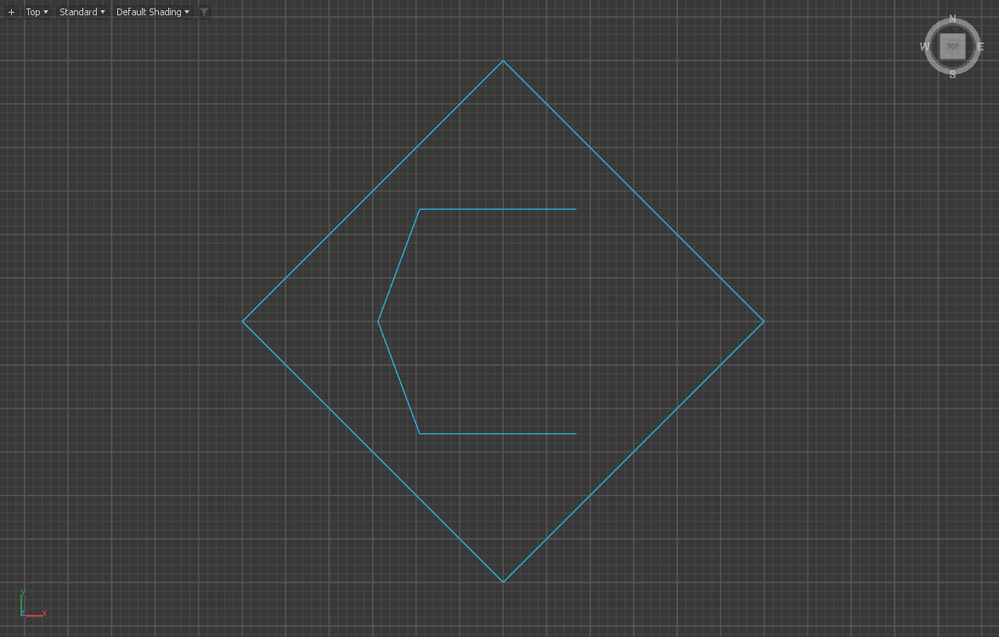
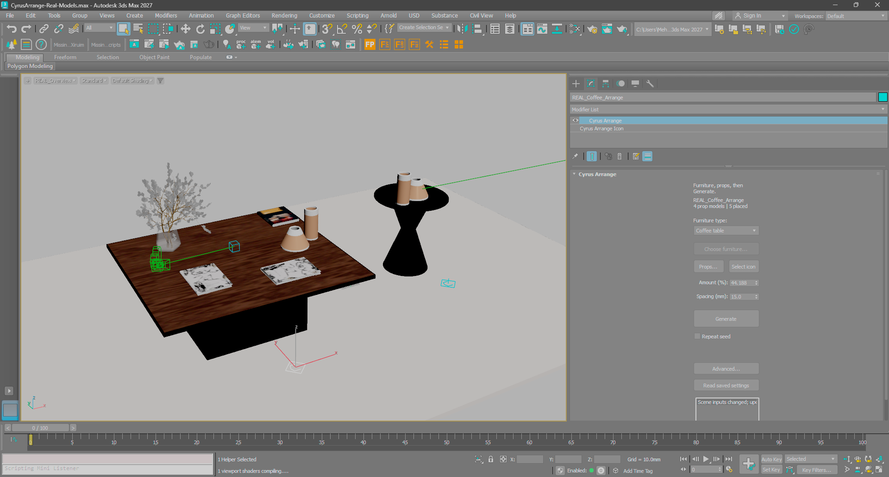

# Cyrus Arrange in the Modify panel

For the 0.3.2 development controls, use the [single Modify workflow](GEOMETRY_USER_WORKFLOW_0.3.2.md) and [implementation](UNIFIED_MODIFY_0.3.2.md). The instructions below retain the qualified 0.3.1 interface.

The native icon and Modify controls are qualified for **0.3.1 / Max 2027**.
Use the matching installer identified by
[the validation report](RELEASE_VALIDATION_0.3.1.md);
[the real model contract](REAL_WORLD_0.3.1.md) records the tested scope.

## Open the controls

New arrangements have a **Cyrus Arrange** viewport helper with a **Cyrus Arrange**
modifier in its stack. Select that helper, open **Modify**, and select its Cyrus
Arrange stack entry to see the arrangement controls. The helper is a selectable
scene control; its wire icon is not rendered.

The icon is cyan by default and uses Max's selection color when selected:

The actual prepared coffee-table scene with native Modify controls:

This original Max capture shows four registered models, five placements,
Amount 44.188% and Spacing 15 mm. The icons remain separate from the furniture.

This is an actual Top-viewport capture. At unit scale the control's envelope is
120 × 120 × 48 mm; its apparent size changes with viewport zoom. Moving the
icon gives you a clearer place to select it. It does not move the furniture or
generated props. Rotating or scaling it changes its own wire display and pick
envelope, rather than transforming the arrangement.

For existing furniture, select the furniture and choose **Cyrus Arrange** from
the Modifier List. Its panel uses the saved arrangement associated with that
target. If the target has no arrangement, explicitly choose the furniture type
and use the furniture action in the panel to create one. Opening the panel by
itself does not create an arrangement or generate props. For a complete furniture
assembly, select its group or all intended parts in the main window and use
**Use selected furniture**. An unbound geometry modifier's **Use this furniture**
action uses that geometry node. If several arrangements share a target, select
the intended arrangement's icon or choose it in the main window's arrangement
list. An unbound helper shows **Choose furniture...**, which opens that window.

## Make a variation

1. Bind the furniture, then open **Props...**.
2. Select original accessory meshes or complete source groups, choose their
   shared category and use **Add selected props**. Repeat for books, plants and
   other decor. Selecting a complete Max group registers the entire group as
   one prop.
3. Return to the arrangement icon. Set **Amount (%)** and **Spacing (mm)**, then choose
   **Generate**. Each click makes a fresh seed by default.
4. Enable **Repeat seed** when you want to reproduce a variation. Use
   **Advanced...** for surface exclusions, category rules, book rows, obstacles
   and the remaining detailed controls.

**Furniture type** chooses the placement recipe for the bound furniture.
Amount is a density target; physical size, support, category limits and spacing
may leave fewer props placed than requested. Distances are millimetres even
when Max uses another display or system unit.

Amount, spacing and type edits are drafts until Generate. **Read saved settings**
reads the shared document while preserving fields you explicitly changed in
this view. **Repeat seed** reveals the seed field and starts off each time a
Modify view opens. The saved seed belongs to the arrangement; the checkbox is
a temporary preference for that view.

The modifier panel, main window and advanced windows edit the same native
arrangement document. Changing views does not copy settings or generate another
set of props. Opening or switching panels reads saved settings without analysis
or generation. Furniture geometry passes through the modifier unchanged. Use
Undo for an authored generation or prop operation.

## Save and reopen

Save the `.max` scene with the original accessory sources and their maps. The
native storage plugin loads the saved helper, modifier and arrangement state;
the matching installed MAXScript files supply the controls. After reopening,
select the icon to read its saved values. If Max prompts about system units,
choose **Adopt the file's unit scale** for the supplied example. Generate explicitly evaluates current
dependencies and makes a new variation unless Repeat seed is enabled. Keep
generated output separate from the original prop library when selecting props.

Install the matching Max 2027 MZP and restart Max before opening a scene that
uses the new classes. Mixing an older native module with newer scripts is not
a supported installation.

After a file loads, Manual mode can say the scene inputs changed because its
transient dependencies need refreshing. The saved output stays visible. Enable
**Repeat seed**, then **Generate** to refresh the saved composition; leave
Repeat seed off when you want a new variation.

## What the evidence covers

The release report separates actual normal-Max Modify interaction, native
viewport Display/HitTest, saved real-scene readback and rendering. A live Modify
page and numeric state checks do not by themselves prove a screenshot's content,
every DPI layout or every renderer. The temporary parameter view is never saved
as another arrangement; the scene retains one native document and its sources.
Exact passed runs, remaining gates and installer status stay in the
[validation report](RELEASE_VALIDATION_0.3.1.md).
