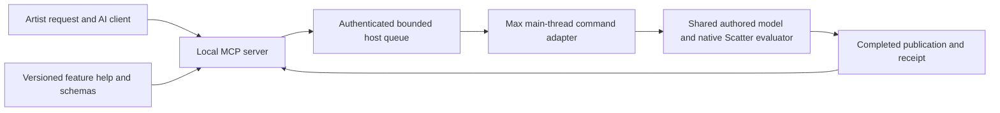

# Cyrus MCP — procedural workflow and agent interface design review

23 October 2026. Research and proposed architecture; no implementation approval
or delivery qualification is implied. This document extends the
[initial audit](AUDIT_20261023.md) and [research reading list](RESEARCH_20261023.md).
It is the recommended design starting point once the user's current plugin fixes
and optimizations are finished. Earlier reports retain their dated observations.

## 1. Recommendation

Extend the existing local MCP adapter and reuse Scatter's authored model and
native evaluator. The client AI interprets the artist's request; Cyrus supplies
truthful feature knowledge, scoped scene state, validated transactions and
verifiable outcomes. Keep domain rules and scene authority in deterministic code.

The first useful milestone is an assistant that can explain an enrolled setup,
make a small approved change to an explicitly editable existing setup, preserve
unaffected work, and verify the actual result. Recipe/library workflows should
reuse the existing recipe engine. Broader spatial authoring and renderer jobs
follow their own qualification.

Do not make a second placement engine, an embedded LLM service, a mandatory vector
database or a multi-agent framework prerequisites for that milestone. Do not turn
every UI control into a tool. Add infrastructure only for a measured problem.
This is an engineering choice for this repository, not a universal prescription
for all MCP servers.

## 2. What was double-checked

### Current evidence and limits

- This review began on branch `codex/workflow-0.75`, HEAD
  `7d5fd264f8c39e306389977d1eda7c4f358bd3c8`, with substantial concurrent edits.
- README now identifies the delivered Scatter **0.86.8.7**, schema 59,
  CyrusUnified2 and Analyzer **0.14.2**, qualified for Max 2027 within the linked
  [delivery scope](../docs/plans/code-quality/DELIVERY_08687.md). That handoff was
  read. Historical three-host deliveries keep their original scope.
- The concurrently edited CMake/catalog identified development **0.86.9** during
  inspection. This is not a claim of a qualified 0.86.9 delivery. Catalog coverage
  was **36 feature families / 333 controls**, correcting the earlier audit's
  historical 332-control observation. MCP remains package 0.73.0 / Plan 0.73.
- The source still registers twelve tools/seven resources. The available chat
  connector still advertises the older seven-tool/Plan 1.0 surface. Its fresh
  connection status call returned `OUTCOME_UNKNOWN` / local connection
  interrupted. No live scope, current Max panel or current host operation was
  qualified in this review.
- Knowledge generation
  `8a58031bf6efb27cf7c8e30a81d6059206b292269b5e5e24bf1045b704989059`
  remains stale: 48 enrolled parents checked, 30 verified, 18 changed. Refresh
  reported stopped. This review relied on current source, not stale retrieval.
  No knowledge refresh, activation or configuration change was performed.
- Fresh offline command: `build/mcp-venv/Scripts/python.exe -m pytest CyrusMCP/tests -q`.
  **130 passed in 11.61 seconds.** The 35 recorded MCP/test/generated-identity
  input files were unchanged across this run. This resolves the *observed current*
  catalog-version regression from the earlier audit; it does not relabel that
  older failed receipt. It does not freeze or qualify all concurrently edited
  native/UI sources.
- Local ignored evidence: `build/mcp-design-review-20261023-01/`, including
  `inputs-before.json`, `input-stability.json`, `tests.log`, `tests.xml`,
  `source_probes.py` and `source-probes.json`.

### Source path traced

| Component | Actual responsibility inspected |
| --- | --- |
| `cyrus_mcp/server.py` | Standard MCP tools/resources and forwarding; no model inference |
| `models.py`, `contracts.py`, `settings.py` | Closed plan types, bounds, units, normalization and allowlisted bindings |
| `transport.py` | Restricted local descriptor, authenticated loopback requests, bounded network/queue resources and host-thread dispatch handoff |
| `service.py` | Scope/context revisions, validation, local approval, operation journal, idempotency, result reads and recovery |
| `panel.py` | Local authority, queued Qt dispatch, proposal review and host lifecycle |
| `max_host.py` | Max reads/mutations, input fingerprinting, bounded authoring, Undo/rollback, capture and diagnostics |
| `procedural.py`, `publication.py`, `records.py` | Recipe metadata, completed publication transport and execution records |
| `AminScatter/tools/ui/templates/unified-core.ms` | Authoritative authored coordination, native evaluation, atomic publication and cached publication access |

### Two new source-level witnesses

These execute actual production Python methods with fake runtimes/hosts. They
are not reproductions in Max and do not establish incidence in artist scenes.

1. **Post-generation bookkeeping failure can be misclassified.** Using the real
   `Service.step` and existing test Host, the simulated generation succeeds, then
   a `Fault("HOST_ERROR", ...)` is injected in the subsequent fingerprint read.
   The journal records `failed`, no owned receipt is installed, and the scope is
   not marked stale. The service does not distinguish this case from a failure
   before a scene commit. The future contract must distinguish committed effects,
   verified rollback and unknown effects even when receipt/export/inspection fails.
2. **Time is an unconditional freshness dependency.** The actual extracted
   `MaxHost.fingerprint` produces a different digest when only `sliderTime`
   changes, even with empty node/controller/mask dictionaries. Current freshness
   can therefore invalidate a static scope for a timeline change regardless of
   whether an enrolled dependency is animated. Correctly narrowing this requires
   dependency witnesses, not simply deleting safety checks.

The existing suite passing does not cover these injected cases. Add maintained
regressions during implementation, together with host witnesses appropriate to
the eventual change.

## 3. How the current procedural workflow actually runs

1. The external Python process serves MCP over stdio. It forwards allowed RPCs
   over authenticated loopback to Max. This loopback RPC is private IPC; it is not
   itself a public remote MCP endpoint.
2. The local panel enrolls design inputs or read-only observation. It assigns
   scope/context IDs and keeps approval authority inside Max.
3. The network worker admits a bounded ticket, signals Qt and waits. It must not
   touch `pymxs` or scene wrappers. Max's Qt/main thread drains requests.
4. Validation checks the closed plan, normalizes values, verifies enrolled opaque
   references, derives conservative region masks, and returns a digest. It does
   not establish actual accepted counts or visual quality.
5. Local approval binds a validated proposal. Apply journals admission and returns
   an operation ID before a later panel tick executes generation.
6. `MaxHost.generate` uses bounded authored commands in a checked Undo transaction.
   Current refinement reconstructs its owned layers/masks and gives them new
   identities; it is a whole-owned-plan replacement, not a fine edit to an artist
   setup. It invokes the same Scatter evaluator rather than computing placements
   in the language model.
7. `evaluateProcedural` validates/adopts work, prepares native candidates and
   dependencies, applies the supported eligibility/transform/Edit/clearance and
   cleanup/refill rules, stages display/publication data, and installs a coherent
   result. Its failure branch restores the previous complete result. Passive
   publication methods read completed state without calling the solve/input-key
   path. Exact stage semantics remain the maintained foundation's responsibility.
8. The adapter checks actual output, returns a generation/receipt and can supply
   publication pages. Configuration is current authored input; publication is the
   last completed output. They can legitimately differ in Manual mode.

The design envelope remains static convex flat sites, up to three mesh sources,
three regions/layers, 2,000 candidates and two successful applications per scope.
Inspection of an existing controller grants no editing authority. These limits
are independent of the larger local plugin's native capacity.

## 4. The simplest architecture to retain



These boxes are responsibilities, not new services to deploy. The current Python
server, local bridge, panel and Max adapter already provide most of this shape.
Keep external MCP dependencies outside Max; use Max's bundled Python/Qt for the
small host adapter. Do not add an API gateway, broker or database just to connect
one desktop AI client to one enrolled Max process.

For local Codex, retain stdio and authenticated loopback initially. Measure both
before considering named pipes, an embedded native MCP server or replacing Qt
dispatch. The model/native work may dominate the end-to-end path; there is no
measurement here proving a transport rewrite would help. Remote/cloud access is
a separate deployment problem because a cloud service cannot dial the user's
loopback endpoint directly. It requires an explicitly designed bridge/tunnel and
authority model if requested later.

Only one admitted scene mutation should execute in a given Max process at a time.
Independent copied metadata/file IO can overlap. This follows Autodesk's
[Max 2027 threading guidance](https://help.autodesk.com/cloudhelp/2027/ENU/MAXDEV-Python/files/MAXDEV_Python_threading_html.html),
which prohibits `pymxs` access and its objects from Python worker threads.

## 5. What the AI needs to understand

An agent needs three different inputs, each with a clear provenance:

| Input | Contents | Freshness/authority |
| --- | --- | --- |
| Feature knowledge | Meaning, ownership, units, inheritance, combinations, costs and examples | Bound to the product/capability version; explains behavior, grants no scene authority |
| Scene state | Enrolled owners, source/receiver references, authored settings, pending flags, missing dependencies and publication summary | Scoped and revisioned; explicitly label cached or unverified information |
| Operation evidence | What was approved, actually committed/evaluated, retained, rejected or left uncertain | Bound to operation, scene epoch and resulting revision/publication |

For example, a feature card must explain that source scale, source footprint
radius and effective collision clearance are different quantities. Live state
supplies their actual values and owners. A completed receipt shows whether the
requested result was generated. A viewport image can help with composition but
cannot prove identity preservation, collision policy or units by itself.

Important distinctions include layer versus Paint Area; receiver versus source
container; Point versus Empty versus missing mesh; requested candidates versus
accepted placements versus shown instances; and configuration versus publication.
These should be explicit fields and examples, not facts the agent must infer
from internal names or a screenshot.

Start with a small, reviewed domain vocabulary and a few representative examples.
Generate descriptions/types from the existing typed operation registries where
practical, and check their bindings against source. Do not build a universal
metadata framework for every product. Use current plugin terms externally while
preserving internal registration identities and stable semantic IDs.

## 6. Discover only the information needed

The ordinary context response should contain connection compatibility, scope,
scene epoch/revision, selected controller/layer summaries, missing dependencies,
pending/publication state, current operation and budgets. Detail queries should
accept owner IDs and filters. Large records use bounded pages or artifact handles.

During this inspection, the saved full catalog was **189,343 bytes**; serializing
only its 36 feature cards produced **16,091 bytes**, and one sample card **323
bytes**. These are file/serialization measurements, not token counts or measured
latency savings. They demonstrate that selective help is possible without first
building a search service. The plan schema file was 13,050 bytes.

Use the resource catalog for rich documentation and add a small feature/capability
lookup tool if intended clients do not make resources accessible to the model.
Resource support, tool search and model-visible discovery depend on the client;
do not advertise a usable path without testing it. Preserve stable tool ordering
and definitions so clients can reuse metadata. Fresh scene state must never be
hidden behind a static help cache.

The October [metadata intervention study](https://arxiv.org/abs/2610.14334)
found that schema structure influenced selection in its tested scenarios. It
measured single-turn selection, not actual execution. Therefore test simple
top-level owner/revision/unit fields while keeping coherent typed recipe objects;
do not flatten recipes indiscriminately. The
[description-quality study](https://arxiv.org/abs/2602.14878) also reports a cost
tradeoff from richer descriptions. Evaluate concise examples against real tasks.

## 7. A small coherent tool surface

Retain useful existing tool names where their semantics remain valid. Expand
capabilities through a few explicit operation families. The names below describe
roles; final API names/schema versions are not selected by this research.

| Family | Interface role | Scope boundary |
| --- | --- | --- |
| Connection/preflight | Extend `connection_get_status` with compatibility and actionable state | Cannot enroll, approve or alter the artist's session |
| Feature discovery | Lookup supported features/fields/examples by task or ID | Help does not imply write support |
| Scene/configuration snapshot | Extend context/configuration with filters and a small combined summary | Read only; no hidden Update, reconciliation or render |
| Publication and diagnostics | Retain manifest/page/event readers with exact provenance | One completed publication/trace at a time |
| Library search/inspect | Search local approved catalog metadata and inspect an entry's requirements | Return stable entry/content IDs, not arbitrary filesystem authority |
| Change validation | Evolve plan validation to support create, recipe instantiation and typed patches | Normalize to a complete approved effect against an exact base |
| Apply/status | Reuse exact-digest apply and operation status | One approved transaction; no arbitrary property/script evaluation |
| Explicit Update | A declared evaluation intent within the transaction or a narrow owned Update operation | Preserves Manual behavior unless Update was requested |
| Capture/output | Retain shared viewport; later add separately enrolled render jobs | Exact publication/camera, resource and artifact checks |
| Cancel/own-result recovery | Optional typed access to permitted pending cancellation or own-result rollback | No arbitrary history traversal or undoing unrelated artist work |

Avoid both extremes: a separate tool for every spinner, and one generic
`execute(command: string)` tool containing an unbounded hidden API. Share the
validation/apply transaction plumbing, but keep typed domain operations with clear
effects. Split tools where their authority, lifecycle or artifact behavior differs.

The implementation should not set a tool-count target as a success metric. For the
first increment, improve the current surface and add only the discovery/library
operations necessary for the selected acceptance tasks.

## 8. Typed changes that preserve artist work

Each proposed change names its scope, controller/owner, scene epoch and base
authored revision. A patch uses a closed list of typed operations; omission means
preserve. Reset, inherit, copy and remove are explicit and field-specific.
Changing a layer's settings must not replace unrelated layers or their identities.

Illustrative future request, not callable today:

```json
{
  "scope_id": "scope_example",
  "scene_epoch": "scene_example",
  "controller_id": "controller_example",
  "base_revision": 42,
  "evaluation_intent": "update",
  "changes": [
    {
      "kind": "set_layer_density",
      "layer_id": "grass_example",
      "plants_per_m2": 120.0
    }
  ],
  "preserve_layer_ids": ["trees_example"]
}
```

The host resolves this into a complete effective transaction, computes dependencies
and work admission, and shows a readable difference. Source/receiver references
must already be enrolled or resolve through a bounded locally approved library
entry. A friendly label may help selection but must not replace identity.

If preserving trees conflicts with shared spacing/refill rules, the system must
explain the conflict or reject the successor. It cannot promise preservation just
because only the grass parameter changed. Verify the unaffected tree IDs/full
transforms, or use a separately supported explicit protection strategy. Never
silently disable collision rules to satisfy the request.

Build this on the existing authored model and recipe machinery. Do not extend the
old offline `3.0-draft1` compiler unchanged: it includes retired model-owning
sets/background composition. Likewise, the current whole-plan replacement path
does not establish identity-preserving patch behavior.

Real library assets require a specific admission design. Today's aggregate
10,000-triangle/12,000-vertex MCP geometry envelope can exclude useful plant models
even though the local plugin can handle them. Searching a library does not itself
qualify importing or generating with every entry. When extending that scope, use
the existing native asset/geometry metadata and resource admission where possible;
do not serialize full high-poly meshes into Python/model context or simply raise
constants without memory/work/host evidence. Distinguish candidate limits, source
geometry cost and viewport-resource limits. The process/profile-owned viewport
memory preference is not an ordinary per-layer recipe field and must not be
silently raised to make an AI request succeed.

## 9. Manual/Live and the transaction boundary

Two simple intents are sufficient initially:

- **Configure/preserve publication:** commit approved authored changes and mark
  pending state; keep the existing complete placement publication. Do not claim
  the visible plants reflect the new settings.
- **Configure and Update:** stage the approved recipe and its complete successor.
  On failure, roll back the MCP-authored transaction and retain the prior complete
  publication. The intended failure behavior includes both authored and published
  state; it must be designed and tested rather than inferred from Undo alone.

Live changes should use existing dependency/scheduling semantics, with a receipt
that identifies the actual completed or pending result. One coherent authored
change should avoid unnecessary repeated solves and uploads; actual native counts
must establish whether that happened. No unconditional redraw/Update after every
parameter setter.

Validation distinguishes syntax/semantics/work admission from evaluation. It can
report estimates and constraints, but cannot label accepted counts as exact unless
the appropriate evaluation actually ran. A user-visible preview solve, if added,
must be a separately defined bounded operation rather than a hidden read.

## 10. Connection and lifecycle behavior

Preflight should report distinct states: adapter unavailable, host unavailable,
incompatible build/contract, connected without scope, inspection scope, editable
scope, busy and recovery required. A socket failure on a read should not be
presented as an uncertain scene mutation. A timed-out apply, however, can be
uncertain even if the host has finished.

Bind compatibility to server/package identity, Max year, script/native producers
and plan/configuration/publication/recipe versions. Product captions alone are
insufficient. Scope and scene epochs must remain application data even though a
modern MCP transport can be stateless. Select the intended Max process explicitly;
never silently switch to whichever Max window becomes active.

Use one bounded session/coordinator per Max connection. Keep startup reproducible
with an exact package/interpreter path and a matching host adapter. Existing
unpublished retired plans should fail explicitly rather than being silently
translated. Reconnect can restore transport and inspect historical receipts; it
must not restore expired editing authority or replay unresolved scene changes.

Expose a readable connected/busy/stale/recovery indicator and a useful recovery
action. An artist should not need to understand Python import paths or protocol
versions to use a qualified connection. Those belong in expandable diagnostics.

### Long operations

Current `Panel.tick` calls synchronous `Service.step` before draining the next
request. A native solve can therefore delay host-backed status requests. Queueing
an MCP operation does not make Max computation asynchronous or interruptible.

First report admission and stable operation identity promptly. During long work,
return only the last confirmed state and its age; do not invent progress. If
measurements justify always-responsive status, mirror a tiny immutable operation
record at safe host-thread boundaries for non-host readers. That adds no scene
access to workers. It does not make cancellation mid-native-call safe. Truly
responsive long native operations require a separately designed engine boundary.

The official [Tasks extension](https://tasks.extensions.modelcontextprotocol.io/specification/2026-07-28/tasks)
is an optional interoperability mechanism, not an engine scheduler. Use it only
when intended clients are verified to support it. Existing operation/status tools
remain adequate application-level machinery for the initial delivery.

## 11. Failure semantics and trustworthy retries

Keep the operation states small: queued, running, succeeded, failed, cancelled,
outcome_unknown. Separately record whether effects are none, committed, verified
rolled back or unknown. Store the resulting publication/authoring identity as soon
as it is known. A status name alone cannot convey all of this safely.

| Failure point | Required behavior |
| --- | --- |
| Unsupported/invalid request | Reject before mutation with the exact field/reason and supported recovery |
| Changed inputs before admission | Return stale context; require a new validated proposal; never carry old approval over |
| Queued cancellation/expiry | No scene mutation; record the terminal outcome |
| Failure during staging | Restore authored/native/display owners or declare recovery required if rollback cannot be verified |
| Host commit succeeds, later fingerprint/export fails | Preserve evidence of committed effects; report verification/export failure distinctly; do not call it a proven no-change failure |
| Journal/process loss around commit | Mark uncertainty and reconcile; no automatic new-key replay |
| UI observer failure after commit | Do not relabel the committed native publication as if it was never published |
| Failed rollback | Block further mutation pending local recovery; keep known publication/operation evidence |

Persist admission before effects. Reuse the same key and request for an uncertain
retry. A different intent needs a different key; the same key with different
arguments must be rejected. Bound journal retention, document it, and reject an
expired/old-epoch mutation rather than pretending idempotency lasts indefinitely.
Do not claim universal exactly-once behavior across crashes, lost journals and
arbitrary scene edits. AWS's
[idempotent API guidance](https://aws.amazon.com/builders-library/making-retries-safe-with-idempotent-APIs/?did=ba_card)
and [retry/backoff discussion](https://builder.aws.com/content/3EumjoZascWd1oZiEgL8ORlv3qE/timeouts-retries-and-backoff-with-jitter)
support explicit request identity and controlled retries; cloud-scale infrastructure
is not necessary to apply those principles locally.

Errors should return code, affected owner/field, effects status and a supported next
action. Empty output is different from an unavailable publication; valid underfill
is different from failure. Application errors belong in structured tool results;
annotations and model instructions do not enforce authority.

## 12. Performance priorities, in order

| Priority | Change to measure | Evidence required |
| --- | --- | --- |
| 1 | Remove unnecessary model round trips and irrelevant result content | Same task success and preserved constraints with fewer turns/bytes/tokens |
| 2 | Make ordinary inspection cached and scoped | No solve/reconcile/upload from passive reads; bounded host cost |
| 3 | Apply coherent changes once through the shared pipeline | Equivalent output, fewer avoidable evaluations, correct Manual/Live behavior |
| 4 | Reuse unchanged metadata and geometry identities | Correct invalidation on relevant edits and no stale acceptance on missed/exceptional notifications |
| 5 | Improve status/recovery during heavy work | Timely admission/last-known-state reporting without worker SDK access or duplicate mutation |
| 6 | Optimize measured IPC/serialization bottlenecks | Profiles demonstrate transport dominates enough to justify the added implementation/lifecycle cost |

### Cached inspection and freshness

`Service.configuration` and `context` call `fresh`; design-scope fingerprinting
snapshots evaluated meshes and serializes settings. Repeating this is not the same
cost as reading a publication summary. The existing publication and diagnostic
event paths intentionally avoid that fingerprint. Preserve that distinction.

Start with a simple scoped authored revision, a completed publication ID and a
scene epoch. Reuse passive metadata/native validity information where already
available. Relevant source geometry, receiver, unit or dependency changes require
fresh admission; cosmetic browsing and unrelated animation should not recompute
placements. A missed-notification or unverifiable dependency must downgrade
freshness or trigger bounded revalidation before apply. Do not simply remove deep
checks to make reads appear fast. Do not build a second dependency graph beside
the plugin's existing one without a demonstrated gap.

### Results and memory

Default to summaries: counts/reasons, relevant parameter differences and publication
IDs. Inspect actual transforms/radii in pages only when the task needs them. Keep
native placement-sized storage native. Large output should have a bounded artifact
or page lifetime, not be copied repeatedly through MAXScript, Python and model
context. Reuse existing immutable native publication access rather than constructing
another full result store for MCP.

Keep image capture deliberate and tied to publication/camera. Screenshots can
redraw and invoke renderer behavior; they are not free status reads. Never identify
draw callbacks as presented FPS or resource reservations as measured free VRAM.

### Measure three layers separately

1. Agent: full task success, tool selection, wrong arguments, owner/units mistakes,
   model turns, input/output tokens, supported recovery and truthful reporting.
2. Adapter: process/metadata startup, serialization bytes/time, queue delay,
   inspection cost, IPC time, timeouts/polling and outcome reconciliation.
3. Engine: solve/preparation/upload/draw, peak and retained memory, warm reuse,
   publication retention and actual host responsiveness.

Record cold/warm and median/tail results on matched assets, settings, clients and
builds. Total task time contains all three layers plus legitimate approval waiting;
do not present human waiting as engine latency. No source reviewed establishes a
universal optimal tool count, response size, poll interval or Cyrus latency target.

## 13. Agent behavior: adaptive planning, deterministic execution

Use one capable client agent initially. It decides what information and supported
change the user needs. Deterministic validation/execution performs the domain work.
Known mechanics such as unit conversion, dependency expansion, IDs, work admission,
retry identity and receipt joins should not require fresh model reasoning on every
call. A full planner/generator/evaluator multi-agent deployment is unnecessary for
this initial interactive plugin workflow.

Recommended loop:

1. Identify the user's outcome and constraints; inspect current scope/capabilities.
2. Resolve required owners and only the relevant feature knowledge.
3. Read a consistent scoped snapshot; clarify only material ambiguity.
4. Create and validate one coherent change with preservation constraints.
5. Obtain the required existing local approval and apply the exact digest.
6. Follow the existing operation; reconcile uncertainty before another write.
7. Verify requested effects and important unaffected results, with optional matching
   visual review. If iteration is authorized, make a bounded next proposal.
8. Report actual results and remaining limits, then stop.

After model context compaction or reconnect, recover from server-owned operation
and publication IDs, not from the assistant remembering that a call probably ran.
A small durable task note may retain user intent, selected identities and pending
questions, but does not replace server truth or renew approval. The
[long-running harness study](https://www.anthropic.com/research/effective-harnesses-for-long-running-agents)
supports explicit progress artifacts; its coding-agent architecture is not direct
evidence that Scatter needs multiple agents.

Keep observation easy within an enrolled scope. Current exact approval per proposal
remains the default. A later locally authorized bounded batch grant can reduce
repeated prompts if desired, but must state owners, operations, work/attempt/time
limits and revocation; never infer it from an assistant's ambition. Read quotas,
candidate budgets, capture permissions and training consent remain distinct.

## 14. A concrete future artist workflow

The follow-up [scene onboarding and artist-input design](SCENE_ONBOARDING_WORKFLOW_20261023.md)
specifies the selected-area entry, role discovery/correction, optional scene
organization, density-versus-coverage interpretation and when to ask questions.

Request: “Use this meadow recipe on the selected terrain, keep this path empty,
make the grass denser, and leave the trees where they are.”

The agent first inspects which controller/terrain/path and library entry are
actually enrolled. It reads grass/tree ownership and collision dependencies. A
recipe is inspected for supported assets, units, topology and required adapters.
The proposal explicitly states which layers/assets/coverage will be added or
changed and whether it will Update now. It does not infer world-space dimensions
from an arbitrary reference image.

A useful local review might say: “Increase grass density from A to B; retain tree
source settings and transforms; retain the path exclusion; estimated work within
the current budget; Update requested.” The quantities A/B come from actual state
and user intent, not a fabricated default. If preservation cannot be guaranteed,
validation explains why before approval.

The host validates, applies and evaluates through its existing engine. Verification
checks grass configuration, path exclusion, tree identity/transform preservation,
actual accepted counts and final publication. A shared viewport helps inspect
composition. Failure retains the last complete approved result; underfill is
reported according to policy. A final assistant message describes what actually
changed, which checks passed and which aesthetic judgments remain subjective.

This workflow requires new public capabilities and is an acceptance target, not
a statement that today's Plan 0.73 already supports it.

## 15. Evaluation plan before implementation expansion

Create a small task set from real artist work, including direct prompts, indirect
requests and cases where no tool/write is appropriate. Change one description or
schema factor at a time. This follows the official
[metadata evaluation guidance](https://developers.openai.com/plugins/guides/optimize-metadata).
The [agent-evaluation guidance](https://www.anthropic.com/research/demystifying-evals-for-ai-agents)
distinguishes transcripts from outcomes and deterministic, model and human grading.
For Cyrus use native/scene assertions for technical facts and artist calibration
for subjective visual quality.

| Task | Required witness |
| --- | --- |
| Explain current setup | Correct owners/units/pending state; no solve or unchanged-buffer upload |
| Distinguish source container and receiver | Correct enrolled reference; no substitution based on similar names |
| Instantiate a qualified recipe | Correct content/dependency identity, authored state and one coherent Undo result |
| Change only an independent layer | Preserve unaffected layer IDs/full transforms; explain coupled exceptions |
| Change Manual pending settings | Keep old publication until explicitly requested Update |
| Change physical spacing | Correct metres/world-unit conversion and preserved dimensionless values |
| Preserve a path/trees | Actual geometric and identity assertions, not just proposal text |
| Reject unsupported feature | Explain missing support; no generic code/UI automation fallback |
| Artist edits after validation | Reject stale approval without overwriting the artist's change |
| Lost reply after apply | Reconcile the original key and resulting publication; no duplicate objects |
| Failure before/after publication | Distinguish no change, verified rollback, committed effects and unknown outcome |
| Bookkeeping/export fails after host success | Preserve known commit identity and block unsafe replay |
| Timeline/unrelated animation | Correct relevance classification; no unnecessary static rebuild |
| Queued/running cancel | No queued effects; report actual cooperative/non-interruptible running behavior |
| Reopen/reconnect | Preserve scene data; require current enrollment and references |
| Large assets/low memory | Enforce independent work/resource limits, retain the old result and report why |
| Misleading scene labels | Treat text as data; never change scope or authority from scene instructions |
| Visual verification | Match publication/camera/viewport; do not certify unseen output |

Run multiple trials for agent behavior; pin model/client/prompt/tool versions.
Score valid alternate tool paths by their results rather than one exact transcript.
Track quality and cost together. Separate stable regression tasks from new
capability tasks. Protocol/transport checks, domain tests, Max host tests and
agent-level evaluations are different gates; a passing MCP handshake does not
qualify the procedural result.

## 16. Implementation order and exit criteria

| Stage | Deliverable | Exit criterion |
| --- | --- | --- |
| 0 — Freeze and align | Final current plugin pair; matching MCP package/host adapter/client; refreshed truthful feature help | Intended client discovers the exact contract; matched Max 2027 identities and one real owned end-to-end workflow verified |
| 1 — Reliable reads and operations | Typed output/error envelopes, cheap scoped context/help, compatibility states, explicit effect/commit/recovery semantics | Passive-read cost/counters verified; both new source witnesses addressed by regressions and appropriate host evidence |
| 2 — First everyday editing | Explicit editable enrollment, identity-preserving typed layer/source/settings changes, explicit Update and preservation checks | Existing artist setup can be changed as requested with correct Undo, Manual/Live and failure retention |
| 3 — Recipe/library workflow | Bounded search/inspect/instantiate/apply using existing library engine | Qualified recipe/asset/topology/units behavior and useful agent task success |
| 4 — Broader native parity | Current population, source clearance/Auto, eligibility/layout/Relax, then coverage/Bands/containers/Edit in appropriate slices | Every advertised family has matched typed operations and actual outcome/lifecycle qualification |
| 5 — Optional long jobs | Renderer jobs/design comparisons and supported Tasks/client orchestration | Verified artifact joins, budgets, cancellation/recovery and supported clients; no inferred training permission |

Stages 2/3 may be combined around one recipe-editing task if this yields a smaller
coherent delivery. The ordering is a recommendation, not authorization to implement
every future feature. Choose release labels under the repository policy when an
implementation delivery is actually scoped.

## 17. Decisions to carry forward

- Reuse the existing adapter, native evaluator and recipe engine.
- Keep one mutation coordinator and host-thread access per Max process.
- Separate feature knowledge, authored state, publication and operation evidence.
- Prefer explicit scoped identities/revisions and typed domain patches.
- Preserve pending Manual state and previous complete output on failed successors.
- Make post-commit failures and retry uncertainty explicit.
- Reduce repeated inspection and model round trips before rewriting IPC.
- Keep tool descriptions/examples concise and empirically evaluated.
- Add feature discovery incrementally; no mandatory vector search or multi-agent
  architecture for the current surface.
- Qualify current clients and Max 2027 with frozen identities before claiming
  best performance or full parity. No universal optimum is established yet.

The next implementation proposal should specify its acceptance tasks, exact
ownership/Update semantics, source/package identities and measured baseline first.
That creates a concrete, small engineering scope rather than another open-ended
framework project.

## Research provenance

Current protocol references were checked against the official
[2026-07-28 tools specification](https://modelcontextprotocol.io/specification/2026-07-28/server/tools),
[stdio binding](https://modelcontextprotocol.io/specification/2026-07-28/basic/transports/stdio),
[Tasks extension](https://tasks.extensions.modelcontextprotocol.io/specification/2026-07-28/tasks)
and [Python SDK documentation](https://py.sdk.modelcontextprotocol.io/).

The earlier [reading list](RESEARCH_20261023.md) preserves the wider paper/SDK/GitHub
inventory. This review adds source-level dispatch/commit/freshness analysis, fresh
offline evidence, current metadata/evaluation guidance and API reliability
principles. Recommendations in sections 4–17 are our engineering synthesis; the
sources do not demonstrate Cyrus performance, current Max runtime acceptance or
the need for a specific framework. No libraries/benchmarks were installed and no
artist process, asset, profile or connection configuration was changed.
