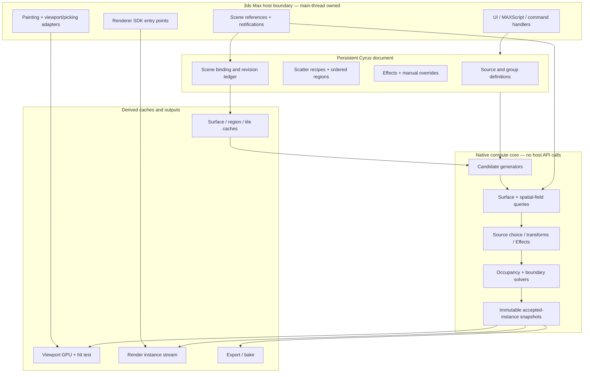
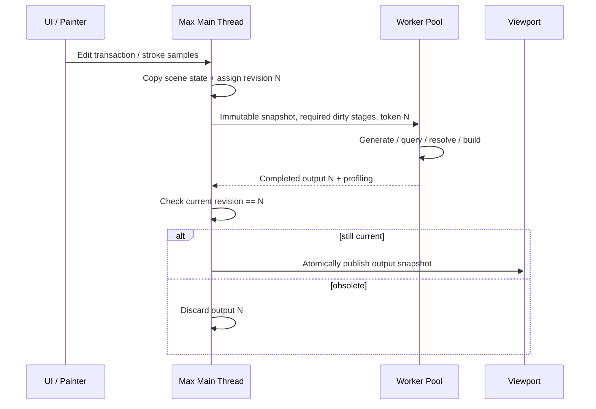
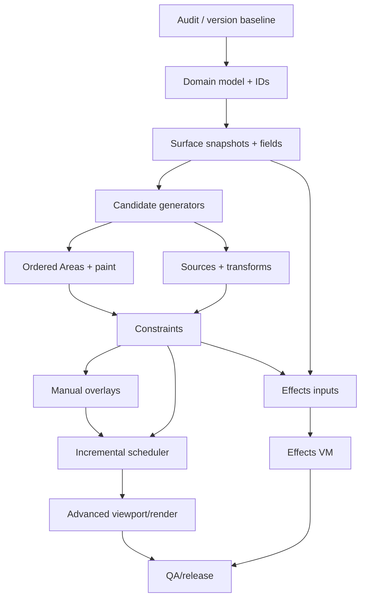

# CYRUS SCATTER — Complete Rebuild Engineering Handbook
**Edition:** October 13, 2026  
**Purpose:** independent, fully documented procedural-scattering architecture and implementation plan for Autodesk 3ds Max.  
**Status:** design proposal, not implemented or benchmark-validated source code.
> This single document consolidates all 26 authored chapters. For working relative cross-links, reference research, and reusable templates, use the multi-file ZIP edition. The full original source research is included unchanged in the ZIP.
## Chapter index
1. **01 — Product scope, parity definition and system requirements**
2. **02 — Full engine architecture, execution model and module boundaries**
3. **03 — Canonical data model and identity contracts**
4. **04 — Evaluation graph, dirty propagation, spatial partitioning and scheduling**
5. **05 — Candidate generation: Image, Path, Reference, Particle and external providers**
6. **06 — Ordered Areas, spatial fields, splines, object exclusions and falloffs**
7. **07 — Surface evaluation: XY, UV, projection, normals and attachment**
8. **08 — Complete Paint Area subsystem: fast strokes, durable coverage, erase, falloff and Undo**
9. **09 — Source Library, probability, Color ID, clustering and transform variation**
10. **10 — Collisions, boundary checking, cross-scatter exclusion and manual editing**
11. **11 — Extensible Effects engine, attribute API and safe evaluation**
12. **12 — Viewport, camera/LOD, renderer output, shading and animation**
13. **13 — Autodesk 3ds Max native implementation, SDK threading, painting, UI and Undo**
14. **14 — UX design, control hierarchy, modes and artist-readable behavior**
15. **15 — Verification suite, behavioral parity experiments and performance benchmarks**
16. **16 — Full rebuild strategy, milestones and dependency-ordered implementation plan**
17. **17 — End-to-end implementation recipes and connected feature scenarios**
18. **18 — ForestPack-style feature inventory mapped to Cyrus engineering components**
19. **19 — Renderer adapter contracts and per-renderer capability validation**
20. **20 — Serialization, scene versioning, assets, missing references and presets**
21. **21 — Shared input collections, libraries, utilities, ForestIvy and specialized extensions**
22. **22 — Primary source register, evidence limitations and open decision log**
23. **23 — Developer handoff, interfaces, work packages, Definition of Done**
24. **24 — Detailed control-interaction and evaluation-precedence matrix**
25. **25 — Concrete native C++ core API sketch and key algorithms**
26. **26 — Guided engineering course: learn the entire scattering system by building it**

---


---

<!-- Chapter 01: 01_SCOPE_REQUIREMENTS.md -->

# 01 — Product scope, parity definition and system requirements

## 1. Define what "fully rebuild" means

The requested outcome is an **artist-directed, procedural, 3ds Max-native scattering system** capable of independently reproducing the *workflows and behaviors* documented for ForestPack's principal scatter features, plus selected improvements. It is not a byte-for-byte clone of its algorithms, file formats, shaders or UX.

Scope categories:

| Category | Requirements | Priority |
|---|---|---|
| Core Forest-type scatter | Geometry list; image/path/reference/particle inputs; area stack; surfaces; source choice; transforms; collisions; falloffs | P0/P1 |
| Art direction | Painted include/exclude areas, spline boundaries, local region overrides, manual editing, grouping, linked regions | P0/P1 |
| Runtime scale | Shared geometry data, multi-threaded evaluation, deterministic caching, GPU-friendly preview, native instancing | P0 |
| Output | Viewport, selection, Arnold/Corona/V-Ray via verified adapters; LOD, camera limits, coloring, animation | P1/P2 |
| Procedural extensions | Effects, user parameters, reusable fields, inter-scatter references | P2 |
| Workflow ecosystem | Scene manager, presets/libraries, exports, migration, scripts and diagnostics | P1/P2 |
| Beyond core scatter | Ivy/growth tools, legacy billboard shadows, RailClone-specific protocol, niche non-geometry scene types | P3, explicit projects |

`P0` = prerequisite foundation; `P1` = complete everyday landscape workflows; `P2` = advanced parity; `P3` = specialized/legacy extensions.

## 2. Functional parity levels

A control is not done merely because a UI widget exists. Assign one of:

- **L0 — Documented:** intent/semantics recorded with public source and version.
- **L1 — Operable:** behavior implemented in an isolated test.
- **L2 — Interoperable:** combinations with neighboring controls behave consistently.
- **L3 — Durable:** save/load, Undo/Redo, scene clone, reference deletion, and asset failure handled.
- **L4 — Scalable:** validated on reference scenes with measured timing, memory, correctness and output parity.
- **L5 — Production verified:** shipped/adopted on supported Max/render-engine versions with regression coverage.

Never use a binary "feature implemented" status in the tracker. Include `parityLevel`, `evidence`, `targetVersion`, `knownDifferences`, and `testIds`.

## 3. Representative artist stories

1. Artist drags six grass variants into the source list, paints a lawn, and gets deterministic live preview.
2. Artist excludes a curved path, makes grass shorter at the border, then moves the path; only affected plants change.
3. Artist creates four splines, each with a different source subset and density; reordering areas changes coverage predictably.
4. Artist puts trees on a steep terrain and uses slope/altitude filters, preserving correct axes and world units.
5. Artist changes species probabilities without unintentionally reshuffling all surviving candidate positions.
6. Artist manually adjusts twenty hero trees and can later change global density without silently losing edits.
7. Artist references CAD markers, resizes/repositions them, and sees source instancing update while preserving marker-based identity.
8. Artist uses one tree population to influence the grass underneath it, with explicit one-way dependency and cycle detection.
9. Artist navigates a multimillion-instance environment without camera movement forcing a full scatter rebuild unless requested.
10. Artist exports a render with source tint, renderer-native instances and correct asset bindings after reopening the scene.

## 4. Correctness requirements

**C-01 Determinism:** Same normalized input data, schema version, engine version, and seeds => identical accepted-instance IDs/attributes within declared floating-point tolerances. Thread count must not change semantic results.

**C-02 Stable edits:** ID retention policy documented for density, transform, source change, path resampling, tile boundaries, mesh deformation/topology change and random-seed changes.

**C-03 Spatial correctness:** ordered inclusions/exclusions, local overrides, falloffs, XY/UV surface projection and collision radius behavior have golden fixtures.

**C-04 Complete transactions:** a paint drag, group edit, bulk source replacement and preset load each form coherent reversible Undo units.

**C-05 Persistence:** orphan scene-node references, missing sources, unknown schema fields, corrupt external caches and incompatible plugin versions do not silently destroy authored data.

**C-06 Render integrity:** preview limitations are distinguished from render limitations; renderer support is capability-based, with warnings for degradation.

**C-07 Safe threading:** 3ds Max scene object access follows verified SDK restrictions; workers receive owned snapshots rather than dereference `INode*` or mutable `Mesh*`.

## 5. Nonfunctional requirements (proposed targets, to calibrate)

Do **not** confuse targets with existing performance. Establish baseline on a specified workstation and scene package before setting release criteria.

| Measure | Initial aspirational gate | Measurement condition |
|---|---|---|
| UI brush cursor | Responsive to display refresh, independently of rebuild | Main-thread UI trace |
| Incremental paint preview | P95 under ~100 ms for small patches on representative scene | 200 strokes, warm caches, target workstation |
| Viewport navigation | No candidate regeneration for pure camera orbit when no camera-dependent controls | Dirty-stage counters |
| 1M accepted records | Bounded memory, no per-instance Max nodes | Peak RSS/working set and GPU allocations |
| Save/reopen | Byte-equivalent authored intent; deterministic reevaluation | Round-trip fixtures |
| Incremental correctness | Same semantic state as full rebuild | Differential comparison across seeds |
| Engine fault behavior | Cancellation, fallback and graceful errors without corrupting scene | Fault injection |

The 100 ms target is **proposed**, not guaranteed. Benchmark actual complexity and adjust after initial prototypes.

## 6. Compatibility policy

Maintain a support matrix indexed by:

- 3ds Max version and corresponding SDK/toolset
- Render engine and version (Arnold, Corona, V-Ray, default host render path)
- Distribution mode (Image/Path/Reference/PFlow/external)
- Area type (Spline/Object/Scatter/Paint/Surface/Linked)
- Surface mode (XY/UV), coordinate space and transformation
- Renderer-dependent boundary/material/animation features
- Device capability (viewport graphics API/GPU limits)

A feature can be `native`, `supported-with-fallback`, `render-only`, `preview-only`, `unsupported`, or `unverified` for any combination.

**[FP-DOC]** ForestPack documents area restrictions in UV mode, render-specific Edge treatment, mode-specific camera behavior, and renderer limitations for sampled animation. Do not flatten these into one global support checkbox.

## 7. Decision policy for matching ForestPack

- Reproduce artist-visible semantics when documented and useful.
- Prefer a clearer implementation over internal imitation when internal details are unknown.
- When ForestPack documentation conflicts across historical versions, record versions and run reference tests.
- Avoid copying ForestPack UI assets, names/branding that could confuse product identity, copyrighted library content or proprietary code.
- Mark an intentional Cyrus improvement as a **difference**, not undisclosed parity. Example: persistent manual overrides improve on the documented Generate/Custom Edit switching model.

## 8. What we must audit before touching existing Cyrus code

Collect module map; C++/MAXScript interfaces; current scatter data store; existing source/area/paint APIs; scene serialization format; threading assumptions; render backends; CS Edit integration; Cyrus Surface Analyzer integration; performance profiles; tests; customer scene compatibility. This document cannot assert those details because the current repository was **not inspected**.

## Deliverable from this chapter

A versioned backlog where every requirement has an owner, references, design decision, implementation status, parity level, regression tests and supported combinations. Continue with `02_ARCHITECTURE.md`.

---

<!-- Chapter 02: 02_ARCHITECTURE.md -->

# 02 — Full engine architecture, execution model and module boundaries

> **[CYRUS-DESIGN]** This is an independent proposed architecture. ForestPack documentation supports some visible mechanisms (projected exclusion masks, shared surface information, cached point clouds) but does not expose its internal class structure.

## 1. The fundamental invariant

**Authoring intent is authoritative. Evaluation results are disposable, independently reproducible derived data.** Do not store high-level scatter settings only in viewport caches or construct a separate host node per instance. An edited scene must remain meaningful if all generated caches are discarded.

## 2. Layered design



### Host adapter (`cyrus_max_host`)

Responsibilities: capture 3ds Max geometry and transform snapshots; map persistent IDs to `INode` references; publish transform/mesh source changes; dispatch undoable commands; supply time/camera/material snapshots; configure painting and viewport drawing; bridge MAXScript/UI; produce compatible scene save chunks. **No heavy candidate generation inside notifications or UI callbacks.**

### Domain model (`cyrus_document`)

Contains scene-independent serialized configuration: sources, emitters, regions, dependency links, fields, Effects, versioned recipes, overrides and references. Refer to `03_DATA_MODEL.md`.

### Core compute (`cyrus_core`)

Portable C++ evaluation services, ideally buildable and unit-testable without 3ds Max. Includes deterministic RNG, spatial queries, sampling, collision, field composition, area stack, instance buffers, diffing and serialization primitives. Avoid `INode`, `Texmap` and direct SDK pointers in public core contracts.

### Cache + scheduler (`cyrus_runtime`)

Dependency graph, revision hashes, cache keys, change-propagation rules, tile ownership, job orchestration, cancellation, memory budgeting, atomic publication and instrumentation.

### Output adapters (`cyrus_output_*`)

Viewport/picking adapter; Arnold, Corona, V-Ray adapters; host-compatible mesh/export fallback; baking tools; material attribute bridge. Separate capabilities and failure handling.

## 3. Reference project layout (not an existing repo inventory)

```text
CyrusScatter/
  src/
    core/
      math/ rng/ ids/ fields/ geometry/ spatial/
      distribution/ surfaces/ areas/ selection/ collision/
      transforms/ effects/ manual/ instance/
    runtime/
      snapshots/ scheduler/ dirty_graph/ tile_cache/ memory/
    maxhost/
      plugin/ scene_refs/ node_capture/ notifications/
      painter/ undo/ ui_bridge/ serialization/
    viewport/
      gpu_buffers/ preview/ picking/ overlays/
    renderers/
      common/ arnold/ corona/ vray/ host_fallback/
    tools/
      library/ export/ migration/ diagnostics/
  ui/
    rollout_scripts/ controllers/ dialogs/ presets/
  tests/
    unit/ property/ integration/ goldens/ max_scenes/ bench/
  docs/
  schemas/
  packaging/
```

Make the real tree *after* auditing Cyrus. Do not re-create working integrations merely because this example has different directories.

## 4. Computation phases

The **logical** sequence is:

1. Resolve authored inputs and versions, capture host snapshots.
2. Prepare terrain/spline/source/mask acceleration data.
3. Enumerate generator candidates with stable IDs and provenance.
4. Resolve world-position, surface binding and field context.
5. Apply ordered region inclusion/exclusion contributions.
6. Choose source; compute transforms; evaluate pre-constraint Effects.
7. Solve boundary eligibility and occupancy (collisions, inter-scatter constraints).
8. Apply explicitly typed post-constraint Effects with clear rules.
9. Merge manual pins/additions/deletions and revalidate relevant constraints.
10. Produce accepted-instance snapshot and statistics.
11. Derive view-, camera- and renderer-specific representations.

This is a dependency graph, **not one irreversible linear call chain**. Certain Effects can modify earlier-stage attributes; such modifications must trigger a specified reevaluation stage or be prohibited at that stage. The scheduler may reuse any unchanged phase output.

### Data packets between phases

```cpp
// Pseudocode: no Autodesk SDK dependencies.
struct Candidate {
    CandidateId id;
    GeneratorId generator;
    AreaId originArea;
    Vec3 preliminaryPosition;
    SurfaceBinding optionalBinding;
    uint64_t randomKey;
};
struct EvaluatedItem {
    CandidateId id;
    SourceId source;
    Mat4 worldTransform;
    SurfaceBinding attachment;
    BoundaryData boundaryData;
    CollisionShape shape;
    PerItemAttributes shadingAndAnimation;
};
struct FinalInstance {
    InstanceId id;
    SourceId source;
    Mat4 transform;
    MaterialBinding material;
    uint32_t flags;
};
```

Use explicit types for coordinate spaces (XY local, world, UV), distances, angles, percentages, and scene units. Prevent accidentally treating degrees as radians or a scene-unit value as meters.

## 5. Host-thread and worker-thread ownership



- Never call unsafe scene operations from worker threads.
- Use owned copied geometry and string/ID handles in workers, not raw host lifetime-bound pointers.
- Keep last valid result visible during long rebuilds; expose an updating status.
- Throttle or coalesce duplicate requests, but do not suppress relevant final updates.
- Rendering may require a different synchronous preparation path; keep it isolated from UI publication.

## 6. Source and surface sharing

A `SurfaceCache` is keyed by scene object binding, evaluated time, geometric revision, transform revision, UV/channel revision and coordinate mode. Multiple scatters referencing the same surface can reuse immutable prepared geometry/BVH information when revisions agree. Separate topological, geometric, UV and transform changes to avoid unnecessary recomputation. Beware instance-specific Max modifiers and evaluation time.

`SourceGeometryCache` keeps source evaluated meshes or render asset handles by `SourceId + time + revision + renderer capability`. Group children must preserve their local transforms, material IDs and scene graph semantics.

## 7. Handling multiple scatter objects

Model scatters as nodes in a directed acyclic evaluation graph when one object's instances drive another object's exclusion or effect field. Detect cycles at authoring time and display dependency paths. Three possible policies for mutual dependence:

1. **Default:** reject cyclic references, explain which link closes the cycle.
2. **Advanced:** explicit frozen snapshot of one scatter used as input to the other.
3. **Special solver:** intentional iterative fixed-point process with convergence criteria, iterations and deterministic ordering (not initial scope).

Do not silently evaluate on whichever object happened to update first.

## 8. Camera/view caches

Accepted population cache is usually **camera-independent**. Camera culling, preview percent, LOD and impostor selection consume it. If the user chooses camera-dependent *density generation* or a camera-reading Effect, the camera becomes an explicit dependency; navigation may then regenerate affected stages. Expose the distinction in the UI.

## 9. Failure and resource behavior

- Invalid source: keep authored reference, mark missing, emit proxy/none according to policy.
- Surface missing: preserve bindings/paint data, show unbound state, never silently snap to origin.
- BVH/candidate budget exceeded: deterministic partial/error policy; do not silently report success.
- Worker canceled: retain last published valid snapshot; free transient allocations.
- GPU/device reset: discard only derived GPU resources and regenerate from accepted-instance snapshot.
- Renderer unavailable: indicate degraded/unsupported export, never silently replace materials with incorrect ones.
- Memory pressure: bounded caches with eviction policies and visible diagnostics.

## 10. Top-level technical acceptance gates

1. Core `cyrus_core` unit tests run without 3ds Max.
2. Scene snapshots are safely produced and immutable to worker threads.
3. Deterministic output is independent of worker count.
4. Change-only-tint does not run generator, surface, area or collision stages.
5. Change-small-paint can reuse unaffected tiles, or explicitly widen its recomputation to obtain identical results.
6. Save/load uses the persistent document rather than trusting cached instance buffers.
7. Viewport display remains stable during brush dragging, scene edits and cache replacement.
8. Render adapters are capability-tested on actual target SDK versions.

See `03_DATA_MODEL.md` for persistent records and `04_EVALUATION_CACHING.md` for scheduler semantics.

---

<!-- Chapter 03: 03_DATA_MODEL.md -->

# 03 — Canonical data model and identity contracts

> **[CYRUS-DESIGN]** Everything in this chapter is an independent schema recommendation. Do not serialize raw C++ object memory, raw 3ds Max pointer values or ephemeral cache indices. The current Cyrus file format has not been audited.

## 1. Divide data into four ownership classes

| Class | Examples | Authoritative? | Stored in .max/project? |
|---|---|---|---|
| Authoring model | Sources, regions, generator configs, brush strokes, Effects, edits | Yes | Yes |
| Scene bindings | External node identities, receiver references, material/map handles | Yes, with resolver | Yes, portable descriptor |
| Evaluation state | Candidates, rejected items, occupancy, surface interpolation | No | Optional validated cache only |
| Presentation state | Point cloud, GPU objects, selected preview density, renderer handles | No | No; rebuildable |

A key rule: the rendering adapter must never mutate authoring data while exporting a frame.

## 2. Proposed persistent hierarchy

```text
CyrusDocument
  docVersion, sceneGuid, settings, compatibility
  SourceLibrary[]                source UUIDs, material/geometry bindings
  InputCollections[]             linked scene node roles and filters
  ScatterObjects[]
    scatterUUID, enabled, name, seed, userSettings
    GeneratorSpec                kind-specific parameters
    ReceiverBindings[]           surface queries, channels, revisions
    AreaStack[]                  ordered operations with source provenance
    VariationPipeline           select / transform / color / animation
    ConstraintConfig            collision / boundary policy
    EffectStack[]                declared read/write signatures
    ManualLayer                 pins, overrides, added instances
    DisplayConfig / RenderConfig
  UserCurves / FieldAssets / SharedAreaDefinitions
  OrphanReferenceRegistry, migrationMetadata
```

Each persisted entity has `UUID`, `schemaVersion`, `displayName`, `enabled`, and a revision or content hash. Visual ordering is explicit, not accidentally inferred from storage index.

## 3. Identity model: four different IDs

Do not overload one ID for everything.

1. **Definition ID:** source, area, scatter, generator, layer, Effect, curve. Create stable UUID once; survive renames and list reordering.
2. **Candidate ID:** identity of a potential placement before source selection and collision. Derived deterministically from generator-specific anchors.
3. **Instance ID:** normally candidate ID + instance namespace; unique among manual and procedural items. Stays unchanged when replacing only source/transform.
4. **Attachment ID:** receiver identity + parameterization anchor (face+barycentric, UV+island+channel, reference object, path segment+arc parameter), with restoration policies.

Example identity generator:

```cpp
CandidateId MakeGridCandidateId(
    Uuid scatterId, Uuid generatorId,
    Int2 signedTileCoordinates,
    uint32_t localSampleOrdinal,
    uint32_t generationAlgorithmVersion);

CandidateId MakeReferenceCandidateId(
    Uuid scatterId, StableNodeId node,
    StableElementKey faceOrPivot,
    uint32_t sampleOrdinal);
```

### What is a stable anchor?

- **Image/map tiling:** tile coordinates and an invariant sample ordinal within the tile; map scale/rotation may change positions but can retain the same anchors by policy. Changes to image resolution or generator algorithm require an explicit remap/reset policy.
- **Path:** path UUID + contour/sub-spline identity + distance-index or knot GUID, depending on sampling mode. Changing spacing may change index identity; retain matchable manual overrides by nearest arclength only under explicit user-approved remapping.
- **Reference:** persistent scene-node identity + pivot/face attribute; do not derive from world position. Topology-changing face edits invalidate face-index anchors unless a correspondence algorithm succeeds.
- **Particle:** particle identity provided by source system when stable; otherwise time+emitter+index is **not** guaranteed stable across simulation edits and must be flagged.
- **Manual add:** random UUID created once and persisted. Never reuse a deleted item ID.

### Identity preservation policy matrix

| Operation | Candidate identity | Manual override | Expected result |
|---|---|---|---|
| Change tint | Retain | Retain | Only color changes |
| Change source weight | Retain | Retain | Source may change, placement identity persists |
| Increase density (fixed candidate reservoir) | Retain candidates | Retain | Additional candidates accepted where possible |
| Change global seed | IDs may remain, random channels change | Explicit keep/discard policy | Intentional variation |
| Move receiver vertices, unchanged topology | Retain face anchors | Re-project by barycentric coordinates | Objects follow surface |
| Change receiver topology | Best-effort mapping | Mark orphan on failure | Do not silently relocate |
| Change path spacing | Depends on anchor semantics | Explicit remap policy | May require warning |
| Delete source geometry node | Retain source UUID | Retain item metadata | Display missing-source state |
| Reorder area list | Candidate provenance retained; eligibility may change | Keep, orphan or suppress under configured policy | Re-evaluate impacted areas |

**Test rule:** stable IDs alone do not guarantee spatial stability. Greedy collision resolution and changes to the accepted set may change neighbor acceptance; record both candidate and final-instance correspondence.

## 4. Strongly typed spatial domains

Define coordinate-domain types rather than passing generic `Vec3` everywhere:

- `WorldPoint` in 3ds Max system units after normalizing coordinate handedness and transforms.
- `ScatterLocalPoint` in the scatter node's local reference frame.
- `ReceiverLocalPoint` in a particular evaluated mesh node's space.
- `UVPoint` plus map channel and UV island/face context.
- `PathCoordinate` = path/sub-spline ID + arclength in system units.
- `PixelCoordinate` = tile ID + integer raster coordinate.

Likewise use `Radians`, `Degrees`, `SceneUnits`, `Normalized01`, and `Percent`. Persist canonical physical values, not slider display text. Preserve nonuniform scale and mirrored transforms; explicitly state whether shear is supported, rejected, or baked.

## 5. Suggested source records

```cpp
struct SourceDefinition {
    Uuid id;
    SourceKind kind;                 // mesh, proxy, group, billboard, light, empty
    SceneReference sourceReference; // persistent scene binding, not INode*
    SourceAssetId externalAsset;
    float relativeWeight;
    Color4 colorId;
    Percent collisionRadius;
    Vec3 sourcePivotOffset;
    SourceDimensions dimensions;
    MaterialBinding material;
    bool allowMirror;
    GroupPolicy groupPolicy;
    LODDefinition optionalLods;
};
```

A disabled source used for intentional gaps should be an explicit `Empty` outcome or a source state that retains its weight. A UI disable-to-exclude-selection command should be distinct. Source `name` is display metadata, not an immutable identity; reference-name matching is a separate operator.

## 6. Candidate and intermediate records

```cpp
struct PlacementCandidate {
    CandidateId id;
    Uuid scatterId;
    Uuid generatorId;
    Uuid originAreaId;
    uint64_t stableRandomKey;
    GeneratorParametricLocation generatorLocation;
    Vec3 initialPosition;
    Vec3 optionalOrientationHint;
    SurfaceBinding optionalSurfaceBinding;
    float baseDensityWeight;
};

struct SurfaceSample {
    bool valid;
    StableNodeId receiver;
    uint32_t faceIndex;  // ephemeral unless topology is stable
    Vec3 barycentric;
    Vec2 uv;
    Vec3 worldPosition;
    Vec3 worldNormal;
    float slopeRadians;
    float worldAltitude;
    uint32_t materialId;
};

struct AcceptedInstance {
    InstanceId id;
    CandidateId candidate;
    SourceId source;
    CompactTransform transform;
    SurfaceBinding attachment;
    AttributeIndex attributes;
    uint32_t flags;
};
```

Keep separate rejected-candidate diagnostics by category instead of using "missing instance" as the only evidence of rejection. Record `AREA`, `DENSITY`, `SURFACE_MISS`, `SLOPE`, `ALTITUDE`, `COLLISION`, `BOUNDARY`, `SOURCE_EMPTY`, `EFFECT_HIDDEN`, `CAP_EXCEEDED` as traceable reasons.

## 7. The typed field contract

A field is not merely a bitmap. It is a value evaluator with coordinate, domain, sampling and dependency semantics.

```cpp
enum class FieldValueType { Scalar, Vec2, Vec3, Color, Bool, Category };

enum class FieldSpace { World, ScatterLocal, ReceiverUV, GeneratorUV, Path, ReceiverLocal };

struct FieldEvaluationContext {
    CandidateId id;
    Vec3 worldPosition;
    Vec2 surfaceUV;
    SurfaceSample surface;
    PathCoordinate optionalPath;
    TimeValueCanonical time;
    RandomContext random;
};

struct FieldResult<T> {
    bool valid;
    T value;
    FieldError error;
};
```

Each field exposes `Dependencies()` and optionally a conservative `AffectedBounds(change)`. Field types: constant, bitmap, host Texmap snapshot/evaluator, procedural noise, signed distance, curve remap, altitude, slope, paint tile, object projected mask, scatter occupancy, object distance, random, composite.

Important: Autodesk `Texmap` evaluation may depend on host-managed state; do not assume arbitrary material maps are safe to call from worker threads. Support host-time prebaking or main-thread sampled field adapters and declare resolution/error limitations.

## 8. Manual overrides and conflict states

```cpp
struct InstanceOverride {
    InstanceId target;
    Optional<SourceId> sourceReplacement;
    Optional<Mat4> absoluteTransform;
    Optional<Mat4> relativeTransform;
    bool suppressed;
    bool pinned;
    Optional<SurfaceBinding> reboundTo;
    OverrideOrphanPolicy orphanPolicy;
};
```

Distinguish `suppressed` from `not accepted due to constraints`. Manual Delete is an authored tombstone; density rejection is derived. Explicit `ManualInstance` records are not candidates, though they may choose to participate in occupancy constraints. Orphan overrides persist invisibly with a warning or become explicit manual instances under policy.

## 9. Efficient memory representation

Avoid `std::vector<Instance>` where every instance owns many heap allocations. Use tightly packed **Structure of Arrays** for hot passes: `id[]`, `position[]`, `rotation[]`, `scale[]`, `sourceId[]`, `receiverId[]`, `attributeIndex[]`. Immutable user-defined records can remain richer objects. Target 32/64-bit ID indices appropriately; never silently overflow with millions of candidates. Compress source/area IDs through per-snapshot lookup tables while preserving full UUIDs in authoring data.

Evaluate float precision over very large 3ds Max coordinates; use double precision in world-space geometry and spatial indexing where necessary, with camera-relative floats in GPU preview. Handle 3ds Max system unit conversion once at the host boundary.

## 10. Version and migration

Every serialized object must support: schema version, canonical units, deterministic default expansion, migration test, unknown-field preservation policy, reference loss and forward-version warning. See `20_SERIALIZATION_AND_ASSETS.md`.

---

<!-- Chapter 04: 04_EVALUATION_CACHING.md -->

# 04 — Evaluation graph, dirty propagation, spatial partitioning and scheduling

## 1. The central correctness contract

Given the same authored document, host scene snapshot, clock time, renderer-independent settings and algorithm version, a **full rebuild** is the reference answer. Incremental rebuilds must produce an equivalent semantic result. Equivalent means accepted identities and attributes meet declared deterministic/tolerance rules; viewport sample ordering need not be byte-identical.

Caches are optimizations, not alternate definitions of the result.

## 2. Dirty dependencies are typed and directional

Possible stages:

```text
HostSnapshot ──> SurfaceBVH ──> SurfaceSample
           ├──> Splines/AreaMask/DistanceFields ─┐
           ├──> Sources/Bounds ──────────────────┤
           └──> TexmapFieldSnapshot ─────────────┤
GeneratorParameters -> CandidateReservoir ──────┤
AreaStackOrder/Fields ---------------------------> Eligibility
Candidate + Eligibility + SourceWeights --------> SourceChoice
SourceChoice + SourceBounds + Transforms --------> ItemBounds
Items + Bounds + Constraints -------------------> OccupancySolution
Accepted + ManualOverrides ---------------------> AuthoredFinalItems
FinalItems -> ViewportBuffer / Picking / RenderStream / Bake
```

Stage keys include `schemaVersion`, `algorithmVersion`, `inputContentHash`, relevant `time`, coordinate mode, source revisions and stable seed. Only include fields actually read by the stage. For example, viewport point size must not enter candidate cache keys.

### Proposed change impact table

| Change | Initial invalidation | Cascading invalidation | Should remain reusable |
|---|---|---|---|
| Source tint | Material attributes | Relevant viewport/render shading data | Placement, surface queries, collision |
| Source replacement | Source bounds, source handle | Transform size, collision, render stream | Image/map candidate coordinates |
| Global density | Candidate acceptance/eligible set | Source selection, occupancy, final items | Terrain BVH, source meshes |
| Area reorder | Region-stack evaluation | Eligibility, constraints, final | Distribution reservoir, surface BVH |
| Paint dab | Paint mask tiles | Affected candidate set, collision propagation | Other tiles and stable source library |
| Receiver vertex deformation | Surface geometry/BVH refit (if valid) | Local surface samples, slope, bounds | Unrelated receivers and sources |
| UV edit | UV sampler | UV-bound distributions/fields | XY-only fields (unless configured otherwise) |
| Source probability | Source-choice field | Bounds/collision/LOD | Candidate positions, basic region coverage |
| Collision radius | Occupancy | Accepted final list | Placement and surfaces |
| Camera movement | Camera filters/LOD | Possibly population if camera-driven Effects/density | Camera-independent generation |
| Seed | Random channels | Their dependent stages | Source geometry and static surface data |
| Preview quality | Viewport sampling | GPU buffers only | Final accepted list |

## 3. Job orchestration

A small state machine is enough initially:

`CLEAN → DIRTY → QUEUED → BUILDING → READY_TO_PUBLISH → CLEAN`.

A new change while `BUILDING` marks a newer revision and **cancels or supersedes** the old job. The old snapshot stays displayed until a newer valid result is published. Publication checks all consumed revision tokens, not merely a single UI counter if data can change through independent pathways.

```cpp
void OnAuthoredEdit(Edit e) {
    ApplyUndoableChange(e); // main thread
    Revision r = document.Revision();
    DirtySet dirty = graph.Propagate(e.AffectedResources());
    scheduler.Enqueue(BuildRequest{CopySnapshots(dirty), r, dirty});
}

void OnWorkerCompleted(BuildResult result) {
    // Dispatch to proper host/UI thread before interacting with 3ds Max.
    if (!result.revisions.Match(CurrentRevisions())) return; // stale
    PublishImmutableBuffers(result); // atomic pointer/version swap
}
```

Add cancellation checkpoints at candidate batches, tile boundaries and heavy field builds. Avoid taking locks per instance. Don't publish partially inconsistent buffers unless explicitly operating in progressive-preview mode with clearly marked partial quality.

## 4. Spatial tiling strategy

Use tiles for caching and spatial queries, **not as a mandate that all algorithms be independent per tile**. A local spatial coordinate may be defined by scatter/receiver in XY; UV mode uses island-aware parameter-space tiles and possibly world-space acceleration too. Potential world-space tile dimensions must be benchmarked, not guessed as universal.

For each tile retain: world bounds, coordinate-space bounds, candidate range and stable IDs, area field revisions, receiver hashes, occupancy halo, final instance buffer, performance counters, publish generation and LRU state.

### Dirty area expansion

For a paint dab of radius `r`, falloff max `f`, random-placement max displacement `j`, collision support max `c`, and effect reach `e`, a conservative first bound is:

`dirtyBounds = dabBounds expanded by (f + j + c + e)`

This is only safe if all influences have finite, known support. Expressions that sample arbitrary external objects, long paths or unbounded effects can require larger regions or global rebuilds.

### Cross-tile collision halo

Each occupancy tile queries neighboring accepted/candidate items overlapping its enlarged bounds. Stable candidate priority must not depend on evaluation-thread ordering. Use one consistent owner rule for cross-tile items and avoid duplicate acceptance.

## 5. Why greedy collisions can propagate beyond one tile

Suppose A and B overlap; A wins. A is removed by painting. Then B becomes accepted. B may collide with C, previously accepted. This can cause a chain of changes beyond the original brush radius. An algorithm that reevaluates only directly touched tiles is **incorrect** if its final accepted state differs from the full solution.

Three possible strategies:

1. **Full rebuild for collision-affected scatters:** correct baseline, simpler, use while prototypes mature.
2. **Dependency tracking:** for each accepted/rejected candidate, record conflict edges and winner priority; propagate changes until stable. Need graph-memory budget and cycle-free priority semantics.
3. **Spatially bounded independent solver:** define tiles/patches whose winner rules cannot be changed from outside or include boundary buffer partitions; sacrifices some global maximality to guarantee bounded invalidation. Must make seams visually acceptable.

Recommended first implementation: deterministic global priority + full fallback; add differential-tested incremental solver only after profiling proves necessary.

## 6. Deterministic work scheduling

Parallelize independent stages and candidate chunks, but do **not** let iteration order choose collision winners accidentally.

Use a deterministic per-candidate rank `(priorityHash, stableCandidateId)`; stable sorts or conflict-solver policies define decisions. Random sampling uses keyed RNG channels. For floating ties, define an epsilon and canonical ID tie break.

Memory/performance note: large global sorts may dominate; compare block sorting, spatial-cell queues and tile-local determinism. Measure on actual data.

## 7. Data cache types and eviction

| Cache | Key | Reusable by | Safe eviction |
|---|---|---|---|
| Receiver BVH | node+geometry/topology revision+time | Multiple scatters | Yes; reprepare |
| UV lookup | receiver+UV channel/revision | UV distributions/fields | Yes |
| Spline arc table | path UUID+geometry transform revision+tolerance | Path generators and distances | Yes |
| Object occupancy mask | object+projection axis+world resolution+revision | Area queries | Yes |
| Painted compiled tiles | paint UUID+stroke revision+tile+resolution | Area/distance queries | Yes; strokes survive |
| Candidate reservoir | generator+space/seed/algorithm version+tile | Density/source changes | Yes |
| Accepted snapshot | all evaluated input keys | Viewport/render/export | Yes, if recomputable |
| Source animation sample | source+frame+renderer capabilities | Many instances and time frames | Bounded LRU |
| GPU preview | final-instance revision+quality+device | Viewports | Drop on device loss |

Store per-cache memory, hit/miss, build time, outstanding job count, and eviction count in diagnostics.

## 8. Hashing and validity

**Revision != content hash.** Revisions are fast invalidation counters. Content hashes help reuse immutable derived data if equivalent inputs return after Undo. Hashes must include algorithm version and coordinate interpretation. Do not hash raw `struct` padding or pointer addresses. Snapshot scene nodes in canonical deterministic order. For very large meshes, topology and vertex revision counters may be preferable to repeated full hashes if host change notifications are reliable.

## 9. Preview while painting

Design two latency budgets:

- **Brush feedback:** cursor, overlay coverage, erase indication; independent of scatter rebuild, updated as often as possible.
- **Population preview:** background worker or bounded synchronous update; stale results discarded.

During continuous strokes, accumulate dirty bounds and use throttling/coalescing. Commit a final authoritative reevaluation when the stroke ends. Support explicit "Fast draft preview" if background collision/Effects are expensive; indicate quality differences.

## 10. Benchmark correctness protocol

For every incremental path, run seeds 1..N across random edit sequences: build full, apply edit incrementally, build fresh full, sort by stable IDs, compare counts, transforms, sources and rejection reasons. Include cross-boundary placements, dense occupancy, overlapping Areas, effect-driven movement, large source radii, stacked receivers, undo/replay, cancel mid-job and camera movement.

Do not promote the incremental solver to production until tests pass. See `15_TESTS_BENCHMARKS.md`.

---

<!-- Chapter 05: 05_DISTRIBUTION.md -->

# 05 — Candidate generation: Image, Path, Reference, Particle and external providers

**[FP-DOC]** ForestPack documents four main distribution modes: Image, Path, Reference, Particle Flow. RailClone segment input was added through Reference-mode integration in 9.4.1. Sources: [Image](https://docs.itoosoft.com/forestpack/forest-plugin/distribution/image-mode), [Path](https://docs.itoosoft.com/forestpack/forest-plugin/distribution/path-mode), [Reference](https://docs.itoosoft.com/forestpack/forest-plugin/distribution/reference-mode), [PFlow](https://docs.itoosoft.com/forestpack/forest-plugin/distribution/particle-flow-mode), [RailClone](https://docs.itoosoft.com/forestpack/forest-plugin/distribution/railclone-integration).

## 1. Common provider contract

```cpp
struct CandidateRequest {
    Uuid scatterId;
    Uuid generatorId;
    Bounds queryBounds;
    GeneratorParameters parameters;
    FieldSamplingContext fields;
    CancellationToken cancellation;
};

class IPlacementProvider {
public:
    virtual Capabilities Capabilities() const = 0;
    virtual void Generate(const CandidateRequest&, CandidateWriter&) const = 0;
    virtual DirtyBounds AffectedBy(const ChangeSet&) const = 0;
};
```

All providers emit candidates with stable IDs, original/proposed position, generator-space coordinates and provenance. They **must not** instantiate host objects. Downstream area tests, source choice, transforms, constraints and outputs consume one representation. A provider can supply orientation/scale hints without forcing the entire scatter to use them.

## 2. Image mode — implement the actual distinction between pattern and density

ForestPack's documented distribution image uses pixels as potential positions; patterns can be bitmaps or procedural maps. Its controls distinguish world dimensions X/Y Units, procedural resolution X/Y Pixels, offsets, rotation, map channel and fit/alignment; `Max Density` counts candidates, including black/empty pixels. Clusters and color selection operate on the resulting candidates. Version 9.3 added **Use as Density Map** for grayscale acceptance. [Reference](https://docs.itoosoft.com/forestpack/forest-plugin/distribution/image-mode).

### Proposed sampler

1. Choose coordinate domain: scatter-local planar XY or appropriate UV map space.
2. Apply inverse map transform (scale/rotation/offset) to candidate-query extent.
3. Enumerate repeating image tiles covering extent; use signed tile coordinates for stability with negative scene positions.
4. Enumerate pixel candidate centers (or documented pattern-defined sample positions) in deterministic order. Optional spatial jitter is an independent control.
5. For each candidate, sample binary threshold / grayscale density mode and assign deterministic acceptance RNG keyed to candidate ID.
6. Emit accepted preliminary candidates with base probability and map coordinates; defer areas/surface/collisions to later stages.
7. Stop or report when candidate budget is exceeded; distinguish generated candidate limit from accepted-instance limit.

**Proposed density acceptance:** `hash01(candidateID,"density") < saturate(coverage(x,y))`. This produces monotonic acceptance when coverage increases for a fixed candidate reservoir. It is not a confirmed ForestPack algorithm.

### Key formulas

For a tiled map with `Px * Py` possible samples and a tile covering `Ux * Uy` world-space units²:

`candidate density ≈ Px*Py/(Ux*Uy)` (before masks, excludes, collisions). Halving both world dimensions increases nominal candidate density about 4×. At large dimensions, guard integer overflow and unbounded tile enumeration.

### What controls must be kept independent

| Control | Target behavior | Key dependencies |
|---|---|---|
| Bitmap/Procedural map | Defines tile values / optional candidate pattern | Sampling and mapping |
| X/Y Units | World or mapping-space footprint | Candidate coordinates, count |
| X/Y Pixels | Procedural map sampling resolution | Candidate reservoir |
| Rotation / Offset | Pattern transform | Candidate positions |
| UV/map channel | Which coordinate domain drives map | Receiver UV snapshot |
| Threshold | Binary acceptance rule | Acceptance only |
| Use as Density Map | Continuous acceptance probability | Density random channel |
| Max Density | Safety budget for potential positions | Diagnostics and abort policy |
| Color ID | Which source to choose by pixel colors | Source selection |
| Clusters | Spatially correlated source types | Diversity field |
| Collisions | Reject overlapping instances | Item bounds / occupancy |
| Distribution seed | Deterministic variety | Candidate RNG, not geometry snapshots |

**[TEST-NEEDED]** Exact virtual-grid jitter, threshold interpretation, map-channel transform, "Fit to Scene" alignment, and duplicate Color ID tie resolution should be empirically measured for the target Forest version. Avoid claiming pixel centers are the exact commercial implementation.

### Avoid re-evaluating expensive procedural maps for every plant

A host-managed Texmap may be unsafe off-thread and expensive per query. If its evaluator is not explicitly supported in worker threads, pre-sample it into a tiled texture/mipmap or host-approved immutable field snapshot. Declare blur/filter/UV sampling behavior; record precision and interpolation (nearest, bilinear, anisotropic). Do not assume standard color-space gamma is correct for density maps; density data should normally be treated as non-color scalar.

## 3. Path mode — parametric spline sampling

[FP-DOC] Path mode supports spacing or vertex positions, several path splines, source `Random/Sequence`, spline offset, random position and `Follow Path` rotation on X/Z. This is placement along a curve, **not** an open-spline area band. [Reference](https://docs.itoosoft.com/forestpack/forest-plugin/distribution/path-mode).

### Arc-length algorithm

1. Snapshot spline segments with transforms and sub-spline identities.
2. Build `(parameter t, cumulative length s)` lookup adaptively with curvature/tolerance bound.
3. For even spacing `d`, sample at arclength positions `s_k = startOffset + k*d`.
4. Invert lookup to get curve position `P(s_k)` and normalized tangent `T(s_k)`.
5. Compute a stable path-plane right vector; define lateral offset and orientation convention.
6. Jitter longitudinal/lateral directions with separate keyed random channels.
7. Emit candidate with path UUID, sub-spline ID and stable ordinal/parameter identity.

Example:

```cpp
for (auto contour : path.contours) {
    ArcLengthTable t = BuildArcTable(contour, tolerance);
    for (uint32_t k=0; k<CountAtSpacing(t.length, spacing); ++k) {
        double s = ComputeSampleArc(k, spacing, endpointPolicy);
        Vec3 p = t.PositionAtArc(s);
        Vec3 tangent = t.TangentAtArc(s);
        writer.Add(MakeCandidate(contour.id, k, p, tangent));
    }
}
```

### Edge cases to define

- Closed loop seam and duplicate at start/end.
- Endpoint inclusion for length shorter than spacing.
- Multiple sub-splines within one object; separate or continuous sequencing.
- Abrupt knot corners and zero-length segments.
- Mirrored/nonuniformly transformed source spline.
- Tangent up-vector singularity; frame flip avoidance.
- Offset on self-intersecting curves.
- Generator change when spacing changes and manual edits need remapping.
- `Sequence` source choice versus disabled entries and gaps.

Arc-length sampling is a **recommended** algorithm; exact commercial path parameterization and jitter order require reference testing.

## 4. Reference mode — preserve authored layout

[FP-DOC] Reference mode takes object pivots or mesh-face positions, supports one/multiple items per face, material-ID filtering, reference orientation and scale inheritance, name/regex matching, and collision settings. A missing name match can fall back to the first source entry. [Reference](https://docs.itoosoft.com/forestpack/forest-plugin/distribution/reference-mode).

### Pivot implementation

Use persistent `StableNodeId`, relative reference transform, and a deterministic source-selection key. On moving a CAD marker, update position/rotation/scale without changing candidate identity. For `Align=false`, document how object/world axes are interpreted. For `Scale=true`, decide whether nonuniform/mirrored reference transforms are supported directly or normalized.

### Face implementation

Snapshot triangulated face records; filter material IDs; compute centroid/normal and prescribed orientation frame. For `itemsPerFace > 1` sample a regular deterministic grid or uniform face positions. Correct uniform random barycentric sampling on a triangle uses `r1, r2∈[0,1]`, `a=1-sqrt(r1)`, `b=sqrt(r1)*(1-r2)`, `c=sqrt(r1)*r2`; resulting point `a*A+b*B+c*C`.

**[TEST-NEEDED]** This formula is our recommended uniform mode; ForestPack's default regular grid and per-face align rule are documented, but exact random sequence/layout is not completely established. Do not conflate face index stability with persistent surface identity after topology edits.

### Name/regex matching

Compile patterns once, handle syntax errors in UI, define match priority and Unicode/case rules. Preserve ordered fallback behavior as a compatibility option. Log source match counts and unmatched references; empty source slot intentionally generates no geometry.

## 5. Particle Flow provider

[FP-DOC] ForestPack supports using PFlow particles and either all events or selected events, with optional align/scale inheritance and live animated particle input. [Reference](https://docs.itoosoft.com/forestpack/forest-plugin/distribution/particle-flow-mode).

Implementation: snapshot `particleId (if exposed)`, emitter/event ID, age, velocity, transform/scale, time, and parent reference. Only call host particle APIs on documented safe threads. Re-evaluation time changes particle population; treat identity as `stable` only when the source exposes durable IDs. Effect variables can consume age, speed and event metadata. Model read-only PFlow **input** separately from a hypothetical particle output/bake adapter.

## 6. External procedural input adapters

RailClone segments in ForestPack 9.4.1 are an example of preserving source tags/names and transforms from another system, not only anonymous points. For Cyrus, define an `IExternalPlacementAdapter` with source UUID, stable external element key, transform, attributes and provenance. Add adapters one at a time after confirming license/API interoperability. Do not reverse-engineer a private binary protocol.

## 7. Density and candidates: two independent selectors

For every mode distinguish:

- Input **candidate count** (positions available).
- Eligibility **density acceptance** (a reproducible rejection field).
- **Source choice** (weights, Color ID or clusters).
- **Constraints** (collisions, geometric boundaries).
- Final **accepted count** and viewer-preview count.

The debug UI should offer stages separately. An artist increasing density on a saturated forest must see high collision rejection rather than concluding the slider does not work.

## 8. Distribution acceptance tests

- Known tiny bitmap (8x8) on flat plane yields predictable candidate count and tile alignment.
- Moving/repeating map tiles produces stable deterministic IDs outside changed definition.
- Increasing grayscale density is monotonic at pre-collision acceptance stage.
- Path test with unequal-length spline segments yields equal **world-distance** placement.
- Closed path has exactly one seam item under chosen endpoint policy.
- Reference pivot keeps the same ID and random source when moving node.
- Reference face sampling is spatially uniform in statistical tests.
- PFlow filter excludes exactly non-selected events.
- Worker-count changes cannot change final deterministic candidate keys.
- All modes pass through one common area/surface/transform/collision pipeline.

---

<!-- Chapter 06: 06_AREAS_FIELDS.md -->

# 06 — Ordered Areas, spatial fields, splines, object exclusions and falloffs

**Primary reference:** [ITOOSOFT Areas rollout](https://docs.itoosoft.com/forestpack/forest-plugin/areas). **Important [FP-DOC]:** documented types include Spline, Object, Forest, Paint and Surface; Areas process from bottom to top; linked areas inherit source-specific parameters while some common properties are local. Object exclusions use projected masks; Forest exclusions can use virtual spheres or mesh representation. Exact behavior across older/newer versions must be version-tagged.

## 1. The core problem: areas are ordered operations, not one unordered mask

Consider the list, bottom to top:

```text
3 Include flower island  ← evaluated last
2 Exclude walkway
1 Include garden          ← evaluated first
```

An implementation `union(all includes) - union(all excludes)` is **wrong** for this behavior: the final Include can add plants after an earlier Exclude. Forest documentation warns that Include areas may overlap, causing overlapping instance geometry. [FP-DOC]

### Recommended Cyrus representation

```cpp
enum class AreaKind { Spline, Object, Scatter, Paint, Surface, Linked };
enum class AreaOperation { Include, Exclude };

struct AreaDefinition {
    Uuid id;
    AreaKind kind;
    bool active;
    AreaOperation operation;
    SpatialReference input;
    AreaOverrides overrides;
    FalloffConfiguration falloff;
    BoundaryPolicy boundary;
    int visualOrder; // explicitly persisted; bottom-to-top semantics
};
```

Object and Scatter Area modes should expose only combinations supported by our capability matrix; ForestPack documents them predominantly as exclusion inputs. A `Surface` may be a placement receiver independent of being active as a covering Include.

## 2. Ordered evaluator with contribution provenance

A robust conceptual model is a list of **population contributions**, each tagged with the Include that generated it.

```text
contributions = []
for area in bottom_to_top(activeAreaStack):
    if area.op == Include:
        candidates = generateForRegion(area)
        candidates = applyAreaSpecificDistributionOverrides(candidates, area)
        append(contributions, tag(candidates, origin=area.id))
    else:
        removeContributionsInsideArea(contributions, area)

apply_remaining_common_rules(contributions)
```

This is **not guaranteed to be ForestPack's internal implementation**. It reproduces the essential ordered behavior while preserving provenance. Two candidate sets produced by overlapping Includes may coexist; a global deduplication option would be a separate Cyrus policy, not automatic parity.

**Open design point:** at which exact stage each Area's local source subset, probability, scale and falloff is applied must be determined by reference tests. Candidate-specific provenance should allow us to encode that policy without redesigning all data structures.

## 3. Spatial region interface

```cpp
struct SpatialQuery {
    Vec3 worldPoint;
    Vec2 uv;
    Optional<SurfaceBinding> receiver;
    uint32_t projectionAxis;
};

struct RegionSample {
    bool inside;
    double signedDistance;    // negative inside, positive outside — Cyrus convention
    Vec3 nearestBoundary;
    Vec3 boundaryNormal;
    Uuid regionId;
    bool valid;
};

class IRegionEvaluator {
public:
    virtual RegionSample Query(const SpatialQuery&) const = 0;
    virtual Bounds3 ConservativeAffectedBounds() const = 0;
    virtual RevisionInputs Dependencies() const = 0;
};
```

Not all regions are true signed-distance fields. For raster masks, nearest-boundary distance can be a separately compiled distance transform. `valid=false` is required when a projection is ambiguous or no receiver is hit.

## 4. Spline region algorithms

### Closed outlines

- Snapshot every contour, winding, transform and knot configuration.
- Flatten to line segments with chosen world-space approximation tolerance; preserve contour/hole metadata.
- Inside test via robust winding rule or even-odd rule; **declare the policy** for nested contours and self-intersections.
- Signed distance from point to nearest segment; build segment BVH/grid for acceleration.
- Resolve heights/axes: XY-plane projected outlines, or explicitly specified UV/axis projection.

**Complexity:** naive nearest-segment queries for `N` plants and `M` segments cost `O(N*M)`; grid/BVH reduces normal workloads dramatically.

### Open bands / Force Open

Open curves become a corridor around the path with chosen half/full `Thickness` semantics. Evaluate signed distance to the polyline and compare with band width. **[TEST-NEEDED]** Match exact ForestPack Thickness interpretation and corner/cap rules. Configurable caps (`round`, `square`, `butt`) and join policy (`miter`, `round`, `bevel`) should be explicit Cyrus settings if diverging.

**Do not confuse open corridor region with Path generator's evenly spaced placements.** They share spline data but use different samplers.

### Multiple sub-splines

Preserve sub-spline identities; support `Separate Sub-Splines` as independently evaluated region contributions. Define overlaps between distinct sub-splines and their local source restrictions.

## 5. Object exclusion masks

**[FP-DOC]** ForestPack projects object geometry along world Z into a black-white bitmap. It documents `Resolution` (commonly default 512 pixels), footprint `Scale`, and `Top Limit` to disregard high geometry. [Source](https://docs.itoosoft.com/forestpack/forest-plugin/areas).

### Recommended independent implementation

1. Capture object triangle snapshot (evaluated with correct transform and time).
2. Filter relevant triangles according to Top Limit; define whether world/local Z and clipping/intersection are used.
3. Determine projected footprint bounds and target raster resolution.
4. Rasterize triangles conservatively into coverage tiles, then build optional distance transform.
5. Apply padding/erosion for `Scale` in units meaningful to artist; if matching Forest behavior, validate percentage semantics.
6. Cache by geometry revision + projection + resolution + policy.
7. Query samples with declared binary filtering/precision; compile to GPU texture only if needed for overlay.

If a 100 m footprint is rasterized to 512 pixels across its width, pixel pitch is approximately `100/512 = 0.195 m`. This illustrates why fixed pixel resolution loses detail in large scenes; it is not a ForestPack error measurement.

Prefer a user-facing **target world-space accuracy** mode backed by adaptive tiles, with a legacy/resolution-parameter mode for parity.

### Tall and stacked geometry problem

A pure XY mask does not distinguish under a roof from above a roof unless `Top Limit`, other height filtering or 3D occupancy is added. Support a separate future **3D Volume Exclusion** feature, clearly labeled as a Cyrus extension.

## 6. Scatter-driven exclusion / cross-population field

Take another scatter's stable accepted positions and effective per-source collision footprints. Represent as:

- Spheres: spatial index over center/radius with area scale.
- Mesh footprints: cached projection/coverage derived from geometry, more accurate but expensive.
- User-defined footprints: explicit trunk/root zone, optional radius curve, physically meaningful for landscaping.

Declare directed dependency `Trees → Grass`. If Trees change, Grass exclusion field invalidates; if Grass changes, Trees need not rebuild. Reject cyclic dependencies unless the user explicitly creates frozen snapshots/iterative solver policy.

## 7. Paint regions

Painted coverage compiles to a spatial region evaluator. Brush strokes and erase operations are handled in `08_PAINT_ENGINE.md`. **[FP-DOC]** ForestPack Paint Areas support include/exclude, pressure-sensitive size, erase, falloff preview and conversion between paint and spline. Its published paint workflow expects a receiving Surface in XY mode (with unrestricted surface inclusion disabled). General Area UV support in ForestPack 8 does not imply every Paint/UV combination is equivalent.

## 8. Surface entries: two roles, one frequent user mistake

A Surface can:

1. Supply a physical receiver for projected candidates.
2. Act as an unrestricted **Include area** if enabled in the Area stack.

The artist often wants the first role without the second. UI should label these independently, e.g. **Use as receiver** and **Fill entire surface**. Do not auto-disable valid user-authored coverage silently; offer a contextual warning when a painted region is present but the receiver is still unrestricted Include.

## 9. Local Area overrides and precedence

Store every setting as one of: `Inherit`, `Replace`, `Multiply`, `Add`, or `CustomOp`; not a plain numeric value whose semantics depend on unrelated code. Proposed examples:

| Setting | Global | Area-local policy to support |
|---|---|---|
| Density | Base intensity | Replace or Multiply (explicitly chosen) |
| Source subset | All eligible sources | Filter by UUID set |
| Source probabilities | Global weights | Local override table |
| Map | Global map | Replace, compose, or independent map |
| Map threshold | Global | Override |
| Random scale range | Global | Replace or range-modulate |
| Falloff | None/global | Local curve on area distance |
| Collision | Common solver | Optionally local radius multiplier |

**[TEST-NEEDED]** ForestPack's precise precedence and combination rules for all Area-local controls. Do not claim multiplication when only the existence of overrides is documented.

## 10. Falloff engine

A falloff is a reusable field driven by spatial distance, not a hardwired slider.

```cpp
float EvaluateFalloff(double signedDistance,
                      double range,
                      Curve1D response,
                      bool invert) {
    if (range <= 0.0) return BoundaryStep(signedDistance);
    float t = Clamp(DistanceOnInfluenceSide(signedDistance)/range,0,1);
    float v = response.Evaluate(t);
    return invert ? 1-v : v;
}
```

Define curve orientation carefully: the ForestPack editor labels distance in a direction that must be matched experimentally. Retain independent include/exclude ranges, density curve, scale curve, curve inversion, strength and height-only scaling.

### Examples

- Footpath exclude: acceptance fades to zero as distance approaches path boundary.
- Meadow edge: size curves from 0.45 to 1.0 without changing count.
- Worn grass: `Scale.z` reduced only, preserving XY width.
- Plant border: inverted density curve produces a band near exclude outline.
- Linked boundary: same spline, different local falloff curves for grass and shrubs.

### Multiple falloff overlap

`multiply`, `min`, `max`, `priority`, and `ordered contribution` yield different results. Define a deterministic default and optionally expose combiners. For parity, test overlapping areas. Every field should expose its influence support so dirty-region expansion is safe.

## 11. Boundary checking belongs near final transforms

Point boundary: test pivot. Size boundary: test approximate footprint. Element-based Edge: test renderable sub-elements, usually requires renderer/shader cooperation. Treat edge logic as a separate output capability, not a CPU Boolean clip. See `10_CONSTRAINTS_MANUAL_EDITS.md` and `19_RENDERER_ADAPTERS.md`.

## 12. Area acceptance tests

- Ordered Include–Exclude–Include matches expected contribution ordering.
- Swapping area order changes only expected contribution subsets.
- Overlapping Includes preserve duplicates under parity mode; optional dedup is explicit.
- Open curve corridor width, junction and cap behavior.
- Object raster mask catches a narrow obstacle within declared world error tolerance.
- Stacked floors share XY coordinates yet differ by receiver identity if randomize-stacked enabled.
- Local source subset restriction does not silently affect other areas.
- Paint add/erase region is consistent before/after serialized reload.
- Linked area updates dependent scatters while preserving local response curves.
- Incremental affected-tile update agrees with full rebuild, including collision propagation.

---

<!-- Chapter 07: 07_SURFACES.md -->

# 07 — Surface evaluation: XY, UV, projection, normals and attachment

**[FP-DOC]** ForestPack supports XY projection along the scatter's local Z axis and UV-aligned distribution, multiple surfaces, normal direction control, altitude limits/falloff and slope filtering. It caches prepared receiving-surface information across Forest objects and may require manual refresh unless Auto is enabled. [Official reference](https://docs.itoosoft.com/forestpack/forest-plugin/surfaces).

## 1. Why surface placement must be a separate engine

Placement generators usually establish **candidate coordinates**; surfaces decide how/where those coordinates occupy 3D geometry. This service is also needed by painting, surface-informed source selection, Effects, collision clearance, object exclusions and manual attachments.

Input: candidate, receiver set, coordinate mode, projection rules, time. Output: position, normal, derivative frame, UV, material ID, face binding, slope, altitude, validity/ambiguity reason.

## 2. Receiver preparation

On host main thread, capture evaluated mesh vertices, triangle indices, face material IDs, mapping channels, transforms, geometry revision and time. Convert to owned immutable arrays. Build BVH/acceleration off-thread from snapshots. Cache prepared geometry by receiver ID and relevant revisions. Keep node bindings in host layer, not compute structures.

Consider:

- Large architectural meshes, sub-objects, instancing, inherited transforms.
- Degenerate/zero-area triangles and invalid normals.
- Open/non-manifold meshes, two-sided surfaces.
- Mirrored transforms reversing winding/normal orientation.
- Multiple UV channels, missing mapping data.
- Skinned/deforming topology, evaluated-time accuracy.
- Nan/Inf geometry and 3ds Max system unit conversions.

## 3. XY projection

**[FP-DOC]** XY mode enumerates positions in the Forest object's local XY plane and projects along its local Z to the receiving surface. The user's visually perceived "vertical" may not match world Z when the scatter is rotated.

### Algorithm

1. Transform candidate `(x,y)` from scatter-local to world, construct a ray along configured scatter-local ±Z.
2. Query receiver BVHs for ray intersections.
3. Apply explicit hit-selection policy (nearest positive hit, highest/lowest, all hits, preferred receiver, surface index priority, etc.).
4. Compute barycentric position/normal, UV coordinates and material ID.
5. Produce canonical `SurfaceBinding` so deformation can re-evaluate.
6. Apply normal-alignment policy, source pivot offset and final transforms downstream.

**[TEST-NEEDED]** Exact Forest behavior for multiple stacked hits, two-sided flags and local projection direction. Do not assume "highest" unless the target test confirms it.

### A subtle density consequence

For a smooth height-field surface, projection of a planar XY process produces approximate density per *actual* surface area `rho_surface = rho_xy * |normal · projectionAxis|`. Thus for a 60° incline, if no compensation is applied, world surface area density is roughly half that of a horizontal patch. This is geometric reasoning, not a claim about ForestPack's internal compensation.

Offer Cyrus modes: `Uniform in projection space` (fast/default compatibility), `Correct for surface-area stretch` (separate algorithm), and `Artist texture controlled`.

## 4. UV placement

UV mode enumerates samples in UV/map space and projects onto mesh faces through mapping coordinates. Inverse UV mapping is not always unique:

- Multiple faces can share the same UV region (stacked islands).
- A seam has discontinuous UV but continuous world geometry.
- Mirrored UV islands invert orientation.
- UV distortion changes world-space area per texture unit.
- Thin/degenerated UV triangles can have zero area even if world geometry is valid.

### Proposed UV sampling algorithm

Build per-face UV triangles and a UV-space BVH/grid. For UV sample `(u,v)`, find triangle candidates containing that coordinate; calculate UV barycentric weights; interpolate world point and normal. Choose among multiple hits using declared `All Islands`, `First`, `Receiver Filter` or `Disambiguate By Face ID` policy. Keep UV island/face in binding.

For uniform **world surface-area** density, weight UV samples by local Jacobian area scale `|dP/du × dP/dv|` or sample triangles directly by world area. These represent different artist controls; do not silently reinterpret existing UV density maps.

**[FP-DOC]** ForestPack 8 enabled Areas on UV surfaces with restrictions; the Paint Area instructions specifically call for XY. Our compatibility matrix should distinguish *general UV areas* from *UV-bound painting* if Cyrus chooses to implement the latter as a new feature.

## 5. Surface orientation frame

Inputs: surface normal `N`, projected up axis `U`, random yaw, generator tangent when applicable. Construct an orthonormal basis robustly:

```text
Z = normalize(BlendDirection(U, N, alignmentWeight))
X = normalize(ProjectOntoPlane(referenceTangent or worldEast, Z))
Y = normalize(cross(Z, X))
```

Handle nearly parallel reference tangents via a fallback axis; store quaternion rather than accumulating Euler rotations. User-facing rotation axes must map to the same convention in viewport and render output.

Forest's `Direction` uses values from −100 (Down) through 0 (normal-aligned) to +100 (Up). Precise interpolation and negative-direction behavior are **[TEST-NEEDED]**; provide a comparable artist-visible slider through a versioned mapping.

## 6. Slope filtering

With world-up vector `U`, triangle normal `N`, slope `theta = acos(clamp(dot(N,U),-1,1))`. For common upward-facing terrain, 0° horizontal and 90° vertical. Decide how double-sided downward faces are treated (use signed angle, absolute dot or reject backfaces). Preserve semantics under rotated receiver/scatter transforms.

Slope range: inclusive/exclusive limits, `max=min` behavior, falloff near limits and units need explicit testing. Evaluate slope after surface resolution, before source/collision in normal pipeline; Effects may read it later.

## 7. Altitude limits and falloff

Use configurable axis and coordinate frame (world altitude vs scatter local Z); the compatibility implementation should follow documented ForestPack behavior. `Bottom/Top` limit candidates; density/scale curves in this range can modify acceptance and dimensions. For multiple overlapping falloffs, defer to area/field composition contract.

## 8. Scale-to-fit-sloped-areas

**[FP-DOC]** ForestPack exposes width adjustment to help compensate XY-mode spacing on slopes, requires normal alignment and is unavailable in UV mode. Details of exact dimension adjustment require reference tests. Independent Cyrus implementation can estimate metric distortion and widen footprints along steep slope direction, but guard near-vertical blow-up with clamps.

Do not market this as automatically changing candidate density unless that behavior is actually implemented.

## 9. Stable surface attachment

`Binding = {receiver UUID, evaluated-time policy, face anchor, barycentric location, optional UV island/coordinate, local offset, attachment revision}`.

- Deformation with identical topology: interpolate stored barycentrics on updated face.
- Topology edit: try correspondence if reliable; otherwise orphan and allow manual rebind.
- Node transform change: update world transform without resampling local position unless rules require.
- UV edit: recompute UV-dependent fields, but world-face-bound manual item can remain attached.
- Receiver deletion: preserve authoring state; show broken reference; never teleport to origin.

## 10. Painting and multiple receivers

A brush ray may hit several floors. Record which receiver the artist intended; provide pick-through, active-receiver filter and surface list selection. For `XY world mask`, strokes may intentionally affect all receivers sharing XY coordinates; for `surface-bound paint`, strokes remain tied to the chosen receiver. Those are **distinct tools** and need distinct user messaging.

## 11. Surface cache invalidation

| Change | Rebuild |
|---|---|
| Material property/tint | Usually shading only |
| Object transform | World-space transform and derived indexes if not transformable cheaply |
| Vertex deformation, same topology | Update vertex positions, BVH refit if safe, normal/slope dependent fields |
| Topology edit | Rebuild BVH, face anchors, mapping correspondence |
| UV channel change | UV mapper and UV-based generator/field results |
| Time change | Evaluated receiver snapshot if animated |
| Source-only edit | Do not invalidate receiver geometry |

Every shortcut must be tested against full rebuild.

## 12. Required edge-case tests

Flat plane; extremely steep slope; rotated scatter; two stacked balconies; thin overhang; UV seam; overlapping UV islands; missing UV channel; mirrored transform; negative world coordinates; deforming terrain; material-ID filter; exact ray edge; two receivers with different transforms; large world origin. Render a diagnostic normal/UV/face-ID view to visualize the sampler.

---

<!-- Chapter 08: 08_PAINT_ENGINE.md -->

# 08 — Complete Paint Area subsystem: fast strokes, durable coverage, erase, falloff and Undo

**[FP-DOC]** ForestPack Paint Areas support direct viewport add/erase, brush size, tablet-pressure-sensitive sizing, falloff preview, include/exclude semantics and conversion to/from splines. Official paint instructions use a receiver in XY mode; the private paint storage architecture is not documented. [Source](https://docs.itoosoft.com/forestpack/forest-plugin/areas). **[CYRUS-DESIGN]** This chapter proposes an original implementation.

## 1. Define artist semantics before choosing storage

An artist does not paint geometry instances directly; they paint **coverage** that controls which candidates can be accepted. A painted region must remain when source models, density or random seed change. Erase modifies authored coverage, not merely today's accepted plant list.

The required editor must answer:

- Is brush radius measured in world units, screen pixels, UV distance or percentage of receiver?
- Does the tool paint all surfaces under the cursor, the nearest hit, or a chosen receiver?
- How do repeated dabs combine: union, max coverage, additive strength or layered opacity?
- Does erasing remove area coverage to zero, subtract brush strength, or create an ordered negative stroke?
- Can old strokes be individually edited, or only undone as transactions?
- Must paint follow deformation? What happens after topology changes?
- Is painted area mask binary or soft? How does boundary distance/falloff interact with it?

**Recommended initial product contract:** world-unit brush size; nearest *active* selected receiver; ordered add/erase brush actions with union/subtract binary coverage; smooth visual preview; transaction Undo; optional soft brush strength as a later independently versioned feature. Surface-bound UV painting is an extension unless deliberately prioritized.

## 2. Three separate data models

```text
Authoring authority           Compiled evaluator             Presentation
  stroke transaction log  --> tiled coverage field       --> brush overlay
  plus optional contours      plus distance field              preview plants
  receiver bindings            area IDs, revisions              affected-tile highlight
```

The authoritative record is durable and editable; compiled evaluation tiles and GPU overlays are discardable. A large history does not imply all strokes are evaluated per candidate per frame.

## 3. Proposed authoritative stroke format

```cpp
struct StrokePoint {
    WorldPoint hit;
    Optional<SurfaceBinding> attachment;
    float pressure01;
    float radiusSceneUnits;
    float strength01;
    double timestampOrder; // input sequence only, no wall-clock dependence
};
struct PaintStroke {
    Uuid strokeId;
    Uuid areaId;
    PaintOp op;         // Add | Erase
    PaintSpace space;   // XYWorld | ReceiverUV | SurfaceBound
    Uuid receiverId;
    std::vector<StrokePoint> samples;
    Bounds3 conservativeAffectedBounds;
};
```

For large projects, compact repeated samples using quantization with declared tolerances. Keep transaction boundaries; do not store each mouse move as a separate Undo transaction.

## 4. Brush input and hit sampling

1. Enter paint mode; acquire a host painter session and active area/receiver list.
2. Receive `StartStroke`, hit samples and `EndStroke`/cancel events from verified Autodesk painting API or custom viewport interaction.
3. Use host hit data (`worldPoint`, normal, node, barycentrics, face index, pressure, modifier keys).
4. Normalize event order, clip invalid pressure/radius, and convert to canonical scene units.
5. Fill gaps by resampling stroke positions at distance step proportional to minimum brush radius, e.g. `step ≤ minRadius/4` (candidate heuristic; benchmark).
6. Draw a provisional overlay immediately; do not await plant regeneration.
7. Merge samples into one in-memory transaction and compile touched coverage tiles.
8. On end, commit durable stroke/Undo transaction and schedule final authoritative update.
9. On cancel, restore changed tile versions or transaction snapshots and drop provisional stroke.

**SDK note:** Autodesk documents `IPainterCanvasInterface_V5::StartStroke`, `PaintStroke`, `EndStroke`, `CancelStroke`, and `PainterDisplay` callbacks. Exact signatures/hosting differ by Max SDK release; use the installed headers. [Autodesk Painter interface](https://help.autodesk.com/cloudhelp/2025/ENU/MAXDEV-CPP-API-REF/class_i_painter_canvas_interface___v5.html).

## 5. Coverage compositor

For a circle dab center `c`, radius `r`, in an XY plane:

`inside = (distance(x,c) <= r)`. For soft brush propose `alpha = curve(clamp(1 - distance/r,0,1))*strength`.

Possible compositors:

- **Binary Add:** `coverage = max(coverage, dab)`.
- **Binary Erase:** `coverage = coverage AND NOT dab`.
- **Soft Add:** `coverage = 1-(1-coverage)*(1-dabAlpha)`.
- **Soft Erase:** `coverage = coverage*(1-dabAlpha)`.

Binary and soft compositors are not interchangeable. Preserve operation order in case of erase-then-add, overlapping strokes and noncommutative behavior. The exact soft-blend formula is a **Cyrus design**, not documented Forest behavior.

## 6. Raster compilation strategy

Recommended hybrid:

- **Edit authority:** compact stroke transactions (or editable contours for converted regions).
- **Sampling cache:** fixed-world-size tiled raster with sparse allocation; coverage bitset for binary and 8-/16-bit normalized texture for soft.
- **Boundary cache:** distance transform or contour representation per tile with neighboring seam exchange; recompute only touched/halo regions.
- **GPU overlay:** uploads only changed tiles; same authoring version determines visual coverage.

Choose tile size and world resolution via experiments. Set a declared minimum meaningful brush radius and an accuracy bound; consider multi-resolution tiles for giant world spaces. Track coverage error across resolution changes. Cache key includes stroke revision, paint-space transform, receiver revision, raster resolution and compositor version.

### Raster resolution and jagged edges

A low-res bitmap may visibly stair-step. Use antialiasing and signed-distance-derived edge smoothing in presentation; the **generation** mask must still have deterministic semantics. When the brush is smaller than raster pixel pitch, automatically increase tile resolution or explain why editing precision is limited. Do not silently lose thin strokes.

## 7. Erase and history behavior

A destructive edited bitmap is fast but cannot reconstruct individual stroke histories. A full list of strokes is flexible but can become expensive. Hybrid logging + compiled current-result cache gives both, but introduces cache-invalidating transactions. Undo can store either command inverse, changed-tile diffs or authoritative stroke-log revision. Compare memory on long sessions.

For a brush transaction:

```text
BeginStroke: capture old edited-tile descriptors (copy-on-write)
Dabs: modify working tile versions, extend dirty bounds
Commit: write stroke action + tile revision, publish stable edit
Undo: remove/reverse stroke in authority, restore/recompute touched tiles
Redo: deterministically replay authoritative operation
```

A cancelled paint drag must restore exact authoritative and compiled versions; no ghost strokes or stale worker publication.

## 8. Spatial attachment and deformation

For **XY paint**, strokes are planar coverage and may stay at XY locations while terrain moves vertically; this is convenient for lawns and architecture but not curved surfaces.

For **surface-bound paint**, each sample stores receiver face and barycentric/UV data so it can follow deformation. Topology updates can orphan samples; show a rebind workflow. UV stamps must consider seams, distortion and overlapping islands. Do not mix surface-bound and world-XY coverage into one field without a conversion policy.

## 9. Paint → Spline and Spline → Paint

- Raster to spline: extract iso-contours (marching squares at a declared threshold), simplify with world-space tolerance, preserve holes and handle self-intersections.
- Spline to raster: fill boundaries using declared winding rule and resolution.
- Conversion is **not necessarily lossless**: record sampling tolerance and replacement/duplicate policy.
- To preserve editability, provide **Convert to contour copy** versus **Replace paint authoring source**.
- Round-trip tests must compare coverage within declared boundary error, not just whether outlines look similar.

## 10. Falloff preview

Display two overlays:

1. Authored coverage (where artist actually painted).
2. Effective generation influence (including density/scale falloff and later area exclusions).

A plant rejected by collision should not appear as a hole in paint. Debug modes: authored mask, compiled mask, distance field, candidate positions, accepted positions, collision rejects.

## 11. Performance and local updates

On each stroke only touched tiles need coverage recomposition. Population changes can extend through falloff, random translation, Effects and collision propagation. Always know conservative influence bounds; if unbounded, fall back to larger/full recomputation.

Use job token + revision snapshot; if dab N+1 arrives before job N finishes, job N result must not publish. Coalesce rapid dabs; keep cursor/overlay responsive. The final release of the mouse must trigger authoritative complete evaluation. See `04_EVALUATION_CACHING.md`.

## 12. Host integration details

Brush callbacks interact with 3ds Max viewport/painter. Catch modifier-key conflicts, scene selection changes, node deletion mid-stroke, Escape/right-click cancellation, undo during a stroke, screen-DPI changes, tablet pressure no-data, surface behind a front object, and Max shutdown. Never dereference `INode*` held by worker tasks. Use proper theHold/restoration policy; test with Max's Undo stack and active modifiers.

## 13. Paint engine acceptance tests

| Case | Check |
|---|---|
| 10 strokes, same locations | Idempotent binary union output |
| Add → Erase → Add same circle | Correct ordered coverage |
| 1,000 overlapping strokes | Brush P95, cache memory, correctness |
| Stroke across tile boundary | No seam in coverage/distance field |
| Tiny radius at giant scene scale | Declared error tolerance, not dropped silently |
| Rapid successive strokes + cancellation | No stale publish, exactly one undo unit per stroke |
| Surface moved vertically | XY paint behavior stays documented |
| Mesh deformed, same topology | Surface-bound samples follow correctly |
| Topology changed | Orphans detected; no silent teleport |
| Convert to spline and back | Coverage difference within tolerance |
| Undo paint then change density | Authoritative state remains correct |
| Camera orbit while painting | Brush doesn't force unwanted generator rebuild |
| Save/reopen in different units | Same world-space brush sizes/coverage |

## 14. Build order for painting

**P1** Minimal world-XY paint coverage + direct overlay + stable density acceptance, no incremental occupancy optimization. **P2** Tiled incremental compiled masks + transaction Undo + boundaries/falloffs. **P3** Correct collision propagation and cross-scatter dependencies. **P4** Surface-bound brush, deforming receiver, contour conversion and soft-pressure workflows. **P5** performance profiling and dense production validation.

Do not begin with a highly complex undoable stroke graph before the simple path is correct; do not ship the simple path while pretending it has all advanced features.

---

<!-- Chapter 09: 09_SOURCES_VARIATION.md -->

# 09 — Source Library, probability, Color ID, clustering and transform variation

**[FP-DOC]** ForestPack Geometry list supports custom objects, billboards, grouping, source scale/offset, collision radius, source probability, disabled/empty choices, Color IDs and material handling. Transform includes translation/rotation/scale ranges, probability curves, spatial maps, probability maps and mirroring. [Geometry](https://docs.itoosoft.com/forestpack/forest-plugin/add-geometry) · [Transform](https://docs.itoosoft.com/forestpack/forest-plugin/transform) · [Image diversity](https://docs.itoosoft.com/forestpack/forest-plugin/distribution/image-mode).

## 1. One source entry is a rich object

`SourceDefinition` combines scene/external asset binding, source bounds, pivot, group hierarchy, materials, mesh variant/renderer proxy, source probability, Color ID, collision radius, optional animation, LOD, source state and previews. Group membership and a set of randomly chosen source alternatives are different concepts.

**Source kinds:** mesh, source scene node, XRef, verified renderer proxy/procedural, billboards, group/compound source, supported lights/non-geometry, and `Empty` reserved for intentional gaps. This last state participates in selection but produces no drawable geometry. Do not implement it as "deleted source".

## 2. Relative source weights

Given weights `w_i >= 0`, `p_i = w_i / Σ(w_j)`. Zero-sum behavior must be declared: no source or equal fallback, not an accidental division by zero.

For large source lists build an Alias table or cumulative weights cache, keyed by source-weight revision. Use candidate-stable `random01(id, SOURCE_SELECT)`.

Example: grass 60, shrub 30, empty 10 -> 10% of raw source selections intentionally produce no object **before** subsequent constraints, if compatibility ordering is chosen. Final visible frequency may differ because larger sources collide more often. Show both selected-source histogram and accepted-source histogram in diagnostics.

### Source selection versus source filtering

`Filter source subset to {A,C}` is not the same as `set B probability=0` if cluster/color-selection semantics depend on all source colors/slots. Preserve explicit eligible source sets per region and matching strategy.

## 3. Source Color ID mapping

[FP-DOC] `Match Color ID on Map` picks the most similar source color and bypasses ordinary source probabilities (subject to source-color duplicate semantics in supported versions). For Cyrus:

1. Sample RGB map in declared color space, convert appropriately (scene linear vs display sRGB).
2. Compare to enabled source Color IDs via a **declared metric** (e.g. RGB Euclidean or perceptual Lab) and stable tie-break.
3. Choose source or `Empty` entry; no hidden weighted random unless documented mode requests it.
4. Provide source-color legend and visual map preview.

**[TEST-NEEDED]** ForestPack's exact color-distance metric, shared Color ID behavior, noise mixing and tolerance. The designer can choose RGB distance for parity-like simplicity or Lab for better perceptual regions; don't call the latter an exact replication without testing.

## 4. Spatial clusters — algorithm design

ForestPack's cluster controls are `Size`, `Roughness`, `Blurry Edge`, `Noise`, and require more than one source to have meaningful grouping. [FP-DOC] How the proprietary fields are generated is not public.

### One independent implementation: warped cellular territory fields

Create a deterministic set of cluster centers across space (Poisson-like seeded grid or Voronoi sites). Each center has assigned dominant source/species. For position `x`:

- Warp `x' = x + amplitude * lowFrequencyNoise(x / warpScale)`.
- Find nearest and second-nearest territory distances `d1`, `d2`.
- Let `edgeDistance ≈ (d2 - d1)` after appropriate normalization.
- `Size` controls site spacing or field frequency.
- `Roughness` controls domain-warp amplitude/frequency.
- `Blurry Edge` controls probability interpolation between dominant and neighbor species at border.
- `Noise` mixes in a stable random independent species choice at selected positions.

Then use categorical sampling from `p_species(x)` to pick a source; the **candidate positions remain unchanged** unless collision behavior depends on selected source.

### Pseudocode

```cpp
SpeciesWeights EvaluateSpecies(Vec2 xy, ClusterSettings s) {
    Vec2 q = xy + s.roughness * NoiseVector(xy / s.warpScale);
    auto nearest = clusterIndex.FindNearestTwo(q, s.size);
    float edgeMix = SmoothTransition(nearest.d2-nearest.d1, s.blurryEdge);
    auto weights = MixDominantNeighbors(nearest.speciesIds, edgeMix);
    return Lerp(weights, baseSourceWeights, s.noise);
}
```

**Cautions:** noise need not change population density; `Size` needs scene units; clusters must tile seamlessly; low species counts and equal weights need stable handling; near edges may produce visual "salt and pepper" if blending is too noisy. Compare with reference imagery using spatial species autocorrelation, patch-size histogram, entropy, boundary lengths and source-count statistics.

### Cluster verification scenes

Two high-contrast box sources on flat plane; sweep Size, Roughness, Blurry Edge and Noise individually with identical candidate positions. Heatmap each source; retain image histograms and accepted counts. Verify source grouping independently of collision.

## 5. Transform stage and mathematical ordering

A conceptual transform might be:

`WorldInstance = ReceiverFrame × GeneratorOrientation × RandomRotation × Mirror × Scale × PivotOffset`.

This is **not a claim about ForestPack's exact matrix order**. Matrix multiplication is not commutative: source pivot translation before scaling differs from afterward. The engine must define and document a consistent order; source objects with rotations/nonuniform scale expose mistakes quickly.

Maintain clear separation of:

1. Geometry source-local transform/pivot.
2. Receiver alignment/orientation.
3. Generator path/reference orientation hint.
4. Random yaw/XYZ rotation.
5. Random translation (source-relative or absolute world units).
6. Source/global/area scale and size falloff.
7. Manually authored overrides.
8. World transform for renderer.

## 6. Translation

[FP-DOC] ForestPack translation is specified as a percentage of source width for X/Y and source height for Z; it is applied **after** initial distribution placement, so it can push items outside initial Area boundaries. [Transform docs](https://docs.itoosoft.com/forestpack/forest-plugin/transform).

For compatibility-style behavior, compute translation from evaluated source dimensions, choose random displacement, and allow boundary overflow under `Pivot-before-translation` policy. Offer alternate `Revalidate after translation` mode as an explicit Cyrus improvement.

## 7. Random rotation and scale

`RotationXYZ`: axis-specific degrees converted to radians once; optional joint/independent channel selection. `ScaleXYZ`: axis-specific min/max with option to lock XY or all axes, guard zero/negative values/mirrored winding. Source global scale and per-area scale should use explicit combine policies.

### Probability curves

An artist-painted probability curve is a density function, not the transformation `value = curve(randomUniform())` unless the curve is explicitly a remapping function.

For a normalized positive weight function `w(t)`, define `CDF(t)=∫[0,t] w(x)dx / ∫[0,1]w(x)dx`, then sample `t = inverseCDF(U)`. Precompute a sufficiently resolved lookup for interactive use; optionally support discrete peaks/steps. Test uniform curve for uniform samples, sharp spikes for rare/bias distribution, and zero weights.

**[FP-DOC]** ForestPack calls these Probability Curves and shows discrete rotation/value variations. We should implement the intended statistical semantics, not infer internal numerical methods.

## 8. Spatial transform maps vs probability maps

- **Value map:** black picks min, white picks max; in RGB scale mode channels R/G/B control scale X/Y/Z.
- **Probability map:** black suppresses randomization, white permits full random range. Thus bright region adds variation rather than assigning a specific maximum transform.
- **Curve:** changes frequency of sampled value.
- **Source weight:** changes model identity, not rotation/scale.

Expose map domain (planar, UV, world), filtering and color-space handling. Host map evaluation may require a baked field for worker use.

## 9. Mirroring

Mirroring is distinct from negative scale in artist semantics, though a transform may encode it with a negative axis determinant. Correct inverted-winding normals and tangent handedness at rendering; handle proxies that don't support mirror instancing, or warn. A mirror decision must use its own random channel and source compatibility flag.

## 10. Compound groups

Represent a compound source as parent local coordinate frame plus child source/geometry and local transform array. Policies:

- **Atomic:** one placement, one parent transform/collision footprint and shared culling.
- **Expanded:** each child sampled/filtered/collided separately according to explicit grouping options.

ForestPack's Keep Group Hierarchy changes transforms and culling relationship of group elements. Do not assume renderer API supports nested instances natively; adapters may flatten child transforms into repeated instance records while still sharing meshes.

## 11. Per-instance attributes

Separate transform and source decisions from shading: `tintRGB`, `materialVariant`, `randomSalt`, `animationSample`, optional user scalar/vector attributes. Stable channels prevent changing tint from reshuffling rotations. Material and renderer bridges implement how attributes are consumed; never create per-instance unique materials unnecessarily.

## 12. Acceptance tests

- Weights 6/3/1 and 60/30/10 yield statistically equivalent source frequencies.
- Blank/disabled weighted source produces intentional empty selection slots.
- Source replacement with different bounds invalidates collision but not candidate coordinates.
- Color ID map chooses specified species in known colored regions.
- Cluster Size changes patch scale without directly changing candidate count.
- Probability curve peaks create correct distribution; CDF histogram checked.
- Map value and map probability modes produce distinct documented results.
- Same candidate IDs keep rotation/tint channels stable across unrelated parameter changes.
- Mirroring preserves correct material normals/backface behavior across supported renderers.
- Groups remain spatially composed according to selected policy and are not accidentally treated as unrelated alternatives.

---

<!-- Chapter 10: 10_CONSTRAINTS_MANUAL_EDITS.md -->

# 10 — Collisions, boundary checking, cross-scatter exclusion and manual editing

## 1. The three different constraint problems

1. **Candidate-to-candidate overlap:** two selected items conflict with geometric spacing rules.
2. **Item-to-region boundary:** a plant center or footprint lies outside a permitted region.
3. **Inter-scatter relationship:** grass or rocks must avoid trees, paths, buildings or another procedural population.

They use related spatial data but have different dependency and ordering semantics. Never put them behind one undocumented `avoidOverlap()` function.

## 2. ForestPack's documented collision model

[FP-DOC] ForestPack documents scattering items then deleting colliding neighbors using virtual bounding spheres; per-source `Geometry > Collision Radius` is multiplied by a global collision-radius percentage, while `Height` adjusts sphere center. Dense candidates can create many rejected items with little gain in final count. Collision support was expanded to Path/Reference/PFlow in release 9.3.5. [Image docs](https://docs.itoosoft.com/forestpack/forest-plugin/distribution/image-mode) · [Release notes](https://docs.itoosoft.com/changelog/2026/03/15/forestpack-9_3_5).

The precise winner-selection algorithm, 3D/2.5D sphere interpretation under nonuniform scaling, and processing order are **[TEST-NEEDED]**.

## 3. Proposed Cyrus collision shape

```cpp
struct CollisionProxy {
    CandidateId candidate;
    Vec3 center;
    double radius;
    float priority;
    uint32_t compatibilityMask;
};
```

`center` derives from final transforms + configured height offset; radius from source dimensions × per-source radius × global factor × relevant scale. For tall trees, the collision region might represent trunk footprint, crown, or a configurable physical envelope; do not equate tree mesh bounds with plant-spacing intent. Optional later ellipsoids/capsules/convex footprints are Cyrus extensions.

Narrow sphere test in 3D: `dot(A.center-B.center,A.center-B.center) < (A.radius+B.radius)^2`. A 2D circular-footprint test ignores Z; which mode is correct depends on intended behavior, particularly stacked floors. Expose **2D projected spacing**, **3D spherical spacing** and **same-receiver-only** policies as distinct modes if implemented.

## 4. Broadphase and narrowphase

Naive `O(N²)` is unacceptable for large populations. Use a sparse spatial hash grid, BVH or neighborhood bins to find nearby candidates; then evaluate exact chosen proxy tests. For variable source radii, choose grid cell size carefully or multi-level bins; enormous objects can span many cells. Record candidate and pair-test counts.

Simple spatial-hash scheme:

```text
For each candidate in deterministic priority order:
    derive effective shape
    query grid cells intersecting shape bounds
    inspect accepted contenders from those cells
    if no incompatible overlap: accept and insert into cells
    else: mark rejected (winner/loser reason)
```

This is a fast **greedy** solver and not necessarily ForestPack's method. Its output depends on priority/order; define stable candidate priority independent of worker thread order. Avoid emitting accepted items in hash-table iteration order.

## 5. Winner policy and stability

Possible policies:

- Lowest immutable priority hash wins (deterministic).
- Earlier procedural Area contribution wins.
- Larger source gets priority (spatially useful, but source changes cascade).
- Artist-pinned manual items win over generated candidates.
- Local layer precedence controls cross-layer collisions.

Choose one default and make exceptions explicit. A visually stable user workflow generally benefits from preserving already accepted candidates when density increases, but that is not always achievable under all global constraint rules. Document what can and cannot be promised.

## 6. Incremental collision solving

A paint edit changes candidate acceptance inside region. If a removed accepted item previously blocked a rejected neighbor, that neighbor may become valid and then block another accepted item. This **propagation chain** can exceed one tile halo. A single dirty-bounds expansion isn't a proof of equivalence.

Recommendation:

1. Begin with deterministic full occupancy recomputation and profile.
2. Add conflict graph `candidate ↔ conflicting candidates`, stable winner IDs, and region-indexed dependencies.
3. On change, activate reevaluation frontier until stable or budget/time limit reached.
4. If frontier grows beyond threshold, fall back to full rebuild (same semantics).
5. Differential-test random edit sequences against full solution.

Do not sacrifice correctness for claimed "only modified tiles" updates.

## 7. Boundary checking

**[FP-DOC]** ForestPack exposes Point, Size and Edge approaches. Point tests placement pivot, Size tests approximate item extent/clearance, Edge can remove renderable geometry elements near boundaries without Boolean clipping, with renderer-dependent mechanisms (V-Ray native and Forest Edge map for some renderers). [Areas](https://docs.itoosoft.com/forestpack/forest-plugin/areas) · [Forest Edge](https://docs.itoosoft.com/forestpack/forest-edge-map).

### Point

`inside(region, pivot)`; fast, geometry may extend outside. If random translation happens afterward, result may visually overflow.

### Size

Require approximate footprint inside region, e.g. `signedDistanceInside(pivot) >= radius` in appropriate signed-distance convention. Different geometry aspect ratios warrant oriented bounding footprints rather than one circle if parity/quality requires.

### Edge/Element trimming

Treat independently per renderable sub-element (usually connected faces and material grouping), based on boundary tests of anchor points or shader cutout. Don't promise clipping arbitrary triangles. Shader-side cutouts require appropriate material insertion and renderer support, and viewport may not preview exact final result.

## 8. Cross-population suppression

ForestPack's Forest Area may use spheres or meshes to exclude other instances. For Cyrus use directed field contributions, not uncontrolled mutual collision. Tree → grass exclusion can query stable accepted tree occupancy; tree source scale changes invalidate related grass fields. Give users scale multipliers, root/trunk footprint selection and directional graph visibility. Cycles rejected by default.

## 9. Manual edits require a persistent overlay

[FP-DOC] ForestPack documents separate Generate/Custom Edit modes with warnings; manual edits in Custom Edit are **not proof** of arbitrary regeneration-stable overlays. [Items Editor](https://docs.itoosoft.com/forestpack/forest-plugin/item-editor). Cyrus can improve here, integrating existing CS Edit after repository audit.

```text
Generated candidate population
  -> accepted instance list
  -> suppressions by stable ID
  -> source replacements
  -> transform overrides
  -> artist pins / forced priority
  -> explicit manually added instances
  -> final validation / viewport/render
```

Keep authored overrides separate from generated instance data. An artist should be able to move a hero tree, later change global plant density, and still retain that edit when the target candidate exists and conditions allow.

## 10. What if a source instance disappears?

State machine:

`ACTIVE_OVERRIDE`: candidate exists; override applied.

`SUPPRESSED_BY_RULE`: candidate exists but no longer accepted; preserve override, do not render by default.

`ORPHAN`: candidate ID or attachment invalid; preserve data with warning.

`PINNED_MANUAL`: convert to durable manual instance independent of candidate generator.

Define policies `preserve hidden`, `convert to manual`, `attempt spatial rebind` and `discard with confirmation`. Default should never silently delete authored work.

## 11. How manual moves affect constraints

Consider artist moves tree A into generated tree B. Policies:

- **Pin wins:** B is suppressed; reevaluate collision chain.
- **Warn but allow overlap:** both remain, user explicitly accepts visual intersection.
- **Constrain manual move:** snap/limit A to free space.

Choose a clear default and provide a per-override "Ignore collisions" flag. Don't let a hidden solver silently move an artist-pinned tree against their instruction.

## 12. CS Edit interaction contract

Before integrating, audit existing CS Edit data model. The target contract should provide:

- Stable `InstanceId` pick/selection across viewport modes.
- Batch selection/transform/source replacement on sub-object-like instances.
- Undo grouping for moved/deleted/replaced selections.
- Clear separation between "regenerate variety" and "delete this instance".
- Rebinding/orphan tool when scene geometry changes.
- Reliable camera/renderer output for edited instances.

Do not rewrite CS Edit until its present responsibilities are cataloged and tested.

## 13. Example: path moves after local tree editing

1. Tree A was generated inside a grass/tree region.
2. Artist rotates Tree A and pins its transform.
3. Footpath spline moves into A's footprint.
4. Area Exclude marks A as ineligible.
5. UI indicates pinned edited tree conflicts with exclusion.
6. User chooses: respect exclusion (temporarily hide), keep pinned as manual, or relocate/rebind.
7. Decision is serialized and undoable.

An engine that simply deletes A from an output array loses design intent and breaks trust.

## 14. Acceptance tests

- Collision winner independent of worker count and hash-map iteration order.
- Candidate counts and collision rejection diagnostics agree with final output.
- Dense saturating area doesn't spawn ever-growing candidate work without warnings.
- Size boundary rejects an oversized object while Point may allow it.
- Exact Edge behavior matches each renderer's declared capability.
- Stacked balcony items do not collide under same-receiver-only policy.
- Incremental occupancy matches full rebuild over hundreds of random add/remove cases.
- Manually moved/pinned item survives source/tint/density updates according to contract.
- Orphan state survives save/load; no silent fallback to world origin.
- Undo collision-relevant edit restores exact prior accepted IDs/overrides.

---

<!-- Chapter 11: 11_EFFECTS.md -->

# 11 — Extensible Effects engine, attribute API and safe evaluation

**[FP-DOC]** ForestPack Effects use mathematical expressions and expose readable/writable attributes plus numeric/object/controller/texture/curve parameters. Examples include stepped rotation, boundary look-at, lean, tint, repulsion and displacement. [Effects](https://docs.itoosoft.com/forestpack/forest-plugin/effects) · [Syntax](https://docs.itoosoft.com/forestpack/forest-plugin/effects/creating-and-editing-effects/effects-syntax) · [Attributes](https://docs.itoosoft.com/forestpack/forest-plugin/effects/creating-and-editing-effects/attributes) · [Functions](https://docs.itoosoft.com/forestpack/forest-plugin/effects/creating-and-editing-effects/functions).

## 1. Two-stage implementation instead of starting with a complete language

**Stage A:** typed built-in modifiers (position, look-at, random rotation, tint, distance-to-spline, scale by slope) using core field services. **Stage B:** artist-facing expression engine exposing the same typed operations. This prevents a large scripting language from blocking core scattering performance and reliability.

## 2. What an Effect reads and writes

Typical read-only inputs: candidate/instance ID, original placement, source, surface normal/slope, UV, nearest include/exclude distances, path tangent/coordinate, linked scene-object transform, selected material/tint fields, camera context, particle metadata and time.

Possible outputs: position, rotation, scale, source ID, visibility, tint, animation sample, custom attributes. Some commercial attributes are writable, some read-only. Define a Cyrus-compatible attribute schema from scratch rather than assuming unrestricted write to every host object property.

## 3. Type system

Data types: `bool`, `int`, `float`, `double`, `vec2`, `vec3`, `color`, `quat`, `mat4`, `sceneUnit`, `angle`, source/area UUID, and optional values/errors. Require explicit angle unit conversions and distinguish positions from vectors. Reject unsafe implicit casts and division by zero or NaNs with predictable error behavior.

## 4. Effect declaration

```cpp
struct EffectDescriptor {
    Uuid effectId;
    String displayName;
    EvaluationStage stage;           // PreConstraint | PostConstraint | RenderOnly
    AttributeReadWriteSet access;
    SceneDependencySet dependencies; // receivers, curves, nodes, fields, time, camera
    InfluenceBound bounds;           // Finite(radius) | Global | Unknown
    bool deterministic;
    std::vector<UiParameterSchema> exposedParameters;
};
```

A tint-only Effect should report `WRITE_TINT`; changing its parameters invalidates shading results but not occupancy. Position/scale/source changes may require constraint reevaluation. Effects that depend on camera/time are declared so navigation/frame change propagates correctly.

## 5. Execution stages and rules

**Pre-constraint Effects** may change placement/source/transform before final collision/boundary. **Post-constraint Effects** may change tint/attributes safely, but positional writes must either trigger another constraint pass or be forbidden. **Render-only Effects** can change shader attributes/LOD without changing placement.

If a procedural modifier can read a property that earlier Effects write, preserve explicit ordering within the Effect stack. Cycles among computed fields are rejected unless the user chooses a finite, deterministic iteration policy.

## 6. Proposed expression pipeline

```text
Text editor
  -> tokenizer + parser
  -> typed AST
  -> semantic validation
  -> dependency/read-write extraction
  -> constant folding / bounded bytecode
  -> per-instance/vectorized evaluator
```

Do not execute arbitrary native user code or unrestricted host/MAXScript from worker threads. The expression VM should have whitelisted pure functions, bounded computational cost per item, no unbounded loops, no disk/network/system access, and clear diagnostics. Host scene-object parameters are captured as safe scalar/transform snapshots first.

For large populations, compile once per Effect revision; evaluate in contiguous batches with SIMD-friendly field operations where useful. Cache expensive spatial-query results in the item context and share between Effects.

## 7. Built-in functions and fields

Implement in this approximate priority:

| Function family | Examples | Required service |
|---|---|---|
| Math | clamp, lerp, smoothstep, min/max, dot/cross, atan2, noise | Numeric VM |
| Random | keyedRandom01, keyedRandomInt | Stable RNG |
| Spline | distanceToSpline, nearestPoint, tangentAtPath, insideRegion | Curve BVH/arc table |
| Surface | hitPosition, normal, altitude, slope, sampleMaterialId | Surface cache |
| Texture | sampleField, sampleColorMap | Field sampler |
| Curves | evaluateCurve, distributionSample | LUT/CDF evaluators |
| Object | worldPosition, transform, bounds | Immutable scene snapshot |
| Scatter | distanceToNearestItem, sourceWeight, occupancy mask | Spatial index, dependency graph |
| Camera | distanceToCamera, viewDirection, screenSize | Camera evaluator |

Use familiar names but don't claim exact Forest expression compatibility unless deliberately implemented and tested.

## 8. Artist parameters and UI

Support: numeric spinner with min/max/default and units, object picker (persistent reference), curve editor (versioned curve), texture/field picker, boolean, enum, color, grouped parameters and labels. A parameter schema should drive UI automatically, validate values, and produce typed change events so cache invalidation can be localized.

UI should show read/write summary, invalid references, stage, cost estimate and whether Effect triggers global regeneration.

## 9. Worked Effect A — shorter grass at a path

```text
Inputs: item.position, path.signedDistance, falloffCurve, minHeight
Output: item.scale.z
Algorithm:
  d = distanceToPath(item.position)
  t = clamp(d / falloffRange, 0, 1)
  heightMultiplier = lerp(minHeight, 1.0, curve(t))
  item.scale.z *= heightMultiplier
```

If only scale changes, collisions may still change depending on whether collision radius derives from scale. Consequently `WRITE_SCALE` must invalidate occupancy when collision is enabled and effective radius changes.

## 10. Worked Effect B — repulsion from object

```text
Inputs: item.position, object.center, radius, force, surface
Outputs: item.position, item.attachment
Algorithm:
  delta = item.xy - target.xy
  direction = normalized(delta) with stable fallback at zero
  w = smootherstep(clamp((radius-length(delta))/radius,0,1))
  item.xy += direction * force * w
  item.position = surface.Reproject(item.xy) // when required
```

**[FP-DOC]** ITOOSOFT's Repulsion sample explicitly re-queries surface height after lateral movement, demonstrating that re-projection can matter. [Repulsion example](https://docs.itoosoft.com/forestpack/forest-plugin/effects/effects-examples/repulsion). Our code is independent pseudocode. Reprojection failure must be handled (hide, retain previous binding or report), not silently produce ground-zero Z.

## 11. Worked Effect C — lean away from wall

Read nearest wall-point/normal within radius; derive bounded lean angle around axis perpendicular to horizontal away-direction, respecting surface orientation and source pivot. Require stable normal fallback at corners. Output a quaternion rotation. If the source's collision envelope changes with lean, rerun constraint evaluation or use a conservative shape.

## 12. Dependency hazards

| Effect | May invalidate |
|---|---|
| Tint by object | Shading; object transform dependency |
| Change source by slope | Source bounds, collision, materials, LOD |
| Scale by distance | Collision, camera LOD thresholds, boundary size check |
| Translate away from path | Surface projection, occupancy, area boundary |
| Hide by altitude | Accepted visibility; may free collision slots depending on stage |
| Camera-facing rotation | Viewport/render presentation, possibly bounds |
| Animation sample by map | Source sample cache and render export |

Define whether visibility happens **before** or **after** occupancy. If hidden items still reserve space, that's a different visual outcome than removing them before collision.

## 13. Error behavior and instrumentation

- Compile errors shown inline with row/column and explanation.
- Missing node/curve/texture reference retains authored config, disables Effect and reports missing reference.
- Runtime numeric exception emits safe fallback and counts invalid items; configurable per-Effect disable/warning threshold.
- Per-Effect CPU time and number of modified instances available in diagnostics.
- Prevent arbitrary host recursion, cyclic scatter dependencies and hangs from unbounded scripts.

## 14. Testing strategy

Unit tests for math/types/functions; deterministic keyed random across threads; AST validation and static dependency extraction; scene-object deletion; Effects order; no uncontrolled NaNs; property test that tint-only Effect doesn't change placement; camera dependencies; save/restore compiled source; million-instance batch performance.

For parity claims, build reference scenes for each documented Forest example; validate visual/output behavior but do not attempt to extract proprietary source code.

---

<!-- Chapter 12: 12_OUTPUT_RENDERING.md -->

# 12 — Viewport, camera/LOD, renderer output, shading and animation

## 1. One accepted population, several representations

The central invariant is that preview, picking, render, and baking consume the same stable accepted instance snapshot but may represent it differently.

```text
AcceptedInstanceSnapshot + SourceLibrary
    ├── GPU point/box/proxy/mesh preview
    ├── instance-ID picking and manipulation
    ├── camera/LOD-filtered render streams
    ├── scatter statistics
    └── bake to editable objects or independent scene assets
```

**[FP-DOC]** ForestPack's Display rollout separates mesh/adaptive/proxy/point-cloud viewport modes and renderer modes. Its point cloud defaults to a capped ~250,000 points per Forest object, with GPU data generally updated when the Forest object changes rather than on every orbit. [Display](https://docs.itoosoft.com/forestpack/forest-plugin/display).

## 2. Viewport representation modes

Recommended modes:

| Mode | Representation | Cost/usage |
|---|---|---|
| Points | Stable selected subset of points, optional tinted/shaded | Fast large-scene overview |
| Cross/Arrows | One marker per chosen preview instance | Orientation diagnostics |
| Boxes | Simplified source bounds | Spatial occupancy and collision preview |
| Proxy | Low-poly replacement or specialized preview mesh | Understand individual silhouette |
| Mesh | Full source mesh preview under budget | Detailed close-up work |
| Adaptive | Select representation based on pixel/face/instance budgets | General default |
| Diagnostic | Color by source/area/reject/receiver/ID | Debug and authoring |

Viewport drawing should reuse immutable buffers and avoid regenerating candidates on pure navigation except when a camera-dependent population or Effect explicitly requires it. GPU uploads should be measured separately from GPU draw time and CPU evaluation.

### Stable preview subset

For a desired preview fraction `q`, accept preview item when `hash01(instanceID,"preview") < q`. Increasing preview quality then adds items instead of reshuffling previously visible ones. A hard point-count budget requires deterministic rank selection or representative sampling over spatial cells; naive first-N leads to biased previews. ForestPack's exact method is not documented.

### Picking

Associate each preview item with stable `InstanceId`; implement GPU-ID picking or CPU ray/BVH picking with a visible selection-quality budget. A low-density point preview shouldn't make an artist unable to select intended hero trees; selected items may use a denser dedicated overlay. Handle multiple scatters and instances at the same screen position with disambiguation UI.

## 3. Camera culling is not population density reduction

[FP-DOC] ForestPack Camera options include visibility limits, Expand, Far Clipping, Back Offset, Look At, LOD activation, distance/scale falloffs, environment range and look-at target. The docs warn camera-dependent scatter/view changes may cause popping or performance overhead. [Camera reference](https://docs.itoosoft.com/forestpack/forest-plugin/camera).

Different operations:

- **Cull for output:** skip instances invisible under declared camera visibility/shadow policy.
- **Reduce distant population:** change accepted/selected item count with distance, potentially causing popping.
- **Select LOD:** preserve instance, change geometry/material representation.
- **Look-at:** modify presentation orientation, e.g. billboard facing camera.

Culling is output dependent: shadows and reflections can require outside-frustum geometry. Provide `Strict Primary Camera`, `Conservative with Margin`, and `No Culling` as selectable modes with warnings.

For animation, define shot-aware bounds (union of frusta over frames) and optional hysteresis/temporal coherence; do not re-randomize instance source/rotation per frame. A swept camera envelope is proposed Cyrus enhancement.

## 4. LOD

**[FP-DOC]** ForestLOD selects source alternatives by camera distance or screen-space size and supports varying materials. It is not automatic polygon decimation. [Forest LOD](https://docs.itoosoft.com/forestpack/forest-plugin/forest-lod).

Source contains:

```cpp
struct LODLevel {
    SourceAssetId asset;
    MaterialBinding optionalMaterial;
    float minScreenSizePx;
    float maxDistanceWorld;
    float hysteresis;
};
```

Distance vs screen-area selection are different policies; use ordered levels and explicitly defined boundary inclusivity. Preserve per-item LOD state across frames if animation needs hysteresis. Renderer-specific proxy systems may already implement LOD; avoid double-switching and feature interference.

## 5. Rendering

Use renderer-native instances where verified. The host renderer adapter receives source references evaluated at a particular time, material binding, transforms, per-instance attributes, motion blur/time samples, and clipping policies. Avoid creating separate Max scene nodes for every plant.

**[FP-DOC]** ForestPack Automatic render mode uses supported renderer instancing/proxy capabilities where available; Meshes mode combines geometry and has different scaling limitations. [Display](https://docs.itoosoft.com/forestpack/forest-plugin/display). Details of actual renderer interfaces must be verified in target SDK versions.

Renderer adapter contracts are in `19_RENDERER_ADAPTERS.md`. Always include a safe generic fallback where possible, but label degraded semantics clearly (e.g. no native per-instance tint/animation, high memory, missing edge trimming).

## 6. Per-instance shading

**[FP-DOC]** ForestPack Material rollout supports randomized gradients and maps, color correction and Forest Color/Material integration. Forest Color can vary at whole-instance and sub-element granularity; Forest Edge depends on compatible rendering/material handling. [Material](https://docs.itoosoft.com/forestpack/forest-plugin/material) · [Forest Color](https://docs.itoosoft.com/forestpack/forest-color) · [Forest Edge](https://docs.itoosoft.com/forestpack/forest-edge-map).

Cyrus attribute stream should include `itemId`, `sourceId`, `tint`, `tintStrength`, `colorCorrect`, `materialVariant`, `animationOffset`, optional user fields, and a stable per-mesh-element hash where needed.

Avoid making 100,000 copied materials just to vary tint. Adapter should attach attributes through renderer-supported instance attributes, material maps/shaders, or another verified pathway. If a renderer cannot consume it, warn and offer bake/fallback mode.

### Material wrapping must be idempotent

For any material optimizer/cutout injection, inspect whether a compatible node has already been inserted; update parameters instead of wrapping again. Preserve existing opacity, normals, reflection, UV, bump, displacement and user-defined material hierarchy. Use undoable transactions and support recovery of original material graph.

## 7. Animation and time-varying sources

**[FP-DOC]** ForestPack documents Disabled, Follow Geometry, Random Samples, Random from Map and Frames from Map. ForestPack 9 has bounded animation sample memory with a documented default ~10 GB cache. Some custom renderer integration interfaces do not support every mode. [Animation](https://docs.itoosoft.com/forestpack/forest-plugin/animation).

Design:

- `Disabled`: freeze source to declared reference time.
- `FollowGeometry`: source evaluated at scene time for all instances.
- `RandomSamples`: pick one of fixed start offsets deterministically using item ID.
- `RandomFromMap`: map controls offset/sample index, preserve UV semantics.
- `FramesFromMap`: map selects absolute source sample; can vary over time.

Key geometry-state cache as `(sourceId, sampleTime, sourceRevision, evaluationMode, rendererVersion)`, bounded LRU. One cached source state can serve thousands of instances. If source animation is deformation per frame, distinguish instance time offset from a static sampled geometry snapshot.

### Motion blur caveat

Renderer motion blur may need multiple source/transform samples per frame. A one-frame mesh snapshot is insufficient for deformation blur; the adapter must supply multiple appropriate time samples and handle topology-changing animations with documented limitations.

## 8. Render-source types

Mesh, proxy, external procedural, compound group, billboard, camera-facing object and supported non-geometric objects need separate capability checks. Lights are not equivalent to triangles and may require host/renderer-specific instancing APIs or explicit fallbacks. Geometry/material use on groups must preserve child transforms and material IDs.

## 9. Export / bake

Artist selects output target: Max instances (where practical), actual cloned objects, combined mesh, renderer-native proxy transform list, or neutral per-instance interchange data. Baking should be undoable and allow only selected scatters/areas/sources. Warn about very large node/face counts. Preserve IDs in custom properties where feasible for later lookup, and never destroy the original scatter unless explicitly requested.

## 10. Viewport/render test matrix

- 1M accepted grass, point cloud budget stable during camera orbit.
- Small subset picked with stable IDs after density/preview changes.
- Camera orbit does not rebuild candidate reservoir without camera-dependent rules.
- Camera expansion/back offset reduces obvious clipping/popping on animation.
- LOD switches stable under hysteresis and supports material variants.
- V-Ray/Corona/Arnold each receive unique source, transform, tint and animation according to declared adapter capabilities.
- Material helper applied twice leaves identical effective graph.
- Renderer edge trimming matches declared element semantics.
- Motion-blurred animation output tested at several frames.
- GPU device loss recovers derived buffers; accepted instances unchanged.

---

<!-- Chapter 13: 13_3DSMAX_INTEGRATION.md -->

# 13 — Autodesk 3ds Max native implementation, SDK threading, painting, UI and Undo

## 1. Important boundary

**[SDK-VERIFY]** 3ds Max C++ APIs, renderer plugin interfaces and UI integration vary between Max releases. Do not copy illustrative signatures blindly; verify against the exact installed SDK headers and compiler/toolset. Autodesk states the 3ds Max SDK is generally not thread safe in concurrent render-session guidance. [Autodesk render sessions](https://help.autodesk.com/cloudhelp/2026/ENU/MAXDEV-Developer/files/3ds_max_sdk_features/rendering/new_rendering_api/render_session.html).

## 2. Division of labor: native C++ vs MAXScript/UI

| Responsibility | Preferred owner |
|---|---|
| Candidate generation, spatial indexes, collision, stable RNG | Native C++ compute library |
| Scene-node capture and mesh conversion | Native Max adapter on allowed host threads |
| Paint callbacks and viewport hit/overlay | Native Max adapter; UI controller |
| Undo persistence/save chunks/references | Native Max plugin/object integration |
| UI controls, presets, dialogs, command orchestration | Existing MAXScript/UI where reliable; native bridge |
| Renderer-native instances | Renderer-specific C++ integration/adapters |
| Long-running build scheduling/cache manager | Native runtime without off-thread host API calls |
| Library asset browsing/previews | UI + metadata services |

Do not transfer thousands of instance transforms over slow fine-grained MAXScript calls each brush update. Expose batched native methods.

## 3. What type of host plugin should represent a scatter?

Evaluate existing Cyrus object representation before choosing. Possible host classes: geometry/object with procedural render handling, helper object with output plugin, or utility plus scene-persistent controller. Selection affects transforms, mod stack, subobject picking, scene saving and renderer support. Decide based on actual SDK capabilities and existing plugin contract, not abstract preference.

Regardless of host plugin type, keep authoring configuration and generated instance buffers logically separate.

## 4. Scene snapshots

Before background evaluation:

1. On host-allowed thread evaluate relevant scene-node object at `TimeValue`.
2. Capture node transform, geometry snapshot, face/material IDs, mapping channels and source bounds.
3. Copy into owned native arrays with document-assigned stable `NodeRef` UUID.
4. Record node/content revision/time.
5. Release temporary host-evaluation locks or objects according to SDK ownership rules.
6. Dispatch immutable snapshots to worker pool.

Do **not** store an unprotected `INode*` in a worker task and later assume it's still valid after scene deletion/Undo.

## 5. Notifications and invalidation

Autodesk documents system notification codes and reference-change mechanisms. [Notification codes](https://help.autodesk.com/cloudhelp/2026/ENU/MAXDEV-CPP-API-REF/group___notification_codes.html).

Monitor relevant changes: source node transform, topology, modifier evaluation, UV/maps, material reference, spline geometry, object deletion, rename (for name matching only), unit system, time, scene load/reset, renderer switch and camera state. Coalesce reentrant notifications; use guard flags to avoid infinite update loops when your own plugin modifies scene state.

Implement an explicit invalidation mapper rather than treating any `REFMSG_CHANGE` as a full plugin rebuild. A conservative full-rebuild fallback is still necessary when the change cannot be classified safely.

## 6. Painting interfaces

Autodesk documents `IPainterCanvasInterface_V5` with `StartStroke`, `PaintStroke` providing hit position/normal/face/bary/pressure and `EndStroke`/`CancelStroke`/`PainterDisplay`. [SDK reference](https://help.autodesk.com/cloudhelp/2025/ENU/MAXDEV-CPP-API-REF/class_i_painter_canvas_interface___v5.html).

Decide whether to use host PainterInterface or custom interactive tool after prototyping latency and coordinate fidelity. Build one `PaintSessionController` that normalizes both into identical `StrokeSample` data. Keep brush overlay independent of generator rebuild; be robust to node deletion and scene close during active session.

## 7. Undo/Redo

Autodesk documents `theHold.Begin()`, `Put(RestoreObj*)`, `Accept()` and `Cancel()`. Each started undoable operation must be accepted or canceled. [Hold SDK](https://help.autodesk.com/cloudhelp/2026/ENU/MAXDEV-CPP-API-REF/class_hold.html).

For our persistent custom data, implement appropriate `RestoreObj`/parameter-block recording. `BeginStroke` starts one user transaction; intermediate samples alter a working data version; `EndStroke` commits one Undo item; cancel aborts/reverts. Don't create a separate undo record for every mouse-motion callback. Handle nested `theHold` activity and exceptions with RAII-style transaction guard.

```cpp
// Illustrative only; actual SDK ownership/lifecycle requires verification.
class ScopedMaxUndo {
    bool active = false;
public:
    ScopedMaxUndo() { theHold.Begin(); active = true; }
    void Commit(const MSTR& label) { theHold.Accept(label); active=false; }
    ~ScopedMaxUndo() { if (active) theHold.Cancel(); }
};
```

Undo invalidates any worker jobs built against the undone revision. Pending jobs must not republish undone state.

## 8. Viewport display and selection

Autodesk documents `ViewportDisplayCallback` and `NodeDisplayCallback` for host viewport rendering/interaction. [Viewport callback](https://help.autodesk.com/cloudhelp/2026/ENU/MAXDEV-CPP-API-REF/class_viewport_display_callback.html) · [Node display callback](https://help.autodesk.com/cloudhelp/2026/ENU/MAXDEV-CPP-API-REF/class_node_display_callback.html).

Use SDK-approved display facilities for the installed Max version. Avoid assuming unrestricted direct GPU-API access or that callback drawing will automatically support millions of points. Test rendering backend, device loss, multiple simultaneous viewports, selection hit-testing, zoom/orbit and high-DPI tablets.

## 9. ParamBlocks and UI state

Define persistent property IDs and versioned semantics; map source/area/field/effect UUID lists to UI models. A MAXScript rollout should issue a typed command such as `SetAreaFalloff(areaUUID, curveSpec)` rather than directly mutating unsupported internal caches. Native engine returns diagnostics and updated state; UI should never infer success simply from a spinner changing value.

Exposed scripting API needs permission boundaries and validation: source references, create/delete area, set transform ranges, paint create/erase, refresh surface, generate, get stats, export. Provide batch operations for automation and MCP integration without allowing arbitrary unsafe C++ callbacks.

## 10. MAXScript vs native ownership

MAXScript can remain valuable as the interface layer, asset coordination and artist automation surface; moving compute-heavy loops to C++ is generally appropriate. However, existing Cyrus architecture may already contain efficient native work. **Audit first.** Blindly rewriting stable host code introduces compatibility and regression risks.

## 11. Thread safety and snapshot → compute → publish

Main thread: scene reads/writes, UI, Undo, host-render entrypoints as required, publish host-visible state. Worker pool: immutable triangles, arrays, noise, fields, collision, deterministic sampling and candidate sorting. Renderer export must follow each renderer's entrypoint contract. Avoid calling host `Texmap` or SDK scene methods off-thread unless explicitly documented safe.

Cancellation requires no incomplete scene mutation; publish only a completed, revision-validated immutable snapshot. At scene shutdown, cancel tasks and release host callbacks in safe order.

## 12. Host-specific acceptance tests

- Load/save/clone/merge/XRef scatter objects across supported Max versions.
- Undo/Redo a long paint stroke, delete source object, change render engine, close scene mid-compute.
- Modify terrain and source while viewport orbit runs; no deadlocks, crashes, stale republish.
- Change system units and verify canonical brush size/height/collision radii.
- Animate receiver, camera and source mesh across frame scrubbing.
- PFlow/reference adapters respect host evaluation time.
- MAXScript batch commands do not need to ship 1M per-instance values individually.
- All callbacks unregistered and resources released on plugin unload/shutdown.

## 13. Version/platform build plan

Choose a **supported version matrix** (e.g. initial Max release verified with your toolchain), build one SDK plugin against it, then add later Max versions using version-specific adapters/build jobs. Windows x64, runtime libraries, renderer header availability, binary compatibility and packaging differ across releases. Maintain per-version CI or reproducible local build scripts and compile-time capability guards.

---

<!-- Chapter 14: 14_UX_CONTROLS.md -->

# 14 — UX design, control hierarchy, modes and artist-readable behavior

## 1. Product principle

**Artist should control composition without understanding the implementation graph.** We can use ForestPack's concepts as behavioral references while creating a distinctive Cyrus Scatter interface and terminology. A UI checkbox is a front end to a typed command with clearly defined dependencies and states.

## 2. Recommended UI information architecture

```text
Cyrus Scatter (one selected scatter)
  Overview           thumbnail / accepted count / build state / scene warnings
  Sources            models, groups, weights, Color IDs, collision footprints, LOD
  Distribution       Image | Path | Reference | Particle/External
  Receivers          surface list, XY/UV, slope/altitude, refresh
  Regions            ordered Include/Exclude Area stack, linked areas
  Paint              brush tools, region selection, coverage/falloff overlay
  Variation          source diversity, clusters, random transforms, maps
  Spacing            collision, boundary/footprint, cross-scatter suppression
  Edit Instances     select/pin/replace/move/remove/rebind
  Procedural Rules   Effects and field graphs
  Appearance         tint, color correction, animation, materials
  Camera & LOD       culling, distance, levels, billboard facing
  Preview & Render   viewport representations, limits, per-renderer capabilities
  Diagnostics        counts, timings, cache, rejected candidates, dependencies
  Presets & Tools    library, exports/bake, version migration, update controls
```

This is a proposed alternative to reproducing ForestPack rollouts one by one; it organizes by user tasks and shared system boundaries.

## 3. Context-aware controls

- `Distribution = Path`: show path list, spacing/vertices, sequence, follow path; hide Image map pixel controls unless explicitly used as a modulation field.
- `Surface = UV`: enable UV channel/island controls and mark unsupported projection/falloff combinations.
- `Area = Paint`: enable brush, erase, preview falloff, convert to spline; warn if no receiver.
- `Diversity = Clusters`: show size/roughness/edge/noise only when at least two eligible sources.
- `Camera-dependent preview`: warn that camera movement may force regeneration.
- `Renderer = unsupported`: show precise fallback, not a misleading enabled setting.
- `Boundary = Edge`: display rendering support requirements, whether viewport can preview, and material dependency.

Disabled controls should explain **why** in a tooltip. Preserve user-defined but temporarily unsupported settings for future reactivation; don't erase them when changing modes.

## 4. Area List editing

Each row includes icon/type, user name, Include/Exclude badge, enabled state, source/receiver icon, falloff indicator, linked-source indicator and warning marker. Drag/reorder with Undo. Display a small live diagram of **bottom-to-top processing**. An overlay can color every accepted candidate by originating Include area and show which Exclude removed it.

For overlaps, warn "two Include regions overlap; duplicate instances may occur" rather than silently deduplicating under compatibility settings.

## 5. Painting UI

Brush size in system/world units, optional screen-size toggle explicitly distinguished; add/erase; tablet pressure for radius/strength; falloff overlay; target receiver; coverage layer selector; brush-edge preview; masked coverage preview. Hotkeys must be configurable and tested against Max's actual current shortcuts.

Distinguish **painted coverage**, **effective density**, and **visible accepted plants** with separate overlay colors. The user can inspect rejected-candidate causes (e.g. coverage exists but collisions suppress plants).

## 6. Source list and variation feedback

Sources should have thumbnails, names, probabilities, enable/empty state, source color, geometry size, collision radius and group policy. Sum and normalized probabilities displayed side-by-side. Give an intentional empty-slot button and a separate mute-from-selection action.

For Color ID mode show legend from map colors to selected source. For clusters show a top-down source-class preview and clarify how Size, Roughness, Mixing and Noise influence patches. Use source labels/IDs, not material colors alone.

## 7. Parameter semantics visible to artists

Every control has unit, default, valid range, type, data domain, dependencies and behavior when toggled. Example:

| Control | Tooltip concept | UI treatment |
|---|---|---|
| Density | Changes candidate acceptance, not always accepted count | Show candidate and accepted counts |
| Collision radius | Controls spacing envelope, may reduce population | Show footprint gizmo and rejects |
| Height-only scale falloff | Shrinks vertical plant dimension, not footprint | Before/after preview |
| Map-as-value | Samples exact transform value | Value gradient preview |
| Map-as-probability | Changes magnitude of randomness | Variance overlay preview |
| Randomize Stacked | Different variation per vertically stacked region | Receiver-ID preview |
| Link to Surface | Attach manual items to receiver | Surface binding badge |
| Preview max items | Display sampling only | Displayed vs final counts |

## 8. Build/update status

Expose statuses: `Up to date`, `Evaluating`, `Preview stale`, `Manual update required`, `Missing source`, `Renderer capability fallback`, `Partially built`, `Error`. Never show the old buffer as if it were a freshly accepted output after a failed job. Progressive updates are fine if labeled draft.

## 9. Diagnostics panel

```text
Scatter: Garden_Grass
Generator candidates:             1,480,000
Area-rejected:                      220,000
Source-empty:                        40,000
Collision-rejected:                 160,000
Accepted:                         1,060,000
Viewport shown:                     120,000
Cache reuse: 92% tiles (example)
Rebuild: Surface 0ms | Fields 12ms | Gen 52ms | Collision 71ms | Upload 8ms
```

Numbers above are **illustrative**, not measurements. Add source histogram, overlap warnings, dirty-tile view, stalled build reason, memory budget and one-click "Compare full rebuild" for developer mode.

## 10. Preset UX

Make scope explicit before saving/loading:

- **Settings:** numeric/curve settings, no scene references.
- **Recipe:** source references/asset descriptors and scatter behavior.
- **Scene Setup:** recipe plus references to actual scene nodes, possibly requiring relink.

Preset loads should preview what will be replaced and create one Undo transaction. Missing assets must remain visibly unresolved, not silently replaced.

## 11. UI performance

Update totals and thumbnails on relevant changes, not every timer tick. Virtualize very large source/region lists. Never synchronously invoke a full scatter regeneration directly from every spinner drag; use throttled draft updates and authoritative commit on release. Keep original Max user interactions (selection, hotkeys, navigation, other plugins) intact.

## 12. Interaction acceptance tests

- Artist can learn basic grass scattering without visiting engineering diagnostics.
- Artist can explain why more density didn't create more plants using reported collision statistics.
- Reordering Areas shows expected result and is undoable.
- Paint cursor remains responsive during heavy builds and can cancel safely.
- Changing distribution modes retains inactive settings without cross-mode corruption.
- User understands when a control affects final render vs viewport only.
- All disabled/warning states cite a specific constraint or source, not generic "not available".
- Every editable control supports consistent copy/paste, reset and Undo if appropriate.

---

<!-- Chapter 15: 15_TESTS_BENCHMARKS.md -->

# 15 — Verification suite, behavioral parity experiments and performance benchmarks

## 1. Testing is part of the design

The goal is *predictable behavior under combinations*, not screenshot resemblance for a single parameter. Every feature must pass isolated, combined, persistence and performance tests. Use documented ForestPack behavior as a reference where possible and label undocumented cases **[TEST-NEEDED]**. Never claim a controlled external experiment has been executed unless it has actually been run.

## 2. Test pyramid

| Level | What to test | Can run outside Max? |
|---|---|---|
| Unit | RNG, probability curves, triangle math, arc length, masks, hashes, solver | Yes |
| Property | Invariants, monotonic density, deterministic ordering, orthonormal frames | Yes |
| Differential | Incremental vs full build across edit sequences | Yes |
| Integration | Source nodes, Undo, Save/Load, Paint callbacks, render bridge | No |
| Reference behavior | Licensed ForestPack scenes compared against our interpretation | Needs target ForestPack/Max |
| System benchmark | 1M+ instances, multi-scatter, CPU/GPU, renderer export | No or hybrid |
| Real project regression | Existing Cyrus customer scenes and compatibility | No |

## 3. Golden fixture library

Suggested fixtures; each has immutable inputs, expected control states, source version, and results or invariant checks:

```text
F001_flat_plane_image_8x8
F002_density_monotonic
F003_color_id_source_matching
F004_cluster_two_species
F005_path_closed_loop
F006_reference_moved_marker
F007_reference_triangle_area_uniformity
F008_area_order_include_exclude_include
F009_spline_holes_open_band
F010_object_exclusion_resolution
F011_paint_erase_order
F012_paint_long_history
F013_two_stacked_receivers
F014_uv_seam_islands
F015_slope_altitude
F016_source_probability_empty
F017_collision_ties_multithread
F018_collision_incremental_cascade
F019_manual_pin_then_density
F020_effect_move_then_reproject
F021_camera_only_nav
F022_renderer_edge_cutout
F023_animation_samples
F024_save_load_undo
F025_missing_source_restore
```

Every fixture should define `authored inputs`, `algorithm version`, `seed`, `time`, `expected accepted IDs/positions`, `expected warnings`, `snapshot of dependency state` and `performance budgets` where relevant.

## 4. Core mathematical tests

- RNG hash test vectors identical across debug/release builds and 1/16/32 workers.
- Uniform weights and Alias/CDF source sampler statistical chi-square sanity tests (do not impose unrealistically tiny random error).
- Inverse CDF sampler matches target probability curve distribution.
- Barycentric triangle sampling gives uniform expected centroid under many samples.
- Arc-length sampler on known curves returns target distances within tolerance.
- Signed distance from point to circle/line segment/closed polygon matches analytic values.
- Region winding policy handles holes/degenerate/self-intersecting contours predictably.
- Quaternion surface alignment is normalized, orthogonal and stable near parallel axes.
- World/UV-area density conversion behaves as expected for known affine mappings.
- Raster coverage recompiled from authoritative stroke sequence equals incremental working tiles within declared precision.

## 5. Semantic metamorphic tests

These are powerful even without reference output:

| Input transformation | Property expected |
|---|---|
| Change tint only | Placement IDs/transforms unchanged |
| Change viewport density only | Render accepted list unchanged |
| Increase binary/grayscale density for fixed candidates | Pre-collision accepted candidate set monotonic |
| Reorder two noninteracting regions | Final result unchanged |
| Duplicate a source weight set scaled by constant | Relative source probabilities unchanged |
| Move a marker with same stable ID | Reference-generated candidate identity unchanged |
| Change thread count | Accepted IDs and attributes unchanged |
| Undo then Redo an authored stroke | Returns exact persisted authoring state |
| Clear all caches | Full rebuild returns equivalent accepted population |
| Reload scene | Same authored IDs and deterministic results |

Collision acceptance is **not necessarily monotonic** with density under greedy reassignment. Distinguish candidate acceptance from final accepted population in the test specification.

## 6. Differential incremental tests

Pseudocode:

```text
for seed in Seeds:
    doc = CreateRandomValidScatterScene(seed)
    full_before = FullEvaluate(doc)
    for edit in RandomValidEdits:
        doc.Apply(edit)
        incremental = IncrementalEvaluate(doc, dirtyRegions)
        baseline = FullEvaluateFromEmptyCache(doc)
        CompareCanonicalOutputs(incremental, baseline)
```

Compare sorted stable IDs, source IDs, transforms within epsilon, surface bindings, rejection reasons where deterministic, and manual edits. Include changes to Areas order, source dimensions, collision radius, dense paint, linked scatter occupancy and Effect position.

If comparison fails, the optimization must be disabled or expanded until correct; don't "fix" tests by loosening tolerance around missing instances.

## 7. ForestPack reference-behavior test plan

Reference tests are **not yet executed**. Install/run a licensed compatible version of ForestPack, create tiny controlled `.max` scenes and capture:

- Screen recording or screenshots of relevant settings.
- Exact 3ds Max version, ForestPack version, renderer, unit setup.
- Candidate/accepted counts where Forest exposes them.
- Instance positions/source assignment (where accessible through legitimate export or visual markers).
- A/B difference after changing one control.
- Document source URL and conflict if documentation differs.

**High-information tests**:

1. Image map with precisely known active pixel grid, no transforms or collisions.
2. Same map with threshold/grayscale density sweep and fixed seed.
3. Include–Exclude–Include stack reversed.
4. Two sources with different collision radii, source probabilities changed.
5. Source-selected transform map vs Probability Map.
6. Random translation crossing a spline boundary.
7. Point/Size/Edge boundary of a large flower clump.
8. Paint–Spline–Paint conversion of a shape with holes.
9. Multiple stacked surfaces, Randomize Stacked off/on.
10. Effect that moves item laterally and reprojects it to receiver.

Use tests to determine behavior, **not** to obtain/disassemble proprietary binaries or code.

## 8. Performance instrumentation requirements

Record per update:

`sceneRevision`, `scatterId`, `changeType`, `cold/warm`, `threadCount`, `candidateCount`, `areaRejectCount`, `sourceEmptyCount`, `collisionPairTests`, `collisionRejectCount`, `acceptedCount`, `dirtyTiles`, `reusedTiles`, `surfaceQueries`, `memoryPeak`, `GPUUploadBytes`, and stage times.

Sampling should be lightweight and optional in production; debug builds can capture detailed traces. Tag cache misses with reason (geometry, transform, area, seed, camera, time, renderer).

## 9. Proposed benchmark scenes

| Benchmark | Construction | Questions |
|---|---|---|
| B1 High-density lawn | 1M accepted grass instances on flat and deformed surfaces | Source memory, candidate gen, collision cost, GPU point preview |
| B2 Shared landscape | 10 distinct scatters on same 1M-face terrain | Surface cache memory reuse and invalidation |
| B3 Paint stress | 1,000 strokes, overlapping adds/erasures, dense coverage | P50/P95 input latency, memory vs history, tile rebuild correctness |
| B4 Path urban layout | Hundreds of splines, 10k path placements | Arc sampling, editing, reference reactivity |
| B5 Mixed per-source sizes | Grass, bushes, trees, rocks at dense candidate level | Collision broadphase and rejection stability |
| B6 Complex area stack | 50 mixed include/exclude/linked areas | Ordered stack correctness, field cache throughput |
| B7 Large multi-camera shot | Camera orbit/flythrough, LOD and culling | Popping, stale camera regeneration, render-preparation time |
| B8 Render matrix | Same scene Arnold/Corona/V-Ray | Instance count, shading parity, memory, animation support |
| B9 History/persistence | Repeated undo, save/load, clone/merge | Referential integrity, orphan handling |
| B10 Effects | Tint-only vs position-writing procedural modifiers | Dirty-stage precision and compute overhead |

Define versions of scene assets and a fixed test machine. Include cold startup and warm interactive conditions; report median, P95, max and memory peak. Compare 1, 4, 8, 16+ threads to find saturation rather than always using all logical cores.

## 10. Acceptance policy

At each milestone: all unit tests green; no invalid host-thread access; no stale publication after cancel; referenced fixture outputs match; performance regression thresholds compared with last known good build; save/load/Undo smoke tests; renderer fallback warnings accurate. Record known unsupported combinations in the release notes.

## 11. Test report template

```markdown
# Test FP-AREA-004
Version: ForestPack X / Max Y / renderer Z / Cyrus commit SHA
Evidence: [FP-DOC] + [Observed] + [CYRUS-DESIGN]
Inputs: 1 flat receiver, 3 spline regions, fixed seed 101
Operation: Include A, Exclude B, Include C; reorder B/C
Expected: exact include/exclude contribution behavior
Actual: counts, source IDs, positions, screenshots
Deviation: count/geometry/order, documented difference
Result: Pass / Fail / Inconclusive
Next action: fix logic / revise spec / investigate version
```

Test IDs should be referenced from the feature catalog, not held in separate notes that become stale.

---

<!-- Chapter 16: 16_ROADMAP.md -->

# 16 — Full rebuild strategy, milestones and dependency-ordered implementation plan

## 1. Key decision: modernize, don't blindly restart

This handbook is a **target architecture**. Before committing to a rewrite, audit Cyrus Scatter's existing C++/MAXScript systems, Cyrus Surface Analyzer and CS Edit. Identify components already implementing these contracts; wrap/migrate them instead of discarding productive code. No repository audit was performed while preparing this blueprint.

Use a **strangler migration** approach where possible: new engine APIs run behind compatibility commands and scene adapters; migrate one feature family at a time; compare output with legacy version; retire modules only after acceptance gates and scene migration tests.

## 2. Workstreams (run concurrently only if their contracts are stable)

- A. Domain/schema/scene persistence
- B. Compute math/geometry/shared surfaces
- C. Candidate generators and source selection
- D. Ordered Areas and paint field engine
- E. Constraints/manual overrides/CS Edit bridge
- F. Viewport/renderer/LOD/material adapters
- G. UI automation/diagnostics/library
- H. QA, reference behavior and performance

Heavy parallel programming before module interfaces stabilize creates integration churn; first freeze common record types and field/renderer contracts.

## 3. Milestone M0 — Existing-system audit and baseline

**Deliverables:** repository module graph, schema/version table, current feature inventory, 3ds Max target SDK matrix, existing render adapter list, hot-path flame graph, 10 representative customer/benchmark scenes, current save/load/Undo risk report.

**Gate:** team can name exact code owners for distribution, paint, areas, viewport, rendering and scene serialization, with a migration/compatibility test strategy.

## 4. Milestone M1 — Core model and deterministic reference engine

**Implement:** C++ canonical math, scene-independent source/area/generator schemas, UUID/keyed IDs, deterministic random channels, immutable candidate/instance buffers, single-thread full evaluation, minimal performance instrumentation.

**Gate:** flat-plane image scatter runs outside Max, deterministic outputs across builds, weight/curve/barycentric tests pass. Save/load schema round-trips. No render-specific dependencies in core.

## 5. Milestone M2 — Surface sampling and foundational generators

**Implement:** main-thread snapshot adapter, mesh BVH and cache, XY/UV sampling, Image and Path generators, Reference Pivot and Face provider, slope/altitude, basic source selection/transforms.

**Gate:** deterministic multi-receiver scenes; path arclength correct; no unsafe worker host calls; stable receiver matching under transform/deformation cases. Render/update minimal preview of accepted instances.

## 6. Milestone M3 — Ordered areas and initial painting

**Implement:** region graph, closed/open spline regions, ordered Include/Exclude, surface dual role, basic object exclusion masks, falloffs, world-XY brush coverage, overlay, Undo; areas update through current full-rebuild correctness path.

**Gate:** Include–Exclude–Include and Paint–Erase tests pass; long brush produces one Undo transaction; no unexpectedly filled terrain; output matches full rebuild after every edit.

## 7. Milestone M4 — Source intelligence and constraints

**Implement:** weighted/empty sources, Color ID, spatial clustering, probability curves, transform maps, global/source collision radius, point/size boundaries, source groups, cross-scatter exclusion.

**Gate:** source histograms, clustering field sweeps, collision determinism across worker counts, documented overlap semantics, seeded outputs and rejection statistics all verified.

## 8. Milestone M5 — Persistent art direction + safe local updates

**Implement:** stable overlay IDs, edits/pins/tombstones/manual adds, CS Edit integration, orphan handling, region compiled-tile caches, dependency graph and worker scheduler, collision-cascade fallback/differential tests.

**Gate:** edit 20 hero trees, change density/terrain/path, undo, reload; all edits survive according to policy. Incremental and full builds equivalent. Brush P95 benchmark published.

## 9. Milestone M6 — Production viewport and render

**Implement:** point/box/proxy/mesh/adaptive GPU display, GPU buffer reuse, picking by ID, camera visibility/LOD, source material attributes, Arnold/Corona/V-Ray capability adapters with safe fallbacks, diagnostics.

**Gate:** production-scale benchmark suite, camera orbit without unintended regen, material/tint parity, render-memory reports and no silent fallback in supported modes.

## 10. Milestone M7 — Effects, animation, extended inputs

**Implement:** typed Effects functions/parameters, strict read/write dependency signatures, sandboxed expression VM (if needed), animation sample cache, PFlow and external/RailClone-compatible public API adapters, complex local overrides.

**Gate:** Effects cannot corrupt caches or hang worker pool; source/position/scale writes propagate correctly; animation samples and external refs persist and render under advertised capabilities.

## 11. Milestone M8 — Libraries, packaging and specialty tools

**Implement:** asset library/presets, shared collections/linked areas, bake/export, batch scripting/MCP commands, scene manager, missing-asset repair, migration utilities, optional ivy/growth and legacy-specific workstreams.

**Gate:** independent scene can be saved, transferred, reopened, relinked and rendered; field support matrix and documentation match implementation; release candidate passes end-to-end regression suite.

## 12. Critical dependency order



Implement minimal preview and at least one usable output adapter earlier than M6 to observe failures. The arrows reflect **primary data dependencies**, not a prohibition on early prototypes.

## 13. Suggested task definition

Each engineering ticket should contain:

`User story → documented behavior → proposed implementation → input/output contracts → dependency/write set → failure modes → Undo/save implications → tests → benchmarks → DoD → known differences`.

Example ticket **AREA-007 Object Exclusion Mask**:

- Input: evaluated triangle snapshot, projection axis/world bounds, top cutoff, scale, target accuracy.
- Output: immutable projected occupancy field + revision + error metric.
- Dependencies: object geometry/transform/time, projection/accuracy policy.
- Tests: thin wall, roof, large terrain, two scattered receivers, animation.
- Performance: memory per mask tile, cold build and warm sample rate.
- DoD: deterministic query and proper cache invalidation; no Max SDK pointer in worker.

## 14. Migration from existing Cyrus scenes

- Version existing schema and export a safe backup before migrations.
- Implement read-only comparison mode: legacy result and new result side by side with ID correspondence where possible.
- Provide explicit migration report: mapped control, changed semantics, lost/unsupported feature, source reference status, manual edit treatment.
- Preserve option to load old scenes through compatibility path until migration is proven.
- Do not overwrite customers' scene data silently during plugin upgrades.

## 15. Risks and mitigating actions

| Risk | Impact | Mitigation |
|---|---|---|
| Renderer API differences | Incorrect tint/Edge/animation, crash | Capability adapters + per-version tests |
| IDs unstable after map/mesh topology edits | Manual edits lost | Attachment policy + orphan ledger + tests |
| Collision local update propagation | Wrong populations | Deterministic full fallback + conflict graph |
| Painting stroke history cost | Brush stalls | Compiled tile cache + coalescing + P95 trace |
| Host thread unsafe usage | Max instability | Immutable snapshots + SDK-host lifecycle review |
| Monolithic new code | Feature coupling, slow dev | Strict subsystem contracts and core-only tests |
| Asset/version migration | Broken customer scenes | Versioned schemas, read compatibility, repair reports |
| Reproducing proprietary implementation | Legal/IP risk | Behavioral parity, independent engineering, original assets/UI |

## 16. Release readiness

A release candidate needs a declared supported Max/renderer matrix, parity test report, customer regression scene package, crash/undo/cancel tests, benchmark report, serialized schema migration, documented fallbacks and reproducible builds. Feature-complete UI without these is a beta, not production parity.

---

<!-- Chapter 17: 17_IMPLEMENTATION_RECIPES.md -->

# 17 — End-to-end implementation recipes and connected feature scenarios

These are original scenario specifications for Cyrus, not claims that the commercial tutorial uses identical internal operations. Each is designed to expose interactions among multiple subsystems and to become a test scene.

## Recipe A — Lawn and winding path with worn grass

### Scene

Flat or gently sloped garden, one receiving terrain, one curved pedestrian-path spline, three grass source meshes, optional stone source.

### Authoring setup

1. Register terrain as receiver; XY projection; do **not** enable unrestricted surface inclusion if the lawn coverage is separately defined.
2. Add Lawn Include closed spline; add Path Exclude above it in ordered Area stack.
3. Add three grass sources with relative weights, explicit empty-slot probability if needed.
4. Image generator uses dense repeatable tile pattern and stable seed; apply density field for broad patches.
5. Path Exclude uses density falloff over narrow world-space range; height-only scale falloff makes near-edge grass shorter.
6. Turn on source-width collision or small-radius spacing only if appropriate for grass density.
7. Enable diagnostic overlay for Area coverage, falloff and collision rejections.

### Evaluation relationships

`terrain snapshot + lawn/path geometry -> projected candidates -> ordered regions -> grass source choice -> scale/density falloff -> collisions -> final instances`.

### Change test

Move one spline knot of Path. Exactly its geometry and dependent region fields become dirty. Candidate reservoirs and grass meshes remain cacheable. Population may require wider collision recomputation. No random rotation should change for stable surviving candidate IDs.

### Acceptance

Grass near path is shorter and/or less dense by independent controls; no unintentional full-terrain scatter; position/scale falloff match declared curves; rerun preserves stable IDs outside edited path influence.

## Recipe B — Layered forest that influences understory

### Scene

200 × 200 m irregular terrain with 5 deciduous/conifer source alternatives, 2 shrub species, 3 grasses.

### Authoring setup

1. Create Trees scatter with broad inclusion, source clusters, probability and per-tree footprint radius; slope/altitude restrictions.
2. Build Grass scatter sharing terrain acceleration and geometry cache.
3. Add Trees scatter as **exclusion input** for Grass with explicit trunk/root zone radius rather than complete crown bounds.
4. Add Shrubs scatter with partially overlapping planted regions; source grouping/boundary falloff.
5. Mark one foreground tree as artist-pinned, with source and transform override.

### Dependency graph

```text
Terrain ──┬──> Trees [clusters/constraints] ──> TreeFootprintField
          ├──> Grass [image distribution] ───────┘ (exclusion input)
          └──> Shrubs [local Area overrides]
```

### Change test

Move foreground tree and change its scale. Tree accepted result updates; derived exclusion field changes; affected Grass updates. Shrubs should not rebuild unless they depend on the same tree field or altered terrain. If a collision chain extends beyond the original local region, solver must expand/fallback.

### Acceptance

No cyclic dependencies, no duplicate terrain BVH builds, manual tree pin survives grass-density updates, per-stage counters prove limited invalidation.

## Recipe C — Architectural balconies on stacked surfaces

### Scene

Three vertically stacked terraces at identical XY coordinates, matching railing and planting-bed spline outlines, multiple receivers and a few UV-unwrapped curved surfaces.

### Authoring setup

1. Register each receiver with stable unique identity.
2. Use separate Areas or sub-spline entries for each balcony, with `Separate Sub-Splines` behavior where applicable.
3. Choose whether generation is XY-projected with explicit hit-selection or UV-bound per balcony.
4. Apply `Randomize Stacked` equivalent so overlapping XY positions don't accidentally share identical source/random transform results, when desired.
5. Restrict surface hit matching to selected balcony IDs; avoid plants teleporting to the floor above.

### Change test

Move the second balcony vertically without changing topology. Its attachments update; other floor IDs/plant variations remain stable. Delete second receiver: authored paint/manually edited items tied to it enter recoverable orphan state.

### Acceptance

No Z-crossing placements, no accidental cross-floor 2D collision under receiver-only policy, resolved orphan warning, correct save/reload.

## Recipe D — CAD marker trees and regular street furniture

### Scene

Imported CAD tree-point blocks, custom benches, lamps and a spline sidewalk.

### Authoring setup

- Trees use Reference Pivot generator, geometry match by naming convention/regex and inherited transforms where appropriate.
- Lamps use Path generator with physical arc-length spacing and fixed orientation.
- Benches use a compound source retaining seat and planter assembly local transforms.
- Empty/disabled source slots can deliberately create missing lamps/benches with selection weights.

### Change test

CAD marker moves, name changes, path is resampled, bench source enlarged. Reference identity survives move; name-matching changes only source choice; path spacing alters expected candidate anchors; bench collision stage recomputes.

### Acceptance

Stable reference tree positions, accurate path spacing including seam behavior, explicit unmatched-names warnings, correct compound source transforms.

## Recipe E — Painted flowering islands with procedural species transition

### Scene

One 40×40 m garden receiving terrain with painted flower areas and three flower sources.

### Authoring setup

1. Paint a binary include region in world-space XY with transactions.
2. Erase a small interior hole; then add another small island.
3. Compile tile coverage and distance transform; apply density falloff at edge.
4. Apply spatial source clusters within region, controlling mix and roughness.
5. Use spatial tint field to vary flower tones across the island.
6. Convert to editable spline copy and compare coverage under declared tolerance.

### Change test

Paint 1,000 additional overlapping strokes; change clustering Size only; change tint only; undo last stroke; alter whole-scatter density. Check each change touches only relevant stages.

### Acceptance

Brush overlay instantly reflects paint; generation result is correct after erase; source clustering changes source distribution rather than paint coverage; tint-only update never causes candidate or surface rebuild.

## Recipe F — Two-million-item environment and a moving camera

### Scene

Large terrain with dense grass, trees, animated leaf source, camera flythrough, preview point budget and renderer-specific output.

### Authoring setup

- Candidate buffers and accepted instance data persist as immutable snapshots.
- Point-cloud preview deterministic and decoupled from renderer count.
- Camera culling and LOD apply at output (unless camera-based density mode intentionally changes population).
- Native render instances share source geometry; shader attributes carry per-instance color.
- Animation sample cache has bounded memory, keyed by source/time sample.

### Change test

Orbit camera; compare dirty-stage counters to confirm no placement rebuild in camera-independent mode. Enable distance-based density generation and verify camera becomes a dependency. Render consecutive frames and inspect clipping, shadows, LOD transitions and materials.

### Acceptance

Stable navigation and deterministic preview subset, declared renderer capability support, bounded cache and measured output preparation time. Exact FPS/latency budgets determined after baseline.

## Recipe G — Effects with real constraints

### Scene

Garden plants near building wall and rock pathway.

### Effect chain

1. `DistanceToWall` field computes proximity.
2. `LeanAwayFromWall` rotates plants, changing footprint bounds.
3. `RepulsionFromPath` shifts XY and reprojects to surface.
4. `TintByAltitude` modifies shading attributes only.
5. Occupancy solver reevaluates after positional changes.

### Change test

Move wall only, then change tint intensity only. The first update changes spatial field and transform/constraints; the second changes only shading attributes. If a post-constraint effect is configured to move position, UI must block it or route to a constrained reevaluation stage.

### Acceptance

No stale overlaps from spatial Effects; pure tint update doesn't recompute geometry; missing wall reference disables effect safely and reports it.

## Recipe H — Full edit, save, reload and render handoff

Artist scatters vegetation, paints areas, manually adjusts heroes, assigns materials/LOD, saves scene, closes and opens on another workstation, relinks missing assets, renders Arnold/Corona/V-Ray as supported. Compare authored UUIDs, authoritative fields, manual overrides and output counts before/after. Treat derived caches as rebuildable, not source of truth.

## General template for each production recipe

Every recipe becomes one machine-readable fixture and accompanying human markdown: source versions, unit settings, seed/time, interface screenshots, scene assets, expected population counts, change sequence, dependency traces, performance metrics and known differences from ForestPack. Include at least one artist-visible screenshot and one debug-field visualization once tested in actual software.

---

<!-- Chapter 18: 18_FEATURE_CATALOG.md -->

# 18 — ForestPack-style feature inventory mapped to Cyrus engineering components

## Usage and evidence standard

This catalog attempts to cover **every major feature family** in the ForestPack plugin reference and the supplied research. It is **not a certified full extraction of every spinner, default, keyboard shortcut, historical option and version-specific combination**. A target ForestPack 9.4.3 UI audit is required before marking control-level parity complete.

Legend: `D` = behavior documented in the linked official reference; `V` = a detail/combination still needs reference testing; `C` = proposed Cyrus extension or product decision. **Unknown numeric defaults are intentionally omitted** rather than invented. `Touches` names the main subsystem(s), not necessarily every indirect dependency. The implementation must also capture parameter data type, unit, range, default, mode restriction, persistence, Undo, renderer capabilities and fixture IDs for each row.

## A. Create and General

Primary source: [Forest plugin reference](https://docs.itoosoft.com/forestpack/forest-plugin), [General rollout](https://docs.itoosoft.com/forestpack/forest-plugin/general).

| ID | Control/feature | Intended behavior | Touches | Evidence |
|---|---|---|---|---|
| GEN-001 | Create Forest/scatter object | Adds authored procedural scatter to scene | Host, persistence | D |
| GEN-002 | Scatter icon/gizmo | Anchor and display of host object | Host, viewport | D |
| GEN-003 | Enable/Disable scatter | Control scene evaluation/output | Runtime, output | D |
| GEN-004 | Random Seed | Reproducible random variation | RNG, downstream | D |
| GEN-005 | CPU Threads/Auto | Thread count during construction | Scheduler | D |
| GEN-006 | Parameter Presets | Save/load parameter-only settings | Presets | D |
| GEN-007 | Set Default Preset | Initialize new scatter settings | Presets/UI | D |
| GEN-008 | Import/Export preset | External parameter preset exchange | Persistence | D |
| GEN-009 | Diagnostics/stats | Errors, candidate and rejected counts, build state | Instrumentation | D |
| GEN-010 | UI rollout visibility | Show/hide sections | UI | D |
| GEN-011 | Disable pop-ups | Warning presentation policy | UI | D |
| GEN-012 | Manual refresh | Recompute on request | Dirty graph | D |
| GEN-013 | Unit handling | Respect 3ds Max scene-unit system | Host/geometry | C |
| GEN-014 | Deterministic algorithm version | Preserve reproducibility across engine updates | RNG/cache/schema | C |

## B. Geometry and Source Library

Primary source: [Geometry rollout](https://docs.itoosoft.com/forestpack/forest-plugin/add-geometry).

| ID | Control/feature | Intended behavior | Touches | Evidence |
|---|---|---|---|---|
| SRC-001 | Add custom source | Use scene geometry as scatter source | Source registry | D |
| SRC-002 | Multi-add sources | Add many selected scene objects | UI, registry | D |
| SRC-003 | Delete source | Remove Geometry List entry | Sources, downstream | D |
| SRC-004 | Copy/paste source | Duplicate source settings and reference | Registry, Undo | D |
| SRC-005 | Reorder source | Change list order/sequence | Selection/path | D |
| SRC-006 | Rename source | Display and reference-name matching | Source/ref | D |
| SRC-007 | Template/Billboard | Use preset billboard/template geometry | Sources, renderer | D |
| SRC-008 | Custom Object | Source linked to arbitrary compatible scene object | Host/source | D |
| SRC-009 | Missing/Empty/Disabled | Deliberately create gaps without removing selection slot | Selection | D |
| SRC-010 | Source Probability | Relative weighted selection | Selection | D |
| SRC-011 | Normalize Probabilities | Display/adjust normalized weights | UI/selection | D |
| SRC-012 | Randomize Weights | Generate varied source weights | Selection/UI | D |
| SRC-013 | Color ID | Palette for matching map colors and viewport ID | Selection/display | D |
| SRC-014 | Source Scale | Per-source size multiplier | Bounds/transform | D |
| SRC-015 | Billboard Width/Height | Physical billboard dimensions | Source/transform | D |
| SRC-016 | Global Size/Scale | Apply global sizing to Geometry List | Bounds/transform | D |
| SRC-017 | Source Z Offset | Elevate/lower source at placement | Transform | D |
| SRC-018 | Center Displacement | Change billboard rotation pivot offset | Source/transform | D |
| SRC-019 | Collision Radius | Source-specific spacing footprint | Collision | D |
| SRC-020 | Material slot | Assign material override | Renderer/material | D |
| SRC-021 | Auto material reassignment | Reconstruct combined material assignment | Renderer/material | D |
| SRC-022 | Groups | Use grouped components as scatter source | Group policy | D |
| SRC-023 | Keep Group Hierarchy | Group transforms/culling behavior | Transform/renderer | D |
| SRC-024 | Include Children | Include linked hierarchy children | Source registry | D |
| SRC-025 | Non-Geometric Object | Support compatible scene sources such as lights | Host/renderer | D |
| SRC-026 | Library import | Load library source/model/preset | Assets | D |
| SRC-027 | Use Object Dimensions (historical) | Older size behavior; some controls removed in later versions | Compatibility | D/V |
| SRC-028 | Explicit source replacement policy | Preserve ID vs generate new outcome when changed | Identity | C |
| SRC-029 | Group atomization policy | One compound placement vs child-level instances | Groups | C |

## C. Image Distribution and Diversity

Primary source: [Image Mode](https://docs.itoosoft.com/forestpack/forest-plugin/distribution/image-mode); [ForestPack 9.3 density map](https://docs.itoosoft.com/forestpack/whats-new/forest-pack-9-3).

| ID | Control/feature | Intended behavior | Touches | Evidence |
|---|---|---|---|---|
| IMG-001 | Image generator mode | Pixel-based potential placement grid | Candidate generation | D |
| IMG-002 | Preset distribution bitmap | Choose provided layout pattern | Input assets | D |
| IMG-003 | Custom bitmap | Supply authored pattern | Input/field | D |
| IMG-004 | Procedural map | Use scene map as distribution field | Host field | D |
| IMG-005 | X/Y Units | World-space dimensions of image repetition | Candidate positions | D |
| IMG-006 | X/Y Pixels | Procedural sample resolution | Candidate reservoir | D |
| IMG-007 | Keep aspect ratio | Couple X/Y proportions | UI/generator | D |
| IMG-008 | Rotation | Rotate pattern orientation | Mapping | D |
| IMG-009 | Offset | Shift distribution pattern | Mapping | D |
| IMG-010 | Fit to Scene | Align/scaling from scene placement | Mapping | D/V |
| IMG-011 | Map Channel/UV | Use receiver UV map coordinates | Surfaces/maps | D |
| IMG-012 | Threshold | Binary map placement acceptance | Density field | D/V |
| IMG-013 | Grayscale Density Map | Treat shades as density, not strict mask | Density | D |
| IMG-014 | Max Density | Cap potential candidate positions (not accepted count) | Safety/runtime | D |
| IMG-015 | Gizmo corner handles | Visual map transform editing | UI/host | D |
| IMG-016 | Diversity Random | Use source probabilities | Source selection | D |
| IMG-017 | Diversity Color ID | Match source color to map color | Source selection | D |
| IMG-018 | Diversity Clusters | Spatially correlated source grouping | Clustering | D |
| IMG-019 | Cluster Size | Spatial patch size in scene units | Cluster field | D |
| IMG-020 | Cluster Roughness | Irregularity of patch boundaries | Cluster field | D |
| IMG-021 | Cluster Blurry Edge | Mix source types at patch borders | Cluster field | D |
| IMG-022 | Cluster Noise | Introduce out-of-patch/random variation | Cluster field | D |
| IMG-023 | Color ID Noise | Random variation from color matching | Source selection | D/V |
| IMG-024 | Collisions Enable | Reject overlapping items | Collision | D |
| IMG-025 | Global Collision Radius | Percentage multiplied with source radius | Collision | D |
| IMG-026 | Collision Height | Change virtual sphere center | Collision | D |
| IMG-027 | Collision Viewport Preview | Show collision filtering interactively | Preview | D |
| IMG-028 | Stable candidate reservoir | Make density changes monotonic pre-collision | RNG/candidates | C |
| IMG-029 | Map-space color management | Declare value-map gamma/filtering | Fields | C |

## D. Path Distribution

Primary source: [Path Mode](https://docs.itoosoft.com/forestpack/forest-plugin/distribution/path-mode).

| ID | Control/feature | Intended behavior | Touches | Evidence |
|---|---|---|---|---|
| PATH-001 | Select Path mode | Sample one or more splines | Candidate generator | D |
| PATH-002 | Add/Remove Paths | Manage spline input references | Scene bindings | D |
| PATH-003 | Multi-add paths | Batch path referencing | Host/UI | D |
| PATH-004 | Spacing | Even physical-distance placement | Arc-length | D |
| PATH-005 | In Vertex Positions | Knot-based placement | Path sampler | D |
| PATH-006 | Geom ID Sequence | Repeat source order | Source selection | D |
| PATH-007 | Geom ID Random | Random source along path | Source selection | D |
| PATH-008 | Spline Offset | Move perpendicular to curve | Path frame | D |
| PATH-009 | Random Position | Break regular positional pattern | RNG/path | D |
| PATH-010 | Follow Path X | Align chosen axis to path | Transform | D |
| PATH-011 | Follow Path Z | Orient around vertical axis along tangent | Transform | D |
| PATH-012 | Closed seam policy | Avoid duplicated/omitted endpoint | Generator | V |
| PATH-013 | Multiple sub-spline sequence reset | Continuity across path components | Source ID/identity | V |

## E. Reference, Particle Flow and RailClone Inputs

References: [Reference](https://docs.itoosoft.com/forestpack/forest-plugin/distribution/reference-mode), [PFlow](https://docs.itoosoft.com/forestpack/forest-plugin/distribution/particle-flow-mode), [RailClone](https://docs.itoosoft.com/forestpack/forest-plugin/distribution/railclone-integration).

| ID | Control/feature | Intended behavior | Touches | Evidence |
|---|---|---|---|---|
| REF-001 | Add/Remove Reference Objects | Link layout markers | Scene binding | D |
| REF-002 | Select by name/multi-add | Bulk reference collection | UI/binding | D |
| REF-003 | Pivot distribution | One placement at object pivot | Generator | D |
| REF-004 | Face distribution | Placement from mesh triangles | Generator | D |
| REF-005 | Items Per Face | Multiple placements per triangle | Generator | D |
| REF-006 | Randomize Position | Random within-face positioning | Generator/RNG | D |
| REF-007 | Material ID filter | Select eligible reference faces | Field/generator | D |
| REF-008 | Align | Inherit reference orientation/face normal | Transform | D |
| REF-009 | Scale | Inherit reference scaling | Transform | D |
| REF-010 | Match Geometry by Name | Source selection from reference names | Registry/regex | D |
| REF-011 | Regular Expressions | Pattern-based name matching | Source matching | D |
| REF-012 | Unmatched fallback to first | First Geometry entry or Empty slot | Selection | D |
| REF-013 | Collisions | Run spacing on reference-based items | Collision | D |
| PFL-001 | PFlow Source List | Use 3ds Max particle sources | Host/provider | D |
| PFL-002 | All Particle Events | Include all events | Provider filter | D |
| PFL-003 | Selected Event List | Use only selected events | Provider filter | D |
| PFL-004 | Align | Inherit particle rotation | Transform | D |
| PFL-005 | Scale | Inherit particle scale | Transform | D |
| PFL-006 | Animated Source | Dynamic particle input | Time/provider | D |
| PFL-007 | Particle Effects attributes | Age, event, speed, rotation, scale | Effects | D |
| EXT-001 | RailClone segments | Use segment transforms as external candidate inputs | External adapter | D |
| EXT-002 | RailClone source matching/tags | Match segments to source models | Source mapping | D |
| EXT-003 | External stable metadata schema | IDs/attributes/transform/provenance | Cyrus adapter | C |

## F. Areas and Linked Regions

Primary source: [Areas rollout](https://docs.itoosoft.com/forestpack/forest-plugin/areas).

| ID | Control/feature | Intended behavior | Touches | Evidence |
|---|---|---|---|---|
| AREA-001 | Area Stack | Evaluate Include/Exclude bottom to top | Area graph | D |
| AREA-002 | Add Spline | Define spline region | Region | D |
| AREA-003 | Add Object Exclude | Exclude from projected geometry | Raster mask | D |
| AREA-004 | Add Forest Exclude | Exclude using other scatter output | Cross-scatter | D |
| AREA-005 | Add Paint | Brush-authored region | Paint/region | D |
| AREA-006 | Surface Include | Use receiver as fill region | Surfaces/areas | D |
| AREA-007 | Add Linked Area | Reuse source Area, keep local properties | Dependency | D |
| AREA-008 | Reorder Area | Change precedence | Area graph | D |
| AREA-009 | Enable/Disable Area | Toggle contribution | Area graph | D |
| AREA-010 | Rename Area | User name and references | UI/document | D |
| AREA-011 | Include/Exclude | Add or remove eligible region | Area graph | D |
| AREA-012 | Spline Thickness | Width of open spline distribution corridor | Spline region | D |
| AREA-013 | Force Open Splines | Treat closed contour as band | Spline region | D |
| AREA-014 | Separate Sub-Splines | Treat multiple sub-curves as separate regions | Region provenance | D |
| AREA-015 | Object Top Limit | Ignore upper geometry in projection exclusion | Raster mask | D |
| AREA-016 | Object Resolution | Exclusion mask pixel resolution | Raster mask | D |
| AREA-017 | Object Scale | Expand/contract exclusion footprint | Region | D |
| AREA-018 | Forest Sphere Shape | Virtual sphere footprint around source items | Cross-scatter | D |
| AREA-019 | Forest Mesh Shape | Mesh-accurate exclusion footprint | Cross-scatter | D |
| AREA-020 | Forest Resolution/Scale | Accuracy and size of generated mask | Cross-scatter | D |
| AREA-021 | Paint/Erase | Edit inclusion/exclusion coverage | Paint | D |
| AREA-022 | Paint Brush Min/Max | Configure brush size | Paint | D |
| AREA-023 | Pressure Sensitivity | Change brush radius with tablet pressure | Paint | D |
| AREA-024 | Preview Falloff | Overlay effective falloff while painting | Display/paint | D |
| AREA-025 | Paint → Spline | Convert coverage to editable contour | Paint/spline | D |
| AREA-026 | Spline → Paint | Convert contour to paint area | Paint/spline | D |
| AREA-027 | Local Source Selection | Restrict Area to source subset | Selection/region | D |
| AREA-028 | Local Density/Distribution | Area-local distribution parameters | Generator/field | D |
| AREA-029 | Per-Area Random Scale | Area-local scale range | Transform | D |
| AREA-030 | Boundary Point | Check pivot only | Boundary | D |
| AREA-031 | Boundary Size | Check approximate item footprint | Boundary | D |
| AREA-032 | Boundary Edge | Trim geometry elements at render | Render/material | D |
| AREA-033 | Density Falloff | Lower/invert density near boundaries | Field/density | D |
| AREA-034 | Scale Falloff | Change scale near boundaries | Field/transform | D |
| AREA-035 | Falloff Include Range | Distance inside include boundary | Field | D |
| AREA-036 | Falloff Exclude Range | Distance around exclusion boundary | Field | D |
| AREA-037 | Falloff Curve | Artist-defined response | Curve field | D |
| AREA-038 | Falloff Affect | Control effect strength | Field | D |
| AREA-039 | Invert Curve | Reverse falloff response | Field | D |
| AREA-040 | Affect Height Only | Scale Z without XY footprint change | Transform | D |
| AREA-041 | Randomize Stacked | Different random variation for vertically stacked items | RNG | D |
| AREA-042 | UV Project Axis | Control Area projection direction on UV surfaces | Surface/region | D |
| AREA-043 | Area Distribution Map on UV | Documented restriction in UV mode | Compatibility | D |
| AREA-044 | Area Linked Local Overrides | Some inherited parameters vs local falloffs | Dependency/field | D/V |
| AREA-045 | Editable Region ID provenance | Track which Include supplied candidate | Data model | C |
| AREA-046 | Accurate 3D volume exclusion | Optional non-projected space exclusion | Spatial field | C |

## G. Surfaces and Projection

Source: [Surface rollout](https://docs.itoosoft.com/forestpack/forest-plugin/surfaces).

| ID | Control/feature | Intended behavior | Touches | Evidence |
|---|---|---|---|---|
| SURF-001 | Surface List Add/Delete | Maintain receivers | Scene binding | D |
| SURF-002 | Multi-add Surface | Batch select receivers | Host/UI | D |
| SURF-003 | Get From Forest | Reuse another scatter's receiver set | Dependency | D |
| SURF-004 | XY Mode | Project local XY along local Z | Surface sampler | D |
| SURF-005 | UV Mode | Placement in surface UV mapping coordinates | UV sampler | D |
| SURF-006 | UV Transform | Mapping alignment/scale | UV sampler | D |
| SURF-007 | Direction Normal/Up/Down | Orient relative to surface | Transform | D |
| SURF-008 | Scale To Fit Sloped | Adjust width on sloped XY receiver | Transform | D |
| SURF-009 | Altitude Top/Bottom | Limit by surface height | Filter | D |
| SURF-010 | Altitude Falloff | Density/scale vary with elevation | Field | D |
| SURF-011 | Slope Angle Range | Restrict steepness | Filter | D |
| SURF-012 | Refresh Surface | Rebuild cached terrain characteristic table | Surface cache | D |
| SURF-013 | Auto Refresh | Refresh when receiver changes | Dependency | D |
| SURF-014 | Link to Surface (Custom Edit) | Follow receiver in manual mode | Manual attachment | D |
| SURF-015 | Place Trees (Custom Edit) | Reproject manual items | Manual attachment | D |
| SURF-016 | Multi-hit policy | Choose among stacked receiver intersections | Cyrus feature | C/V |
| SURF-017 | World-area density | Correct projected area distortion | Cyrus feature | C |

## H. Transform

Source: [Transform rollout](https://docs.itoosoft.com/forestpack/forest-plugin/transform).

| ID | Control/feature | Intended behavior | Touches | Evidence |
|---|---|---|---|---|
| TR-001 | Translation X/Y/Z | Random source-dimension-relative offsets | Transform | D |
| TR-002 | Rotation X/Y/Z | Random per-axis rotations | Transform | D |
| TR-003 | Scale X/Y/Z | Random per-axis dimensions | Transform | D |
| TR-004 | Lock Aspect Ratio | Coupled scaling axes | Transform | D |
| TR-005 | Probability Curve Rotation | Bias frequency of angles | CDF sampling | D |
| TR-006 | Probability Curve Scale | Bias size sampling | CDF sampling | D |
| TR-007 | Transform Map | Map to specific transform values | Field sampler | D |
| TR-008 | RGB Scale Map | Per-channel X/Y/Z scale values | Field sampler | D |
| TR-009 | Probability Map | Modulate amount of randomization | Field sampler | D |
| TR-010 | Mirroring | Flip source instance | Transform/renderer | D |
| TR-011 | Mirror Custom Objects | Allow mirroring imported source assets | Transform | D |
| TR-012 | Post-placement translation | Potentially outside original area | Evaluation order | D |
| TR-013 | Revalidate after transform | Optional Cyrus boundary policy | Boundary | C |

## I. Items Editor and Manual Controls

Source: [Items Editor](https://docs.itoosoft.com/forestpack/forest-plugin/item-editor).

| ID | Control/feature | Intended behavior | Touches | Evidence |
|---|---|---|---|---|
| EDIT-001 | Generate vs Custom Edit | Separate automatic and manual modes | Editor | D |
| EDIT-002 | Item Sub-Object Mode | Pick/edit generated or custom items | Picking | D |
| EDIT-003 | Add Single Item | Manually add placement | Manual layer | D |
| EDIT-004 | Add Selection/Random/Sequence | Choose model when adding | Selection | D |
| EDIT-005 | Move/Rotate/Scale Item | Manual transform edits | Manual layer | D |
| EDIT-006 | Choose Source on Selected Item | Source replacement | Manual layer | D |
| EDIT-007 | Sub Item | Select group component in compound source | Groups | D |
| EDIT-008 | Select By Type | Select all instances of source | Picking | D |
| EDIT-009 | Randomize Type | Re-select source of selected items | Manual layer | D |
| EDIT-010 | Reset Size | Restore selected item scale | Manual layer | D |
| EDIT-011 | Re-Seed | New random transforms for selected items | Random/manual | D |
| EDIT-012 | Store Transform | Bake random transform into explicit edit values | Manual layer | D |
| EDIT-013 | Attach Forest Items | Merge manual populations | Editing | D |
| EDIT-014 | Detach Items | Create new scatter from selection | Editing | D |
| EDIT-015 | Consolidate Geometry List | Merge by matching names/types on attach | Source registry | D |
| EDIT-016 | Persistent Overlay while generating | Manual transforms survive procedural adjustments | Cyrus improvement | C |
| EDIT-017 | Orphan Recovery | Rebind/discard/pin edits whose IDs vanish | Cyrus improvement | C |

## J. Camera and LOD

Sources: [Camera](https://docs.itoosoft.com/forestpack/forest-plugin/camera), [ForestLOD](https://docs.itoosoft.com/forestpack/forest-plugin/forest-lod).

| ID | Control/feature | Intended behavior | Touches | Evidence |
|---|---|---|---|---|
| CAM-001 | Limit To Visibility | Restrict to current camera FOV | Camera/output | D |
| CAM-002 | Expand | Enlarge camera region margins | Camera/output | D |
| CAM-003 | Far Clipping | Skip beyond distance | Camera/output | D |
| CAM-004 | Back Offset | Include some behind-camera items | Camera/output | D |
| CAM-005 | Copy Parameters | Apply camera config to other scatters | UI/doc | D |
| CAM-006 | Look At | Orient items toward camera/target | Transform/output | D |
| CAM-007 | Enable LOD | Use ForestLOD sources | LOD | D |
| CAM-008 | Override Max Distance | Replace per-LOD distance limit | LOD | D |
| CAM-009 | Use Environment Range | Use camera environment distance controls | Camera | D |
| CAM-010 | Use Look At Target | Use target as distance origin | Camera | D |
| CAM-011 | Camera Density Falloff | Thin distant population | Density | D |
| CAM-012 | Camera Scale Falloff | Size variation with distance | Transform | D |
| CAM-013 | Viewport Camera Preview | Enable camera behavior in viewport; performance trade-off | Runtime | D |
| LOD-001 | Distance LOD | Choose supplied model by view distance | LOD | D |
| LOD-002 | Screen-size LOD | Choose supplied model by on-screen size | LOD | D |
| LOD-003 | LOD Material Override | Model-dependent material | Material | D |
| LOD-004 | LOD Transition Variation | Reduce abrupt switching | LOD | D |
| LOD-005 | Temporal Hysteresis | Avoid frame-to-frame toggling | Cyrus improvement | C |

## K. Display and Rendering

Source: [Display rollout](https://docs.itoosoft.com/forestpack/forest-plugin/display).

| ID | Control/feature | Intended behavior | Touches | Evidence |
|---|---|---|---|---|
| DISP-001 | Mesh View | Draw original geometry | Viewport | D |
| DISP-002 | Adaptive View | Switch by geometry budget | Viewport | D |
| DISP-003 | Proxy View | Draw box/plane/plant/etc placeholder | Viewport | D |
| DISP-004 | Point Cloud | Fast point representation | GPU preview | D |
| DISP-005 | Point Display Size | Control point size | GPU preview | D |
| DISP-006 | Color ID Point Preview | Color points by source ID | Viewport | D |
| DISP-007 | Material/Random Tint Preview | Color preview from source/tint | Viewport/material | D |
| DISP-008 | Point Shading | Fake 3D point shading control | Viewport | D |
| DISP-009 | Viewport Max Items | Bound displayed populations | Viewport | D |
| DISP-010 | Manual Update | Defer recompute until requested | Runtime | D |
| DISP-011 | Disable Object | Hide in view/render | Output | D |
| DISP-012 | Freeze All | Temporarily stop heavy updates for many scatters | Runtime | D |
| DISP-013 | Render Representation Mesh/Proxy | Select renderer geometry style | Renderer | D |
| DISP-014 | Render Simplification Level | Reduce rendered population | Output | D |
| DISP-015 | Render Auto/Meshes | Native renderer mode vs combined mesh | Renderer | D |
| DISP-016 | Render Max Items/Faces | Limit generated geometry | Resource budgets | D |
| DISP-017 | Hide Custom Sources at Render | Do not double-render source nodes | Renderer/host | D |
| DISP-018 | Stable Preview Subset | Preview quality without reshuffling | Cyrus improvement | C |
| DISP-019 | GPU Buffer Lifecycle | Retain/reuse GPU buffers until result changes | Viewport runtime | D/C |

## L. Material, Forest Color and Forest Edge

Sources: [Material rollout](https://docs.itoosoft.com/forestpack/forest-plugin/material), [Forest Color](https://docs.itoosoft.com/forestpack/forest-color), [Forest Edge](https://docs.itoosoft.com/forestpack/forest-edge-map).

| ID | Control/feature | Intended behavior | Touches | Evidence |
|---|---|---|---|---|
| MAT-001 | Tint Gradient | Select random tint from gradient | Material attrs | D |
| MAT-002 | Tint Strength | Blend tint with source appearance | Material attrs | D |
| MAT-003 | Tint Map | Select tint from texture | Material field | D |
| MAT-004 | Map Random Values | Random texture pixel color per item | Material field | D |
| MAT-005 | Map As Texture | Spatial texture-based color | Material field | D |
| MAT-006 | Map Channel | Use surface UV for tint mapping | Surface/material | D |
| MAT-007 | Hue Range Correction | Selective H/S/V correction | Material/shader | D |
| MAT-008 | Saturation/Brightness Correction | Color correction controls | Material/shader | D |
| MAT-009 | Forest Color Whole Item | Per-instance color variation | Shader attributes | D |
| MAT-010 | Forest Color Element | Different color within source components | Element attributes | D |
| MAT-011 | Forest Color Alternatives/Blend | Multiple maps/tints and blending | Shader | D |
| MAT-012 | Material Optimizer | Insert required compatible material nodes | Host material graph | D |
| MAT-013 | Forest Edge Cutout | Remove elements outside boundary at render | Renderer/material | D |
| MAT-014 | Safe Idempotent Wrapping | Reapply optimizer without duplicate wrappers | Cyrus contract | C |

## M. Animation and Shadows

Sources: [Animation](https://docs.itoosoft.com/forestpack/forest-plugin/animation), [Shadows](https://docs.itoosoft.com/forestpack/forest-plugin/shadows).

| ID | Control/feature | Intended behavior | Touches | Evidence |
|---|---|---|---|---|
| ANIM-001 | Disabled | No source animation sampling | Source output | D |
| ANIM-002 | Follow Geometry | Synchronized source animation | Source time | D |
| ANIM-003 | Random Samples | Discrete random source time offsets | Sample cache | D |
| ANIM-004 | Sample Count | Number of animation sample choices | Sample cache | D |
| ANIM-005 | Time Offset | Frame offset between sample points | Sample cache | D |
| ANIM-006 | Random From Map | Map chooses time sample | Material/UV/time | D |
| ANIM-007 | Frames From Map | Map controls absolute frame | Time field | D |
| ANIM-008 | Start/End Frames | Allowed sampled range | Animation | D |
| ANIM-009 | Animate Only At Render | Restrict animated evaluation to render | Preview/output | D |
| ANIM-010 | Bounded Animation Cache | Reuse samples with memory limit | Runtime | D |
| SHAD-001 | Billboard Shadow Helpers | Legacy billboard-oriented shadow support | Legacy renderer | D |
| SHAD-002 | XShadow/Raytrace settings | Specialized historical shadow workflows | Legacy renderer | D |

## N. Effects and programmable rules

Source: [Effects overview](https://docs.itoosoft.com/forestpack/forest-plugin/effects), [Attributes](https://docs.itoosoft.com/forestpack/forest-plugin/effects/creating-and-editing-effects/attributes), [Parameters](https://docs.itoosoft.com/forestpack/forest-plugin/effects/creating-and-editing-effects/parameters).

| ID | Control/feature | Intended behavior | Touches | Evidence |
|---|---|---|---|---|
| FX-001 | Effects List/Library | Assign built-in or imported procedural rules | Effect stack | D |
| FX-002 | Expression Editor | Author math expressions | Parser/VM | D |
| FX-003 | Editable Attributes | Modify position/rotation/scale/visibility/source/tint etc. | Attribute pipeline | D |
| FX-004 | Read-only Surface Attributes | Access normal/slope/height | Surface field | D |
| FX-005 | Read-only Area Distance | Access nearest include/exclude boundaries | Region field | D |
| FX-006 | Distribution/Path Attributes | Access coordinates and path position | Generator | D |
| FX-007 | Particle Attributes | Read age/rotation/scale/speed/event | Particle provider | D |
| FX-008 | Numeric Parameter | Artist-facing number/percentage/unit | Effect UI | D |
| FX-009 | Object Parameter | Scene node reference and position | Scene snapshot | D |
| FX-010 | Controller Parameter | Host animation/controller value | Scene snapshot/time | D |
| FX-011 | Texture Parameter | Sample user map | Field snapshot | D |
| FX-012 | Curve Parameter | Artist-defined curve | Curve field | D |
| FX-013 | Math / Random / Spline Functions | General per-instance calculations | VM | D |
| FX-014 | Effect Import/Export | Reusable effect recipes | Serialization | D |
| FX-015 | Look-at Boundary / Repulsion / Lean | Example procedural utilities | Fields/transform | D |
| FX-016 | Declarative Read/Write Set | Automatic dependency invalidation | Cyrus extension | C |
| FX-017 | Sandboxed Typed VM | Prevent unbounded/unsafe expressions | Cyrus extension | C |

## O. Shared inputs, tools and extended family

Sources: [ForestSet](https://docs.itoosoft.com/forestpack/forestset-plugin), [Forest Library](https://docs.itoosoft.com/forestpack/forest-library/library-browser), [ForestIvy](https://docs.itoosoft.com/forestpack/forest-ivy/forest-ivy-overview), [Forest Lister](https://docs.itoosoft.com/forestpack/forest-lister).

| ID | Control/feature | Intended behavior | Touches | Evidence |
|---|---|---|---|---|
| SET-001 | ForestSet | Shared reusable collection of inputs | Collections | D |
| SET-002 | Scene Layer Membership | Dynamic collection membership | Host refs | D |
| SET-003 | Nested Collections | Reuse collections within collections subject to restrictions | Dependency | D |
| SET-004 | Role-Specific Consumption | Geometry vs surface/spline collections behave differently | Provider | D |
| SET-005 | Linked Areas | Reuse region definitions across scatter objects | Area graph | D |
| LIB-001 | Library Browser | Browse/install scatter sources and presets | Assets/UI | D |
| LIB-002 | Full Preset | Restore geometry + scatter recipe | Serialization | D |
| LIB-003 | Portable Geometry Preset | Include/bind assets for scene portability | Assets | D |
| LIB-004 | Missing Asset Resolver | Repair unresolved source paths | Cyrus extension | C |
| UTIL-001 | Forest Lister | Manage multiple scatter objects | Scene manager | D |
| UTIL-002 | Convert To Native Instances | Bake scatter into standard Max nodes | Export | D |
| UTIL-003 | Export/Bake Collections | Reusable instance export pipeline | Cyrus extension | C |
| IVY-001 | ForestIvy Plant Growth | Separate climbing/growth procedural subsystem | Plant generation | D |
| IVY-002 | Ivy Branch/Leaf Controls | Growth geometry and botanical parameters | Separate solver | D |
| IVY-003 | Ivy Wind/Growth Animation | Deform/animate generated vine | Time/renderer | D |

## P. What is still required for **literal control completeness**

1. Record ForestPack version **9.4.3** (or selected target release) and Max version in installed UI; capture every rollout and contextual mode.
2. Export a control registry with one row per actual spinner/checkbox/button/menu option; document exact type, units, min/max, default, mode restrictions and visibility dependencies.
3. Reconcile historical UI descriptions in public documentation with the installed version; some labels refer to removed features.
4. For every control create `documented behavior`, `combined behavior test`, `Cyrus behavior`, `known deviation`, `test IDs`, `status level L0–L5`.
5. Make renderer and UV/Paint/Edge compatibility separate dimensions.

Until this audit is performed, the catalog is a **high-coverage design inventory** rather than a verified 1:1 count of all controls.

---

<!-- Chapter 19: 19_RENDERER_ADAPTERS.md -->

# 19 — Renderer adapter contracts and per-renderer capability validation

## 1. Do not design the engine around a single renderer's API

A scatter source can be a native mesh, renderer proxy, procedural, animated object, group or compatible light. Arnold, Corona and V-Ray support different pathways for instancing, per-instance shader data, motion blur, clipping and procedural source evaluation. This chapter proposes a neutral contract; **actual renderer hooks/class IDs must be confirmed against installed renderer SDKs**. No claim is made that all features are supported identically today.

**[FP-DOC]** ForestPack Automatic render mode uses renderer capabilities, while Meshes mode combines geometry. Its documentation also describes renderer-specific Forest Edge and sampled-animation differences. [Display](https://docs.itoosoft.com/forestpack/forest-plugin/display), [Animation](https://docs.itoosoft.com/forestpack/forest-plugin/animation), [Forest Edge](https://docs.itoosoft.com/forestpack/forest-edge-map).

## 2. Common neutral render stream

```cpp
struct RenderSource {
    SourceId sourceId;
    RenderAssetHandle rendererSpecificOrMesh;
    MaterialBinding material;
    TimeSampleId evaluatedTimeState;
    Bounds3 conservativeBounds;
    uint32_t sourceFlags;
};

struct RenderInstance {
    InstanceId instanceId;
    uint32_t sourceIndex;
    Matrix4 transform;
    float time;
    AttributeIndex attributes;
    uint32_t elementMaskIndex;
};

struct RenderStream {
    uint64_t snapshotRevision;
    std::vector<RenderSource> sources;
    std::vector<RenderInstance> instances;
    AttributeBuffers attributes;
    CameraVisibilityPolicy cullingPolicy;
};
```

The backend resolves source handles and adapts to renderer semantics. Group children can expand to multiple render instances while sharing one parent logical `InstanceId`; stable child keys are required for per-element selection/tint.

## 3. Capability discovery

```cpp
struct RendererCapabilities {
    bool nativeMeshInstancing;
    bool customProxyInstancing;
    bool proceduralSourceSupport;
    bool nonGeometryInstances;
    bool perInstanceColor;
    bool perInstanceFloat;
    bool animatedSourceSamples;
    bool transformMotionBlur;
    bool deformMotionBlur;
    bool elementBoundaryTrim;
    bool visibilityFlags;
    bool sourceMaterialOverride;
    bool cameraCullingSafety;
};
```

Every feature with renderer dependence queries capabilities before enabling or committing a render. Capabilities are versioned (renderer build + Max version + adapter version), not guessed from renderer name alone.

## 4. Rendering handshake

1. Renderer requests scene geometry at evaluation time and camera context.
2. Cyrus obtains or rebuilds an immutable accepted population snapshot consistent with time and scene revisions.
3. Camera/output policy computes visible subset and LOD, respecting shadow/reflection options.
4. Source resolver prepares renderer-compatible source assets and time samples.
5. Render adapter streams instance transforms and attributes.
6. Adapter registers/releases renderer resources according to SDK lifecycle.
7. Error/fallback counters report omitted sources, downgraded materials and unsupported animation.

Protect against recursive render callbacks or scene mutations originating from render export. Renderer source evaluation may depend on current time; don't cache across frames incorrectly.

## 5. Primary renderers: an initial verification matrix

**Unverified by design**. Fill results only after testing installed SDKs. `T` = required test, `—` = not established, never infer support.

| Capability | V-Ray | Corona | Arnold | Fallback |
|---|---|---|---|---|
| Native mesh instancing | T | T | T | Combined mesh / node bake |
| V-Ray/Corona/Arnold proxy source | T | T | T | Host mesh if resolvable |
| Per-instance tint | T | T | T | Baked material variants (limited) |
| Per-element tint | T | T | T | Specialized shader or unsupported |
| Boundary Edge trim | T | T | T | Preprocess/opacity material if safe |
| LOD source switching | T | T | T | Explicit level-selected mesh |
| Discrete animation source samples | T | T | T | Evaluated mesh source state per sample |
| Deformation motion blur | T | T | T | Warn if unavailable |
| Non-geometry/lights | T | T | T | Warning or explicit native node bake |
| Camera shadow margin policy | T | T | T | Conservative no-cull |
| Interactive render/live updates | T | T | T | Refresh-compatible fallback |

The intention is not to imply missing capabilities; it is to avoid silently promising them before SDK validation.

## 6. Material and attribute bridge

Use stable item/source/element IDs to derive tint and material variation. Preferred path is **one source mesh/material plus per-instance attributes** when renderer supports it. Otherwise consider a bounded variant palette; document limits and color quantization. Shader injection must preserve existing opacity/cutout, displacement, normal/bump, layered materials and referenced material graph.

For Forest Edge-style trimming, evaluate sub-element classification using boundary data and supply an element visibility/cutout field through renderer capability. Don't implement arbitrary triangle Boolean clipping under the name Edge.

## 7. Motion blur and animation

Handle:

- static transform instances;
- animated transform with sampled transforms;
- animated deformation with source-geometry time samples;
- per-instance animation time offsets;
- topology-changing sources (possible loss of deformation interpolation);
- shutter samples and renderer motion ranges.

Cache `(source, time, revision)` samples, not one unique mesh per instance. Bound memory and evict LRU states only when renderer no longer holds references. A lifetime bug can crash render process after cache eviction.

## 8. Renderer resource ownership

Adapters must explicitly specify thread ownership, host references, ref counts, callbacks, resource-release timing, cancellation and scene shutdown behavior. Do not release a source buffer while a render worker is consuming it. Use immutable snapshot handles with strong ownership through render completion, separate from UI refresh lifetimes.

## 9. Camera visibility and shadows

Camera FOV culling can remove geometry casting shadows/reflections into frame. Conservative expansion and back offset can alleviate popping, but they do not guarantee perfect secondary visibility. Provide `No Cull`, `Primary FOV only`, `Expanded FOV`, `Shot Envelope` policies and surface warnings. Include rays/visibility extensions only when renderer exposes suitable data safely.

## 10. Render acceptance tests

One scene, fixed IDs, fixed time, three sources including source material IDs, tint, two LODs, animated source and boundary trim. Compare:

- distinct source usage;
- transform/scale/orientation correctness;
- per-instance tint and sub-element tint;
- opacity/cutout/material preservation;
- camera and shadow correctness;
- source animation phase/motion blur;
- asset lifetime and render memory;
- live IPR updates and render cancellation.

Export a per-renderer capability report, screenshots and memory/log metrics. Any renderer that fails must surface an accurate specific warning and a documented fallback.

---

<!-- Chapter 20: 20_SERIALIZATION_AND_ASSETS.md -->

# 20 — Serialization, scene versioning, assets, missing references and presets

## 1. Authoring data, not caches, is the save contract

Persist the logical scatter configuration, geometry/material references, stroke authority, override transactions, data version, units and user-facing settings. Candidate reservoirs, acceleration BVHs, GPU buffers and render handles are derived and normally not authoritative; they can be serialized as optional verified caches but must be recomputable.

## 2. Native scene ownership

The host plugin may need native 3ds Max save/load chunks or parameter-block integration; choose exact structure after auditing existing Cyrus and Max SDK interfaces. Preserve stable 64/128-bit UUIDs across save/load and copy/merge. Avoid raw pointer persistence. Merge into another scene must handle duplicate IDs by remapping namespaces while preserving internal references.

## 3. Proposed versioned manifest (illustrative)

```json
{
  "format": "CyrusScatterDocument",
  "schemaVersion": 3,
  "generatorAlgorithmVersion": 5,
  "sceneGuid": "<uuid>",
  "unitSystem": "centimeter-system-unit",
  "scatterObjects": [
    {
      "id": "<uuid>",
      "name": "Lawn",
      "seed": 1001,
      "generator": {"type":"Image", "version":2, "params":{}},
      "sources": ["<source-id-A>", "<source-id-B>"],
      "receivers": ["<receiver-node-binding>"],
      "areasOrderedBottomToTop": ["<include-uuid>","<exclude-uuid>"],
      "overrides": "<override-layer-id>"
    }
  ],
  "externalAssets": [],
  "unknownExtensionFields": {}
}
```

Illustrative JSON; do not assume this is the desired physical `.max` storage format. Chunked binary or host-native parameter persistence may be more practical, with JSON for external export/debug interchange.

## 4. UUID and cloning behavior

- **Save/reopen:** IDs unchanged.
- **Clone scatter in same scene:** new scatter namespace; source library references may be shared or duplicated by explicit policy. Preserve internal override mapping to cloned candidate namespace.
- **Merge external scene:** avoid ID collision across copied documents; relink scene references.
- **XRef/linked asset:** treat external node stable ID/namespace differently from local node ID; record unresolved state.
- **Copy source record:** new source definition UUID unless the user chooses shared reference alias.
- **Delete source:** keep tombstones/repair hints for downstream references.

## 5. Asset reference format

Recommended metadata: logical asset UUID, display name, source type, original path/URI, relative project path, content hash/size if available, required renderer family/version, material references and optional license metadata. Paths must handle Windows case normalization, UNC networks and relocation; do not assume absolute artist workstation directories remain valid.

Asset resolver priority: embedded/portable packaged asset if present and authorized → project-relative path → configured shared library roots → approved remapping table → manual repair. Never auto-download untrusted executable/code assets into an active Max scene.

## 6. Three different preset types

**Settings preset:** value/curves only; doesn't overwrite scene bindings unless explicitly requested.

**Scatter recipe:** source selection, distribution, Areas and Effects rules, with asset references that may need resolution.

**Scene setup:** recipe plus actual receiving surface/spline/node bindings and manual states, requiring per-scene relinking.

**[FP-DOC]** ForestPack distinguishes parameter presets from complete library presets; its newer versions offer additional portable geometry functionality. [General](https://docs.itoosoft.com/forestpack/forest-plugin/general), [Library](https://docs.itoosoft.com/forestpack/forest-library/library-browser).

## 7. Migration engine

Each schema migration is a pure, repeatable transformation `Version N -> N+1`, with fixtures of actual older scenes where legal. Preserve unknown future fields when feasible. Migration report must say: changed control mapping, dropped/unsupported behavior, altered random algorithm version, missing references, manual edit orphan count and renderer fallback.

A new C++ random or placement algorithm can change every generated source assignment even if user seed is unchanged. Therefore serialize an **algorithm version** and support compatibility mode or explicit regeneration option. A migration tool should not silently replace existing authored composition.

## 8. Save/load integrity

- Detect corrupted or partial data with checksums/lengths before reading arrays.
- Bound allocation sizes to protect against malformed files.
- Reject duplicate persistent IDs unless explicitly remapped.
- Restore all object references after host load, not while nodes are still unavailable.
- Mark unknown/unsupported effects inactive with retained source definition.
- Rebuild derived caches lazily; do not block scene load on unnecessary expensive regions.
- Avoid blocking UI forever on missing network asset; preserve authored structure.

## 9. Undo policy for preset/asset operations

Loading a preset or replacing a set of sources is one coherent transaction; source import operations that instantiate host nodes must also participate in appropriate host Undo. External cache generation is not an Undo change, but it must respond to reversion of authored state.

## 10. Persistence tests

- Same scene after save/reload, cleared caches, identical accepted state.
- Move/copy across machines with relinked assets and identical unit system.
- Merge two scenes with deliberately colliding UUID values; IDs safely remap.
- Delete and re-create source object, recover manually or via explicit binding procedure.
- Undo preset import and redo without orphan references.
- Load future-schema document; retain unknown fields or show explicit incompatibility rather than corrupting.
- Clone scatter with manual overrides and linked areas; no cross-link to original unless chosen.
- Import damaged/truncated data safely with repair report.

---

<!-- Chapter 21: 21_UTILITIES_ADVANCED.md -->

# 21 — Shared input collections, libraries, utilities, ForestIvy and specialized extensions

## 1. Keep the family of tools separated

"Replicate all ForestPack" can mean several distinct deliverables: Forest scatter object/rollouts, material helpers (Forest Color/Edge), ForestLOD, ForestSet, library management, Forest Lister, bake/conversion scripts, and ForestIvy. These are not one engine feature and should not share one unbounded milestone.

## 2. ForestSet-like shared input collections

**[FP-DOC]** ForestSet exposes reusable scene groups/collections used in source, surface, area, reference and path contexts; nested and scene-layer-driven behaviors have documented restrictions. [ForestSet](https://docs.itoosoft.com/forestpack/forestset-plugin).

### Design

`InputCollection {UUID, members[], dynamicLayerQuery?, nestedCollections[], rolePolicy}`.

A Geometry collection may supply one randomly selected source; a Surface collection often supplies all eligible receivers; a Spline collection may represent multiple region/path inputs. Role-specific adapters must be explicit so the same collection type doesn't behave mysteriously depending on context.

Manage nested collections as DAGs; detect cycles and empty/missing members. Dynamic membership updates via host scene-layer notifications, not constant polling.

### Example

```
Master Landscape Collection
  terrain: Landscape_Main
  footpaths: Pedestrian_Path_* (dynamic layer membership)
  exclusions: Building_Outline_*

Grass Scatter: terrain + footpaths as exclusion
Trees Scatter: terrain + exclusions as clearance
Flower Scatter: terrain + footpaths as distance-driven density field
```

## 3. Linked Areas

Shared definition (spline/object/paint source) with local behavior (falloff, source subset, density response) per scatter. Preserve link source UUID, actual region geometry revision and local parameter overrides. Changing master boundary invalidates all consumers; changing one consumer's falloff should not invalidate others. Define what happens when master area is deleted or its type changes.

## 4. Scatter manager / Forest Lister equivalent

Scene-level table of all scatters with name, status, enabled, selected source count, accepted count, viewport mode, manual/auto update, dirty state, render visibility, cache memory and recent build times. Bulk actions: set update mode, freeze/unfreeze, choose display quality, refresh surfaces, choose renderer profile, validate links, export list and select scene objects. All changes create clear Undo actions where authored state changes.

## 5. Forest Tools equivalent

Bake/convert procedure:

1. Capture selected scatters and exact frame.
2. Choose output type: standard Max instances, clones, combined mesh, external manifest or compatible proxy group.
3. Validate estimated nodes/faces/memory before operation.
4. Convert source transforms and grouping without changing world-space meaning.
5. Preserve source/material IDs where possible.
6. Execute undoable host operation; optionally hide (not delete) original scatter.
7. Produce report on omitted unsupported source types and approximate output size.

Mass conversion to 100,000 Max scene nodes is often prohibitively heavy; don't offer it as a silent default.

## 6. Asset library

Support thumbnails, tags (grass, shrubs, flowers, trees, architectural props), preview geometry bounds, material/renderer variants, source categories, recipes and scene setup collections. Store metadata separately from actual scene-instantiated geometry. Respect asset licensing; never bundle ForestPack's copyrighted commercial vegetation without authorization. Scene preset portability and user library roots belong to the asset resolver (chapter 20).

## 7. ForestLOD and material helpers

LOD and Color/Edge-style helper functions should be independent modules exposed through source/renderer interfaces. For example, a source can declare multiple LODs and all renderer adapters consume the resolved selected level. Color/Edge material helper nodes must be recreated independently, not copied shader code; prioritize artist-visible output parity and clear support caveats.

## 8. ForestIvy is a separate plant-generation system

**[FP-DOC]** ITOOSOFT documents ForestIvy as a distinct procedural system for ivy/growth-related work, rather than merely an ordinary scatter distribution mode. [ForestIvy overview](https://docs.itoosoft.com/forestpack/forest-ivy/forest-ivy-overview).

A serious independently built equivalent would need its own architecture:

```text
Guidance curves / start seeds / attraction fields
  -> surface-following branch propagation
  -> collision and support attachment
  -> branching grammar / growth state
  -> branch geometry synthesis
  -> leaf/flower instancing
  -> wind and growth animation
  -> material/renderer output
```

Requirements to define: growth direction (gravity, light, attractors), branching probability and pruning, attachment strength to walls, tip collision, self-avoidance, vein geometry, per-leaf orientation, growth time, controllable vine silhouettes and temporal consistency. This is **not covered in sufficient detail by the provided Forest scatter tutorial or current research** to claim full ForestIvy parity. Treat it as a separate research/specification project after core scatter platform is stable.

## 9. Legacy billboard shadow modes

ForestPack's Shadows rollout includes historical billboard-specific workflows and renderer-specific behavior. These may not be relevant to a modern archviz mesh-centric deployment. Track separately with documented deprecation/renderer decisions; do not let them delay core geometry/renderer parity.

## 10. RailClone and external systems

A RailClone-aware adapter should use public documented data/SDK contracts to consume segment transforms, source mapping tags and metadata. Do not reverse-engineer private scene formats. The generalized external provider should support stable IDs, time, attribute schema and per-element transforms so future integrations (CAD/BIM/particle/geometry nodes) do not require a new core engine.

## 11. Remote automation / MCP interfaces

For Cyrus's scene-building workflows, expose a **versioned command API** above the domain model:

```
CreateScatter(name)
AddSources(scatterId, sourceIds, probabilities)
AssignReceivers(scatterId, receiverIds)
SetGenerator(scatterId, spec)
AddArea(scatterId, areaSpec, order)
PaintCoverage(scatterId, areaId, worldOrUVStroke)
SetFalloff(areaId, curve, range)
SetSourceCluster(scatterId, params)
GetScatterStats(scatterId)
EvaluateScatter(scatterId, quality)
GetInstancePreview(scatterId, region, cap)
```

Commands validate active scene, user selection and permissions, return structured errors, use Undo transactions and never expose raw unsafe C++ pointers. Bulk commands should be atomic where possible. An LLM agent can then create a scene using this API while retaining human review and deterministic scene state.

## 12. Prioritize extensions explicitly

- **Core-dependent helpers (high):** shared input collections, linked areas, diagnostics manager, library and bake tools.
- **Renderer-related (medium):** Color/Edge helper equivalents, specialized LOD and animated sources.
- **Specialized (separate):** ivy growth/wind, old billboard shadow modes, complex third-party procedural source protocols.

Do not claim comprehensive ForestPack ecosystem parity until separate acceptance matrices cover every component.

---

<!-- Chapter 22: 22_SOURCES_DECISION_LOG.md -->

# 22 — Primary source register, evidence limitations and open decision log

## 1. Source hierarchy

1. **ITOOSOFT official reference:** authoritative about advertised ForestPack feature behavior, but can contain historical-version wording and undisclosed implementation details.
2. **ITOOSOFT changelog/What's New:** authoritative about named feature additions/fixes and approximate release/version scope.
3. **Autodesk official Max SDK:** authoritative about documented 3ds Max interfaces and threading/Undo constraints for referenced SDK releases.
4. **User-supplied Research Forest.md:** project research foundation, retained verbatim in `../reference/Original_Research_Forest.md`.
5. **Our independent design:** proposed algorithms and data structures; not evidence about ForestPack internals.
6. **Controlled reference experiments:** to be created; none were run while preparing this handbook.

**Date checked:** 2026-10-13. Latest ForestPack release entry located on official changelog: **9.4.3, September 8, 2026**. [Changelog](https://docs.itoosoft.com/changelog).

## 2. Official ForestPack references

| Subject | Link |
|---|---|
| Main feature tree | https://docs.itoosoft.com/forestpack/forest-plugin |
| Geometry/source list | https://docs.itoosoft.com/forestpack/forest-plugin/add-geometry |
| Image mode, diversity, collisions | https://docs.itoosoft.com/forestpack/forest-plugin/distribution/image-mode |
| Path mode | https://docs.itoosoft.com/forestpack/forest-plugin/distribution/path-mode |
| Reference mode | https://docs.itoosoft.com/forestpack/forest-plugin/distribution/reference-mode |
| Particle Flow | https://docs.itoosoft.com/forestpack/forest-plugin/distribution/particle-flow-mode |
| RailClone input | https://docs.itoosoft.com/forestpack/forest-plugin/distribution/railclone-integration |
| Ordered Areas, Paint, Falloff | https://docs.itoosoft.com/forestpack/forest-plugin/areas |
| Surface XY/UV | https://docs.itoosoft.com/forestpack/forest-plugin/surfaces |
| Transforms | https://docs.itoosoft.com/forestpack/forest-plugin/transform |
| Items Editor | https://docs.itoosoft.com/forestpack/forest-plugin/item-editor |
| Camera | https://docs.itoosoft.com/forestpack/forest-plugin/camera |
| LOD helper | https://docs.itoosoft.com/forestpack/forest-plugin/forest-lod |
| Material rollout | https://docs.itoosoft.com/forestpack/forest-plugin/material |
| Forest Color | https://docs.itoosoft.com/forestpack/forest-color |
| Forest Edge | https://docs.itoosoft.com/forestpack/forest-edge-map |
| Effects | https://docs.itoosoft.com/forestpack/forest-plugin/effects |
| Effects Syntax | https://docs.itoosoft.com/forestpack/forest-plugin/effects/creating-and-editing-effects/effects-syntax |
| Effects Attributes | https://docs.itoosoft.com/forestpack/forest-plugin/effects/creating-and-editing-effects/attributes |
| Effects Functions | https://docs.itoosoft.com/forestpack/forest-plugin/effects/creating-and-editing-effects/functions |
| Effects Parameters | https://docs.itoosoft.com/forestpack/forest-plugin/effects/creating-and-editing-effects/parameters |
| Repulsion example | https://docs.itoosoft.com/forestpack/forest-plugin/effects/effects-examples/repulsion |
| Animation | https://docs.itoosoft.com/forestpack/forest-plugin/animation |
| Shadows (legacy) | https://docs.itoosoft.com/forestpack/forest-plugin/shadows |
| Display / render modes | https://docs.itoosoft.com/forestpack/forest-plugin/display |
| General | https://docs.itoosoft.com/forestpack/forest-plugin/general |
| ForestSet | https://docs.itoosoft.com/forestpack/forestset-plugin |
| Forest Library | https://docs.itoosoft.com/forestpack/forest-library/library-browser |
| Forest Lister | https://docs.itoosoft.com/forestpack/forest-lister |
| ForestIvy | https://docs.itoosoft.com/forestpack/forest-ivy/forest-ivy-overview |
| Render best practices | https://docs.itoosoft.com/forestpack/rendering/rendering-best-practice |
| What's New 9.3 | https://docs.itoosoft.com/forestpack/whats-new/forest-pack-9-3 |
| What's New 8 | https://docs.itoosoft.com/forestpack/whats-new/forest-pack-8 |
| Official release log | https://docs.itoosoft.com/changelog |
| 9.3.5 collisions | https://docs.itoosoft.com/changelog/2026/03/15/forestpack-9_3_5 |
| 9.4.1 RailClone | https://docs.itoosoft.com/changelog/2026/06/17/forestpack-9_4_1 |
| 9.4.3 release | https://docs.itoosoft.com/changelog/2026/09/08/forestpack-9_4_3 |

## 3. Autodesk primary technical references

| Subject | Link |
|---|---|
| Painting canvas interface (Max 2025) | https://help.autodesk.com/cloudhelp/2025/ENU/MAXDEV-CPP-API-REF/class_i_painter_canvas_interface___v5.html |
| Painter interface (Max 2027) | https://help.autodesk.com/cloudhelp/2027/ENU/MAXDEV-CPP-API-REF/class_i_painter_interface___v5.html |
| SDK Undo (`Hold`) | https://help.autodesk.com/cloudhelp/2026/ENU/MAXDEV-CPP-API-REF/class_hold.html |
| ViewportDisplayCallback | https://help.autodesk.com/cloudhelp/2026/ENU/MAXDEV-CPP-API-REF/class_viewport_display_callback.html |
| NodeDisplayCallback | https://help.autodesk.com/cloudhelp/2026/ENU/MAXDEV-CPP-API-REF/class_node_display_callback.html |
| Notification codes | https://help.autodesk.com/cloudhelp/2026/ENU/MAXDEV-CPP-API-REF/group___notification_codes.html |
| Render-session threading caution | https://help.autodesk.com/cloudhelp/2026/ENU/MAXDEV-Developer/files/3ds_max_sdk_features/rendering/new_rendering_api/render_session.html |

Review exact SDK version and headers before implementation; links to nearby SDK versions do not guarantee binary/API compatibility with your installed build.

## 4. Important things not established by public sources

These are critical **[TEST-NEEDED]** items, not missing details to fill with intuition:

- ForestPack's exact private collision spatial index, winner-selection and incremental algorithm.
- Private paint history format, raster/vector representation, contour conversion implementation and Undo scheme.
- Cluster underlying noise/territory algorithm.
- The complete internal evaluation order across every Area, Transform, Effect, collision and render rule.
- Stable internal per-instance identity implementation, if any.
- Exact Image Mode candidate placement jitter, threshold rounding, grayscale conversion, Color ID distance metric.
- Precise handling of multi-hit stacked XY and UV overlapping islands for each configuration.
- Renderer-specific internal callbacks/memory ownership; public claims of support do not supply SDK code.
- Whether current Cyrus Scatter already has equivalent/native components and how they are organized.
- Exact numerical defaults/ranges for every version-specific control; the official docs are not a complete certified machine-readable registry.

## 5. Explicit independent design decisions proposed in this handbook

| ID | Decision | Reason | Alternative |
|---|---|---|---|
| DEC-001 | Persistent authoring schema + derived caches | Recoverability and reproducibility | Store generated positions as authority (rejected) |
| DEC-002 | Candidate IDs separate from source choice | Keep placement stable under weight changes | Index-based IDs (rejected) |
| DEC-003 | Typed field interface | Reuse distance/map/surface queries | One-off features (rejected) |
| DEC-004 | Ordered Area contributions with provenance | Match compositional semantics | Union-minus-union (insufficient) |
| DEC-005 | Initially authoritative full occupancy solution | Correctness before local optimization | Approximate dirty tiles only |
| DEC-006 | Hybrid stroke authority + tiled compiled coverage | Editing and fast repeated evaluation | Pure stroke scan/pure bitmap |
| DEC-007 | Snapshot/compute/publish threading boundary | Host safety and cancelability | Off-thread SDK scene access (unsafe assumption) |
| DEC-008 | Sparse manual override layer | Procedural/manual coexistence | Destructive flattening |
| DEC-009 | Renderer capability adapters | Avoid false feature support | Single generic renderer path |
| DEC-010 | Full fixture-based regression | Detect interaction bugs | UI visual test alone |

Decisions are **proposals**, not repository facts. Review/accept them via architecture review after code audit.

## 6. Open behavior investigations ordered by leverage

| Investigation | Reason | Proposed test |
|---|---|---|
| Ordered Area + local override precedence | Fundamental evaluation model | Three overlapping regions, distinct source subsets |
| Density vs collision winner stability | Instance identities, preview flicker | Fixed seed, increasing density and different radii |
| Paint coverage vs falloff | Core paint architecture | Paint shape, erase hole, inspect accepted and effective coverage |
| Random translation/boundary check order | Difficult combined mode | Box centered near spline with large translation |
| Source transform/collision radius relation | Spacing correctness | Swap large/small sources, vary scale |
| Cluster field semantics | Natural environment quality | Two colors, parameter sweeps, distribution heatmaps |
| Surface XY stacked hit policy | Architectural balconies | Two vertically offset floors, identical XY positions |
| UV paint/masks by version | Version restrictions and product scope | Curved receiver, UV and Paint/Area permutations |
| Edge trimming in target renderer | Requires shader/render API | Controlled clump at spline boundary |
| Animated source sample renderer support | Production pipeline | One wind-animated source with random sample offsets |

## 7. Documentation debt / conflict policy

Some official ForestPack reference pages retain notes for older releases and may conflict with newer feature introductions (e.g., UV Areas vs legacy restrictions). Record for each controversial control: source URL, date/version applicability, target installed build screenshot, actual observed behavior, parity policy. Never silently replace a historical claim with a guessed current rule.

## 8. IP and engineering discipline

Independent implementation may reproduce feature ideas and artist-visible workflows but should not copy protected source code, asset libraries, logos, copyrighted UI artwork, license systems, or proprietary binary integrations. Respect SDK licenses and renderer redistributable policies. Use original tests, field algorithms and UI expression to differentiate Cyrus Scatter.

---

<!-- Chapter 23: 23_DEVELOPER_HANDOFF.md -->

# 23 — Developer handoff, interfaces, work packages, Definition of Done

## 1. What a development team should do first

1. Read chapters 01–04 and this handoff.
2. Obtain and audit actual Cyrus Scatter/CS Edit/Surface Analyzer source, tests and build environment (not reviewed for this document).
3. Select supported 3ds Max SDK versions and target render engines.
4. Baseline current behavior/performance on test fixtures.
5. Decide which modules can be retained, adapted or replaced.
6. Approve canonical types and versioned serialization format.
7. Build one vertical slice from input → candidate → area → source → output → Undo/Save.
8. Expand features only with unit, combo, persistence and benchmark tests.

## 2. Core C++ interface sketch

```cpp
// All interfaces below are design pseudocode; SDK signatures are not verified.
class ISceneSnapshotProvider {
public:
    virtual SceneSnapshot Capture(const SceneRequest&, TimePoint) = 0;
};
class ISurfaceSampler {
public:
    virtual SurfaceQueryResult Sample(const SurfaceQuery&) const = 0;
};
class IScalarField {
public:
    virtual double Sample(const FieldContext&) const = 0;
    virtual Dependencies Dependencies() const = 0;
};
class IRegionEvaluator {
public:
    virtual RegionSample Query(const SpatialQuery&) const = 0;
};
class IPlacementProvider {
public:
    virtual void Generate(const CandidateRequest&, CandidateWriter&) const = 0;
};
class ISourceSelector {
public:
    virtual SourceSelection Choose(const PlacementCandidate&, const SourceContext&) = 0;
};
class IConstraintSolver {
public:
    virtual ConstraintResult Resolve(const EvaluatedPopulation&) = 0;
};
class IEffectEvaluator {
public:
    virtual EffectResult Apply(ItemBatch&, const EffectContext&) = 0;
};
class IRendererAdapter {
public:
    virtual RendererCapabilities Capabilities() const = 0;
    virtual RenderResult Submit(const RenderStream&, const RenderContext&) = 0;
};
```

All `const` core interfaces should be thread-safe by construction or explicitly synchronized. Allocate input/output buffers through batch allocators/arenas to avoid one heap allocation per candidate.

## 3. Minimal vertical slice before broad feature work

Create a new scatter with two source cubes and one receiving plane. Add a 16×16 image distribution, one Include spline and one Exclude path. Project onto surface, choose sources by weights, apply random yaw, output points/boxes and at least one render instance adapter. Implement Undo for changing the Area order and saving/reopening the authored configuration. Verify deterministic accepted IDs.

**This small complete route reveals more architectural defects than implementing fifty disconnected UI spinners.**

## 4. Work-package template

```markdown
# ISSUE: CS-AREA-007
User story:
Behavior/evidence URL and version:
Scope and explicit non-goals:
Canonical units/default/range:
Input/output data contracts:
Spatial domain / coordinate convention:
Dependencies and dirty stages:
Thread safety and host callbacks:
Serialization / migration implications:
Undo and cancel behavior:
Failure and warning states:
Reference fixtures:
Unit and integration tests:
Performance benchmark:
Renderer capability implications:
Definition of Done:
Known differences / follow-up:
```

## 5. Suggested issue backlog — foundations

| ID | Work package | Deliverable | Blocking prerequisite |
|---|---|---|---|
| CORE-001 | Canonical IDs/types | UUIDs, typed coordinates, RNG channels | Repo audit |
| CORE-002 | Versioned domain schema | Source/Area/Scatter specs, migration harness | CORE-001 |
| CORE-003 | Immutable candidate buffers | SoA writer and stable IDs | CORE-001 |
| CORE-004 | Deterministic random service | Hash-to-float and source sampling | CORE-001 |
| CORE-005 | Dependency graph | Typed dirty propagation and versions | CORE-002 |
| CORE-006 | Job scheduler | cancellation, snapshot-aware publication | CORE-003/005 |
| HOST-001 | Scene snapshot | geometry/spline/UV and transform capture | CORE-001 |
| HOST-002 | Undo/save adapter | 3ds Max document persistence | CORE-002 |
| SURF-001 | BVH receiver cache | XY ray hit and surface samples | HOST-001 |
| SURF-002 | UV lookup | UV triangles, islands, overlap policy | SURF-001 |
| DIST-001 | Image generator | bitmap candidate records and density | CORE-003/004 |
| DIST-002 | Path generator | arc-length, offset/orientation | HOST-001 |
| DIST-003 | Reference provider | pivots/faces and name mapping | HOST-001 |

## 6. Suggested issue backlog — artist-facing systems

| ID | Work package | Deliverable | Blocking prerequisite |
|---|---|---|---|
| AREA-001 | Region evaluator | closed/open spline inside/distance | HOST-001 |
| AREA-002 | Ordered Area stack | provenance and Include/Exclude | DIST-001/AREA-001 |
| AREA-003 | Object exclusion | projected raster + accuracy control | HOST-001 |
| AREA-004 | Falloff curves | include/exclude density + scale/height | AREA-001 |
| PAINT-001 | Host brush session | pressure, surface hits, visual overlay | HOST-001 |
| PAINT-002 | Authoritative strokes | add/erase, Undo, save | HOST-002/PAINT-001 |
| PAINT-003 | Coverage tile compiler | cache and SDF | PAINT-002 |
| PAINT-004 | Incremental redraw | changed tiles, preview safety | CORE-006/PAINT-003 |
| SRC-001 | Source registry | weighted/empty/compound sources | CORE-002 |
| SRC-002 | Diversity | Color ID and clusters | DIST-001/SRC-001 |
| TR-001 | Transform evaluator | curves, maps, mirroring | SRC-001 |
| CON-001 | Collision solver | stable priorities and broadphase | TR-001 |
| CON-002 | Boundary policies | Point/Size, renderer Edge contract | AREA-002/CON-001 |
| EDIT-001 | Sparse overrides | edit/pin/delete/add/orphan | CON-001/CORE-001 |
| EDIT-002 | CS Edit bridge | selection/transform/Undo workflow | EDIT-001/HOST-002 |

## 7. Suggested issue backlog — production/advanced

| ID | Work package | Deliverable | Blocking prerequisite |
|---|---|---|---|
| VP-001 | GPU point cache | stable budget preview and upload | CORE-003 |
| VP-002 | ID picking | select/transform accepted items | VP-001/EDIT-001 |
| RND-001 | Neutral render stream | source/instance/attribute descriptors | CORE-003/SRC-001 |
| RND-002 | Arnold adapter | capability-tested source/instance output | RND-001 |
| RND-003 | Corona adapter | capability-tested output | RND-001 |
| RND-004 | V-Ray adapter | capability-tested output | RND-001 |
| SHDR-001 | Instance tint bridge | colors and material variants | RND-001 |
| RND-005 | Camera/LOD | culling, level selection, animation envelope | RND-001 |
| ANIM-001 | Source sample cache | bounded evaluation of animated assets | SRC-001 |
| FX-001 | Typed built-in modifiers | fields, stage, read/write sets | CORE-005 |
| FX-002 | Expression VM | restricted typed AST/bytecode | FX-001 |
| LIB-001 | Library/presets | assets, recipes, scene reference repair | CORE-002 |
| UTIL-001 | Bake/export | Max instance/mesh and neutral instance export | RND-001 |
| QA-001 | Golden regression runner | full/differential build tests | CORE-003 |
| QA-002 | Version/render matrix | automated/manual SDK scenes | RND-* |

## 8. Data-contract review checklist

Before implementing any subsystem, resolve: stable ID, world/UV coordinate space, units, projection, state mutability, owning thread, source revision, output cache key, invalidation, serialized state, Undo unit, failure states, output capabilities, and test names. An interface lacking these fields is likely to generate coupling later.

## 9. Definition of Done per feature

A feature is production-ready only when:

- User-facing behavior is described with version/evidence.
- Input and output types are stable and tested.
- It works in isolation and in the declared combinations.
- It does not access host API from unsafe worker threads.
- Changes invalidate exactly the required stages (conservative fallback is acceptable).
- It supports Undo/Redo and save/load when authored.
- Missing references/invalid inputs fail visibly, not silently.
- Results are deterministic and full/incremental builds agree if incremental is exposed.
- Renderer/viewport limitations are accurately declared.
- It passes benchmark regression tests and has actionable diagnostics.

## 10. Rebuild risk checklist

**Never:** overwrite old customer scene data without migration; use random array indices as persistent IDs; permit stale worker publishes; assume `Texmap` calls are worker safe; infer renderer capability from name; delete orphan manual overrides silently; optimize collision tiles without differential correctness; rewrite existing architecture without baseline profiling.

**Always:** preserve source data, document deliberate parity differences, capture performance evidence, keep a simple full rebuild fallback, and ship clear failure states.

## 11. What to hand to a coding agent

For each bounded task, provide the relevant chapter, selected files from **actual repository**, a narrow goal, exact version/SDK, existing test fixture, required interface, no-change boundaries, and a definition of done. Instruct it to run unit/integration tests, report changed files and known limitations, and not perform unrelated refactors. A giant one-shot "clone ForestPack" coding prompt is unlikely to produce safe, coherent or testable output.

## 12. Final design target

The goal is an engine where an artist can place millions of repeated objects, shape compositions through ordered regions and brushes, edit individual heroes, keep the results stable under revisions, and render accurately—while all of those features share **one coherent model of candidate identity, spatial fields, dependencies and outputs**.

---

<!-- Chapter 24: 24_INTERACTION_MATRIX.md -->

# 24 — Detailed control-interaction and evaluation-precedence matrix

The most difficult part of a ForestPack-class scatter engine is not creating individual controls; it is defining their **composition**. This is an explicit matrix of interactions requiring implementation contracts and tests. Where ForestPack publishes a behavior, a source is named; otherwise the result is an independent Cyrus policy to select/verify.

## 1. Evaluation stage vocabulary

| Symbol | Stage | Typical output |
|---|---|---|
| G | Generator | Candidate anchors and base coordinates |
| S | Surface | World hit, normal, UV, attachment |
| A | Area | Eligibility, per-area contribution, boundary distances |
| D | Density | Probability/threshold rejection |
| Q | Source Choice | Species/geometry ID or intentional empty |
| T | Transform | Random translation, orientation, scale |
| E | Effects | Attribute modifications (stage dependent) |
| B | Boundary | Pivot/size/element validity |
| C | Collision | Accepted/rejected population |
| M | Manual | Overrides, pins, explicit additions |
| O | Output | Camera, LOD, preview, renderer material/animation |

This notation is not one fixed order; for example, `A` can include generator-specific contributions and `E` can run before/after `C` depending on declared write sets. The planned scheduler constructs a graph from actual dependencies.

## 2. Paired-control interaction matrix

| ID | Controls combined | Central issue | Proposed safe behavior | Test |
|---|---|---|---|---|
| X-001 | Density + Source probability | Existence vs species | Independent keyed random channels | T-SRC-01 |
| X-002 | Density + Collisions | More candidates, limited survivors | Separate stats and deterministic winner | T-COL-01 |
| X-003 | Source probability + Collision radius | Species affects acceptance | Choose source before shape/collision | T-COL-02 |
| X-004 | Color ID + Probability | Which rule wins | Color ID overrides normal weights in matching mode [FP-DOC] | T-SEL-03 |
| X-005 | Clusters + Density | Cluster patch size shouldn't implicitly mean count | Spatial species field independent of candidate positions | T-CL-04 |
| X-006 | Clusters + Area Source Subset | Dominant source may be disabled locally | Re-normalize only allowed eligible sources | T-CL-05 |
| X-007 | Image map + UV surface | Mapping domain interpretation | Explicit UV mapper/channel | T-UV-01 |
| X-008 | UV placement + Area projection axis | Which space defines region | Area uses declared projection axis [FP-DOC] | T-UV-02 |
| X-009 | UV mode + Paint Area | Published restrictions vary by context | Mark specific combo support, test target version | T-UV-03 |
| X-010 | XY receiver + Spline Include | Surface vs coverage | Receiver active, unrestricted Surface Include off | T-AREA-04 |
| X-011 | Ordered Include + Exclude | Exclude only previous contributions | Stack evaluated bottom-to-top [FP-DOC] | T-AREA-05 |
| X-012 | Exclude + later Include | Reintroduction after exclusion | Preserve later Include contribution | T-AREA-06 |
| X-013 | Two overlapping Includes | Double generation/overlap | Preserve unless explicit dedup policy | T-AREA-07 |
| X-014 | Local source selection + Global weights | Local pool normalized how? | Typed inherit/filter/override | T-AREA-08 |
| X-015 | Local density + Global density | Multiply or replace? | Explicit combiner; commercial rule to verify | T-AREA-09 |
| X-016 | Local scale + Global scale | Transform precedence | Chosen multiplication/replace policy | T-TRANS-10 |
| X-017 | Exclusion + Density Falloff | Density near edge | Distance field drives candidate acceptance | T-FALL-11 |
| X-018 | Exclusion + Scale Falloff | Height/size near edge | Separate scale curve | T-FALL-12 |
| X-019 | Height-only + Source radius | XY collision footprint should not shrink due to height-only | Separate effective height and footprint | T-FALL-13 |
| X-020 | Invert curve + Other areas | Border band can re-add population | Area-specific ordered field | T-FALL-14 |
| X-021 | Open spline + Path generator | Band vs evenly spaced series | Different provider types | T-PATH-15 |
| X-022 | Force Open + Closed loop | Corner/seam definition | Open-corridor boundary with explicit cap rule | T-PATH-16 |
| X-023 | Random translation + Area boundary | Can leave region after test | Parity mode may allow overflow [FP-DOC] | T-TRANS-17 |
| X-024 | Source scale + Collision radius | Radius grows/shrinks? | Recompute shape from evaluated transform | T-COL-18 |
| X-025 | Random scale + Size boundary | Footprint changes | Boundary after effective bounds | T-BOUND-19 |
| X-026 | Effect moves item + Surface hit | Z/normal may become stale | Reproject if requested/required | T-FX-20 |
| X-027 | Effect moves item + Collision | Previously valid placement can overlap | Effects before occupancy or revalidate | T-FX-21 |
| X-028 | Effect hides item + Collision | Does hidden reserve occupancy? | Stage-specific choice explicit | T-FX-22 |
| X-029 | Effect changes source + Transform | New source may have different pivot/dimensions | Recompute dependent transform/bounds | T-FX-23 |
| X-030 | Effect tint + Geometry | Color shouldn't rebuild positions | Shading-only dirty set | T-FX-24 |
| X-031 | Camera LOD + Source animation | LOD source sample state different | Resolve LOD and time per output | T-OUT-25 |
| X-032 | Camera density + Render visibility | Camera motion can change candidates | Explicit camera dependency; warned | T-CAM-26 |
| X-033 | Preview max items + Final render | Preview may omit instances | Final accepted population unaffected | T-VP-27 |
| X-034 | Edge trimming + Shader opacity | Existing cutouts must survive | Idempotent material integration | T-EDGE-28 |
| X-035 | Manual pin + Collision | Pin may overlap generated neighbor | Pin-priority or explicit overlap override | T-EDIT-29 |
| X-036 | Manual pin + Area Exclude | Does exclusion hide pin? | Preserve intent, warn/rebind policy | T-EDIT-30 |
| X-037 | Density + Manual overrides | Candidate identity may persist | Keep keyed candidate IDs/tombstones | T-EDIT-31 |
| X-038 | Seed change + Manual overrides | Candidate identity policy | Persist stable anchors, explicit remap | T-EDIT-32 |
| X-039 | Receiver topology change + Paint | Surface anchor invalid | Orphan/rebind; don't silently move | T-SURF-33 |
| X-040 | Receiver UV change + Paint | UV masks change mapping | UV revision invalidation | T-SURF-34 |
| X-041 | Stacked XY receivers + Random Seed | Identical XY may have identical random | Receiver-ID salted randomize-stacked option [FP-DOC] | T-SURF-35 |
| X-042 | Tree Exclude Grass + Tree moves | Downstream update | One-way dependency and spatial mask invalidation | T-GRAPH-36 |
| X-043 | Tree ↔ Grass mutual reference | Cycle | Error/frozen-input policy | T-GRAPH-37 |
| X-044 | Asset absent + Manual replacement | Preserve source binding and edits | Missing-source placeholder/orphan info | T-SAVE-38 |
| X-045 | Preset load + Scene references | External links may not be part of preset | Preset scope declared and previewed | T-SAVE-39 |
| X-046 | Undo paint + Pending job | Old result can overwrite Undo | Job token/revision check | T-THREAD-40 |
| X-047 | Render cancellation + Cache eviction | Use-after-free source handles | Renderer owns sample buffers until done | T-RND-41 |
| X-048 | Group source + Boundary Edge | Element definition differs by grouping | Explicit child/element semantics | T-RND-42 |
| X-049 | Path sequence + Disabled source | Intentional empty slots in source sequence | Define empty item behavior, test | T-PATH-43 |
| X-050 | Source tint + Per-element tint | Color-level composition order | Typed blend policy with stable IDs | T-MAT-44 |

## 3. Example detailed interaction: Source selection × Collision × Area

**Setup:** one inclusion area, three species: A small grass, B large shrub, C empty source. Weight ratio 60:30:10. Candidate grid fixed.

Possible stage orders:

`G → A → D → Q → T → C` (source influences footprint and occupancy).

`G → A → C → Q → T` would run collisions without knowing whether an item is empty or large—making it impossible to reproduce source-dependent sphere radii without later correction. Choose first as initial Cyrus design.

Test procedure: change B weight while keeping candidate set and random selection channels fixed. Candidate positions remain unchanged. Source choices change, so collision acceptance may legitimately change. Report separate candidate, source-empty and collision-reject counts. Check manual overrides on IDs whose chosen source changed.

## 4. Example detailed interaction: Density falloff × Scale falloff × source-specific collision

**Setup:** shrubs near a curved path; density declines toward path; vertical scale declines; radius derived from source XY footprint.

- Evaluate path distance once and cache as reusable scalar.
- Density curve controls candidate acceptance using keyed threshold RNG.
- Height-only scale controls Z, not XY collision footprint.
- Uniform scale influences XY radius if enabled.
- Collision result can still affect density appearance near edge.

If falloff is inverted, an outer band may appear, but it should not reverse or bypass unrelated Area Include/Exclude precedence unexpectedly. Compare visual coverage map with accepted instances.

## 5. Example detailed interaction: Painting × Undo × asynchronous rebuild

**Timeline:** Stroke S1 begins; evaluator A starts. Stroke S2 begins; evaluator B starts. User hits Undo of S2. Evaluator A and B finish out of order.

Correctness policy: authoring model revision increments at each state transition. Publish occurs only if complete consumed snapshot revisions match the current model. The UI keeps its last valid result or displays a clearly labeled draft while waiting; no evaluator may overwrite undone state. Undo restores strokes/tiles and reschedules exactly relevant evaluation.

## 6. Interaction-test outcome schema

```yaml
id: X-027
controls: [FX.TranslatePosition, Collision.Enable]
referenceEvidence: unverified
cyrusPolicy: effect-pre-constraint
expectedDirtyStages: [effect, surfaceReproject, boundary, collision, final]
fixture: scene_fx_move_then_collision
assertions:
  - no accepted overlap under chosen sphere policy
  - incremental output equals full rebuild
  - surviving unaffected IDs retain random rotation
persistence: save_load_and_undo
rendererCheck: not_required
```

Every matrix entry must eventually become a fixture or explicit declared unsupported combination. Maintain the matrix as an evolving engineering specification, not static marketing content.

---

<!-- Chapter 25: 25_CORE_API_ALGORITHMS.md -->

# 25 — Concrete native C++ core API sketch and key algorithms

> Code here is **architecture-level C++20-style pseudocode**, not code verified against a particular 3ds Max SDK, renderer or current Cyrus repository. Its purpose is to make module boundaries, memory ownership and algorithms clear before coding.

## 1. CMake/library boundaries

```text
cyrus_math         vectors, matrices, scalar types, RNG, curves
cyrus_geometry     immutable triangles, splines, BVH, UV sampler
cyrus_fields       bitmap/procedural/paint/distance field evaluators
cyrus_distribution image/path/reference/particle candidate writers
cyrus_population   eligibility, source selection, transforms, collision, overrides
cyrus_runtime      dependency graph, cache keys, scheduler, telemetry
cyrus_max_bridge   scene snapshots, host plugin, Paint, Undo, serialization
cyrus_viewport     preview buffers and picking
cyrus_renderers    generic stream, SDK-specific adapters
cyrus_tests        standalone unit/property/differential tests
```

The portability goal is to build and test `cyrus_math`, `cyrus_geometry`, `cyrus_fields`, `cyrus_distribution`, `cyrus_population`, `cyrus_runtime` **without launching Max**. `max_bridge`, viewport and actual renderer adapters naturally require host toolchains.

## 2. Immutable snapshot structure

```cpp
struct SceneSnapshot {
    RevisionVector versions;
    double canonicalTimeSeconds;
    std::shared_ptr<const SourceTable> sources;
    std::shared_ptr<const PreparedReceiverSet> receivers;
    std::shared_ptr<const SplineTable> splines;
    std::shared_ptr<const ImmutableFieldTable> fields;
};

struct ScatterRecipe {
    Uuid id;
    uint64_t seed;
    GeneratorSpec generator;
    std::vector<AreaSpec> areasBottomToTop;
    SourceSelectionSpec diversity;
    TransformSpec transforms;
    ConstraintSpec constraints;
    std::vector<EffectSpec> effects;
    ManualEditLayer edits;
};
```

Immutable shared pointers are not enough if the referenced objects wrap mutable Max internals; enforce deep ownership for worker inputs. `RevisionVector` can track independent source, receiver, region, material, camera and time revisions so cache invalidation is granular.

## 3. Candidate generation and deterministic IDs

```cpp
uint64_t Hash64(uint64_t a, uint64_t b, uint64_t c);

float StableRandom01(CandidateId id, PropertyChannel channel, uint64_t seed) {
    uint64_t h = Hash64(id.value, uint64_t(channel), seed);
    return FloatFromHighBits(h); // canonical [0,1), platform-tested
}

void ImageProvider::Generate(const CandidateRequest& q, CandidateWriter& out) {
    for (TileKey tile : EnumerateTilesCanonical(q.bounds)) {
        for (uint32_t ordinal : EnumeratePixelCandidates(tile)) {
            CandidateId id = MakeCandidateId(q.scatterId, q.generatorId, tile, ordinal);
            Vec2 xy = PixelToWorld(tile, ordinal, q.params);
            float coverage = q.map.Sample(xy);
            if (StableRandom01(id, PropertyChannel::Density, q.seed) >= coverage) continue;
            out.Push({id, xy, ...});
        }
    }
}
```

The hash and float mapping require fixed-width integer types and deterministic test vectors across compilers. Use a candidate budget, tile count overflow guards and cancellation checks. Include generator algorithm version in ID/caches.

## 4. Surface projection algorithm

```cpp
SurfaceHit ProjectXY(const PreparedReceiverSet& receivers,
                     Vec2 scatterLocalXY, const Mat4& scatterTransform) {
    Ray ray = RayAlongScatterLocalZ(scatterLocalXY, scatterTransform);
    HitList hits = receivers.Raycast(ray);
    auto best = ChooseHit(hits, declaredPolicy); // e.g. nearest, target receiver
    if (!best) return SurfaceHit::Missing();
    return InterpolateFaceAttributes(best);
}
```

UV version builds UV-space triangle acceleration and uses barycentric interpolation. Receiver validity and selected face are explicit. Never silently return `{0,0,0}` for a miss.

## 5. Ordered area contributions

```cpp
CandidateBuffer EvaluateAreas(const Recipe& r, const GeneratorOutput& g) {
    CandidateBuffer active;
    for (const AreaSpec& area : r.areasBottomToTop) {
        if (!area.enabled) continue;
        if (area.mode == Include) {
            auto generated = RestrictAndTagCandidates(g, area.id, area.region);
            ApplyLocalAreaOverrides(generated, area);
            active.Append(generated);
        } else {
            active.RemoveIf([&](auto& c) { return area.region.Contains(c.position); });
        }
    }
    return active;
}
```

**Important limitation:** `RestrictAndTagCandidates(g, area)` assumes one common generator reservoir. Forest-style Include areas can contribute their own independent candidate sets with local distribution parameters. Production implementation must support `GenerateForArea(area, sharedGeneratorSpec)` instead of merely filtering one global `g`, and preserve contribution provenance. This sketch only illustrates ordered inclusion/exclusion structure, not the final production algorithm.

## 6. Source chooser and transform evaluator

```cpp
SourceId SelectSource(const Candidate& c, SourceSelectionContext s) {
    if (s.mode == MatchColorID) return FindClosestColorSource(s.field.Sample(c));
    if (s.mode == Clusters) return SampleCategorical(ClusterWeights(c.position),
                                                     StableRandom01(c.id, Species, s.seed));
    return s.aliasSampler.Pick(StableRandom01(c.id, Species, s.seed));
}

Transform EvaluateTransform(const Candidate& c, const SurfaceHit& hit,
                            const SourceDefinition& source, const Settings& s) {
    auto rotation = SampleProbabilityCurves(c.id, s.rotationCurves);
    auto scale = SampleScale(c.id, s.scaleParams, s.valueMaps);
    auto offset = SampleRelativeTranslation(c.id, source.dimensions);
    return ComposeUsingDeclaredOrder(hit.frame, rotation, scale, offset,
                                     source.pivotTransform);
}
```

Explicitly specify field domains, source bounds, unit scaling, handedness and transformation order. Sample source first if collision radius depends on source.

## 7. Occupancy solver

```cpp
std::vector<Item> ResolveGreedy(std::vector<Item> items) {
    StableSortByPriorityThenId(items);
    SpatialHash accepted;
    std::vector<Item> winners;
    for (const Item& i : items) {
        if (i.empty || !i.valid) continue;
        auto shape = EffectiveCollisionProxy(i);
        if (accepted.AnyOverlap(shape, i.compatibilityMask)) {
            RecordReject(i.id, COLLISION);
            continue;
        }
        accepted.Insert(i.id, shape);
        winners.push_back(i);
    }
    return winners;
}
```

This produces a reproducible greedy result **only if** sort, shape, floating-point tie rules and hashing are deterministic. Grid ownership and neighboring cells must account for variable source radii. Local updates require conflict propagation or fallback to a full solve.

## 8. Manual editing overlay

```cpp
void ApplyEdits(FinalPopulation& out, const ManualEditLayer& edits) {
    for (auto& tombstone : edits.suppressedIds) out.Remove(tombstone);
    for (auto& [id, ov] : edits.overrides) {
        if (auto* item = out.Find(id)) ApplyOverride(*item, ov);
        else MarkOrphan(ov); // preserve authored data, do not delete it
    }
    for (auto& item : edits.explicitManualItems) out.Add(item);
}
```

Placement in pipeline matters: if pinned edits are collision winners, insert them before/generated occupancy and rerun constraints. The above illustrates the data overlay, not a complete collision-aware merge.

## 9. Job cancellation and publication

```cpp
void Scheduler::Submit(ScatterId id, RevisionVector v, DirtySet dirty) {
    CancelObsoleteJobs(id, v);
    auto snapshot = host.CaptureOnMainThread(id, dirty);
    pool.Enqueue([this, id, v, snapshot=std::move(snapshot), dirty]() {
        auto next = Evaluate(snapshot, dirty);
        PostToHostMainThread([this, id, v, next=std::move(next)]() {
            if (host.CurrentRevisionVector(id) != v) return;
            published[id].Store(std::move(next));
            viewport.RequestRedraw(id);
        });
    });
}
```

Avoid raw `this` lifetime across shutdown, callback reentrancy, exception leaking out of threads and blocking host with long locks. Actual implementation uses ownership/cancellation types and safe main-thread task dispatch verified with SDK.

## 10. Fast bitmap/paint evaluator

```cpp
struct CompiledPaintTile {
    TileKey key;
    uint64_t strokeRevision;
    std::vector<uint16_t> coverage;
    std::vector<int16_t> signedDistance;  // quantized with known scene-unit scale
};

void ApplyStroke(CompiledPaintTile& tile, Span<const Dab> dabs) {
    for (Pixel p : AffectedPixels(tile, dabs)) {
        for (auto& dab : RelevantDabs(p, dabs)) {
            float alpha = BrushFootprint(dab, p.worldPosition);
            tile.coverage[p] = Quantize(Compose(tile.coverage[p], alpha, dab.op));
        }
    }
    RecomputeDistanceFieldWithNeighborHalo(tile);
}
```

For a high-frequency brush stream, spatially partition dabs, rasterize touched tiles and avoid repeated evaluation of all historical strokes against every pixel. Compilation semantics and blur/tolerance must match the authoritative paint evaluator. Erase/add order is material.

## 11. Rendering stream example

```cpp
RenderStream PrepareForRenderer(const FinalPopulation& pop,
                                const SourceRegistry& sources,
                                const Camera& camera,
                                const RendererCapabilities& caps) {
    RenderStream result;
    for (const auto& item : pop) {
        if (!ConservativelyVisible(item, camera)) continue;
        auto lod = ResolveLOD(item, camera, caps);
        auto source = ResolveRenderSource(sources, item.source, lod, caps);
        result.AddInstance(source, item.transform, item.attributes, item.id);
    }
    return result;
}
```

Renderer submission, source lifetime, motion blur, material attributes, and specific native instances are implemented in dedicated adapters rather than inside this function. This is not a substitute for renderer SDK integration.

## 12. Practical code organization standards

- Deterministic core tests and checksums for every algorithm version.
- No Max SDK headers in portable `core/` public interfaces.
- No per-instance scene nodes or heap-allocated polymorphic objects on hot paths.
- All math uses clear coordinate-space and unit conventions.
- Diagnostics by stage and rejection reason in debug/production-safe form.
- Safe cancellation/version checks at every asynchronous publication.
- Instrument every fast path before claiming it is faster than baseline.
- Keep a full-rebuild reference implementation permanently for correctness comparison.

## 13. MVP compilation target

An independent test executable should be able to load a fixture description, generate candidate IDs/positions, apply a spline exclusion, select weighted sources, solve collisions, apply manual pin, and emit a canonical JSON summary **without launching Max**. A host plugin then supplies scene geometry to that same core and renders a preview. This vertical slice validates the architecture before hundreds of UI controls are built.

---

<!-- Chapter 26: 26_LEARNING_LAB.md -->

# 26 — Guided engineering course: learn the entire scattering system by building it

> **Audience:** developer and technical artist implementing Cyrus Scatter, not merely an end user operating ForestPack. This is a sequence of **small independent prototypes and observable experiments**. The course is derived from the attached research and this handbook; wherever ForestPack behavior is not directly documented, use the reference test procedure rather than assuming the suggested algorithm is proprietary ForestPack behavior.

## What “understanding a feature” must mean

For every control, be able to answer: (1) what the artist intends, (2) its input units and coordinate frame, (3) what instance attribute or population it changes, (4) when it runs, (5) whether results change when neighboring options change, (6) the invalidated caches, (7) save/Undo/thread implications, (8) observed reference evidence, and (9) error/unsupported behavior. Record answers using `templates/FEATURE_SPEC_TEMPLATE.md`.

Start with a standalone C++ test harness producing CSV positions and visualizable debug geometry. Add 3ds Max host integration only after mathematical behavior is deterministic. This avoids confusing SDK or renderer faults with algorithmic errors.

## Module 01 — Candidate identity and deterministic randomness

**Read:** **03**, **05**, **25**.

Build a simple grid generator (e.g., 100 x 100 candidates). Give each candidate an ID from stable generator identity plus grid coordinates; derive separate random channels for density, source, rotation, scale, and tint.

**Exercise:** Generate 10,000 positions; change tint settings and confirm rotations are byte-identical; adjust density from 0.25 to 0.5 with collision disabled and confirm that the original accepted IDs are a subset of the new set. Repeat with a different tile traversal order. **Pass** only if outputs are identical in canonical order.

**What this does not prove:** arbitrary changes to pattern size or receiver topology can invalidate candidate identities, and collision outcomes need not remain monotonic.

## Module 02 — Image distribution and map sampling

**Read:** **05**, **18**.

Create a repeating 2D pattern with world-size controls, rotation, translation, pixel-center sampling, binary thresholding and grayscale stochastic acceptance. Separate map *evaluation* from *candidate reservoir construction*.

**Exercise:** Fix map resolution, halve both world dimensions, and show the expected fourfold potential-candidate density in a large uniformly covered region. Add a checkerboard and verify transform orientation. Test non-square maps, filtering, UV mappings and rotated grids. Count generated, rejected and accepted candidates separately.

**Questions:** Are samples at pixel centers? How do negative tile coordinates work? What is the map's linear/sRGB policy? Which map-related settings rebuild candidates versus update acceptance only?

## Module 03 — Surface sampling in XY and UV

**Read:** **07**, **03**.

Prepare immutable meshes with face IDs, transforms, normals, UVs and acceleration structures. Implement raycast placement with an explicit multi-hit policy. Implement UV-triangle lookup using barycentric interpolation and declare handling of overlaps/seams.

**Exercise:** Scatter on a plane, a 60-degree slope, a sphere, two stacked planes, mirrored UVs, and UV islands of unequal area. Measure surface-area density versus XY/UV density. Deform the mesh and verify which bindings survive; rebuild deliberately on topology changes.

**Pass:** correct miss reporting, stable receiver attribution, no implicit placement at origin and no worker access to live `INode` geometry.

## Module 04 — Paths and external reference candidates

**Read:** **05**, **24**.

Build an arc-length table for cubic splines, then sample evenly by physical distance. Add vertices-only, position jitter, lateral offsets, tangent-based orientation and ordered source sequences. Separately read reference pivots and reference triangle samples into the same `CandidateRecord` interface.

**Exercise:** Use straight and curved splines of identical length; test open/closed seam, sharp corners and reversed winding. Move one reference marker and show its assigned source/rotation remain stable if its identity is stable. Test whether a topology edit invalidates face-derived IDs.

## Module 05 — Areas are ordered, not additive masks

**Read:** **06**, **24**.

Represent inclusions as candidate contributions with provenance. Process the area stack in declared bottom-to-top order and have each exclusion operate only on contributions already present. Implement nested polygon contours and open spline corridors as different region constructors.

**Exercise:** Include garden → Exclude road → Include flower bed. Reorder entries and show the difference. Enable two overlapping Includes and demonstrate duplicate candidates or the explicit Cyrus deduplication policy. Repeat with linked area definitions and different local responses.

**Pass:** reference-order semantics preserved without flattening area history into one un-ordered Boolean mask.

## Module 06 — Signed distance, falloff and local overrides

**Read:** **06**, **09**.

Build field inputs for boundary distance and curve response. Use the same sampled distance to drive independent density, X/Y/Z scale, source probability and height-only behavior. Specify precedence rules for multiple influences: replace, multiply, max, min or ordered contribution.

**Exercise:** One path with a 1 m grass-density fade and a 0.3 m grass-height fade; show four distinct outputs: none, density only, scale only, both. Change the spline and verify affected cached regions update.

## Module 07 — Real Paint Areas with Undo

**Read:** **08**, **13**, **04**.

Create pointer/tablet stroke samples; snap surface hit data on the main thread; store authoring transactions with Add/Erase semantics; compile coverage into spatial tiles; display a brush and coverage overlay independently from generated plants.

**Exercise:** Make 1,000 strokes in the same region, paint and erase repeatedly, undo 100 transactions and redo 100. Compare compiled coverage to authoritative stroke replay. Test 1 m brush size across different viewport zooms. Test strokes over two stacked receiver surfaces.

**Pass:** stroke interaction stays responsive; Undo/Redo restores identical authoring state and generated result; cancellation does not publish stale jobs.

## Module 08 — Sources, clusters and transform statistics

**Read:** **09**, **03**.

Build weighted categorical sampling with a deliberate disabled/empty source choice. Implement color-ID selection separately. Prototype a stable spatial cluster field and invert a piecewise-integrated PDF for artist-edited probability curves.

**Exercise:** Select 100,000 models from weights 6:3:1 and verify frequencies statistically; disable one slot and verify intended holes rather than redistributing its weight. Change cluster size and observe spatial correlation separately from overall density. Verify rotation/scale maps and their coordinate spaces.

**Pass:** no conflation of source probability, population density, or transform probability.

## Module 09 — Occupancy and collision propagation

**Read:** **10**, **04**.

Start with a full deterministic collision solver using a uniform grid or BVH. Define center height, source-dependent radius, winner ordering and whether boundary checking occurs before or after transforms. Only then attempt incremental solving.

**Exercise:** Insert one extra candidate near a tile seam and compare incremental output against a full rebuild. Build adversarial chains where one accepted/rejected item changes the fate of its neighbor and then the next neighbor. If the incremental solver cannot demonstrate equivalence, fall back to full recompute for the affected dependency component.

**Pass:** final accepted IDs and transforms match a full rebuild under a declared deterministic order; no collision escape through tile borders.

## Module 10 — Persistent individual edits (CS Edit)

**Read:** **10**, **20**.

Store sparse transform/source/delete overrides keyed by stable instance identity and separate persistent manual additions. Define orphan policies; never silently discard edits when an underlying generator or receiver changes.

**Exercise:** Manually move a foreground tree, increase grass density, modify another source weight, then save/reopen and Undo. Change tree seed and force the override to become orphaned; test deliberate retain-as-manual and disabled-pending-relink policies.

## Module 11 — Effects and explicit dependency stages

**Read:** **11**, **24**.

Implement a small typed field graph first (attribute reads, arithmetic, curve evaluation and approved scene queries). Add a declarative read/write manifest, stage constraints, cycle rejection, deterministic evaluation and a safe error mode. A general expression parser is optional at this stage.

**Exercise:** Make a distance-to-path effect change tint; verify zero distribution/surface work is invalidated. Then use an effect to change source scale and verify collision/LOD/bounds are marked dirty. Reject an invalid cycle involving mutually dependent scatters.

## Module 12 — Viewport, render, LOD and material attributes

**Read:** **12**, **19**.

Create separate per-instance arrays for full accepted population, preview subset and renderer export; keep shared source geometry. Implement stable point-cloud previews, coarse culling, renderer capability negotiation, animated sample caching and per-instance material/tint attributes.

**Exercise:** Change preview quality from 20% to 50% and confirm IDs only increase (under the stable threshold policy). Orbit the viewport with static rules and confirm the distribution generator does not rerun. Compare a direct render-output checksum with results after save/reopen.

**Pass:** switching preview modes cannot change authoritative placement; rendering fallback is explicit rather than silently dropping unsupported features.

## Module 13 — Persistence, host events and recovery

**Read:** **13**, **20**.

Implement versioned scene serialization and reference resolution. Exercise cloning, merging, XRef/source deletion, missing maps, changing units, 3ds Max scene Undo/Redo, and render during active scene edits. Ensure snapshot -> compute -> publish checks exact input revisions before commit.

**Exercise:** Save with populated caches and reopen after deleting all derived caches; the original authoring document must remain sufficient to rebuild identically. Simulate worker cancellation and deliberate stale completion order.

## Module 14 — Full landscape validation

**Read:** **17**, **15**, **16**.

Build the tutorial-style scene: trees exclude grass around trunks; painted flowers form clustered beds; a path excludes grass but generates rocks along its corridor; a manually edited foreground tree stays fixed; the same terrain is shared across scatters. Change path, brush, source, slope, source tint, and camera independently.

**Pass:** outputs satisfy 50 interaction cases in **24**, survive save/reopen and Undo/Redo, and meet measured latency/memory budgets agreed for Cyrus's target machines. When comparing to ForestPack, record observed differences rather than forcing unsupported numerical equivalence.

## Suggested method for each module

1. Make a small **artist-intent card** showing the starting scene, action, and desired outcome.
2. Write a behavior contract, using the feature template.
3. Capture the official reference behavior or mark it unverified.
4. Write a minimal standalone numerical/geometry prototype with saved input data.
5. Write deterministic unit tests and failure tests.
6. Integrate with the 3ds Max host behind main-thread-safe snapshots.
7. Compare incremental output to full rebuild and record timing/memory before optimizing.
8. Put the decision, alternatives rejected, and evidence in **22**.

## Reading map for artists and programmers

For an **artist**, learn modules 02, 04, 05, 06, 07, 08, 10, 12 and 14 first, focusing on the intended visual consequences. For a **C++ developer**, start with 01, 03, 09, 11 and 13 because errors there can destabilize every later feature. For a **technical director**, prioritize scope, version capability policy, deterministic outputs, render parity and regression tests.

This is a learning and verification sequence, not evidence that ForestPack's private algorithms match the prototypes. The goal is to create a system with equivalent useful artist behaviors and explicit, testable engineering contracts.
