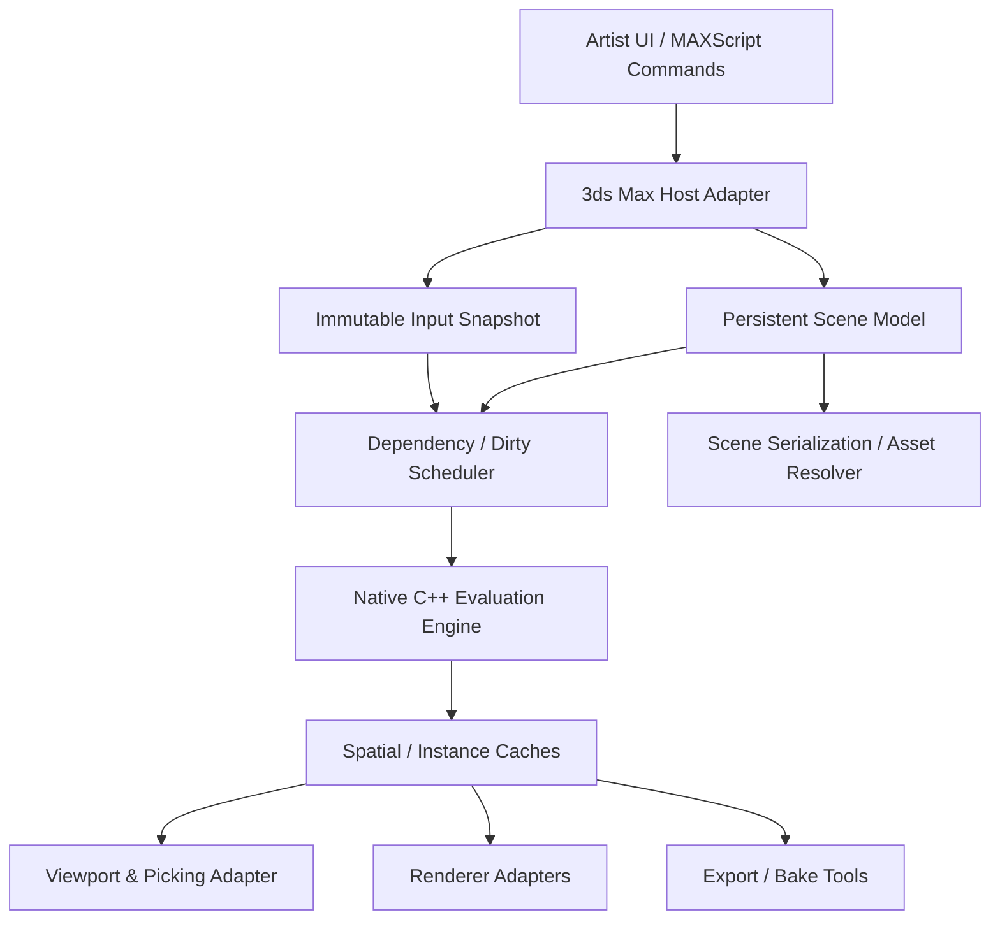

# CYRUS SCATTER — Full Procedural Scattering Rebuild Blueprint

**Edition:** 2026-10-13 · **Status:** architecture/design proposal, not implemented code · **Target:** native Autodesk 3ds Max plugin with C++ core, MAXScript/host UI and independently implemented renderer adapters.

## Why this handbook exists

This handbook turns the attached ForestPack study into **an actionable engineering design for rebuilding and extending Cyrus Scatter**. It covers **26 chapters and 296 cataloged control/feature entries**, including the responsibilities and artist-visible behaviors of ForestPack-style geometry distribution, areas, brushes, surfaces, transforms, clustering, collisions, editing, Effects, camera/LOD, viewport/render integration, libraries and utilities. It is deliberately **not a claim to possess or reproduce ITOOSOFT proprietary source code**. Reproduce observed behaviors with independent designs, not copied code/assets or product branding.

The provided research file is retained unchanged in `reference/Original_Research_Forest.md`. The proposed specifications expand that research, identify undocumented behavior, and supply example algorithms, schemas, interfaces, tests and development gates.

## Read in this order

| Order | File | Purpose |
|---:|---|---|
| 0 | [01 — Scope and contracts](docs/01_SCOPE_REQUIREMENTS.md) | What 'full rebuild' includes, parity definitions, quality bars |
| 1 | [02 — Architecture](docs/02_ARCHITECTURE.md) | Modules, pipeline, graph, ownership and threading boundaries |
| 2 | [03 — Data model](docs/03_DATA_MODEL.md) | IDs, schemas, scene binding, units, serializable records |
| 3 | [04 — Evaluation/cache](docs/04_EVALUATION_CACHING.md) | Dependency graph, dirty propagation, tiling, correctness |
| 4 | [05 — Distribution](docs/05_DISTRIBUTION.md) | Image, Path, Reference, PFlow, external candidates |
| 5 | [06 — Areas and fields](docs/06_AREAS_FIELDS.md) | Ordered include/exclude, splines, masks, falloffs, links |
| 6 | [07 — Surfaces](docs/07_SURFACES.md) | XY/UV placement, steep slopes, projection, attachment |
| 7 | [08 — Painting](docs/08_PAINT_ENGINE.md) | Stroke capture, representation, erase, undo, responsiveness |
| 8 | [09 — Sources, clustering, transforms](docs/09_SOURCES_VARIATION.md) | Geometry list, weighting, maps, clusters, transform curves |
| 9 | [10 — Collision, boundaries, edit](docs/10_CONSTRAINTS_MANUAL_EDITS.md) | Collision resolution and local-edit persistence |
| 10 | [11 — Effects](docs/11_EFFECTS.md) | Typed procedural rules, stages, dependency-safe expression VM |
| 11 | [12 — Output, shading, animation](docs/12_OUTPUT_RENDERING.md) | Viewport, LOD, camera, materials, renderers, time samples |
| 12 | [13 — 3ds Max host](docs/13_3DSMAX_INTEGRATION.md) | Host API, callbacks, MAXScript bridge, Undo, safety |
| 13 | [14 — UX and behavior contracts](docs/14_UX_CONTROLS.md) | UI structure, modes, validation, understandable diagnostics |
| 14 | [15 — Verification](docs/15_TESTS_BENCHMARKS.md) | Test fixtures, reference experiments, performance acceptance |
| 15 | [16 — Delivery roadmap](docs/16_ROADMAP.md) | Phased implementation and developer handoff |
| 16 | [17 — Recipes](docs/17_IMPLEMENTATION_RECIPES.md) | Worked landscapes and end-to-end evaluation scenarios |
| 17 | [18 — Coverage catalog](docs/18_FEATURE_CATALOG.md) | Broad control-by-control feature inventory and dependencies |
| 18 | [19 — Renderer contracts](docs/19_RENDERER_ADAPTERS.md) | Capabilities matrix, per-renderer contracts, fallback policy |
| 19 | [20 — Persistence](docs/20_SERIALIZATION_AND_ASSETS.md) | Native save, external assets, migrations, failure recovery |
| 20 | [21 — Advanced scope](docs/21_UTILITIES_ADVANCED.md) | ForestSet-like collections, tools, ivy, legacy features |
| 21 | [22 — Sources & uncertainties](docs/22_SOURCES_DECISION_LOG.md) | Primary references, what is known, what must be tested |
| 22 | [23 — Developer checklist](docs/23_DEVELOPER_HANDOFF.md) | Build-ready work packages, interfaces, definition of done |
| 23 | [24 — Interaction matrix](docs/24_INTERACTION_MATRIX.md) | 50 paired-control interactions, precedence questions and regression tests |
| 24 | [25 — Core APIs and algorithms](docs/25_CORE_API_ALGORITHMS.md) | Native C++ interface sketches, candidate/area/collision/paint algorithms |
| 25 | [26 — Learning laboratory](docs/26_LEARNING_LAB.md) | Hands-on engineering exercises and acceptance checks for each subsystem |

## How to interpret every technical claim

- **[FP-DOC]** — Publicly documented ForestPack behavior; links included in chapter or [source register](docs/22_SOURCES_DECISION_LOG.md).
- **[CYRUS-DESIGN]** — Independent recommended implementation, not an assertion about ITOOSOFT internals.
- **[TEST-NEEDED]** — Exact order, numerical rule, combination behavior or renderer support is not conclusively established by sources; test with a licensed target ForestPack version.
- **[SDK-VERIFY]** — 3ds Max or renderer SDK integration requires verification against the actual installed versions and SDK headers.

Where a document uses pseudocode, it is **illustrative**, not drop-in SDK-compilable code. Numeric budgets, priorities, timings and memory targets are proposed acceptance criteria, not measurements of ForestPack or existing Cyrus Scatter.

## Non-negotiable engineering rules

1. Separate authoring state, evaluated candidates, accepted instances, and preview/render data.
2. Preserve **stable semantic identity**, not array-index identity; define what it means when topology and generator patterns change.
3. Model spatial operations and precedence explicitly; do not combine all includes/excludes into one unordered bitmap.
4. All heavy host-dependent data must be snapshotted on allowed threads before worker computation.
5. Every operation declares dirty dependencies; stale jobs must never overwrite newer scene state.
6. Incremental and full rebuilds must agree to a defined correctness tolerance. Provide full fallback when they cannot.
7. Renderer-specific implementations are replaceable adapters; never assume all render engines expose equivalent facilities.
8. Undo/Redo, save/load, cloning, object deletion and missing assets are feature requirements, not cleanup.
9. Expose counts and timings by stage so performance can be diagnosed.
10. Audit the **existing Cyrus repo before refactoring**. No code from the repo was inspected as part of creating this handbook; no current feature state should be inferred from this plan.

## Proposed software composition

## Deliverable boundaries

**Included now:** a complete planning/design handbook, implementation pseudocode, control map, testing strategy and staged roadmap. **Not included now:** modified Cyrus plugin source, validated performance benchmarks, licensed ForestPack behavioral tests, compiled 3ds Max SDK integration, or assurance of renderer feature parity. These are separate implementation/verification milestones.

**Recommended start:** read chapters 01–04; then audit the current Cyrus C++/MAXScript repository and execute the first test suite before selecting data structures or rewriting modules.
