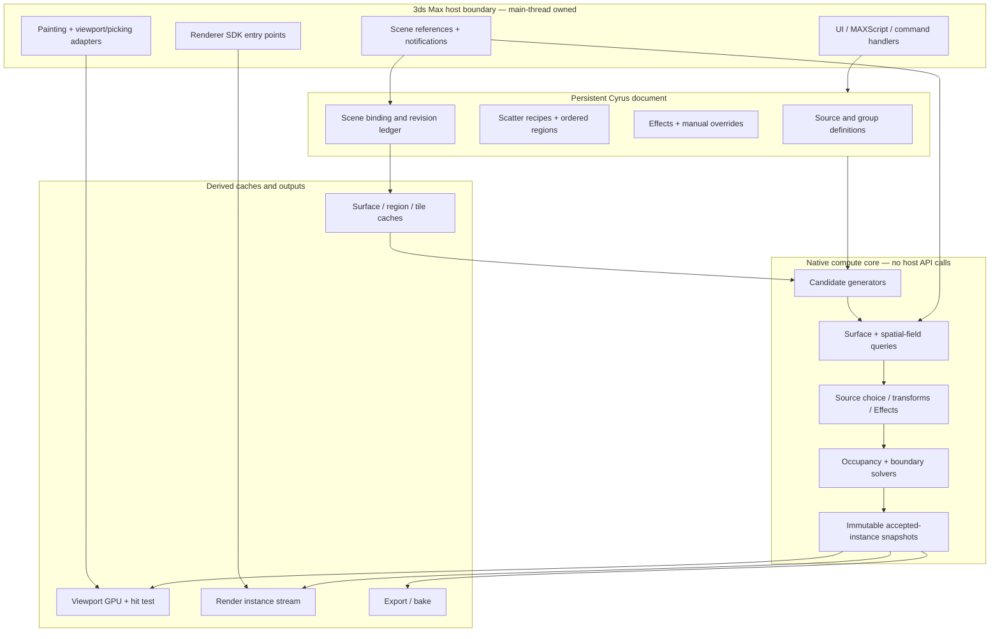
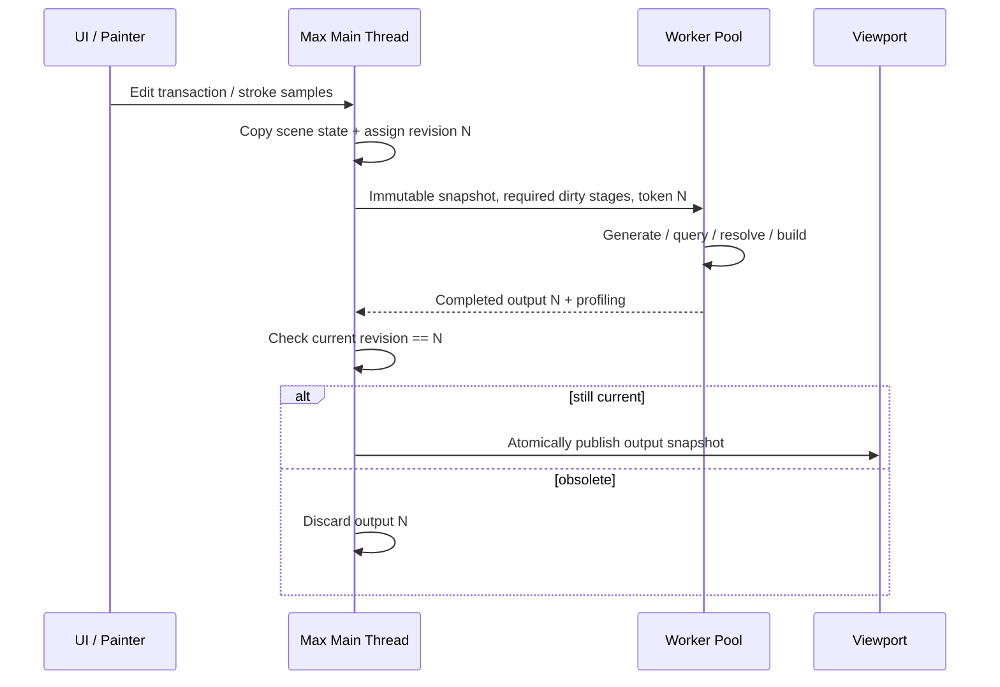

# 02 — Full engine architecture, execution model and module boundaries

> **[CYRUS-DESIGN]** This is an independent proposed architecture. ForestPack documentation supports some visible mechanisms (projected exclusion masks, shared surface information, cached point clouds) but does not expose its internal class structure.

## 1. The fundamental invariant

**Authoring intent is authoritative. Evaluation results are disposable, independently reproducible derived data.** Do not store high-level scatter settings only in viewport caches or construct a separate host node per instance. An edited scene must remain meaningful if all generated caches are discarded.

## 2. Layered design



### Host adapter (`cyrus_max_host`)

Responsibilities: capture 3ds Max geometry and transform snapshots; map persistent IDs to `INode` references; publish transform/mesh source changes; dispatch undoable commands; supply time/camera/material snapshots; configure painting and viewport drawing; bridge MAXScript/UI; produce compatible scene save chunks. **No heavy candidate generation inside notifications or UI callbacks.**

### Domain model (`cyrus_document`)

Contains scene-independent serialized configuration: sources, emitters, regions, dependency links, fields, Effects, versioned recipes, overrides and references. Refer to `03_DATA_MODEL.md`.

### Core compute (`cyrus_core`)

Portable C++ evaluation services, ideally buildable and unit-testable without 3ds Max. Includes deterministic RNG, spatial queries, sampling, collision, field composition, area stack, instance buffers, diffing and serialization primitives. Avoid `INode`, `Texmap` and direct SDK pointers in public core contracts.

### Cache + scheduler (`cyrus_runtime`)

Dependency graph, revision hashes, cache keys, change-propagation rules, tile ownership, job orchestration, cancellation, memory budgeting, atomic publication and instrumentation.

### Output adapters (`cyrus_output_*`)

Viewport/picking adapter; Arnold, Corona, V-Ray adapters; host-compatible mesh/export fallback; baking tools; material attribute bridge. Separate capabilities and failure handling.

## 3. Reference project layout (not an existing repo inventory)

```text
CyrusScatter/
  src/
    core/
      math/ rng/ ids/ fields/ geometry/ spatial/
      distribution/ surfaces/ areas/ selection/ collision/
      transforms/ effects/ manual/ instance/
    runtime/
      snapshots/ scheduler/ dirty_graph/ tile_cache/ memory/
    maxhost/
      plugin/ scene_refs/ node_capture/ notifications/
      painter/ undo/ ui_bridge/ serialization/
    viewport/
      gpu_buffers/ preview/ picking/ overlays/
    renderers/
      common/ arnold/ corona/ vray/ host_fallback/
    tools/
      library/ export/ migration/ diagnostics/
  ui/
    rollout_scripts/ controllers/ dialogs/ presets/
  tests/
    unit/ property/ integration/ goldens/ max_scenes/ bench/
  docs/
  schemas/
  packaging/
```

Make the real tree *after* auditing Cyrus. Do not re-create working integrations merely because this example has different directories.

## 4. Computation phases

The **logical** sequence is:

1. Resolve authored inputs and versions, capture host snapshots.
2. Prepare terrain/spline/source/mask acceleration data.
3. Enumerate generator candidates with stable IDs and provenance.
4. Resolve world-position, surface binding and field context.
5. Apply ordered region inclusion/exclusion contributions.
6. Choose source; compute transforms; evaluate pre-constraint Effects.
7. Solve boundary eligibility and occupancy (collisions, inter-scatter constraints).
8. Apply explicitly typed post-constraint Effects with clear rules.
9. Merge manual pins/additions/deletions and revalidate relevant constraints.
10. Produce accepted-instance snapshot and statistics.
11. Derive view-, camera- and renderer-specific representations.

This is a dependency graph, **not one irreversible linear call chain**. Certain Effects can modify earlier-stage attributes; such modifications must trigger a specified reevaluation stage or be prohibited at that stage. The scheduler may reuse any unchanged phase output.

### Data packets between phases

```cpp
// Pseudocode: no Autodesk SDK dependencies.
struct Candidate {
    CandidateId id;
    GeneratorId generator;
    AreaId originArea;
    Vec3 preliminaryPosition;
    SurfaceBinding optionalBinding;
    uint64_t randomKey;
};
struct EvaluatedItem {
    CandidateId id;
    SourceId source;
    Mat4 worldTransform;
    SurfaceBinding attachment;
    BoundaryData boundaryData;
    CollisionShape shape;
    PerItemAttributes shadingAndAnimation;
};
struct FinalInstance {
    InstanceId id;
    SourceId source;
    Mat4 transform;
    MaterialBinding material;
    uint32_t flags;
};
```

Use explicit types for coordinate spaces (XY local, world, UV), distances, angles, percentages, and scene units. Prevent accidentally treating degrees as radians or a scene-unit value as meters.

## 5. Host-thread and worker-thread ownership



- Never call unsafe scene operations from worker threads.
- Use owned copied geometry and string/ID handles in workers, not raw host lifetime-bound pointers.
- Keep last valid result visible during long rebuilds; expose an updating status.
- Throttle or coalesce duplicate requests, but do not suppress relevant final updates.
- Rendering may require a different synchronous preparation path; keep it isolated from UI publication.

## 6. Source and surface sharing

A `SurfaceCache` is keyed by scene object binding, evaluated time, geometric revision, transform revision, UV/channel revision and coordinate mode. Multiple scatters referencing the same surface can reuse immutable prepared geometry/BVH information when revisions agree. Separate topological, geometric, UV and transform changes to avoid unnecessary recomputation. Beware instance-specific Max modifiers and evaluation time.

`SourceGeometryCache` keeps source evaluated meshes or render asset handles by `SourceId + time + revision + renderer capability`. Group children must preserve their local transforms, material IDs and scene graph semantics.

## 7. Handling multiple scatter objects

Model scatters as nodes in a directed acyclic evaluation graph when one object's instances drive another object's exclusion or effect field. Detect cycles at authoring time and display dependency paths. Three possible policies for mutual dependence:

1. **Default:** reject cyclic references, explain which link closes the cycle.
2. **Advanced:** explicit frozen snapshot of one scatter used as input to the other.
3. **Special solver:** intentional iterative fixed-point process with convergence criteria, iterations and deterministic ordering (not initial scope).

Do not silently evaluate on whichever object happened to update first.

## 8. Camera/view caches

Accepted population cache is usually **camera-independent**. Camera culling, preview percent, LOD and impostor selection consume it. If the user chooses camera-dependent *density generation* or a camera-reading Effect, the camera becomes an explicit dependency; navigation may then regenerate affected stages. Expose the distinction in the UI.

## 9. Failure and resource behavior

- Invalid source: keep authored reference, mark missing, emit proxy/none according to policy.
- Surface missing: preserve bindings/paint data, show unbound state, never silently snap to origin.
- BVH/candidate budget exceeded: deterministic partial/error policy; do not silently report success.
- Worker canceled: retain last published valid snapshot; free transient allocations.
- GPU/device reset: discard only derived GPU resources and regenerate from accepted-instance snapshot.
- Renderer unavailable: indicate degraded/unsupported export, never silently replace materials with incorrect ones.
- Memory pressure: bounded caches with eviction policies and visible diagnostics.

## 10. Top-level technical acceptance gates

1. Core `cyrus_core` unit tests run without 3ds Max.
2. Scene snapshots are safely produced and immutable to worker threads.
3. Deterministic output is independent of worker count.
4. Change-only-tint does not run generator, surface, area or collision stages.
5. Change-small-paint can reuse unaffected tiles, or explicitly widen its recomputation to obtain identical results.
6. Save/load uses the persistent document rather than trusting cached instance buffers.
7. Viewport display remains stable during brush dragging, scene edits and cache replacement.
8. Render adapters are capability-tested on actual target SDK versions.

See `03_DATA_MODEL.md` for persistent records and `04_EVALUATION_CACHING.md` for scheduler semantics.
