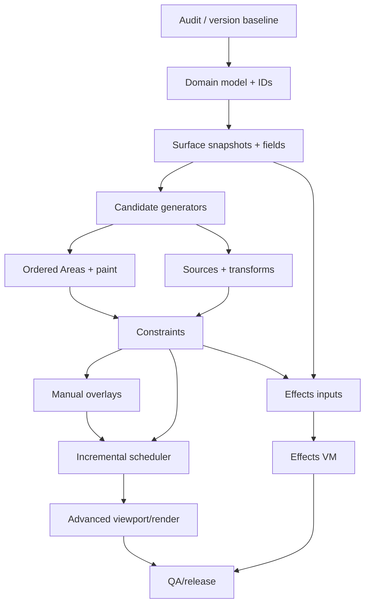

# 16 — Full rebuild strategy, milestones and dependency-ordered implementation plan

## 1. Key decision: modernize, don't blindly restart

This handbook is a **target architecture**. Before committing to a rewrite, audit Cyrus Scatter's existing C++/MAXScript systems, Cyrus Surface Analyzer and CS Edit. Identify components already implementing these contracts; wrap/migrate them instead of discarding productive code. No repository audit was performed while preparing this blueprint.

Use a **strangler migration** approach where possible: new engine APIs run behind compatibility commands and scene adapters; migrate one feature family at a time; compare output with legacy version; retire modules only after acceptance gates and scene migration tests.

## 2. Workstreams (run concurrently only if their contracts are stable)

- A. Domain/schema/scene persistence
- B. Compute math/geometry/shared surfaces
- C. Candidate generators and source selection
- D. Ordered Areas and paint field engine
- E. Constraints/manual overrides/CS Edit bridge
- F. Viewport/renderer/LOD/material adapters
- G. UI automation/diagnostics/library
- H. QA, reference behavior and performance

Heavy parallel programming before module interfaces stabilize creates integration churn; first freeze common record types and field/renderer contracts.

## 3. Milestone M0 — Existing-system audit and baseline

**Deliverables:** repository module graph, schema/version table, current feature inventory, 3ds Max target SDK matrix, existing render adapter list, hot-path flame graph, 10 representative customer/benchmark scenes, current save/load/Undo risk report.

**Gate:** team can name exact code owners for distribution, paint, areas, viewport, rendering and scene serialization, with a migration/compatibility test strategy.

## 4. Milestone M1 — Core model and deterministic reference engine

**Implement:** C++ canonical math, scene-independent source/area/generator schemas, UUID/keyed IDs, deterministic random channels, immutable candidate/instance buffers, single-thread full evaluation, minimal performance instrumentation.

**Gate:** flat-plane image scatter runs outside Max, deterministic outputs across builds, weight/curve/barycentric tests pass. Save/load schema round-trips. No render-specific dependencies in core.

## 5. Milestone M2 — Surface sampling and foundational generators

**Implement:** main-thread snapshot adapter, mesh BVH and cache, XY/UV sampling, Image and Path generators, Reference Pivot and Face provider, slope/altitude, basic source selection/transforms.

**Gate:** deterministic multi-receiver scenes; path arclength correct; no unsafe worker host calls; stable receiver matching under transform/deformation cases. Render/update minimal preview of accepted instances.

## 6. Milestone M3 — Ordered areas and initial painting

**Implement:** region graph, closed/open spline regions, ordered Include/Exclude, surface dual role, basic object exclusion masks, falloffs, world-XY brush coverage, overlay, Undo; areas update through current full-rebuild correctness path.

**Gate:** Include–Exclude–Include and Paint–Erase tests pass; long brush produces one Undo transaction; no unexpectedly filled terrain; output matches full rebuild after every edit.

## 7. Milestone M4 — Source intelligence and constraints

**Implement:** weighted/empty sources, Color ID, spatial clustering, probability curves, transform maps, global/source collision radius, point/size boundaries, source groups, cross-scatter exclusion.

**Gate:** source histograms, clustering field sweeps, collision determinism across worker counts, documented overlap semantics, seeded outputs and rejection statistics all verified.

## 8. Milestone M5 — Persistent art direction + safe local updates

**Implement:** stable overlay IDs, edits/pins/tombstones/manual adds, CS Edit integration, orphan handling, region compiled-tile caches, dependency graph and worker scheduler, collision-cascade fallback/differential tests.

**Gate:** edit 20 hero trees, change density/terrain/path, undo, reload; all edits survive according to policy. Incremental and full builds equivalent. Brush P95 benchmark published.

## 9. Milestone M6 — Production viewport and render

**Implement:** point/box/proxy/mesh/adaptive GPU display, GPU buffer reuse, picking by ID, camera visibility/LOD, source material attributes, Arnold/Corona/V-Ray capability adapters with safe fallbacks, diagnostics.

**Gate:** production-scale benchmark suite, camera orbit without unintended regen, material/tint parity, render-memory reports and no silent fallback in supported modes.

## 10. Milestone M7 — Effects, animation, extended inputs

**Implement:** typed Effects functions/parameters, strict read/write dependency signatures, sandboxed expression VM (if needed), animation sample cache, PFlow and external/RailClone-compatible public API adapters, complex local overrides.

**Gate:** Effects cannot corrupt caches or hang worker pool; source/position/scale writes propagate correctly; animation samples and external refs persist and render under advertised capabilities.

## 11. Milestone M8 — Libraries, packaging and specialty tools

**Implement:** asset library/presets, shared collections/linked areas, bake/export, batch scripting/MCP commands, scene manager, missing-asset repair, migration utilities, optional ivy/growth and legacy-specific workstreams.

**Gate:** independent scene can be saved, transferred, reopened, relinked and rendered; field support matrix and documentation match implementation; release candidate passes end-to-end regression suite.

## 12. Critical dependency order

Implement minimal preview and at least one usable output adapter earlier than M6 to observe failures. The arrows reflect **primary data dependencies**, not a prohibition on early prototypes.

## 13. Suggested task definition

Each engineering ticket should contain:

`User story → documented behavior → proposed implementation → input/output contracts → dependency/write set → failure modes → Undo/save implications → tests → benchmarks → DoD → known differences`.

Example ticket **AREA-007 Object Exclusion Mask**:

- Input: evaluated triangle snapshot, projection axis/world bounds, top cutoff, scale, target accuracy.
- Output: immutable projected occupancy field + revision + error metric.
- Dependencies: object geometry/transform/time, projection/accuracy policy.
- Tests: thin wall, roof, large terrain, two scattered receivers, animation.
- Performance: memory per mask tile, cold build and warm sample rate.
- DoD: deterministic query and proper cache invalidation; no Max SDK pointer in worker.

## 14. Migration from existing Cyrus scenes

- Version existing schema and export a safe backup before migrations.
- Implement read-only comparison mode: legacy result and new result side by side with ID correspondence where possible.
- Provide explicit migration report: mapped control, changed semantics, lost/unsupported feature, source reference status, manual edit treatment.
- Preserve option to load old scenes through compatibility path until migration is proven.
- Do not overwrite customers' scene data silently during plugin upgrades.

## 15. Risks and mitigating actions

| Risk | Impact | Mitigation |
|---|---|---|
| Renderer API differences | Incorrect tint/Edge/animation, crash | Capability adapters + per-version tests |
| IDs unstable after map/mesh topology edits | Manual edits lost | Attachment policy + orphan ledger + tests |
| Collision local update propagation | Wrong populations | Deterministic full fallback + conflict graph |
| Painting stroke history cost | Brush stalls | Compiled tile cache + coalescing + P95 trace |
| Host thread unsafe usage | Max instability | Immutable snapshots + SDK-host lifecycle review |
| Monolithic new code | Feature coupling, slow dev | Strict subsystem contracts and core-only tests |
| Asset/version migration | Broken customer scenes | Versioned schemas, read compatibility, repair reports |
| Reproducing proprietary implementation | Legal/IP risk | Behavioral parity, independent engineering, original assets/UI |

## 16. Release readiness

A release candidate needs a declared supported Max/renderer matrix, parity test report, customer regression scene package, crash/undo/cancel tests, benchmark report, serialized schema migration, documented fallbacks and reproducible builds. Feature-complete UI without these is a beta, not production parity.
