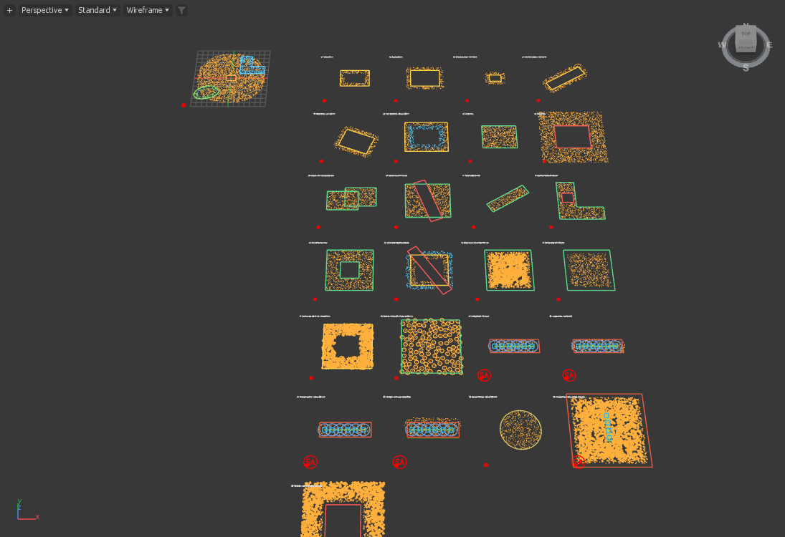

# Layer and navigation fixes — Scatter 0.79.2

11 October 2026. Development candidate, schema 55 / CyrusUnified1. Matched private Max 2026 and 2027 hosts; no computer use, artist installation, Git commit or push. Analyzer remains 0.14 and team licensing retains the existing owner trust.

## Changes

- [x] **B15: display snapshots follow published owners.** A new unpublished Manual layer displays no plants. Removing the first, middle or last layer and switching display mode cannot reuse another layer's rows, sources or radii. Successor previews are staged before installation.
- [x] **B17: cached viewport records and native radius lines.** Navigation consumes prepared controller/cache records. Relevant edits and scene events refresh those records; a small Analyzer revision watch handles its independent updates. Radius circles are immutable retained line buffers, with the same 24 segments and colors. The CPU fallback uses those same coordinates. Point telemetry still counts points, while buffer accounting includes the line vertices.
- [x] **B18: radius controls preserve Manual edits.** Radii / layer, Show All Radii and per-source Show Radius refresh presentation. Pending population and footprint-radius values remain pending. Display reconstruction uses the published radii. Undo/Redo updates the circles without publishing the pending recipe.
- [x] Disabled Analyzer inputs also suppress their radius overlay.
- [x] Version labels, native/package metadata and the descriptive MCP catalog agree on 0.79.2. No saved schema change or licensing-policy change.

The Live picker disappearance report **B16 remains open**. Both the supplied scene and recreated button/shared-handler sequences retain their source rows and original geometry. That does not reproduce or certify the actual modal mouse-picking transition; no speculative picker rewrite was made.

## Navigation measurements

The original example file has 26 controllers, 18,759 displayed points and 5,546 radius circles (133,104 segments). Every circle's native coordinates and color match the previous scripted array. The final timing runs were serialized between owned hosts, using the previous fitted perspective camera and 12 synchronous redraws per block. Background system activity was not controlled.

| Scripted perspective redraw median | 0.79.1 Max 2027 | 0.79.2 Max 2027 | 0.79.1 Max 2026 | 0.79.2 Max 2026 |
| --- | ---: | ---: | ---: | ---: |
| Orbit | 103.0 ms | 14.4 ms | 121.0 ms | 14.4 ms |
| Repeat orbit | 100.6 ms | 13.7 ms | 117.5 ms | 14.3 ms |
| Pan | 100.9 ms | 13.9 ms | 119.3 ms | 14.5 ms |
| Zoom | 102.1 ms | 13.4 ms | 115.9 ms | 14.9 ms |

Source of the baseline: [0.79.1 investigation](../Point_Workflow_0.79.1_2026-10-11/NAVIGATION_PERFORMANCE.md). These are **synchronous redraw timings, not presented FPS, physical navigation latency or a same-process randomized benchmark**. Different warm host runs and background artist activity can affect timings. Both normal and simulated held-input navigation kept placement epochs, candidate/receiver caches, preview builds, retained preparation/publication/uploads, input-validity queries, Analyzer runs, Live events and render-bridge builds unchanged. All visibility was retained; no diagnostic drawing bypass was active.

Explicit reconstruction still costs time. In this scene, load took 2.22/2.39 seconds in Max 2026/2027. The following explicit all-controller Update plus initial redraws took 7.49/5.99 seconds. These are workload observations, not isolated solver timings or a claim that cold Update has been optimized.

## Qualification

Per host, **292 recorded checks/phases passed**: 260 correctness assertions, eight native Undo/Redo request phases and 24 navigation assertions. The 260 comprise 40 layer lifecycle, 36 display, eight animation/invalidation and 176 existing Point/falloff/UI assertions. Additional cache, Point/model and copied-artist probes record intermediate states.

- [x] Manual and Live geometry → Point layer → remove → restore original source editor; with and without a second receiver.
- [x] First/middle/last removal with distinct populations, Centres/Mesh switching, published-owner mapping and actual retained instance counts.
- [x] Layer removal Undo/Redo and radius-limit Undo/Redo, outside an outer Python transaction.
- [x] Ten populations with twenty point/radius caches; unchanged save/reopen placement fingerprints.
- [x] Hidden/visible and disabled/enabled layers/controllers; retained drawing stops for hidden controllers.
- [x] Pending Manual amount, source radius and receiver changes; explicit Update applies them afterward.
- [x] Relevant Live receiver changes and animation update output; unrelated animation leaves static output unchanged.
- [x] Analyzer enable/disable and data-revision updates reach the cached viewport.
- [x] Malformed native radius input is rejected; an injected invalid display-stage radius preserves the preceding complete point/radius snapshot and recovers after correction.
- [x] CPU fallback/recovery preserves snapshots; unchanged navigation does not upload them again.
- [x] All 25 include/exclude examples preserve their recorded fingerprints. Point assignment/replacement, source identities, falloff curves/scales, Empty sources, save/reopen and native control bounds pass the focused existing campaign.
- [x] Supplied layering scene: first layer remains at 200 placements with fingerprint `10175500218081974701` throughout Point addition, model addition/list-return handling, second-layer removal and simulated held/released input.
- [x] 24 native suites per Max SDK, one unchanged Analyzer core suite per SDK, 158 Python tests, generator integration and approved-layout checks pass.
- [x] Both MZP archives are verified against the tested script and native hashes. No installer was executed in the artist profile.

The supplied layering file is Max 2027 format. Max 2026 correctly rejected that file, so its test uses a copy back-saved by the owned Max 2027 process. The current original SHA-256 is `f517f9da93f44cbaafb1ed69bac5226d5600ff1edec25329df09b8eab777c1cb`; it matches the first copy made in this campaign and all later original-input copies. It differs from the earlier 0.79.1 investigation's input hash. The point-example original remains `b7e561c15e942843a1ebd694691fc36a18f9e79c385c31d140b1366cf633fc0b`. Neither original was written by these tests.

## Delivery and identities

- [Max 2027 installer](../../dist/refinement-0.79.2/CyrusScatter-0.79.2-Max2027.mzp)
- [Max 2026 installer](../../dist/refinement-0.79.2/CyrusScatter-0.79.2-Max2026.mzp)

Run the appropriate MZP through **Scripting → Run Script**, then restart Max to load the matched native/script pair. Existing offline team activation applies. Analyzer remains the separately distributed 0.14 package. Local `dist/` archives and `.max` files are ignored by Git.

Final generated script SHA-256: `cb3d5e5dca1c3d6799dc626dc9a49397a92abc21baf6e4935b8cfdd4ff09447b`. [Evidence](evidence.json) records loaded module paths/hashes, final test assertions, before/after navigation counters, every timing sample, original-file hashes, package manifests and raw receipt locations. Native build sources were frozen before the final script-only corrections; the launcher/packager verify every compiled source against the frozen build and the delivered script against the tested host.

## Failures and remaining limits

- Preliminary testing found and then corrected per-source Manual radius refresh and radius-limit Undo/Redo. Those failed runs are not counted as acceptance.
- Fixture corrections: native functions are read-only, so failure injection uses a disposable invalid radius value; hidden native buffers may remain allocated while drawing is disabled, so visibility is checked with draw counters; Analyzer resolution must be at least 48. The shared older Python fixture now preserves a replaced MAXScript function inside MAXScript and waits for rollout HWND creation before manually invoking a mount timer.
- One preliminary retained-instance assertion after deleting the last Manual layer differed from the expected count. Instrumented reruns and the final runs passed. Its cause remains unqualified under **B01**, rather than being labelled fixed by a successful retry.
- One owned Max 2027 process exited before readiness/module verification. Subsequent fresh launches passed. Startup/driver/deployment reliability remains an acceptance gate; this is not evidence of a diagnosed plugin crash fix.
- **B14 cross-unit conversion**, physical picker/brush/graph/DPI interactions, sustained heavy scenes, renderer/material fidelity and device-loss qualification remain open. No physical navigation or all-renderer certification is claimed.

## Reproduction

Use fresh ignored directories and preserve artist sessions. The examples and their earlier reference receipts are local inputs, not provided by a Git clone. Valid owner-trusted test activation is required.

1. Build each SDK with `tools/licensing/build_candidate.py`, specifying the owner public trust header.
2. Launch with `tools/refine0791/launch.py`; use a profile name beginning `refine0791-layer0792-`. The prefix permits reuse of the older guarded probes; it does not identify the product version.
3. Run `tools/refine0792/campaign.py <profile>` for radius Undo, display, Point/falloff and layer probes. For Max 2026, use `convert_artist.ms` in the 2027 host to back-save the copied artist input, copy that result into the 2026 profile, then rerun the `artist` phase.
4. Run `tools/refine0792/run.py <profile> invalidation`, followed by `navigation`. Serialize timing runs across hosts. Inspect JSON errors and failed assertions; transport success alone is insufficient.
5. `tools/refine0792/package.py` rejects mismatched source/binaries or failed required checks. `summarize.py` preserves the final evidence. Update its explicit campaign paths for a new run.

Source baseline: `15957a66de0480679dea6c533c7c5d09d9598d54`, branch `codex/workflow-0.75`. Website changes and licensing work outside the version labels were left untouched. Current behavior and remaining gates are maintained in the [artist guide](../ARTIST_GUIDE.md), [architecture](../ARCHITECTURE.md) and [backlog](../BACKLOG.md).
