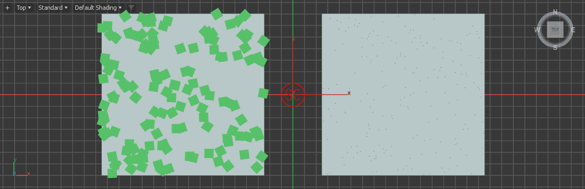
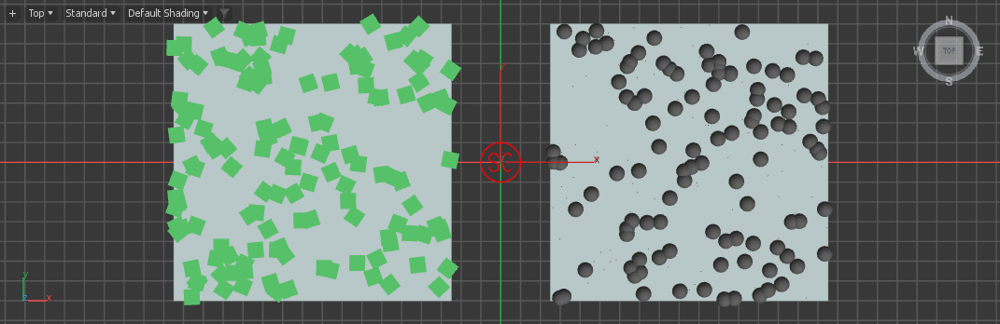
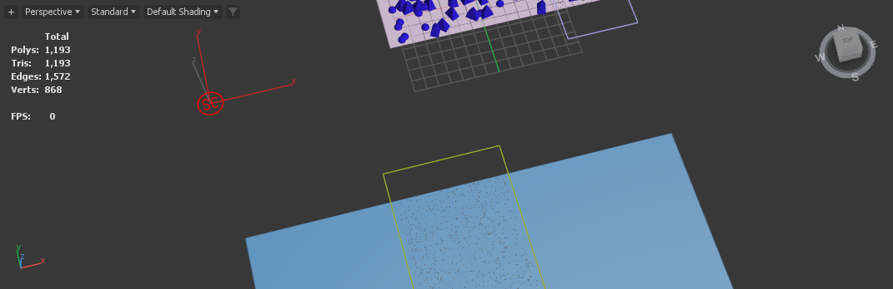

# Layer and Point investigation — 0.79.1

Follow-up: [0.79.2 owner-cache correction and qualification](../Layer_Navigation_0.79.2_2026-10-11/README.md). The investigation below remains the historical failure evidence; physical picker behavior is still open.

11 October 2026. Tested unchanged product commit `15957a66de0480679dea6c533c7c5d09d9598d54` in owned Max 2026 and 2027 processes. This follow-up confirms a Manual display-cache defect. The reported Live disappearance and physical picker behavior remain unresolved. No product correction, installation or Git push is included in this investigation.

## Results

| Scenario | Result and qualification |
| --- | --- |
| Geometry layer, then Point layer, then remove the Point layer | Live tests retain the first layer's 137 placements, inputs and editor values, with and without a receiver on the second layer |
| Different receiving surfaces for the two layers | Native viewport captures show the original geometry and the second layer's Points together |
| Add Model after Add Point | Generated picked callback retains the Point row and adds the model; shared add-from-list function also retains it |
| Duplicate model additions | Existing model rows are not duplicated or substituted for the Point |
| Edit Point-layer scale/radius, then remove that layer | First-layer values return correctly in data and controls: scale 1.75, radius 3.25 |
| Layer deletion Undo/Redo | Separate native MAXScript requests pass on both host years |
| Deselect/reselect and three unchanged passes | Publication epoch, preview builds, retained revision, preparation and upload counters remain unchanged |
| Add a layer while Manual has a previous publication | **Failed:** display preparation reports `Unknown property: "count" in undefined` until explicit Update |
| Delete an earlier Point layer in Manual, then change display mode | **Failed:** surviving geometry receives the removed Point layer's cached display; explicit Update restores it |
| Exact saved artist scene, scripted recreation | First layer's 200 placements retain their fingerprint throughout; Point and added models coexist |
| Physical scene picking and list-dialog interaction | **Open:** scripted callback/function calls do not exercise the native modal selection interaction |

The lifecycle fixture passes 40 endpoint assertions per host. That does **not** mean the campaign passes: its intermediate Manual error states and the separate wrong-owner display witness are confirmed failures.

## Confirmed cause: display arrays indexed by current layer position

`procEnsureDisplay` in `AminScatter/tools/ui/templates/unified-core.ms` indexes `groupSnapshotRows[i]` and `procPublishedSources[i]` using the current `layerObjects` index. While Manual edits are pending, those arrays still describe the previous publication. Adding a layer can exceed their length. Removing an earlier layer shifts the current indices onto another owner's cached data.

The placement accessor already resolves against `procPublishedOwners`; this display path does not. The decisive witness, identical in Max 2026 and 2027:

1. Publish a first layer with 23 Points and a second layer with 137 box instances.
2. Use Manual mode and remove the first layer. The surviving geometry initially still displays 137 instances.
3. Change to Centres and back to Mesh without Update.
4. The surviving layer now reports 23 displayed placements and zero retained mesh instances. Its actual owner-mapped published placement array still contains 137 entries.
5. Explicit Update republishes the current owners and restores all 137 mesh instances.

This demonstrates incorrect display ownership, rather than deleted receiver/model settings. It does not establish that the user's reported Live sequence has the same cause.

**Next correction (B15):** resolve each current layer against its published owner identity, handle new unpublished layers explicitly, and preserve staged/atomic display installation. Do not force a placement rebuild to conceal the Manual defect. Acceptance should include first/middle/last layer removal, addition, enabled/visible changes, pending display changes, Undo/Redo, failed successor retention and unchanged-buffer reuse.

## The supplied saved scene

Only a copy of `Test Scene/for layering test.max` was loaded, in the private Max 2027 profile using the file's system units. Original size: 864,256 bytes. SHA-256 before and after:

`47bacfe989267c2c9bd85e362aa38f5ffa1b6cc3a72284000686a2c759dd510a`

The file contains:

- **Layer_01:** Plane001; Pyramid001 and Sphere001; 200 accepted/shown placements.
- **Layer_02:** Plane002 and Plane001; Pyramid001 and Sphere001; two Include rectangles; 20,000 candidate budget, 5,136 accepted and 2,000 shown under the display cap.
- Both layers enabled and visible, with Live updates and Mesh display. **Neither saved layer contains a Point source row.** This establishes the saved state, not which earlier action removed or replaced the Point.

In the copy, removing Layer_02's models, adding a Point, adding Pyramid001 through the picked callback, adding Sphere001 through the shared list-add function, and removing Layer_02 all preserve Layer_01's 200 placements and fingerprint `10175500218081974701`. The Point remains alongside the two models until the second layer is deliberately removed. A separate simulated held-input/release scheduling branch also preserves the first layer and publishes the new Point/model layer.

Add Model is intended to append a source; Replace Point converts a selected placeholder. The current callback tests support that distinction. They do not prove which interactive path ran in the artist session, and the investigation does not attribute the reported loss to a mistaken user action.

## Reproducibility and evidence

[Machine-readable receipts](layer-investigation-evidence.json) contain loaded module identities, per-stage owner/source/receiver data, fingerprints, errors, cache counters and original-scene hashes. Generated script SHA-256 is `ff2bee7e0baa1399d94c0d74b9dc8cad0335e45ef311e982e97225256344de08`; the on-disk installed scripts match. That alone does not identify script definitions already loaded in an artist process.

Private runs are under `build/mcp-qualification/refine0791-layer2026-01` and `refine0791-layer2027-01`. Reproduction fixtures are in `tools/refine0791/`:

- `layer_lifecycle.py`: generated layer/source handlers, both update modes, ownership and endpoint assertions.
- `layer_cache_probe.py`: earlier-owner removal, pending display changes, settings and unchanged-cache observations.
- `point_model_probe.py`: separate receivers, mixed Point/model sources and native viewport captures.
- `layer_undo_probe.ms`: native preparation/deletion/Undo/Redo in separate requests.
- `artist_layer_probe.py`: supplied scene copy and simulated held/released scheduling.
- `summarize_layers.py`: receipt collection, fixture hashes and original-file preservation check.

Use `launch.py` with a matched licensed candidate and a fresh owned profile. Send Python fixtures with `undo off (python.ExecuteFile @"absolute/path/to/fixture.py")` through `tools/procedural_lab/runtime_driver.py`. The artist fixture requires a private `artist-layering-input.max` copy first. Never run these reset/mutation fixtures in an artist session. Private scenes and binaries under `build/` remain ignored by Git.

Fixture errors were distinguished from product errors: an initial pymxs call treated the listbox's `selected` property as an event; it was corrected to the production selection method. A synthetic input-hold test initially restored a lazy pymxs callable incorrectly; saving/restoring the function value within MAXScript corrected that test. Original error receipts remain recorded. Attempting to substitute the native `selectByName` function was rejected as read-only, so no modal-picker pass is claimed.

The three unchanged passes show cache reuse, not zero draw cost or presented FPS. No controlled performance comparison or physical interaction certification is claimed.

## Optional passive capture for the unresolved interactive case

`tools/refine0791/watch_layer_sources.ms` is a separate diagnostic recorder, privately tested and **not installed or started in the artist session**. Running it with MAXScript Run Script samples state every 200 ms, writes changes under `build/layer-source-watch/`, and automatically stops after 15 minutes. `CyrusLayerWatchStop()` stops it sooner and prints the log path.

It reads layer/source identities, Point flags, receiver membership, active editor owner and publication status. It does not change plugin parameters or call Update. The private test left the epoch unchanged while idle and captured the next Add Point transition. Sampling can miss intermediate states inside a blocking modal operation; it is diagnostic evidence, not a complete event trace or a performance benchmark.

## Native viewport witnesses

Separate receivers: original geometry on the left, Point layer on the right.

After Add Model, the Point row and model coexist while the original geometry remains.

Artist scene copy after adding a Point to the second layer. The original camera only partly frames the upper receiver; numerical receipts establish the unchanged first-layer result.

