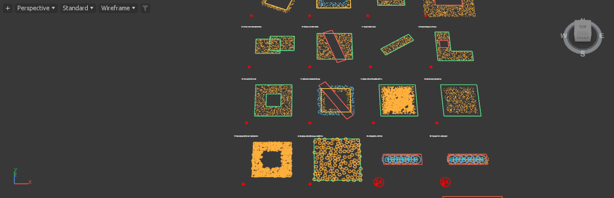

# Point-example navigation performance — 0.79.1

Follow-up: [0.79.2 fixes and measured results](../Layer_Navigation_0.79.2_2026-10-11/README.md). The measurements below are the unchanged 0.79.1 baseline.

11 October 2026. Investigation of orbit/pan/zoom lag in `build/vector-brush-078/include-exclude-visible2026-01/Include_Exclude_Point_Examples.max`, using unchanged product commit `15957a66de0480679dea6c533c7c5d09d9598d54`. Matched private Max 2026 and 2027 hosts; original scene and artist sessions preserved. No computer-use input, product patch, installation or Git push.

## Finding

**The scene is spending time on scripted viewport work, while placement and point-buffer caches are being reused.** It contains 26 Scatter controllers: the original `Cyrus_Point_Examples` plus 25 numbered examples. Together they display 18,759 points. Five examples additionally draw 5,546 radius circles, or 133,104 line segments, on every redraw.

Unchanged navigation produced no new placement publications, candidate builds, receiver-cache changes, preview builds, retained preparation or point-buffer uploads in either host. The extended Max 2026 perspective run also recorded unchanged input-validity queries, Analyzer analysis counts, Live event count and renderer-export build count. The idle observation similarly retained all inspected scatter/cache counters.

There are two demonstrated costs:

1. `AminScatterObjectDraw` calls `viewportLayerEntries` for every visible controller every redraw. Outside held-input mode this walks `layerEntries`, checks dependencies and the Edit stack, and synchronizes layer settings. With held input it still walks layer enable/visibility ownership. These checks consume time even though they do not produce a new result.
2. `drawRadii` loops over cached circles, issuing `gw.setColor` and `gw.polyline` for each one. Circle vertices are cached, but their drawing remains thousands of individual MAXScript-to-host calls per frame. This path has no camera-frustum filtering before submitting the circles; the default budget is per layer, not per scene.

Native retained point drawing already avoids rebuilding/uploading unchanged point buffers. Replacing placement generation or adding GPU scatter calculation would not address the demonstrated hot paths.

## Measured comparison

Each table entry is the median of 12 scripted synchronous redraws with small perspective-view rotations. Scene, display buffers and view are held constant within each comparison. The perspective campaigns ran sequentially. These durations are **not presented FPS or physical mouse-navigation measurements**.

| Perspective redraw variant | Max 2027 | Max 2026 |
| --- | ---: | ---: |
| Unchanged product, first / repeated block | 103.0 / 100.6 ms | 121.0 / 117.5 ms |
| Radius overlay omitted; normal layer checks retained | 63.1 ms | 79.7 ms |
| Pre-captured layer/cache access; radius overlay retained | 56.0 ms | 61.8 ms |
| Pre-captured layer/cache access; radius overlay omitted | 19.9 ms | 23.7 ms |
| Entire Scatter script overlay omitted; retained points remain | 11.4 ms | 15.1 ms |
| Simulated held-input branch, including radius overlay | 71.6 ms | 80.5 ms |
| Simulated held-input branch, radius overlay omitted | 34.8 ms | 42.6 ms |

The unmodified product's perspective pan and zoom blocks were 100.9 / 102.1 ms in Max 2027 and 119.3 / 115.9 ms in Max 2026. Saved Top-view trials showed the same cost pattern.

An instrumented repeat attributed roughly **41 ms / 53 ms** per callback to layer-entry checks in Max 2027/2026, **38 ms / 39 ms** to radius drawing, and about 2–4 ms each to icon and preview access. Held-input mode reduced entry checks to approximately 14–16 ms, while radius drawing remained around 38–39 ms. Instrumentation adds overhead; these means are diagnostic components, not additive median frame timings.

The cached-access variants deliberately bypass dependency checks for a frozen scene. They establish the cost of those checks; they are **not a production fix** and must not be installed as one. All temporary callbacks were restored in the disposable hosts.

## Normal radius controls and a separate Manual defect

The five radius-enabled examples are 15, 17, 18, 24 and 25. Each has Show All Radii off and a 2,000-circle per-layer limit.

Using the actual generated **Radii / layer** handlers in the Max 2027 copy reduced the saved Top-view redraw median as follows:

| Radius limit on those five controllers | Displayed circles | Redraw median |
| --- | ---: | ---: |
| Original 2,000 per layer | 5,546 | 95.0 ms |
| 250 per layer | 1,116 | 63.9 ms |
| 0 | 0 | 58.6 ms |
| Original settings restored | 5,546 | 94.3 ms |

This is an available temporary way to reduce navigation cost. A zero limit requires Show All Radii to remain off. It does not remove the layer-check overhead.

**However, the radius controls currently call `refreshAll()` instead of a display-only refresh.** That increments `procManualRevision` and explicitly republishes placement settings. A separate witness in example 15, in Manual mode:

- Published amount: 2,400; publication epoch 4.
- Change amount to 2,537 without Update: epoch remains 4, as expected.
- Change only Radii / layer: epoch becomes 5 and the placement fingerprint changes from `3753609909106783109` to `7990872893067786720`.

Thus a viewport-radius edit also applies pending Manual placement changes. This is B18, distinct from the per-redraw slowdown. Both the amount and radius settings were restored afterward; all 26 final placement fingerprints match the initial loaded results. No test changes were saved over the artist file.

## Recommended correction and acceptance

- **B17 — navigation:** keep an owner-identified list of current drawable layers/caches and invalidate it on relevant membership, visibility, display, dependency and publication changes. Reuse it while navigating. Preserve Live dependency response and Manual pending edits; do not suppress legitimate updates with a permanent diagnostic shortcut.
- **B17 — radius drawing:** prepare circles when their inputs change, then batch/cache their line display rather than issuing one scripted polyline per instance per redraw. Keep the existing limit and Show Radius behavior. A selected-layer-only preview or lower default budget would be a separate UX decision.
- **B18 — radius controls:** route both radius limit and Show All Radii changes through display refresh. Verify that pending Manual placement edits stay pending, positions remain unchanged, and only the requested circle preview changes.
- Retain the confirmed **B15** layer-cache ownership correction as a separate correctness fix. A faster display must still select the right owner's publication after layer removal.

Acceptance should repeat this exact scene with ordinary point/radius visibility, both held and released navigation paths, controller/layer selection, hidden/disabled layers, relevant edits, Undo/Redo and Manual/Live contrasts. Require unchanged publication/upload counters during navigation and current output after real edits. Physical navigation and sustained-session measurements remain separate gates.

## Evidence and scope

[Compact machine-readable evidence](navigation-evidence.json) records source/native hashes, loaded paths, every frame sample, counter-change validation, scene inventory, radius-control results, fixture hashes and raw receipt locations. Fixtures: `tools/refine0791/navigation_probe.py`, `navigation_probe.ms`, and `summarize_navigation.py`. Run them only through the owned profile transport; the load phase opens a private `input-examples.max` copy, and the controls phase changes settings in that copy.

The generated script SHA-256 remains `ff2bee7e0baa1399d94c0d74b9dc8cad0335e45ef311e982e97225256344de08`. Original scene SHA-256 before/after is `b7e561c15e942843a1ebd694691fc36a18f9e79c385c31d140b1366cf633fc0b`. Hosts use the file's system units to avoid the separate B14 conversion defect.

The first control fixture used unprefixed template control names instead of generated names and failed before changing a setting. The corrected generated-handler run passed; the failed receipt is retained explicitly. The earliest Max 2026 Top-view block overlapped that brief fixture; the table above uses later serialized perspective trials. Other ordinary Max processes remained open and untouched. Private viewport size/camera differ from the artist window, so this is a within-host causal comparison, not a Max-version speed ranking.

Native capture from the fitted perspective test:

