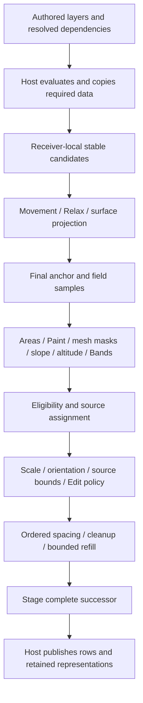

# Cyrus Scatter: evaluated mesh data, fields and portable planting recipes

**Subsequent implementation:** the user later authorized 0.82.5. The [current implementation and qualification](../plans/recipes-0825/PROGRESS.md) deliver the supported static core, including native Paint, while Phase 6 remains paused. This document retains the earlier design baseline and broader follow-ups; its original receipts are historical. The illustrative example remains non-loadable. Actual wire data uses the explicitly allowlisted typed controller settings and native Paint sidecars, documented in the handoff.

Research and architecture recommendation · 15 October 2026 · 3ds Max 2027

**Keep Max responsible for evaluating scene objects and their modifier stacks. Keep Cyrus responsible for interpreting those evaluated inputs, generating stable candidates, applying planting rules and publishing complete results. Extend the existing preset system into a small, data-only recipe library inside Max. A separate application and a general-purpose node graph are unnecessary for the first useful delivery.**

The most valuable improvement is a predictable contract: a layer owns a population, a Paint Area owns coverage on one receiver, fields influence that population, and a recipe saves authored settings plus dependency roles. None of those concepts should silently become a second population or trigger calculation merely because its controls are displayed.

This study builds on the existing [surface/paint experiments](../Vendor_Surface_Paint_Research_2026-10-09/README.md), [native inspection](../Vendor_Native_Deep_Research_2026-10-09/README.md), current [0.82.4 mesh-mask evidence](../plans/eleven-phase-roadmap/MESH_MASK_0824.md) and [P02 settings-preset delivery](../plans/eleven-phase-roadmap/P02.md). It refines the planned [P10 recipe work](../plans/eleven-phase-roadmap/IMPLEMENTATION.md#p10--planting-recipes-and-browser-0829); it does not resume the paused implementation program.

Companion files: [implementation plan and checklist](IMPLEMENTATION_PLAN.md), [field and enum map](FIELD_MAP.md), [parameter declaration inventory](PARAMETER_INVENTORY.csv), [example three-layer recipe](example-recipe.json), [schema and import contract](PRESET_CONTRACT.md), [validation plan](VALIDATION.md), [sources and evidence limits](SOURCES.md), and [source identities](SOURCE_EVIDENCE.json). The example is proposed data, not a file the current plugin can load.

**15 October review revision:** the user selected **Save Everything**, including Paint. The default complete-setup export must preserve every selected layer's authored Paint document, holes, area order, density, fade settings, editable curves and receiver binding context, including disabled or temporarily unbound areas. Portable planting rules remain a separately named, explicitly lossy export. This revision also adds Chaos configuration save/load evidence, the dated Forest multi-object library limitation, and a complete implementation work breakdown with field accounting. It authorizes documentation only. **Phase 6 remains paused; no product version is reserved or changed.**

## 1. What the evidence establishes

The following labels apply throughout:

- **Documented:** an official source describes the behavior. This does not certify the installed build.
- **Observed, historical:** a reproducible prior experiment, with its original fixture/build limits. No new Max tests ran for this study.
- **Binary evidence, historical:** selected native instructions support a narrow interpretation; they are not recovered proprietary source.
- **Source inspected:** current Cyrus implementation was read directly. Historical test receipts remain separately qualified.
- **Recommendation:** a proposed Cyrus contract, including mathematics and architectural choices below.
- **Unknown:** evidence does not establish the implementation or behavior.

The checked checkout is `codex/workflow-0.75`, HEAD `604e3aa3fd1c84c5ef128dc564f4abaf6f4978e4`, with substantial pre-existing changes. README identifies **0.82.4 / scene schema 58 / CyrusUnified1**. Some architecture/backlog headings retain older version labels, so specific source and the current handoff take precedence for implemented scope. The knowledge index is compatible but stale: 16 of 38 enrolled sources verified; the F02 lookup rejected changed evidence. Direct source inspection supplied the current findings. The index was not refreshed.

### Product and documentation scope

| Product | Relevant identity and limitations |
| --- | --- |
| Forest Pack | Prior local tests used **Lite 9.4.3**, PE `9,4,3,766`, API 900. Official 9.4.3 notes are dated **8 September 2026**; 9.4.0 added Max 2027/Arnold 7.5 support on **1 April 2026**. Our Lite fixture rejected uneven receivers. User-library editing is documented as Pro-only. [9.4.3](https://docs.itoosoft.com/changelog/2026/09/08/forestpack-9_4_3), [9.4.0](https://docs.itoosoft.com/changelog/2026/04/01/forestpack-9_4_0), [library editing](https://docs.itoosoft.com/forestpack/forest-library/editing-a-library) |
| Chaos Scatter | Prior local package **9.0.671707**, adapter/core PE **15.0.671707**, core API 9, build **25 May 2026**. Package and PE numbering are different. Official Corona guidance documents inclusion with Corona 8+, instance brush from Corona 12, and revised surface distribution from Corona 12 Update 1. These are feature milestones, not an inferred mapping of our binary to a Corona release. [FAQ](https://support.chaos.com/hc/en-us/articles/4953317171985-How-to-use-Chaos-Scatter-with-Corona-for-3ds-Max-FAQ), [overview](https://support.chaos.com/hc/en-us/articles/4953289514513-How-to-use-Chaos-Scatter-with-Corona-for-3ds-Max), [advanced features](https://support.chaos.com/hc/en-us/articles/4953359913617-How-to-use-Chaos-Scatter-with-Corona-for-3ds-Max-Advanced-Features) |
| Autodesk | Use the **2027 C++ API** for host integration. Accessible Data Channel operator/UI pages are **2025 documentation**; attempted equivalent 2027 user-help routes were unavailable. The current local 2027 mesh-mask receipts corroborate the specific Curvature → Vertex Output workflow. |
| Rendering | Geometry, masks and recipe metadata should be renderer-independent in Cyrus. Materials, proxies, texture evaluation and final instancing still need their own adapter/renderer qualification. Forest publishes a renderer/feature matrix, with item-specific material compatibility; Corona documentation is not a blanket V-Ray/GPU/Arnold guarantee. [Forest requirements](https://docs.itoosoft.com/forestpack/requirements), [Chaos FAQ](https://support.chaos.com/hc/en-us/articles/4953317171985-How-to-use-Chaos-Scatter-with-Corona-for-3ds-Max-FAQ) |

All web sources were accessed on 15 October 2026. Most iToo reference pages do not show a revision date; a footer copyright is not one. Chaos Help Center dates are recorded in [SOURCES.md](SOURCES.md). The main Chaos technical page returned no extracted body and a direct fetch returned HTTP 403; current claims therefore use accessible official Help Center pages. Its earlier automatic-update description remains historical documentation evidence.

### Sourced comparison

| Question | Forest: documented behavior | Chaos: documented behavior | Cyrus direction |
| --- | --- | --- | --- |
| Receiving geometry | Mesh receivers; XY projection or UV-based distribution; normal alignment, slope/altitude controls. [Surfaces](https://docs.itoosoft.com/forestpack/forest-plugin/surfaces) | Separate target/model lists; surface, spline and bounding-box modes; normal/Z orientation. [Getting started](https://support.chaos.com/hc/en-us/articles/4953372632209-How-to-use-Chaos-Scatter-with-Corona-for-3ds-Max-Getting-Started), [advanced](https://support.chaos.com/hc/en-us/articles/4953359913617-How-to-use-Chaos-Scatter-with-Corona-for-3ds-Max-Advanced-Features) | Explicit receivers on each owning layer; copied evaluated triangles and separately selected attributes. |
| Paint and areas | XY paint areas, spline conversion, ordered include/exclude areas, area model subsets, density/scale falloff. [Areas](https://docs.itoosoft.com/forestpack/forest-plugin/areas) | Paint-with-instances layers override lower layer assignments; the base is fully populated. [Advanced](https://support.chaos.com/hc/en-us/articles/4953359913617-How-to-use-Chaos-Scatter-with-Corona-for-3ds-Max-Advanced-Features) | Receiver-bound coverage within a population; preserve current max-density overlap and explicit inter-layer spacing. |
| Field inputs | Surface UVs/normals/slope and distribution maps are exposed; area filtering can use material IDs. [Surfaces](https://docs.itoosoft.com/forestpack/forest-plugin/surfaces), [Areas](https://docs.itoosoft.com/forestpack/forest-plugin/areas) | Density textures, slope/altitude, surface-color sampling and transform maps are documented. [Other features](https://support.chaos.com/hc/en-us/articles/4953423307025-How-to-use-Chaos-Scatter-with-Corona-for-3ds-Max-Using-with-Other-Features), [overview](https://support.chaos.com/hc/en-us/articles/4953289514513-How-to-use-Chaos-Scatter-with-Corona-for-3ds-Max) | Read map-face corner values directly when the artist chooses a mesh channel. A texture and a numeric mesh channel are separate input types. |
| Reuse and updates | Surface preparation is documented as shared between Forest objects, with refresh/Auto controls. [Surfaces](https://docs.itoosoft.com/forestpack/forest-plugin/surfaces) | Public update controls exist; our historical tests do not establish per-stage cache reuse. [Prior experiment](../Vendor_Surface_Paint_Research_2026-10-09/README.md#updates-and-costs-what-is-actually-established) | Dependency-specific revisions and explicit counters; static idle/UI activity must not solve. |
| Reusable content | Parameter presets and asset-bearing library items are distinct. A vendor reply dated 2 July 2025 states that several Forest objects could not be saved as one library preset; this does not prove every later release has the same limit. [General](https://docs.itoosoft.com/forestpack/forest-plugin/general), [dated vendor reply](https://forum.itoosoft.com/forest-pro-%28%2A%29/can-you-add-a-few-forest-packs-as-a-single-preset-in-the-library/) | Cosmos preset import and MAXScript configuration save/load are documented separately. This does not establish a multi-object, asset-complete recipe exporter. [Getting started](https://support.chaos.com/hc/en-us/articles/4953372632209-How-to-use-Chaos-Scatter-with-Corona-for-3ds-Max-Getting-Started), [vendor configuration reply](https://forums.chaos.com/t/request-scatter-library-similar-to-forestpacks-library-browser/155909) | Keep existing settings presets; add complete authored setups with Paint and explicit dependency resolution. |

**Unknown:** neither vendor's public controls establish their complete normal policy, curvature estimator, general dependency graph, thread ownership, deterministic hash function or cache keys. Direct arbitrary mesh-channel-component density reading equivalent to Cyrus 0.82.4 was not established for either competitor; map-based controls alone do not prove it.

### What earlier experiments actually measured

In the **9 October owned Max 2027.1 campaign**, Chaos adding receiver 21 to 20 equal planes retained **163/10,000 full model/transforms** in both tested random modes. Fixed Total stayed at 10,000; Density rose to 10,500. Restoring the original configuration restored the tested output. This does not describe every Chaos layout or current Cyrus. [Fixture, methods and exclusions](../Vendor_Surface_Paint_Research_2026-10-09/README.md#multiple-surfaces-measured-placement-stability).

The historical Chaos paint fixture retained **all 400 positions** while changing model assignments, including on a sphere. Removing that sphere discarded its stroke records. Forest Lite's flat paint fixture preserved the original **38 transforms**, but overlapping separate Include areas produced **21 duplicate transforms**. Those are different ownership semantics, not evidence that one implementation is universally faster. Forest Pro curved painting was not tested. [Paint experiment](../Vendor_Surface_Paint_Research_2026-10-09/README.md#painting-flat-receivers-overlap-and-missing-targets).

Selected native inspection supported triangle/barycentric attachments and a 3D capsule distance test in Chaos, and contour operations/XY lookup in Forest. Forest source-geometry sample reuse was identified, but placement-cache hit rates were not measured. These are historical, partial binary findings; no new binary analysis was needed to choose the architecture below. [Native findings](../Vendor_Native_Deep_Research_2026-10-09/README.md).

## 2. The Max/Cyrus boundary

### Read the evaluated object, not the base modeling object

**Documented host contract:** `INode::EvalWorldState(t)` provides the pipeline result at time `t`. `GetObjectTM(t)` provides the transform needed to put that result into world space; it may be identity after a world-space modifier. `GetNodeTM()` alone omits object-offset/pipeline context. [Autodesk INode](https://help.autodesk.com/cloudhelp/2027/ENU/MAXDEV-CPP-API-REF/class_i_node.html).

**Recommendation:** obtain one coherent evaluated snapshot per receiver/revision/time context. Triangulate through the supported host interface, validate, copy the required data and release temporary conversions according to ownership. Never modify a borrowed host mesh. Distinguish viewport evaluation from render-time geometry: render subdivision/displacement may produce a different surface. The initial contract should explicitly scatter on the evaluated viewport receiver; matching render-only deformation is a separate feature.

The snapshot should contain positions and triangle indices, receiver identity, geometry/topology revisions, transforms and validity. Add map faces/values, material IDs, smoothing/corner normals, selections and adjacency only for enabled consumers. Building every possible attribute and adjacency table for every receiver would waste time and memory.

Our current `meshOf` already evaluates/converts the object and transforms vertices with `GetObjectTM`; the mesh-density bridge independently evaluates/copies selected map corners. Consolidating duplicate reads into a shared snapshot is a potential optimization, **not a claim that the current implementation already evaluates each receiver only once**. Measure its benefit before changing a working pipeline. [Current geometry extraction](../../AminScatter/src/max_bridge.cpp), [mask extraction](../../AminScatter/src/mesh_density_bridge.inc).

### Coordinates, normals and transforms

Use the following mathematical convention in design documents: column vectors, `p_world = A p_local + b`, where `A` is the linear part. Max uses its own `Point3 * Matrix3` row-vector convention; implement the equivalent convention consistently rather than transcribing the equation literally.

- Position includes translation; a direction uses only the linear part.
- Transform a normal with `normalize(A^(-T) n_local)`. Multiplying it by `A` fails under nonuniform scale/shear. Autodesk's normal-transform API explicitly uses the inverse transpose and renormalization. [MeshNormalSpec::Transform](https://help.autodesk.com/cloudhelp/2027/ENU/MAXDEV-CPP-API-REF/class_mesh_normal_spec.html).
- For geometric face normals, taking the cross product of **world-space triangle edges** gives the actual oriented world-space face normal. World area is half the cross-product length. Do not multiply local area by a single scale component under nonuniform scale.
- Mirroring needs an explicit convention: transformed winding includes the sign of `det(A)`, while inverse-transpose normals need matching orientation treatment. Choose whether alignment follows winding or an outward-facing convention; test reflected receivers and sources. Reject singular/nearly singular transforms where inversion is unreliable. Do not silently use absolute slope to hide flipped faces.
- Face normals describe geometry. Smooth normals are face-corner attributes grouped by smoothing; a welded geometric vertex may have several normals. Explicit normals may override smoothing-derived values. Interpolate the three correct corner normals, transform and normalize; do not average across a hard edge or assume one normal per vertex.
- Keep **geometric normals for slope eligibility** initially, with the current 0..180° world-up convention. A future smooth/explicit-normal option for visual orientation must be independent: editing shading should not unexpectedly change where trees are allowed.

**Source inspected:** current Cyrus orientation uses geometric triangles; `surface_filter.cpp` computes oriented world-face slope and anchored world Z. It does not implement a smooth/explicit-normal policy. This is a deliberate scope boundary to preserve until a separate option is designed and tested. [Slope implementation](../../AminScatter/src/surface_filter.cpp), [architecture](../ARCHITECTURE.md).

### Channels are indexed data, not a screenshot

Max mesh map channels have their own vertices and face-corner indices; they need not match geometric vertex indices. At a candidate with face-corner barycentrics `(b0,b1,b2)`, sample the chosen component from that face's three **map** corners. This preserves UV/color seams. Channel 0 conventionally holds vertex colors; numbered channels can hold UVW or arbitrary authored numbers. Do not automatically apply gamma/color management to numeric fields. [Autodesk Mesh API](https://help.autodesk.com/cloudhelp/2027/ENU/MAXDEV-CPP-API-REF/class_mesh.html).

Data Channel can output to Vertex Color, Map Channel, Normals, selections or VData. These are distinct destinations. Cyrus currently reads channel 0 or 1..99, one selected X/R, Y/G or Z/B component; VData and selection channels are outside that implementation. **There is no universal semantic meaning such as “channel 7 is curvature.”** A recipe must name its expected field role and bind that role to an actual channel/component. [Autodesk output operators](https://help.autodesk.com/cloudhelp/2025/ENU/MAXScript-Help/files/3ds-Max-Objects-and-Interfaces/Modifier-MAXWrapper-and/Modifier-and-SpacewarpModifier/Modifiers/Parametric-Modifiers/Data_Channel-Modifier/GUID-F55E55FE-A78F-431D-9B47-2670DAABEAB6.html), [current mask contract](../plans/eleven-phase-roadmap/MESH_MASK_0824.md).

The Data Channel viewport can visualize a scalar with customizable minimum/middle/maximum colors and display normalization. Those colors are a visualization of the scalar; they are not necessarily the RGB values written to the output channel. Read the numeric output and use its declared range. A green patch might represent a negative scalar, a middle value, or a vector component depending on the display setup. [Data Channel Interface](https://help.autodesk.com/cloudhelp/2025/ENU/3DSMax-Modifiers/files/GUID-C8A1211F-8C4B-4D91-B8E5-73A9AAAC8C44.htm).

Material IDs are categorical face data: select the hit face's ID rather than interpolate it. Soft vertex selection may be interpolated if explicitly supported; face selection is a face membership test. Topology supplies connectivity, but adjacency is a derived acceleration structure Cyrus should build only for consumers such as curvature or geodesic operations.

### Field ownership and cache table — recommendation

| Field | Required inputs; Max vs Cyrus | Space and units | Evaluate when | Invalidation and reusable data |
| --- | --- | --- | --- | --- |
| Slope | Max evaluated vertices/transform; Cyrus geometric normal, angle and response | World normal vs world +Z; degrees 0..180 | Once per face for changed geometry/transform; candidate response when settings change | Vertex/topology/transform/up-axis changes. Cache face angles; threshold edits reuse angles. Smooth-normal edits have no effect in geometric mode. |
| Altitude | Max positions/transform; Cyrus final-anchor height and range curve | World Z relative to declared datum; metres at recipe boundary | At final anchor; update on moved/deformed receiver or moved candidate | Translation, deformation, datum/range/anchor changes. Reuse triangle positions and sampled heights when only response changes. |
| Curvature | Max authored channel **or** evaluated geometry; Cyrus samples/remaps, or computes a chosen estimator | Authored channel units declared by producer; native principal/mean curvature generally 1/metre, Gaussian 1/metre² | Only when enabled and relevant mesh/estimator changes | Channel values/map topology or geometry/topology/neighborhood/smoothing. Cache scalar field, adjacency and remapping separately. World-space curvature also depends on scale/shear. |
| Density | Max optional map/channel values and UVs; Cyrus coverage/composition and deterministic acceptance | Dimensionless mask 0..1; base amount instances/m² or fixed candidate budget | At final projected anchors when masks/anchors change | Selected channel, UVs, map dependencies/time, paint, areas, Bands, slope/altitude. Preserve candidate IDs and separate random streams. |
| Scale | Max source geometry/bounds and optional field; Cyrus base random size × authored multipliers | Dimensionless multiplier; physical bounds in metres | When source, size settings or scale field changes | Sources, scale/Band/Paint field and source animation if bounds change. Reuse positions/random samples; recheck spacing if size changes. |
| Orientation | Max geometric or optional corner normals, source pivot/axis and path; Cyrus basis/yaw/tilt/look-at | Orthonormal basis/quaternion; UI degrees | At changed anchors/normals/path/axis/rotation settings | Receiver shape/transform, normal mode, source axis, path or target animation. Reuse position and random channels. |
| Surface velocity | Max evaluated receiver at two times or a declared velocity-producing channel; Cyrus correspondence and derivative | World metres/second, with declared sample interval | Only for an enabled motion-dependent feature | Time, topology/correspondence, transform/deformation and producer configuration. Cache a bounded time pair, not all frames. |
| Source animation / final instance motion | Max evaluated source samples/controllers; Cyrus per-instance time choice and final transform derivative | Source-local shape motion separately from world instance motion; seconds/ticks explicit | At required output/shutter samples | Source frame/time settings, receiver motion, per-instance animation. Cache unique source samples; stable identity alone does not establish motion correspondence. |

**Curvature choice:** start with artist-authored Data Channel output. It already fits the delivered mask and lets artists inspect, smooth, remap or combine values before scattering. Autodesk describes a curvature input and an extensible channel engine; it does not document a universal geometric estimator whose numeric output we should claim to reproduce. [2027 ChannelData API](https://help.autodesk.com/cloudhelp/2027/ENU/MAXDEV-CPP-API-REF/namespace_max_s_d_k_1_1_channel_data.html).

A native curvature feature should be justified by a frequent workflow or measured modifier cost. It would require a declared estimator, sign convention and neighborhood. A one-ring neighborhood changes physical size as mesh resolution changes; a radius in metres is more consistent artistically but more expensive to query. Mesh noise, irregular triangles and skinny faces can dominate curvature. Optional smoothing must have its own radius/iterations, avoid crossing disconnected sheets, and handle open boundaries/nonmanifold vertices explicitly. Refining topology changes both the estimator and sample locations; discard incompatible caches. Nonuniform scaling changes curvature nonuniformly, so a local-space field is not automatically world-space curvature. Neither method guarantees mesh-resolution invariance.

**Velocity choice:** do not make it a default scatter input. A static mesh snapshot contains no useful motion derivative by itself. Surface motion is the derivative of the *same attached point*, for example `(p_world(t+dt)-p_world(t))/dt`; arbitrary closest-point rematching can invent motion. Source animation changes the replicated object's geometry independently. Final instance velocity includes receiver motion and procedural transform changes, and may be discontinuous when instances appear/disappear. Data Channel exposes a Velocity operator with time offset, world-space and translation controls; verify its units and correspondence in a Max 2027 fixture before consuming it as m/s. [Velocity operator](https://help.autodesk.com/cloudhelp/2025/ENU/MAXScript-Help/files/3ds-Max-Objects-and-Interfaces/Modifier-MAXWrapper-and/Modifier-and-SpacewarpModifier/Modifiers/Parametric-Modifiers/Data_Channel-Modifier/GUID-F55E55FE-A78F-431D-9B47-2670DAABEAB6.html).

Forest separately exposes source-animation sampling and Particle Flow speed in Effects. These controls do not establish a general receiver-velocity field. [Animation](https://docs.itoosoft.com/forestpack/forest-plugin/animation), [Effects attributes](https://docs.itoosoft.com/forestpack/forest-plugin/effects/creating-and-editing-effects/attributes). Chaos documents source geometry animation and optional preservation of animated source scale/rotation; this likewise does not establish a receiver-velocity channel. [Advanced features](https://support.chaos.com/hc/en-us/articles/4953359913617-How-to-use-Chaos-Scatter-with-Corona-for-3ds-Max-Advanced-Features).

## 3. Connect geometry, fields and placements without hidden coupling

### Recommended logical pipeline

This is a dependency description, not a proposed reorder of existing production calls. Some source/layout choices are needed early for movement, Bands or Relax. Their stable inputs may be prepared early, but final eligibility must reflect the resulting anchor. Current script generates/transforms receiver rows, applies final Relax, mesh density, Analyzer/falloff, Paint and source transforms; subsequent evaluation handles filters/Edit/acceptance. Preserve its tested semantics until a specific change has its own parity test. [Controller source](../../AminScatter/tools/ui/templates/unified-core.ms).

1. **Validate authored ownership and dependencies.** Determine the enabled layer, receiver roles, map requirements, sources, paths and explicit spacing relationships. Missing required data rejects the successor; it must not silently become an all-white mask.
2. **Prepare candidates independently of acceptance.** Candidate identity belongs to the layer/receiver/sample, not the compacted output row. The generation domain must include any outward feather. Density masks thin a pool; they do not move the pool.
3. **Resolve position.** Apply supported movement/Relax and receiver-local projection. Capture receiver, triangle and barycentric locator. Re-evaluate locators after position changes. A face+barycentric pair is only valid for its evaluated topology.
4. **Evaluate final-location conditions.** Include/exclude membership, paint coverage, selected map channel, slope, altitude and Band distance must use the final relevant surface point. A random horizontal move must not inherit density from its starting triangle. Cosmetic lift from a plant pivot need not change terrain altitude; name the anchor used by each control.
5. **Resolve source and transforms.** Bands/assignment groups may constrain source selection. Choose through a source-specific random stream. Scale and orientation use independent streams and field outputs. Compute spacing radii from the final source and scale, not a stale pre-scale bound.
6. **Apply explicit Edit policy and acceptance.** Existing protected edits have priority semantics; ordinary constrained edits and protected placements must not be conflated. Preserve the current contract until intentionally changed. Collisions depend on source bounds, final scale, metric and layer order. A source replacement can change acceptance without changing candidate positions.
7. **Bound cleanup/refill.** Accepted-target mode may sample further stable candidates to fill rejections. Limit attempts and report underfill. It is not equivalent to simple density thinning. If cleanup moves points, repeat affected projection/field/spacing checks, or prohibit movement at that stage; do not leave invalid anchors.
8. **Stage and publish atomically.** Build compatible instance rows, source correspondence, statistics, radii and output/display representations. Commit one complete epoch or retain the previous one.

Early coarse culling is allowed only if conservative: it cannot reject a point that later movement, outward fade or an Include operation would admit. Finite collision dependencies can propagate through an ordered acceptance chain, so a fixed spatial update radius is not automatically an exact incremental solver.

### Mask operators — explicit mathematical meanings

Normalize individual mask inputs to `[0,1]` using declared ranges before combining. Let `a=0.4`, `b=0.7`, and interpolation weight `t=0.25`.

| Operator | Formula | Example | Artist meaning / important limit |
| --- | --- | ---: | --- |
| Multiply | `a*b` | 0.28 | Both restrictions apply. Appropriate default across independent constraints. Several soft masks compound quickly. |
| Minimum | `min(a,b)` | 0.4 | Strongest restriction wins; overlapping softness does not multiply. |
| Maximum | `max(a,b)` | 0.7 | Union of alternative coverage. Appropriate for current same-layer Paint Areas; prevents duplicate population. |
| Add with clamp | `min(1,a+b)` | 1.0 | Accumulate influence; saturation can erase gradients. Overlapping identical half masks become full density. |
| Replace | `b` | 0.7 | Ordered override. Reversing order changes meaning. Never let this bypass a protected hard exclusion without an explicit contract. |
| Interpolate | `(1-t)*a+t*b` | 0.475 | Crossfade compatible fields. The blend field/constant `t` is another declared input. |

Keep hard eligibility gates outside optional creative field blending. A missing receiver, forbidden material face or mandatory exclusion should not be resurrected by a later Add. The default should remain simple: union Paint Areas within their owner; multiply independent restrictions; keep advanced field mixing for a demonstrated artist need. Current source does **not** expose a general six-operator field stack.

Density is the probability/amount of accepted candidates; scale is object size. Multiplying density by 0.5 approximately halves expected count in uncapped thinning without collisions. Multiplying scale by 0.5 retains candidate membership but shrinks objects; automatic radii may then admit more through spacing. Size zero is not an appropriate substitute for density zero because invisible rows can still cost work or occupy acceptance semantics.

For probability masks, `expected_count = sum_i weight_i` before collisions/refill/caps; an individual result need not equal that expectation. The physical target for surface density is approximately `density_per_m2 * integral_surface(weight dA)`. Uniform candidates and local sampling errors still matter. UV uniformity differs from surface-area uniformity on stretched UVs.

### Stable randomness and its limits

Use named deterministic streams derived from saved layer/receiver sampling salts, candidate ordinal and purpose: candidate location, density decision, source choice, yaw, scale and animation. Never consume one mutable random sequence conditionally across all stages. Never seed by output-row number, UI selection or receiver list index.

For a combined density field, a fixed `u_i` and acceptance `u_i < weight_i` makes increasing a mask monotonic before later acceptance: existing survivors remain eligible. Current Cyrus mesh and slope filters use **separate independent thresholds**, each keyed by stable candidate information. Their intersection has the expected product probability, but its exact selected set differs from one threshold against a multiplied field. Reusing the *same* threshold for two separate tests would instead produce minimum-like behavior. Preserve the shipped choice; changing to a general field stack requires an explicit evaluation-version change and comparison. [Mesh eligibility](../../AminScatter/src/mesh_density.cpp), [surface eligibility](../../AminScatter/src/surface_filter.cpp).

A mask edit should not alter surviving source choices or random transforms when their own inputs are unchanged. It may change collision winners, accepted-target refill, or neighborhood-dependent Relax. Density on unchanged independent receivers should preserve candidate prefixes below caps; Fixed Total necessarily redistributes quotas when receiver area changes. This is conditional stability, not an unconditional promise that every old plant remains. [F02/F03](../ENGINEERING_FOUNDATION.md#f02-randomness-and-conditional-point-stability).

## 4. Presets, recipes, assets and scene setups

| Term | What it stores | Evidence and recommended Cyrus use |
| --- | --- | --- |
| Settings preset | Typed values for a defined category; no asset/receiver ownership transfer | Forest's General preset overwrites numeric/options while leaving external object references intact; `.fpe` export and `forest_presets.ini` are documented. Cyrus already has JSON category presets. [Forest General](https://docs.itoosoft.com/forestpack/forest-plugin/general), [Cyrus P02](../plans/eleven-phase-roadmap/P02.md) |
| Complete setup / Save Everything | Selected ordered layers, all their authored settings and Paint, internal relationships, plus explicit external dependencies | Default proposed Cyrus workflow. Preserve disabled/dormant values and unbound documents as well as active ones. Referenced assets can remain external; self-contained asset collection is a separate package choice. Unsupported authored data blocks a completeness claim. |
| Portable planting rules | A deliberately filtered recipe with dependency roles and declared omissions | Optional export for different terrain. Omitting Paint footprints is permitted only here, after a visible omission summary. It is never silently substituted for Save Everything. |
| Multi-layer import | Several owners and their relationships restored together | A 2 July 2025 iToo reply describes separate Forest-object library handling. Chaos configuration save/load is documented, but arbitrary multi-owner dependency packaging remains unverified. These are scoped comparisons, not claims about all current releases. [iToo reply](https://forum.itoosoft.com/forest-pro-%28%2A%29/can-you-add-a-few-forest-packs-as-a-single-preset-in-the-library/), [Chaos reply](https://forums.chaos.com/t/request-scatter-library-similar-to-forestpacks-library-browser/155909) |
| Asset library | Discoverable models/materials/textures with identities and metadata | Forest Library and Chaos Cosmos provide this. Cyrus can reference existing scene objects or external packages; building an asset marketplace is unnecessary. [Forest Library](https://docs.itoosoft.com/forestpack/forest-library/library-browser), [Cosmos](https://support.chaos.com/hc/en-us/articles/4953819541265-How-to-Use-Chaos-Cosmos-Assets-in-Corona-for-3ds-Max) |
| Packaged scene setup | Host scene content and external assets sufficient for a specific setup | Forest's asset-bearing preset uses a `.max` source; ordinary scene transfer preserves host-native materials/modifiers better than plain settings data. Cyrus should offer optional asset packages later, with an explicit manifest and compatibility checks. [Forest Library](https://docs.itoosoft.com/forestpack/forest-library/library-browser) |

**Documented Forest workflow:** library items may use Merge or XRef; thumbnails, folder navigation, search and renderer-specific material choices are exposed. System libraries are read-only, user libraries editable. Library creation can collect external assets and create viewport thumbnails; paths may be local/network and relative paths help portability. These are useful workflow precedents, not a reason to copy its file format. [Browser](https://docs.itoosoft.com/forestpack/forest-library/library-browser), [editing](https://docs.itoosoft.com/forestpack/forest-library/editing-a-library).

To substitute a Forest model, select its Geometry entry and use the Custom Object picker to choose another scene object; its material can follow the new source unless overridden. Distribution rules belong to the Forest setup rather than the model file. Reusing numeric rules through General presets leaves object references intact; reusing a library preset brings an asset-bearing setup. [Geometry controls](https://docs.itoosoft.com/forestpack/forest-plugin/add-geometry), [General presets](https://docs.itoosoft.com/forestpack/forest-plugin/general).

**Documented Chaos workflow:** Cosmos supports preset import and scene-model replacement. Separately, Chaos representative maru confirmed configuration save/load through MAXScript on **15 May 2023**. The official MAXScript reference exposes the Chaos Scatter interface and a `saveConfiguration` entry; its extracted table stops there, so this study does not assert unverified argument signatures or file contents. Configuration I/O is established; a user-facing arbitrary multi-Scatter recipe with all assets, Paint and dependencies is not established by this evidence. [Getting started](https://support.chaos.com/hc/en-us/articles/4953372632209-How-to-use-Chaos-Scatter-with-Corona-for-3ds-Max-Getting-Started), [vendor reply](https://forums.chaos.com/t/request-scatter-library-similar-to-forestpacks-library-browser/155909), [official MAXScript reference](https://docs-chaos.atlassian.net/wiki/spaces/CRMAX/pages/124394405/MAXScript).

**Dated Forest limitation:** iToo's Michal Karmazín stated on **2 July 2025** that Library Manager did not handle multiple Forest objects as one preset, including the separate objects used by Layered Lawns. A December 2025 follow-up is a user request, not a release-status confirmation. Use this as evidence of that workflow limitation at that date, and recheck current releases before making a present-day competitive claim. [Vendor response](https://forum.itoosoft.com/forest-pro-%28%2A%29/can-you-add-a-few-forest-packs-as-a-single-preset-in-the-library/).

For scene transfer, Max exposes Save Selected and Merge operations. A host scene package can therefore carry a setup with selected dependencies, but dependency completeness, plugin compatibility, units and external asset resolution still require checking. This general Max route does not establish a special Forest/Chaos portable multi-layer recipe serializer. [Autodesk 2027 file operations](https://help.autodesk.com/cloudhelp/2027/ENU/MAXDEV-CPP-API-REF/class_interface.html).

### What Cyrus already has

Current source contains `cyrus.settings-preset` version 1 with categories population, transforms, spacing, density_curve and scale_curve. The MAXScript browser captures a fixed owner, applies one Undo transaction, preserves scene references, stores metre-based distances, and rejects animated/wired destination settings. Files are bounded to **64 KiB**, nesting to eight levels, curves to 257 samples, and a directory scan to **512 presets**. Writes validate a same-directory temporary file before replacement. The path is `getDir #plugcfg` plus `CyrusScatter\Presets`. [Native codec](../../AminScatter/src/presets.cpp), [browser/storage](../../AminScatter/tools/ui/templates/presets.ms).

These are category presets, not complete layers. The 0.82.4 mesh-mask curve deliberately disables that preset button; named mesh-mask curve presets are not implemented. A complete recipe should use a separate schema and extension rather than force reference graphs into the current small flat category format. This study supplies no importer and makes no format changes.

### Save authored meaning, not runtime machinery

Save layer order/enabled state; population mode and bounds; seeds and declared algorithm version; source roles, row weights, assignment groups, per-source size/lift/axis/radius; transforms; slope/altitude and mesh/texture mask settings; curves with domains; Paths/Bands and membership; Paint Area documents and receiver role bindings; include/exclude roles; and explicit between-layer spacing rules.

Save role-local IDs for cross-references. On import, create new scene owner/row/Path/Band/area IDs and remap every internal edge consistently. Keep seeds as authored choices, but do not transplant cached candidate/output arrays, host handles or caches. Persistent locators referenced by authored Edit/radius records require a qualified binding/remap adapter; they cannot simply be discarded under a no-cache rule. A reusable recipe reproduces a design; an exact same-scene save/reopen additionally preserves scene identities and placements. Those are different acceptance tests.

Do not save transient UI selection, open panels, active gestures, progress/error strings, cached evaluated meshes, BVHs, generated placement rows, GPU buffers, current time-derived samples, temporary handles or publication epochs. Save authored presentation values and saved brush radius/mode in a separate preferences block, without restarting a brush or automatically enabling an expensive overlay. Destination Manual/Live and display budgets remain unchanged on Add; a new setup can apply the captured values after the import transaction. Authored per-instance Edit/radius overrides need their own binding-aware adapter; silently dropping them is not Save Everything. [Complete field policies](FIELD_MAP.md).

**Save Everything includes Paint by default and as a core delivery requirement.** Save the canonical native vector document and its saved-unit/binding context, not a screenshot, preview mesh or spline approximation. Preserve holes, disconnected islands, area ordering, disabled/empty/orphan documents, per-area and layer density, both fade flags/distances, edge/inner scales, samples and editable graph handles. Saving must not solve, flatten, union independent areas or mutate the document. A same-frame compatible receiver can restore coverage after validation. Different geometry, units or coordinate frames require an explicit supported transfer, or preservation as unresolved inactive coverage. Do not erase the original, substitute whole-receiver coverage, or relabel an incomplete file as complete. [Paint contract](PRESET_CONTRACT.md#paint-is-required-authored-content).

**Portable planting rules** is a separate optional export that can deliberately omit receiver-specific footprints. The omission must be chosen and listed before writing, and the original complete setup remains intact. A paint-dependent layer without coverage stays unresolved/inactive. Saving a document and applying it to unrelated terrain are separate capabilities; general remeshing/surface transfer remains later work.

Likewise, a Band needs its Path role; a texture map needs a real asset/scene binding or a supported serialized data description. JSON cannot preserve arbitrary MAXScript controllers, third-party Texmaps or modifier stacks by itself. For the first recipe version, report unsupported animated/wired settings and block full-fidelity export, with a separately named snapshot-at-time option only if implemented deliberately.

### Save three layers, load them into another scene — proposed workflow

1. Select **Canopy**, **Shrubs** and **Groundcover** in their existing order. Choose **Save selected layers > Save Everything**. The exporter summarizes layers, Paint documents and holes, source roles, receiver/path/map roles, internal spacing links and references to unselected layers. Save all layers is a selection shortcut, not another serializer.
2. Name it “Dry hillside planting”; choose tags and an optional thumbnail. All authored settings and Paint are retained. Models may stay as external roles or be collected later through the optional asset package workflow. Unselected collision partners become visible external requirements. Selecting Portable planting rules is a separate explicit scope change with an omission report.
3. In a second scene, select the intended terrain and choose **Add recipe** from the same Library browser. The resolver proposes that selection for `ground` but requires compatibility validation. Bind canopy/shrub/grass roles to the artist's own models; review pivot, units, scale, radius and source-frame requirements.
4. Bind `ridge_mask` to this terrain's channel/component and numeric range. If the channel is missing, show the problem beside the affected layer. Bind every Path/exclusion role. Paint is already in the file: restore it only when receiver geometry, frame and units are compatible. Otherwise choose a qualified transfer or explicitly import the affected layer inactive for later resolution; retain the original document. Discard-and-repaint requires a separate visible decision and cannot be the default.
5. Preview the import summary: layer order, source mappings, missing roles, unit conversion and spacing dependencies. With required dependencies resolved, commit the authored setup as one Undo. In Manual, plants wait for Update; in Live, schedule one coalesced evaluation. A failed solve retains the previous complete publication and the new pending settings with an actionable error; a failed import commit rolls back authored changes.
6. Replace the shrub role with another model later. Keep the source row's identity, group membership and authored weight. Recompute its bounds and dependent spacing; surviving candidate positions/random yaw should remain stable where the source change does not affect those stages.

## 5. Precise commands and restrained blending

| Command | Proposed meaning |
| --- | --- |
| Browse / Load for review | Read metadata and prepare an import proposal. No scene mutation or scatter solve. Use an explicit Apply/Add/Import button for the actual action. |
| Apply settings | Replace only the named category on the captured selected layer/curve. Preserve identity and bindings. Show the fields affected. This builds on current P02. |
| Replace layer settings | Replace a full compatible authored settings block on one chosen layer. Preserve its scene identity; retain bindings unless explicit replacements are included/resolved. This is broader than category Apply and needs its own summary. |
| Add layers | Append the recipe's layers in saved order, with new scene identities and remapped internal references. No collision relationship to existing layers is implied. |
| Import setup | Create a new controller containing the whole recipe. Resolve dependencies and global setup options; do not delete existing controllers. |
| Merge sources / groups | An explicit operation on selected source roles/rows. Default is append; deduplication requires matching asset identity and compatible settings, not equal display names. Present weight/group conflict choices. |
| Replace setup | Replace the selected controller's authored setup through a complete validated transaction. This is a distinct, clearly named destructive edit with Undo, not the default preset action. |
| Blend density fields | Combine compatible scalar fields on a declared receiver domain with a named operator. This changes eligibility, not scene ownership. |
| Interpolate parameters | Interpolate only matching typed continuous values with compatible units/meaning. Angles/quaternions, positive scales and curves need declared interpolation rules. Enums, IDs, seeds and missing references are not interpolated numerically. |
| Combine recipes | Add both layer groups, bind dependencies, then explicitly choose order and inter-group spacing. Do not claim that arbitrary complete recipes can be blended by one slider. |

Different receivers have no shared blend coordinate domain until explicitly mapped. Paint documents on unrelated meshes cannot be averaged meaningfully. Bands can have different paths, memberships and interval semantics. Source groups may contain different species or cardinalities. Collision relationships are discrete constraints; halfway between two conflicting priority graphs has no defined meaning. Even two valid fixed-total recipes need a declared total-count policy before a density crossfade makes sense.

**UX recommendation:** one compact Library browser shared by settings and recipes, reached from small context-specific buttons. Layer management remains where artists select/reorder/enable layers. From Amount, “Presets…” filters to population settings; from a curve, it filters to compatible curve domains; from layer selection, “Save recipe…” captures that selection; “Add recipe…” opens the resolver. Selecting thumbnails never mutates the scene. The browser remembers its captured destination and detects deleted/replaced owners instead of following unrelated selection.

This supports three concrete tasks without duplicating UI: reuse a density value on one layer; save a three-layer planting design; and substitute all assets in an imported design. An always-expanded library inside the layer editor would increase panel cost and visual noise. A separate executable would add deployment and synchronization without solving these tasks better.

## 6. Local library storage and distribution

**Recommendation:** ordinary MAXScript/.NET file operations plus the native validated codec are sufficient. They already exist for settings presets. Add bounded metadata indexing and lazy thumbnail loading inside the plugin. A companion application becomes worthwhile only for demonstrated needs such as cross-DCC asset management, remote authentication/download queues or independent thumbnail farm processing.

| Storage | Proposed location / policy |
| --- | --- |
| Existing category presets | Keep the current `getDir #plugcfg` location until an explicit import/move command exists. Do not silently relocate working files. |
| User-authored reusable recipes | Default to the Windows **Documents known folder** plus `CyrusScatter\Library`; allow another root. Resolve the known folder rather than hard-code `C:\Users\...`, because Documents may be redirected. |
| Preferences and disposable indexes | `%LOCALAPPDATA%\CyrusScatter`; preferences may store configured library roots. Rebuildable caches are separate from authored files. |
| Bundled recipes | Read-only data under the installed plugin payload or a separately versioned supplied library. “Save a copy” writes to the user library. |
| Studio/network libraries | User-configured UNC/root paths, read-only by default unless writable. Cache metadata locally, expose offline/stale status and refresh explicitly. Never scan network trees on every redraw. |

Windows distinguishes Documents, LocalAppData and RoamingAppData; use the appropriate known-folder API or equivalent .NET facility. [Microsoft known folders](https://learn.microsoft.com/en-us/windows/win32/shell/knownfolderid).

**Format choice:** UTF-8 JSON for typed settings/recipe manifests and bounded curve data, with versioned native Paint attachments in the core Save Everything format. Small native payloads may use a bounded base64 representation; large ones use hashed relative sidecars. Preserve exact authored payloads rather than converting them through display samples. MAXScript expressions are not the preset format: loading them with `execute`/`fileIn` can run arbitrary actions and loses a closed data contract. `.max` files are optional host assets for supported materials/modifiers/controllers, never a requirement for passive metadata browsing.

Use relative package paths or stable library-root aliases; absolute paths are optional local hints, never identity. A model manifest can reference an external `.max`, proxy, texture set or existing scene role. Import resolves dependencies and material/renderer requirements explicitly. Do not embed megabytes of geometry in JSON, and do not merge arbitrary `.max` content merely to show a thumbnail.

For an atomic data save: validate bounds and references, write a temporary file in the destination directory, close/flush it, parse it back, replace the destination while retaining a recoverable prior copy, then update the index. Same-directory replacement limits partial-file exposure; it does not establish universal power-loss or network-share crash durability. For multi-file packages, publish an immutable versioned folder and switch a manifest pointer only after all payloads validate. Never claim a sequence of independent file overwrites is one atomic package transaction.

The browser should report damaged/unsupported entries individually and continue listing healthy files. Bound byte size, depth, item counts, image dimensions and decompressed size; reject nonfinite numeric values, duplicate JSON keys and escaping paths. Compare file identity/version before overwrite to avoid quietly losing another user's edits on a shared library. Thumbnails and indexes are replaceable; authored recipes are not.

Use a schema version separate from product version and engine evaluation version. Future format versions should be rejected clearly. Supported older *preset* schemas can be upgraded through validated, explicit copy-to-new-file transformations; this does not authorize restoring retired scene-schema migrations. Do not overwrite the original on read. Keep bulk models/textures as optional library downloads/packages so the Max installer stays small.

## 7. Dependencies, caching and interaction

**Recommendation:** maintain a small explicit dependency graph using existing owners and stages. Revisions signal relevant changes; fingerprints validate copied content when necessary. Hashing every mesh on every idle tick would defeat the cache. Notifications plus validity intervals decide when to revisit host data. Some procedural objects only provide aggregate validity, so use conservative fallback rather than invent per-channel certainty. [Autodesk Object validity](https://help.autodesk.com/cloudhelp/2027/ENU/MAXDEV-CPP-API-REF/class_object.html).

| Change category | Invalidate / reconsider | Reuse when valid |
| --- | --- | --- |
| Receiver topology | Triangulation, map-face correspondence, adjacency, BVH, anchors, geometry-bound paint/Edit compatibility | Authored settings and orphan documents; unrelated receivers |
| Receiver vertex positions | Triangles, normals/areas, projection, geometric fields and attached positions | Connectivity/adjacency if unchanged; raw channel values if separately valid |
| Receiver transform | World positions/normals/areas, world fields, bounds/spacing; world-dependent modifiers may require mesh reevaluation | Local snapshots only where pipeline semantics permit |
| Selected map component values | Field samples/remap/eligibility and dependent acceptance | Geometry, spatial lookup and unaffected channels; candidate stream where generation does not depend on that map |
| Texture distribution map or UVs | Actual generation and/or eligibility stage according to its declared mode | Unrelated receiver/source resources; do not label every map change a cheap mask-only edit |
| Source mesh/material/frame | Source representation; bounds and spacing if geometry changes; renderer resources | Candidate positions and random values unless source-dependent generation/Relax is involved |
| Paint or area curve | Coverage/scale/eligibility and dependent acceptance | Receiver geometry, candidate stream and unrelated layers; exact reuse remains stage-specific |
| Seed/layout/amount | Candidate/source/transform channels actually governed by those settings; quotas and possible Relax | Host snapshots, independent layers and applicable source geometry |
| Display mode/color/budget | Requested representation/palette/subset | Placement publication, receiver preparation and unchanged ready buffers |

Current Cyrus is only partially split this way. Mesh-channel keys enter receiver-row cache keys, and a changed key reruns that receiver's row path. It already preserves other receiver rows in qualified cases, but a perfectly granular “filter only” cache is not demonstrated. Keep that distinction visible before proposing an optimization. [Current receiver cache](../../AminScatter/tools/ui/templates/unified-core.ms), [0.82.4 timings](../plans/eleven-phase-roadmap/MESH_MASK_0824.md#mountain-and-performance-witnesses).

| Artist action | Expected behavior |
| --- | --- |
| Static idle | No geometry/map reads, placement solves, preparation or uploads caused by Cyrus. A timer may check cheap state; it must not repeatedly reconstruct dependencies. |
| Open/switch panels | Bind existing owner records, display cached statistics. Cold UI construction has a separate cost; it is not permission to solve. |
| Select unrelated objects | No placement invalidation. A pinned editor keeps its captured owner. |
| Edit one layer | Mark that owner and genuinely dependent spacing successors. Independent siblings keep output; controller admission/atomic staging may still do bounded shared work. |
| Paint | Update tentative coverage and bounded cached feedback; coalesce input. Commit one authored gesture on release. Manual waits for Update; Live schedules bounded work after the gesture. |
| Change Data Channel output | Reevaluate/copy selected data when relevant; recheck dependent eligibility. Display-gradient-only edits should retain numeric results after any necessary cheap dependency check. |
| Animate a receiver | At relevant time samples, reevaluate expired geometry/transform dependencies and attached placements. Topology changes can invalidate attachments. |
| Scrub time | Static dependencies inside validity retain placements; source-only animation updates source samples; animated masks/receivers update their consumers. No blanket time-based rebuild of all layers. |
| Browse a preset | Metadata/thumbnail work only. No asset merge, host mesh evaluation or publication. |
| Apply a preset/recipe | Validate and commit authored settings once; Manual marks pending, Live coalesces the resulting dependency changes. |

Keep host evaluation, reference access, texture callbacks unless explicitly qualified, scene mutation and publication on the host thread. Native workers consume owned immutable numeric copies. General Max APIs are not assumed thread-safe. [Autodesk threading guidance](https://help.autodesk.com/cloudhelp/2026/ENU/MAXDEV-Developer/files/3ds_max_sdk_features/rendering/new_rendering_api/render_session.html).

Bound copied receiver data, candidates, curves/contours, source samples, old/new publications and retained display representations together. Cancellation should be cooperative at numeric chunk boundaries; associate a revision with the job and discard stale results before commit. Do not kill threads or retain SDK pointers on workers. The current executor is synchronous and joins; a responsive asynchronous cancellation system is a recommendation, not existing functionality. A host modifier evaluation may remain uninterruptible until that call returns; report that boundary honestly. [F05–F08](../ENGINEERING_FOUNDATION.md#f05-atomic-publication-and-failure-recovery).

## 8. Measurements, roadmap and decisions

### Existing measurements, without promoting them to new qualification

The 0.82.4 handoff records an owned **20,000-candidate, 20,000-face mountain**: channel 2 accepted **3,746**, channel 3 **7,424**, and inverted channel 3 **12,391**, with surviving matrices/sources/anchors/IDs preserved. Explicit solve wall times were approximately **121–312 ms** across named settings. A separate **200,000-candidate, 180,200-face** fixture recorded disabled mask **2,501 ms**, ramp mask **2,631 ms**, and changing the smaller receiver's channel **581 ms**, reusing the other receiver's rows. Five-second idle windows recorded zero additional mask reads/queries. These are historical build-specific wall times, not new tests, frame rates or universal budgets. [Exact receipt and limitations](../plans/eleven-phase-roadmap/MESH_MASK_0824.md#mountain-and-performance-witnesses).

P02 recorded a **119.39 ms** scan of 512 valid preset files on its owned Max 2027 fixture, plus unchanged placement/preparation/upload counters during passive browsing. This supports extending the existing solution before introducing a separate executable; it does not qualify network libraries or rich thumbnails. [P02 performance](../plans/eleven-phase-roadmap/P02.md#performance-and-limitations).

The new [validation plan](VALIDATION.md) defines fixtures, counters, exact comparisons, failure cases and performance targets. These are pending tests. No Max host was launched, no proprietary binary was reanalyzed, and no implementation/build/installer work was performed in this study.

### Staged roadmap, simplest first

| Stage | Deliverable | Exit condition / relative difficulty |
| --- | --- | --- |
| A. Preserve and clarify current behavior | Document actual category scope, mesh-mask numeric semantics and current unit/binding limits. Add recipe design to P10 planning only when resumed. | No behavior change. Small. |
| B. Complete single-layer capture including Paint | Field-complete codec, typed units, native Paint preservation, source/receiver roles, static values and explicit unsupported-data rejection. | Full authored round trip, holes/dormant settings intact; no save-time solve. Medium–large. |
| C. Three-layer recipe and transactional import | Ordered IDs/relationships, assignment groups, Bands, compatible Paint restore, unresolved-state preservation, source substitution and one Undo. | Cross-scene role remapping, Paint ownership and untouched sibling output; unit/Undo/failure tests pass. Large. |
| D. Small shared library browser | Bundled/user roots, metadata search/tags, lazy thumbnails and explicit refresh; existing preset directory remains readable through its own format. | Browsing causes zero solves; damaged/offline entries remain manageable. Medium. |
| E. Optional host asset packages and coverage transfer | External model/texture/controller dependencies, material requirements and package integrity; deliberate transfer to a different qualified Paint frame. Paint storage and compatible restore already ship in B/C. | No silent retargeting or loss; original Paint remains recoverable. Large. |
| F. Measured cache refinements | Share coherent snapshots, separate filter/remap caches where useful, bounded cooperative jobs if profiling justifies them. | Same deterministic result as reference; demonstrated avoided work and responsiveness. Large. |
| G. Advanced fields | Compatible density-field blend, optional smooth-normal orientation, native curvature or receiver motion only for validated needs. | Analytic geometry and animation witnesses; explicit numerical/version contracts. Largest and optional. |

This is an overview. The [complete implementation plan](IMPLEMENTATION_PLAN.md) assigns work packages, source touchpoints, dependencies, acceptance gates and an unchecked TODO list. The [field map](FIELD_MAP.md) accounts for current parameters, enums, units and unsupported cases. Neither document resumes Phase 6, changes the eleven-phase ordering or reserves a release. A general geodesic brush, universal arbitrary-recipe blend, automatic remesh transfer and a companion executable remain outside the first recipe delivery.

### Decisions that need explicit contracts or host evidence

- **Coverage decision made:** Save Everything preserves Paint; optional Portable planting rules may omit it only explicitly. Arbitrary terrain transfer remains unqualified and must not prevent lossless storage of the original.
- **Normals and reflections:** preserve current winding-based geometric eligibility; qualify mirrored/nonuniform/WSM cases before adding shading-normal alignment.
- **Density meaning:** keep candidate budget versus accepted-target/refill distinct. A field-stack change must not silently alter the existing independent probability streams.
- **Animation:** first recipe scope should be static settings; a full animated recipe needs controller/time-unit serialization or a host asset package. Receiver motion correspondence remains separate.
- **Presets and references:** do not infer arbitrary map/modifier serialization, vendor recipe export, or artist asset availability from UI similarity.
- **Performance:** source shows possible repeated receiver extraction; benchmark before snapshot consolidation. Stable hashes/positions alone never prove cache hits.
- **Current acceptance:** cold/heavy UI, physical painting/tablet input, long sessions, renderers/device loss, extreme units and arbitrary topology correspondence remain distinct from the scoped historical passes.

The recommended product is a small, predictable system: evaluated Max data feeds independent Cyrus fields; those fields affect stable layer populations; portable recipes describe those layers and the roles they need. That delivers reusable planting workflows without requiring a new application or a wholesale engine rewrite.
