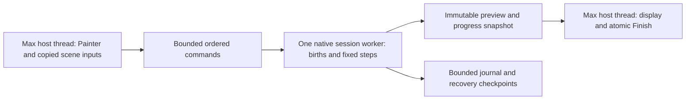

# Continuous Physics Brush: research and recommended design

17 October 2026. **Research and proposal only.** This follow-up concerns the separate Max 2027 Physics Lab. No feature implementation, engine rebuild, installation, Max interaction or Computer Use was performed. It follows the [artist recording analysis](ARTIST_LOG_013_20261017.md) and preserves the original studies and qualification receipts.

## Recommendation

Keep **one live native physics world across multiple brush strokes**. Mouse-up ends an emission gesture; it must not close the world to further births. New objects should collide with earlier moving or sleeping objects in that same session. Explicit Finish or Freeze publishes the result; Cancel discards the tentative session and preserves the previous completed result.

Continue with Jolt for this experiment. Its existing-world body APIs support the required mechanism; our current session lifecycle imposes the wait. This finding does not establish a new Jolt/PhysX performance winner. Changing engines or raising MAXScript heap allocation would not change the present `released` checks.

This recommendation supersedes the original proposal's **one completed gesture per simulation world** for the standalone continuous-brush experiment. It preserves frozen obstacles from previously finished sessions. Re-settling those completed results remains a separate operation. It does not change Scatter's architecture, version or integration status.

## 1. What the evidence establishes

The supplied 0.1.3 recording contains three accepted strokes, eighteen explicit settling rejections and one commit. The first batch took approximately 18.73 wall seconds after release to commit. Later batches contained bodies outside the finite receiver and far below it, still moving. The recording ends with ordinary cancellation, without a recorded fatal exception or out-of-memory event. See the [recording and limitations](ARTIST_LOG_013_20261017.md).

Current source explains the restriction:

| Source | Current behavior | Design consequence |
| --- | --- | --- |
| `CyrusPhysicsLab/src/max_host.cpp:98–99` | Creates a session for a stroke; refuses a new stroke after release. | A new stroke needs a gesture boundary within the existing session. |
| `src/max_host.cpp:107–117`, `include/core.h:76` | Mouse-up releases the session; emission requires it to be unreleased. | Removing only the rejection message would leave an invalid lifecycle. |
| `src/core.cpp:134–136` | Whole-batch quiet detection completes a released session; a global step limit bounds it. | Sleeping, Finish completion and session lifetime need separate meanings. |
| `src/max_host.cpp:135` | Publishes and destroys the pending world; later worlds treat saved rows as static. | Preserve publication safety while extending dynamic interaction across live gestures. |
| `scripts/CyrusPhysicsLab.ms:209,235` | Requests two fixed steps per 40 ms timer event. | Nominal progress is only 0.417 simulated seconds per wall second before overhead. |
| `src/max_host.cpp:107` | A rejected footprint candidate can cancel the pending stroke. | Boundary clipping must become a bounded emission policy. |

The recording also shows no solver ticks during its first mouse-held gesture. This is a specific scheduling observation, not proof that Max can never dispatch a timer while painting. It means a timer-only architecture cannot be assumed to provide continuous simulation during pointer capture.

The 0.1.3 callback guards address an earlier reproduced native null read. They must remain effective throughout a redesign. The current recording does not prove an additional crash cause or resolve every possible collision failure.

## 2. What Houdini documents actually support

The public SideFX pages read for this follow-up identify themselves as Houdini 22.0. These are documented workflows, not newly executed Houdini tests or claims about proprietary implementation details.

| Primary reference | Relevant documented behavior | Application to Physics Lab |
| --- | --- | --- |
| [Stroke SOP](https://www.sidefx.com/docs/houdini/nodes/sop/stroke.html) | Stores stroke positions, hit validity, pressure, radius and time measured from the curve's start. | Preserve authored samples and timing separately from display callbacks. |
| [RBD Bullet Solver SOP](https://www.sidefx.com/docs/houdini/nodes/sop/rbdbulletsolver.html) | Supports emission into an ongoing simulation. Provides separate render/proxy/collision inputs, sleep controls and emission-cache limits. | Adding objects need not wait for the previous objects to settle. Keep emission, collision representation and simulation state distinct. |
| [RBD Configure SOP](https://www.sidefx.com/docs/houdini/nodes/sop/rbdconfigure.html) | Configures active, animated, deforming and sleeping properties; emission properties select pieces for emission. | Give each body an explicit role. Sleeping should not turn a live body into a permanently frozen placement. |
| [EmittingObjects example](https://www.sidefx.com/docs/houdini/examples/nodes/dop/rbdpackedobject/EmittingObjects.html) | Describes adding new RBD objects to an existing packed RBD object with a SOP Solver. | Direct vendor precedent for a persistent world receiving additional bodies. |
| [DeleteObjects example](https://www.sidefx.com/docs/houdini/examples/nodes/dop/rbdpackedobject/DeleteObjects.html) | Describes removing simulated objects using a bounding box. | Define an explicit removal policy for bodies outside the useful simulation domain. |
| [DOP Network](https://www.sidefx.com/docs/houdini/nodes/obj/dopnet.html) | Checkpoints allow continuation from a previously cached simulation state; history has explicit retention rules. | Recovery requires state/history ownership and a disk budget. |
| [File Cache SOP](https://www.sidefx.com/docs/houdini/nodes/sop/filecache.html) | Distinguishes sequential simulation caching from independent frame cooking and supports cached geometry output. | Completed transforms and resumable solver state are different artifacts. |

The useful lesson is a separation of responsibilities: **authored emission → live rigid bodies → simulation history → reusable output**. Houdini's frame-based tools establish this model; they do not by themselves establish a Max viewport scheduler or a ready-made interactive brush for our plugin.

### A concrete Houdini reference workflow

For a future comparison fixture, construct this conceptual network:

1. Record a surface-projected stroke with position, hit validity and sample time. Resample it into an emission schedule with persistent piece names.
2. Select only births due at the current simulation time. Feeding the entire accumulated birth history on every emission frame would request repeated emissions.
3. Instance packed source pieces and matching simplified proxies. Configure emitted pieces as active, with animation/deformation disabled for the static-input experiment.
4. Feed the RBD Bullet Solver's current documented inputs: render geometry **1**, constraints **2**, proxies **3**, static collision geometry **4**; guides **5** are unnecessary here. Enable emission. Keep piece correspondence consistent between render geometry and proxies. These port numbers come from the [specific node reference](https://www.sidefx.com/docs/houdini/nodes/sop/rbdbulletsolver.html), rather than a generalized overview.
5. Apply removal to actual simulated bodies using an appropriate packed-RBD/SOP Solver arrangement. Deleting only output geometry would hide a body while leaving its simulation work and completion problem intact. The exact network remains unexecuted.
6. Inspect collision proxies and sleeping state; cache the final output independently of any resumable simulation checkpoint.

The proposed Max implementation follows these responsibilities directly in C++; it does not need a procedural node framework or a Houdini dependency.

## 3. Artist behavior and session boundaries

**Proposed behavior:** Start Brush prepares one session. Press, drag, release and press again while previous bodies continue moving. A session owns all tentative bodies from those gestures. Sleeping bodies remain eligible to wake from new contacts; Jolt explicitly documents that behavior. [Pinned Jolt architecture](https://github.com/jrouwe/JoltPhysics/blob/1b2e77e3c6c09709e5edc79dc208459b8ff32051/Docs/Architecture.md#L415-L421).

| Action | Proposed result |
| --- | --- |
| Mouse-down / drag | Begin a gesture; enqueue admitted births into the live world. |
| Mouse-up | End that gesture's path connection. Continue simulation and accept another gesture. |
| All bodies sleep while idle | Suspend unnecessary stepping; retain the world and reset its wall-clock baseline before resuming. Record this dormancy boundary. |
| Pause / Resume | Pause both authoring and simulation without deleting tentative bodies. Resume without catching up the paused wall interval. |
| Finish | Close emission, settle within explicit step and wall-time budgets, then publish atomically. |
| Freeze Now | Publish the current valid transforms with an explicit **Unsettled** result flag. |
| Cancel session | Discard tentative bodies; preserve the last completed result. |
| Finish budget expires | Preserve a paused preview and explain the unfinished count. Allow Freeze, bounded continuation or Cancel. |

There should be no ambiguous Stop action that silently deletes the moving preview. Use the established Cyrus panel sizing and compact controls; keep solver diagnostics in a collapsed section. Display live/sleeping/lost counts and a useful state such as “Brush ready — 12 objects moving.”

Keep the two collision scopes explicit: bodies from all gestures in the **current** session interact dynamically; results from **previously finished** sessions remain fixed blockers. A future Re-settle operation can deliberately change the second rule.

## 4. Ownership, identity and scheduling

### Native ownership

Retain a native document with an immutable committed result. Add one live session holding copied receiver/collider geometry, source/proxy snapshots, stable IDs, an ordered command journal and a numeric physics world. Keep MAXScript responsible for bounded UI commands and summaries.

Use persistent document/body/gesture identities independently of Jolt handles and array order. Retain an ID high-water mark across Undo and abandoned history branches so later authoring does not reuse an earlier identity. Commands need session epoch, input revision, sequence and target fixed step. A preview needs the corresponding owner/session/revision and completed-step tags. A cancelled, deleted or superseded owner cannot accept a late preview.

Capture static inputs once per session. Brush radius, spacing, selected source weights and other supported emission changes become per-gesture settings records. Changes to geometry, units or solver configuration invalidate the captured world: pause it, retain recovery data and require an explicit new preparation/rebuild. Do not silently recook colliders halfway through an interacting pile. Animated/deforming colliders remain outside this scope.

### Recommended execution target

Use **one native simulation worker owning the world**, initially retaining Jolt's single-threaded job system. Its justification is progress independent of Painter callback delivery, including a held pointer with no movement. Validate the same command/state machine first in a serial numerical harness. A host-only alternative is acceptable only if Max 2027 tests demonstrate uninterrupted held-stroke progress and suitable input latency; current timer behavior does not establish that.

The worker must never evaluate Max nodes, access viewport/UI objects, manipulate Max Undo or publish scene results. Autodesk's [2027 SDK documentation](https://help.autodesk.com/cloudhelp/2027/ENU/MAXDEV-CPP-API-REF/class_max_s_d_k_1_1_rendering_a_p_i_1_1_i_rendering_process.html) explains that scene translation/update generally belongs on the main thread. This citation supports the thread boundary; its renderer-specific job interface is not a proposed brush API.

Apply ordered birth/removal commands between solver updates. Jolt's documented callback restrictions rule out adding/removing bodies from a step listener. Preserve one owner of mutable world state. Use batch body insertion where practical; the [pinned body interface](https://github.com/jrouwe/JoltPhysics/blob/1b2e77e3c6c09709e5edc79dc208459b8ff32051/Jolt/Physics/Body/BodyInterface.h) exposes batch insertion and explicit removal/destruction.

On cancellation, scene reset, owner deletion or module shutdown: close the input gate, advance the epoch, detach Painter on the host thread, request worker retirement, join it, then release captured inputs. Never hold a host lock needed by the worker while joining. Keep the 0.1.3 closed-callback/null guards, including callbacks delivered during shutdown. Autodesk documents separate stroke and session callbacks in [Painter V5](https://help.autodesk.com/cloudhelp/2027/ENU/MAXDEV-CPP-API-REF/class_i_painter_canvas_interface___v5.html); it does not require our settle-before-next-stroke policy.

### Fixed time, bounded catch-up

Retain a 1/120-second physics step as the first comparison baseline. Accumulate monotonic elapsed time while actively simulating; run fixed steps within an admitted work window. Jolt's collision substeps subdivide that interval; four collision substeps do not advance four times as much simulation time. [Pinned PhysicsSystem API](https://github.com/jrouwe/JoltPhysics/blob/1b2e77e3c6c09709e5edc79dc208459b8ff32051/Jolt/Physics/PhysicsSystem.h).

Bound queued commands, catch-up debt and work between cancellation checks. A candidate starting catch-up ceiling is 100 ms; it is an experiment parameter, not a qualified default. When overloaded, pause admission visibly and retain accepted commands. Record any clock resynchronization. Do not silently enlarge `dt`, discard authored births or claim real-time speed when the simulation is behind.

Input callbacks only capture/queue bounded work. Distance resampling determines drag density; raw callback frequency does not determine count. Map births to the consumer's acknowledged fixed-step frontier with deterministic ordering and no backdating. Record the actual applied step for replay. Defer hold-to-spray until the stationary-pointer scheduling test passes; an eventual time-rate mode needs its own explicit clock rule.

Preview publication can skip intermediate display snapshots without dropping commands. Draw/read operations must not advance physics. Measure queue delay, step duration, preview delay and total click-to-visible latency separately. The existing 0.469 ms average / 14.937 ms maximum solver slices are useful evidence, but neither guarantees a 4 ms callback budget or presented FPS.

Replace the present one-stroke `maxSteps` meaning with separate live-session resource/work admission and a **Finish-specific** settling budget. Otherwise continuous painting would inherit a surprise whole-session timeout. Exhaustion should pause and preserve recoverable work rather than cancel the session.

## 5. Outside the surface: two distinct policies

### An emission sample misses

Emit nothing and break path interpolation. On re-entry start a fresh path segment, without bridging the empty region. If the brush disk partly crosses an edge, test generated candidates against the receiver, admit valid candidates and count skipped candidates. Bound attempts; report underfill. Do not cancel earlier accepted strokes because one footprint sample misses.

Preserve random/candidate ordinals for skipped candidates so clipping and later samples remain reproducible. Spawn separation must use the session's current body state at the applied step, with finite retries/lift bounds. It must not rely on a stale preview of a moving pile.

### A previously emitted body falls away

Keep legitimate collisions with all declared colliders, including floors below the receiver. Leaving the receiver's XY rectangle is insufficient reason to delete a body.

Propose a visible **lost-body plane below the bounds of all relevant colliders**, with a conservative source-size margin and artist override. The first experiment should use a lower plane only; optional lateral bounds need separate validation. Remove a pending body only after its complete collision bounds cross the declared plane. Do not create an invisible floor or clamp the body back onto the receiver.

Removal occurs between updates and records body ID, step and reason. Release its native resources and exclude it from Finish's active-body requirement. Preserve the journal record for Undo/replay; lost bodies still consume total-emission/history admission, so continuous falling cannot bypass capacity limits. Never apply this automatic removal to earlier committed results. Bounding-box deletion has a [SideFX RBD example](https://www.sidefx.com/docs/houdini/examples/nodes/dop/rbdpackedobject/DeleteObjects.html); the exact lower-plane rule here is our proposal.

A lower platform, holes, steep slopes and large coordinate offsets are required tests. The supplied log alone cannot decide edge escape versus contact penetration; trajectory/contact probes are still needed to exclude a separate tunnelling defect.

## 6. Undo requires restoring the interacting world

A later stroke can push bodies from an earlier stroke. Deleting only the later bodies leaves those earlier bodies in their displaced state. That is an incomplete Undo.

Jolt documents that `SaveState` records engine-updated state, while application changes and added/removed body topology need separate restoration. Compatible rollback also requires matching engine body identities. A plain snapshot restore after spawning bodies is insufficient. [Pinned rollback documentation](https://github.com/jrouwe/JoltPhysics/blob/1b2e77e3c6c09709e5edc79dc208459b8ff32051/Docs/Architecture.md#L838-L842).

Recommended first continuous-brush history contract:

- **Undo Last Stroke within the live session:** pause, restore/reconstruct the world immediately before that gesture, including prior bodies' poses, velocities, sleep state and body topology. Remove that gesture's commands and subsequent free evolution. Resume from that boundary. Redo restores the stored forward branch up to its recorded endpoint.
- Retain checkpoint metadata plus ordered births, removals, configuration and engine-ID mapping. Reconstruct the matching body set before applying engine state, or rebuild/replay from a known initial state. Do not claim cross-build binary checkpoint compatibility.
- Bound history memory and replay work. If a checkpoint is evicted, keep the canonical commands needed to reconstruct it. At the history-admission limit, pause further authoring or Finish; do not silently erase history.
- **Max Undo:** one short transaction per Finish/Freeze, retaining shared immutable before/after results. Never keep a Max Hold open across a brush session or worker lifetime.

This initially gives a dedicated Undo Stroke command for live work, and standard Max Undo for finished sessions. Per-stroke entries in the global Max Undo stack would be a separate, more complex contract. Global Undo during a live session needs a validated notification path: pause/detach the live authoring state, retain it for recovery, and invalidate publication before Max restores another state. Do not intercept Ctrl+Z globally or allow a worker to overwrite an Undo result.

## 7. Save, recovery, failure and publication

Separate three artifacts: **canonical authored journal**, **build-specific resumable world checkpoint**, and **completed renderable transforms**. Final transforms alone do not preserve velocities/contact state for continued simulation. The [DOP checkpoint](https://www.sidefx.com/docs/houdini/nodes/obj/dopnet.html) and [geometry File Cache](https://www.sidefx.com/docs/houdini/nodes/sop/filecache.html) documentation inform this distinction; our file format remains a future design.

Propose Save pauses at a consistent command boundary and serializes the completed result plus a bounded recovery record for the live session. Reopening shows the completed result and offers the pending session in a paused recovery state; it does not silently run physics. Exact continuation requires a matching checkpoint/build; otherwise recovery uses declared replay or Freeze behavior with clear validation. Save/load must preserve persistent source correspondence and unit/frame mapping.

Rendering consumes the last completed result. Starting a render pauses live authoring and preserves its recovery data. It must not advance simulation on render threads or silently discard a visible tentative session. Timeline playback/reverse and animated colliders remain outside this first continuous-brush scope.

Finish stages and validates a complete successor, checks owner/revision, then performs host publication and Undo together. On preparation, solver, allocation or publication failure, retain the last completed result. Preserve recoverable pending data where valid; report an invalid session rather than publishing partial output. Fault injection must cover failure both before and after provisional result assignment. Arbitrary allocator failure inside a physics library is still a qualification limit, even with admission checks.

## 8. Memory and diagnostics

Share immutable source meshes, proxy shapes, collider snapshots and committed data. Do not recapture/copy all geometry per gesture, copy full render meshes per body, or transport placement-sized arrays through MAXScript. Keep a bounded latest-preview buffer and reuse state-extraction capacity.

Account for **captured geometry + cooked shapes + world/body/contact storage + scratch + command queue + preview buffers + journal/checkpoints + committed before/after generations + Max Undo + render materialization**. Body count alone is not a memory bound. The existing native 5,000-body ceiling also does not guarantee that 5,000 detailed sources fit the separate output-mesh limits.

Preserve current admission limits as initial test inputs; measure peak/retained bytes before setting new defaults. Total emitted bodies, live bodies, collider triangles, contacts/pairs, queued bytes, retained history and recovery disk bytes need independent caps. Pausing at capacity must retain the last valid pending state. A language change or increased script heap is not evidence of reduced cost.

Extend the existing crash-surviving diagnostics with command sequence and applied step, worker/session state, gesture boundaries, queue/debt metrics, body sleep/wake/removal events, input revisions and checkpoint IDs. Distinguish command intent, application and publication. Keep out-of-process dump capture and matching PDB/package identities.

The diagnostic event ring is **not a complete recovery journal**: a long session can rotate away its beginning. Retain a separately bounded durable base checkpoint/input snapshot plus its subsequent command journal. Replace a checkpoint atomically, verify it, then compact only commands covered by that checkpoint. A process crash can leave an incomplete final record; recovery must reject it and use the last complete boundary. Measure logging/flush cost; “capture everything” cannot be treated as a zero-cost or absolute durability guarantee.

## 9. Implementation sequence and acceptance gates

These are proposed future work packages, not executed tests. Keep them confined to the independently versioned Physics Lab and Max 2027.

| Phase | Work | Evidence required before progressing |
| --- | --- | --- |
| CB1: session/gesture core | Separate begin/end gesture, live world, Finish, Freeze and cancellation; add ordered commands and batch admission. | Ten or more gestures accepted while previous bodies move. No rejection based solely on sleep/release. No duplicate IDs. Previously completed rows unchanged. Late callbacks harmless. |
| CB2: scheduler and preview | Qualify one numeric worker, fixed-step clock, bounded queues/debt and host-only publication. | Stepping during held movement and a stationary hold; pause/resume without catch-up; queue pressure without silent input loss; reset/delete/shutdown joins without stale publication. Measure median, p95 and worst click-to-preview/cancel latency. Initial interaction target: p95 below 50 ms in the declared baseline fixture, subject to measured capacity. |
| CB3: receiver boundaries and lost bodies | Clip candidates, break misses, remove lost pending bodies at safe boundaries. | Leave/re-enter, release/start outside, partial brush disk, finite plane, hole and lower support. No bridge births, no erased supported bodies, finite Finish. Record trajectories to distinguish edge escape from tunnelling. |
| CB4: history and persistence | Reconstruct coupled pre-gesture state, bounded redo, atomic Finish/Freeze, paused recovery. | Stroke B moves bodies from A; Undo B restores all of A's full state. Repeated Undo/Redo, lost-body restoration, global Undo during live work, save/reopen, clone/merge and unit/frame tests. Frozen cached loads perform no automatic solve. |
| CB5: resource/failure qualification | Stress exact source/native pair, admission, history retention and diagnostic durability. | 1,000-body baseline; 5,000-body low-poly stress only where mesh/contact admission permits. Repeated start/pause/finish/cancel, failures on both sides of publication, queue/checkpoint exhaustion and forced crash recovery in an owned host. Report geometry, steps, peak memory and timings separately. |
| CB6: artist acceptance | Deliver the exact qualified standalone Max 2027 pair in its own MZP when implementation is authorized. | User can repeatedly brush while objects collide, understands Finish/Freeze/Cancel and confirms panel sizing. Physical input/viewport quality remains an artist gate; scripted callbacks do not establish it. No main-plugin integration. |

Replay the supplied geometry/birth recipe as a regression fixture, then add immediate additional gestures during movement; the original recording's rejected inputs are not a complete authored birth schedule for a hypothetical continuous implementation. Replay the same canonical step-stamped journal with different batching/display rates and require identical admitted IDs and schedule. Late live callbacks can map to different applied steps; record that difference rather than promising identical live physics under arbitrary input delays. Numerical transform parity applies only to the declared engine/build/configuration and replay conditions.

Thin-leaf quality needs separate fixtures for source scale, pivot/center-of-mass mapping, proxy thickness, contact margins, high-speed impact and compound curved shapes. Keep render geometry independent of the proxy. More substeps cost more work; choose them against measured penetration and latency. Rigid-body damping does not establish aerodynamic leaf behavior.

### Source change map for that future work

| Existing area | Required responsibility |
| --- | --- |
| `include/core.h`, `src/core.cpp` | Session/gesture state machine, stable command journal, independent finish/time/resource policies and recovery state. |
| `src/jolt_world.cpp` | Batch insertion, safe removal, bounded state extraction, explicit topology/checkpoint handling and exclusive world ownership. |
| `src/max_host.cpp` | Painter lifecycle, copied inputs/revisions, session retirement, immutable previews, host Undo/save/publication. |
| `scripts/CyrusPhysicsLab.ms` | Compact state-driven controls and summaries; no physics stepping dependency on its 40 ms timer. |
| Existing tests/diagnostics/package tooling | Multi-gesture replay, worker lifecycle/fault probes, recovery evidence and exact-pair Max 2027 delivery. |

## 10. Evidence limits and provenance

The source basis is branch `codex/workflow-0.75`, HEAD `8645c6cc4878a05e8fa6f835610872b2da1359ea`, with substantial pre-existing tracked and untracked changes. Physics Lab source is independently identified by the [evidence manifest](CONTINUOUS_BRUSH_RESEARCH_20261017_EVIDENCE.json); HEAD alone does not identify its untracked implementation. The cited artist recording is a historical 0.1.3 runtime witness, not a test of this proposal.

Knowledge source verification returned `stale_evidence`: 33 of 36 enrolled parents verified in generation `70c3934732cfdcec5c56ac5b5cef3b261a25491cce8826b38198a8a42a3e3100`. A narrow successful search returned the physics extension contract with its original qualifiers; affected originals were inspected directly. No corpus refresh or enrollment change occurred. Relevant design constraints are the foundation's native/physics boundaries, F02 identity, F05 publication, F06 admission, F07 lifetime, F10 units and F11 persistence; these are requirements, not acceptance receipts.

No Houdini HIP file/HDA was executed, no new tyFlow binary analysis or Jolt/PhysX benchmark was performed, and no new Max test or crash reproduction was run. The older [tyFlow](TYFLOW.md), [engine comparison](ENGINES.md) and [standalone execution](IMPLEMENTATION.md) records retain their exact scopes. New numerical targets and scheduler/history policies above are proposals that need the stated gates.
