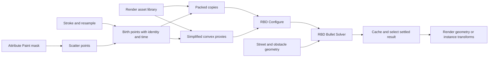

# Houdini procedural workflow study

16 October 2026. VENDOR DOC plus a proposed reference network. The official unversioned pages inspected identify Houdini 22.0; this task did not launch Houdini, inspect an installed Houdini version, build an HDA or execute this network.

## Separate authoring from simulation

The [Stroke SOP](https://www.sidefx.com/docs/houdini/nodes/sop/stroke.html) records interactive stroke geometry, hit state, pressure, radius, sample time and primitive coordinates. Its raw curves can be resampled. This is a suitable reference for a direct emission gesture, where path and time both matter.

[Attribute Paint](https://www.sidefx.com/docs/houdini/nodes/sop/attribpaint.html) instead edits point attributes, including masks. Its caching/reprojection choices and point-correspondence limits illustrate why a painted field differs from a replayable emission path. [RBD Paint](https://www.sidefx.com/docs/houdini/nodes/sop/rbdpaint.html) paints values controlling geometry/constraints, including fracture density; it is not documented as a turnkey rigid-body spray tool.

**PROPOSAL:** give Cyrus two explicit inlets. Physics Brush retains sampled emission records. Physics Area uses the current canonical coverage document as a mask. Both produce the same identity-bearing birth records for a shared solver. Do not rename ordinary Paint or change its behavior.

## Proposed Houdini reference network

This is a design recipe assembled from documented components, not a supplied or tested SideFX example.

The diagram groups related node branches for readability. It does not specify socket wiring by itself. The solver's documented inputs distinguish render geometry, constraints, proxy simulation geometry, external collisions and guides. Supplying the proxy input avoids solving the detailed render mesh. The solver supports emission, sleep thresholds, collision padding, internal substeps and diagnostics. Increasing global and internal substeps multiplies work; the docs recommend internal Bullet substeps when only Bullet needs higher resolution. [RBD Bullet Solver](https://www.sidefx.com/docs/houdini/nodes/sop/rbdbulletsolver.html).

### 1. Build an emitter

**PROPOSAL:** for spraying, resample a recorded path by distance while retaining its time samples, then distribute births within the brush disk at scheduled simulation steps. For an area, paint a density field and scatter once from that field. Moving input can change Scatter point positions/numbers; the [Scatter documentation](https://www.sidefx.com/docs/houdini/nodes/sop/scatter.html) discusses this stability issue. Do not use a transient point number as the saved identity of a leaf.

Keep the emission footprint distinct from final occupancy. An object may roll or slide outside the footprint. A strict final boundary would require a separate constraint/collider policy. All timing and counts must be explicit: a mouse event is not a physical time step, and a density mask is not an emission rate.

### 2. Pair render assets with collision assets

[Convex Decomposition](https://www.sidefx.com/docs/houdini/nodes/sop/convexdecomposition.html) approximates concave geometry with convex segments; its documentation discusses open geometry and reducing hull complexity. The [RBD Convex Proxy shelf tool](https://www.sidefx.com/docs/houdini/shelf/rbdconvexproxy) uses that decomposition to prepare proxies.

**PROPOSAL:** each Cyrus source has one render asset identity and an optional paired collision proxy. Use a simple thickened convex outline for flat leaves; use a bounded compound of hulls where curvature/concavity materially changes contact. Validate a proxy once per relevant source revision and reuse it for scaled variants where supported. Explicitly reject degenerate hulls, rather than falling back invisibly to a large box.

### 3. Configure physical participation and emission

[RBD Configure](https://www.sidefx.com/docs/houdini/nodes/sop/rbdconfigure.html) authors active, animated, deforming and sleeping properties, and per-piece emission control. These have different meanings: active objects react to simulation; animated transforms can drive inactive pieces; deforming objects can rebuild collision shapes. Emitted pieces require the solver's emission mode as well as appropriate input timing. The [SOP simulation guide](https://www.sidefx.com/docs/houdini/destruction/sop_sim.html) also describes emission cache budgeting.

**PROPOSAL:** Cyrus v1 snapshots scene colliders at the beginning of a gesture or explicit solve and keeps them fixed. It simulates new emitted bodies and treats completed strokes as fixed blockers by default. A later interaction mode can awaken an explicitly selected region. This produces predictable authoring and keeps ordinary independent layers unchanged.

Houdini's documented emitted-name suffix is time-based. Cyrus should instead use collision-free owner/stroke/emission IDs so multiple births within one step, copies and replay cannot alias. Preserve the solver's temporary handles separately.

### 4. Solve proxies and retain correspondence

Houdini's [instancing attributes](https://www.sidefx.com/docs/houdini/copy/instanceattrs.html) distinguish position, quaternion orientation, uniform/nonuniform scale, pivot and transform precedence. [Transform Pieces](https://www.sidefx.com/docs/houdini/nodes/sop/xformpieces.html) can match input and template pieces by an integer or string attribute.

**PROPOSAL:** choose one transform-transfer route. Either consume the RBD solver's already transformed render output, or apply solved transforms to untouched reference assets using stable correspondence. Applying both would transform assets twice. In Cyrus, reconstruct the rendered source-pivot transform from the physics center-of-mass transform and saved proxy/source-frame mapping. Add pivot, scale and mirrored-frame fixtures before declaring parity.

### 5. Cache a completed result

[File Cache](https://www.sidefx.com/docs/houdini/nodes/sop/filecache.html) separates cooking upstream work from reading saved output; it also distinguishes versioned cached results from current upstream settings. **PROPOSAL:** Cyrus stores final transforms in the scene and exposes when authored physics inputs differ from the retained result. Parameter edits should not cause a surprise full replay while browsing. Rebuild/settle is an explicit action in Manual mode; any later Live policy must be bounded and dependency-aware.

## Leaves: rigid placement versus deformable motion

[Vellum](https://www.sidefx.com/docs/houdini/vellum/index.html) uses position-based dynamics for cloth and other deformable materials. Its [solver](https://www.sidefx.com/docs/houdini/nodes/sop/vellumsolver.html) documents wind drag with normal/tangential weighting. This is a useful reference if flutter, bending or curling becomes a requirement.

**PROPOSAL:** start with rigid settled leaves and an optional simple directional impulse. A directional impulse is an artistic control, not validated leaf aerodynamics. A deformable leaf changes the required result from one transform per source instance to deformed geometry/cache data. Treat that as a separate product decision with memory, renderer and persistence costs.

## Lessons to carry into Cyrus

Authoring path, density mask, source selection, physical proxy, collider role, simulation state and render result deserve separate ownership. Bind high-resolution output by stable identity. Cache completed work deliberately. Expose collision debugging selectively. Keep advanced settings subordinate to an understandable artist workflow. These are proposed Cyrus design lessons, not claims that Houdini has implemented our exact brush.
