# Proposed Cyrus Physics architecture

16 October 2026. All choices in this document are PROPOSALS, not implemented capabilities or implementation authorization. Evidence is in [CYRUS_SOURCE.md](CYRUS_SOURCE.md), [TYFLOW.md](TYFLOW.md), [HOUDINI.md](HOUDINI.md) and [ENGINES.md](ENGINES.md).

## Product scope

Use **Physics** for the category and **Physics Brush** for direct spraying. Add Physics Area as a second emitter mode after the shared solve/result contract is established. Initial target: static composition with rigid leaves, small stones and debris. Settled results behave as ordinary retained instances for viewing/rendering.

Animated render sequences, deformable leaves, destruction, two-way motion of scene objects and GPU simulation are separate possible products. No evidence justifies including them in the first delivery.

Artist actions:

1. Create a Physics layer and add source models. Choose a supplied/simple collision proxy or explicitly pick a custom one.
2. Pick receiving surfaces and a separate collider list. Receivers can also be colliders, but each role is explicit.
3. Choose brush radius, distribution/flow, emission height and basic physical appearance. Start Brush.
4. Drag to emit; see tentative moving instances or a bounded proxy preview. Release to finish settling and commit one gesture.
5. Erase, undo, append more strokes, or explicitly Re-settle selected work. Stop exits authoring.

Physics Area uses receiver-bound Paint coverage to generate births. It solves a bounded population on explicit Settle/Update, rather than emitting continuously. Coverage overlap retains existing union semantics; repeated coverage does not accidentally create extra quotas.

## Ownership and identity

| Owner/document | Proposed contents |
| --- | --- |
| Physics layer | Source bindings, emitter mode, collider bindings/filtering, physics defaults, committed gestures and result revisions |
| Brush gesture | Persistent gesture ID, seed, emitter frame, bounded sample/emission records and settings snapshot |
| Physics Area | Existing Paint binding plus explicit emitter settings; generated birth recipe uses persistent receiver/candidate correspondence |
| Source physical profile | Proxy binding/type, local frame mapping, mass or density, friction, bounce, damping and thickness policy |
| Body record | Stable authored ID, source identity, pre-solve scale, birth step/transform/velocities, final transform and optional protected/frozen status |
| Solve session | Copied numeric scene snapshot, transient body handles, step count, contact/memory budgets and tentative output |
| Committed result | Immutable rows/metadata/source correspondence and completed revision, independent of transient solver lifetime |

Solver handles and array order are never persistent IDs. Copy/import remaps correspondence identities deliberately while offering the established variation choice. Erase does not renumber surviving bodies. Do not force physics birth IDs into existing receiver-key or grid-cell bit encodings without a reviewed identity contract.

## Two distinct kinds of procedural editing

**Append authoring:** completed gestures stay fixed by default; later gestures collide with them as fixed blockers. This is stable, fast to understand and compatible with preserving earlier work. It deliberately does not model full two-way interaction across all strokes.

**Rebuild recipe:** replay a chosen ordered emission document from its declared initial state. Earlier-body changes can move later bodies. Stable IDs do not imply independent transforms in a physically coupled solve. Rebuild is an explicit potentially expensive action with a preview/cancel boundary.

Optional **Re-settle region** can awaken selected existing bodies. A support/contact island may extend beyond the visible brush disk; the policy must either include it within a bounded expanded region or declare its boundary fixed. Arbitrary local cropping must not silently omit a nearby curb or a supporting pile.

## Emission must be independent of presentation

Recommend distance-sampled flow for drag authoring. Optional hold-to-spray uses a declared emission rate. If both are later exposed, avoid counting the same interval twice. Resample the complete path before deriving births, carrying hit validity and pressure when enabled.

Use stable counters/channels for source choice, footprint sample, scale, rotation, velocity and spin. Consume random choices independently of redraw count or timer frequency. Record the resulting birth schedule in fixed simulation-step coordinates; retaining only a seed and raw mouse-event frequency is insufficient for replay.

Off-surface samples break the stroke connection and emit nothing by default. Avoid bridging across empty space. Give world-up versus surface-normal emission a clear choice; world gravity remains independent of emitter normal. Prevent starting penetration through spawn queries/separation and bounded retry. Report skipped births/underfill rather than hiding them.

An overloaded input queue must cause a declared pause/rejection/cancel policy, never silent loss of authored samples. Feedback may be throttled without changing the birth stream.

## Native physics and host scheduling

```mermaid
stateDiagram-v2
    [*] --> Idle
    Idle --> Preparing: Start gesture or Settle
    Preparing --> Previewing: Admit copied inputs
    Previewing --> Settling: Mouse release
    Settling --> Committing: Completion criteria satisfied
    Committing --> Idle: Publish result and Undo
    Preparing --> Cancelling: Error or Cancel
    Previewing --> Cancelling: Error or Cancel
    Settling --> Cancelling: Error or Cancel
    Committing --> Cancelling: Failed install
    Cancelling --> Idle: Restore complete previous result
```

The exact scheduler remains OPEN. Two viable experiments are time-sliced native steps returning to Max between slices, or one owned worker consuming copied numeric data with bounded progress snapshots. Existing `forRanges` does not provide the latter lifetime model. Do not hold Max's Undo transaction open across arbitrary asynchronous callbacks; stage first and perform a short main-thread commit with a validated owner/revision.

For either scheduler:

- Host thread captures geometry, transforms, references and revisions; workers never evaluate nodes or touch UI.
- The native solver runs fixed steps. UI wall-clock delay cannot change birth identity or skip replay steps. Bound catch-up work.
- Each preview snapshot is immutable and tagged with owner/session/input revision. Old/cancelled sessions cannot publish late.
- Bound live bodies, proxies/hulls, collider triangles, pair/contact capacity, scratch, queued samples, retained snapshots and total steps separately.
- Cancel is serviced between bounded units of work; a single uncancellable cook/step remains a measured latency risk.
- On owner deletion, load/reset, source/collider invalidation or shutdown, retire the session and join workers before releasing dependencies or unloading the module.

Snapshot scene colliders at gesture start for v1. If a required collider changes mid-solve, cancel the tentative successor and preserve the committed result. A fresh solve captures the new revision. Animated/deforming obstacles require a future explicit time-sampling contract.

## Geometry and physical units

Convert copied data into one documented physics-unit/frame convention and back. Use Max 2027's world units and world-Z gravity correctly; no assumption that an engine's sample floor or Y-up example matches Max. Work near a session-local origin where appropriate to limit large-coordinate precision loss, preserving an exact stored mapping.

Normalize the source-pivot to proxy-frame/center-of-mass mapping once. Apply source and instance scale exactly once to contact geometry and rendered transforms. Reject or explicitly bake unsupported shear/mirroring/nonuniform scale cases. Cache keys include evaluated source/proxy geometry, frame/scale, relevant units, cook options and engine revision.

For leaves, collision thickness, hull tolerance and contact skin are different quantities. Test their ratios to leaf dimensions and world scale. A zero-thickness leaf card or its alpha texture cannot automatically serve as a reliable closed volume. Display the proxy on demand and require an explicit correction when invalid. Curved leaves may need a small compound hull; full render-mesh/SDF collision is a later measured choice.

Gravity plus friction can settle objects, but cannot produce wind-driven curb accumulation on a flat street without a horizontal force or deliberate emission. Damping/impulse controls are artistic approximations unless separately validated. Low mass alone is not an aerodynamics model.

## Preserve the settled transform

Physics owns the final position/orientation after settling. Source selection, variation, emission filtering and initial scale happen before the solve. Ordinary surface projection, alignment, Relax, refill or cleanup must not move/delete a support afterward. Existing pair spacing relationships require an explicit Physics policy: pre-spawn exclusion, selected frozen colliders, or unsupported with a clear message. Do not silently reuse radius rejection as contact simulation.

Reuse retained sources/output where compatible, but add a dedicated Physics result inlet. Scene rendering consumes the committed snapshot. Incremental live preview may use a separate transient display; unchanged static siblings should not be re-uploaded. Moving transforms still cost upload/draw work and need measurement.

## Completion, commit and failure

Recommend a quiet-duration criterion over linear/angular motion plus engine sleep state, bounded by maximum steps/time. Wind or a slope can keep bodies active indefinitely. Hitting a limit is not equivalent to successful settling: offer a clearly labelled explicit Keep Current action or cancel; do not automatically claim a settled result.

Stage final rows, source correspondence, result metadata, display resources and Undo payload before installing one coherent result. Hold previous publication until the successor is complete. Check post-mutation rollback too. Fail on nonfinite transforms, invalid shapes, stale inputs or dropped contacts. Preserve all earlier gestures and independent layers on failure.

Manual's explicit gesture/Settle action authorizes that Physics result only; it does not consume unrelated pending layer edits. Browse, select, orbit and unrelated timeline changes use cached result data. A later Live mode should follow only relevant dependencies and must define what edits trigger replay versus warning.

## Persistence and portability

Store authoritative completed transforms and stable source/body identities in the scene, along with a bounded emission document, input/proxy fingerprints and engine/configuration revision. Store intermediate velocities/solver state only if resume is an actual requirement. Reopening a completed scene must not require replay merely to display/render it.

Portable recipes need an explicit result-inclusive versus settings-only choice, size limits, units and external-source/proxy/collider bindings. Existing recipe format 5 does not already cover this. Native binary state is not a portable interchange format. Missing sources/colliders preserve records and report inactive/stale bindings; same-name replacement is not automatic identity recovery.

Changing source geometry can invalidate the physical meaning of saved contacts even if old transforms still display. Distinguish a visual-only change from a proxy/scale change and show when Re-settle is needed. Do not silently reproduce a different result after an engine upgrade.
