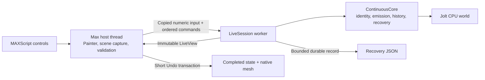
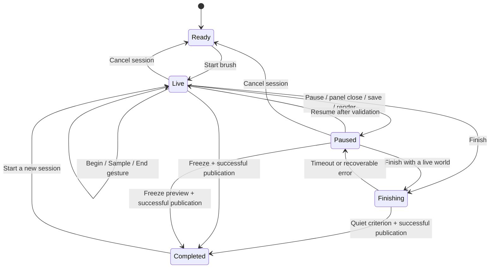

**Current standalone workflow:** [0.2.0 artist guide](ARTIST_GUIDE_020.md) and
[technical qualification](BAKE_WORKFLOW_020.md). The [0.1.9 repair](STABILITY_UI_019.md)
and this document's 0.1.4 body/receipts retain their historical scope.
**Current completion workflow:** [0.2.0 artist guide](ARTIST_GUIDE_020.md). Finish/Freeze now bake independent Editable Poly colliders; this versioned 0.1.4 text remains historical.

# Physics Lab technical guide

The [0.1.8 technical successor](COLLISION_QUALITY_018.md) documents compound
preparation/cache ownership, palette Undo/persistence and bounded hull rounding.
The architecture/evidence below retain their original 0.1.4 scope.

**Implemented architecture · 0.1.4 · Max 2027**  
[Documentation home](DOCUMENTATION.md) · [Validation report](VALIDATION_REPORT_014.md)

## Scope and engineering model

The lab is a standalone geometry-object experiment for rigid placement. It owns
its native storage, registration, controls and installer. It does not route
simulated rows through CyrusScatter's placement generation, projection, cleanup
or display pipeline. The completed output is a combined native mesh built from
retained transforms and captured source geometry.

The applicable foundation concerns are bounded work, host-thread ownership,
stable identity, atomic publication and Undo/persistence (F02, F05–F08 and F11).
The [physics extension contract](../ENGINEERING_FOUNDATION.md#physics-and-animation-extension-contract)
is an integration constraint, not evidence that integration exists. Static scene
inputs are supported; timeline animation, deforming colliders, soft bodies and
local contact-island re-settling remain outside this delivery.

## Components and ownership

| Component | Owner and responsibility | Boundary |
| --- | --- | --- |
| Scripted rollouts | Max host thread; controls, status, bounded commands | No placement-sized physics arrays or solver stepping in MAXScript |
| Native `Document` | Max host thread; scene references, input capture, Painter callbacks, publication | Workers receive copied numeric data rather than SDK objects |
| `LiveSession` | One native worker per live world; ordered queue, clock, snapshots, recovery sink | Sole caller of the mutable continuous core |
| `ContinuousCore` | Worker-owned numeric model; births, history, clipping, removals, replay | No Max objects, wall clock, UI calls or thread creation |
| `JoltWorld` | Core-owned solver state, shapes, bodies and engine checkpoints | Host never mutates the world directly |
| Completed state | Host-owned published result, independent of a running worker | Failed successors preserve the previous complete result |
| Crash watcher | Separate hidden process | Observes notifications and attempts dumps; does not attach as a debugger |

Jolt's job system is configured for single-threaded jobs inside the dedicated
worker. Moving the world off the UI thread does not imply a multi-core Jolt job
pool or GPU simulation. PhysX CPU is built for the offline comparison/test path;
the Max modules use Jolt only.

## The live-session lifecycle

This diagram is the principal flow. A loaded cached session needs Resume before
Finish or live history editing; Freeze can publish its preview without replay.
Publication failure retains the pending result for an explicit retry.

Mouse-up closes a gesture while leaving the world active. Each later gesture
can interact with every pending body. On a new session, completed rows become
fixed collision bodies. This distinction avoids implicitly resimulating an
already accepted composition.

Inputs are captured for the session. Meaningful binding, geometry, owner-frame
or unit changes invalidate continued authoring. The copied preview remains
available for an explicit Freeze. Open/merge frame adoption is allowed only
after recapture verifies the same physical inputs in metres. Topology and
identities remain exact; small floating-point roundoff has a bounded tolerance.

On retirement, the host closes input and detaches Painter, requests worker stop,
joins the worker, then releases its data. Owner/session epochs and closed-callback
guards make late callbacks harmless. Reset and owner deletion retire the owned
session; panel close pauses it. Pausing is not cancellation.

## Commands, clocks and snapshots

`LiveCommandKind` includes Begin, Sample, End, CancelGesture, Pause, Resume,
Finish, Freeze, Undo, Redo, Barrier, Archive and Result. Commands have monotonically
ordered sequence numbers. A snapshot records the processed sequence and revision
as well as body states, counts, session flags, history bytes and an error.

The worker uses a fixed **1/120-second step** and **four collision substeps** in
the delivered settings. Substeps subdivide the interval rather than advancing
four times as much simulated time. Wall-clock debt is capped at **0.1 seconds**;
Pause/Resume does not accumulate a large catch-up interval.

A work slice targets **6 ms**, checks elapsed time after each step and caps at
eight steps. One expensive solver step cannot be interrupted by this policy.
Above the sustainable workload, real-time correspondence can degrade even though
queueing and retained work remain bounded.

The host consumes immutable snapshots. Its timer refreshes the preview/status;
the timer does not drive the physics clock. Test evidence includes worker
progress during a held gesture while the host makes no further calls.

Archive requests are explicit synchronization points, separate from PaintStroke.
Finish/Freeze request the bounded current birth recipe through Result rather
than serializing all recovery history. Archive completion is sequence-checked to
avoid returning an older successful archive after a newer failure.

## Emission, identity and geometry

An `Emitter` samples travel distance and applies seeded variation. `Birth`
extends the placed `Row` with a simulation step, velocity and spin. A row carries
body ID, gesture ID, source index, position, quaternion and uniform scale.
Integer identity counters are high-water marks and do not rewind with live Undo.

Each footprint candidate is projected back to the captured receiver. Unsupported
candidates are skipped. A cursor miss breaks interpolation so re-entry cannot
create a connecting strip across unsupported space. This is an emission rule;
it does not constrain subsequent motion to the receiver outline.

Birth admission accounts for completed rows, pending authored births and source
render cost. A bounded separation pass lifts births above intersecting existing
bounds before insertion; a required lift greater than five metres is rejected.
Batch insertion avoids repeated per-body preparation. Failed insertion restores
the preceding core checkpoint.

The dynamic proxy is convex. Automatic preparation keeps the detailed render
mesh and limits collision complexity. Custom proxies accept up to 128 input
vertices before thickening; large automatic inputs use at most 192 collision
vertices. Alpha transparency does not change collision geometry.

Verified closed axis-aligned boxes use solid box colliders. A fully filled,
upward-facing horizontal rectangle, including a subdivided Max Plane, receives
a finite solid slab extending 10 cm below its exact top surface. Coverage,
winding and boundary checks exclude holes and inconsistent input. General
meshes use triangle collision; arbitrary open meshes are not automatically filled.

The removal threshold is below the minimum collider height, with a margin based
on source extent (at least one metre). A body is removed only when its entire
collision bounds lie below that plane. The receiver supplies the height basis
when no colliders exist. The core records removal ID and step, preserves lower
support, and retains the authored birth in history. Falling objects therefore
cannot evade the current session's admission limit by disappearing.

## Coupled Undo and atomic publication

A stroke can move older bodies, so live Undo restores the whole interacting
world. A checkpoint contains native engine state, body topology/engine identities,
births, removal records and step/quiet counters. Undo captures the later state
for Redo, stages a new compatible world and swaps only after restoration succeeds.
An empty outside gesture does not append history or clear a Redo branch.

These native checkpoints are **in-memory only**. Files are not accepted as raw
Jolt checkpoint bytes. History is bounded by both gesture count and memory;
admission rejects further work rather than silently dropping accepted history.

Finish checks the quiet-motion condition within step and wall-time budgets.
Freeze accepts current poses and records `settled=false`. The host then prepares
a complete successor and publishes through a short Max Undo transaction.
Pre-publication and post-assignment fault tests verify previous-result retention.
A failed commit does not automatically retry on every timer tick; the user must
explicitly retry Finish/Freeze.

Global Max Undo pauses a live session. If it removes the completed base that
pending work depends on, the dependent session is discarded. Unrelated Undo
retains paused work. Live stroke history and Max result history are separate
mechanisms with distinct ownership.

## Persistence and reproducibility

| Stored form | Purpose | Replay policy |
| --- | --- | --- |
| Completed state / scene schema 2 | Renderable cached result plus recipe and settings | Reopening does not solve automatically |
| Schema-1 historical result | Preserve older completed geometry and solver profile | No implicit replay or historical-file rewrite |
| Pending recovery core, schema 2 | Captured inputs, current births, history references, removals, preview and IDs | Exact recorded solver fingerprint required for Resume |
| In-memory `WorldCheckpoint` | Low-latency live Undo/Redo | Owned native bytes and explicit topology; not a file import format |
| Result JSON | Bounded cached data exchange | Does not embed Max material/bitmap/reference bindings |

Schema numbers describe different layers. The recovery file's host envelope is
schema 1 while its continuous **core** is schema 2; the saved scene/result state
uses schema 2. Do not treat these values as one shared file-format version.

Core recovery stores the full current birth list once. Historical points refer
to birth IDs; a catalog holds births needed only by Redo. Recovery reconstructs
canonical births at recorded fixed steps, verifies removals and builds new
native checkpoints. This avoids trusting serialized engine bytes and reduces
redundant encoding of the same births.

The fingerprint hashes the pinned Jolt revision plus the CMake and core solver
sources. Same-build replay with matching input is qualified in the recorded
fixtures. It does not establish arbitrary cross-platform, cross-build or
changed-input equivalence. A cached preview can still be frozen when replay is
incompatible. A seed alone is insufficient to guarantee the same simulation.

Explicit Rebuild uses the authored schedule against current bindings/settings,
including previously completed bodies. Its 30,000-step bound can reject a long
schedule while preserving the saved result. Area/Rebuild remain separate batch
paths; their unfinished work is not serialized as a continuous session.

## Resource contract

| Resource | Delivered bound | Interpretation |
| --- | ---: | --- |
| UI body default / hard maximum | 1,000 / 5,000 | Completed rows plus pending authored births; separate 5,000 saved-birth recipe cap |
| Sources / explicit colliders | 64 / 64 | Independent input limits |
| Combined render-source vertices and faces | 200,000 each | Input admission, not per-instance output allowance |
| Collider faces | 200,000 | Separate collision-geometry budget |
| Output vertices and faces | 2,000,000 each | Detailed source geometry can exhaust this before the body limit |
| Pair / contact budget | 65,536 each | Larger configured budgets rejected before solver creation |
| Numerical scratch policy | 128 MiB | Does not guarantee arbitrary allocator/unwind recovery |
| Queued samples / all commands | 384 / 512 | Control capacity reserved separately from samples |
| Live history | 128 gestures and 64 MiB | Admission considers checkpoint ownership |
| Individual engine checkpoint | 16 MiB | Native in-memory state bound |
| Recovery file | 32 MiB | Atomic durable replacement |
| Concurrent recovery slots | 8 | Live/paused sessions retain slots until retirement |
| Live session work | 120,000 steps | Separate from Finish's bounded work |
| Finish | Configured step budget and 30-second wall limit | Timeout preserves pending work |
| Explicit Rebuild | 30,000 steps | Whole recorded schedule must fit |

These are multiple rejection boundaries, not a single memory reservation or a
promise that the maximum configuration is interactive. Peak memory can overlap
the live world, retained source geometry, history, preview, prior publication
and prepared successor. Memory observations in the validation report identify
their process and sampling scope; they are not a universal peak/OOM proof.

## Why 0.1.4 feels faster

The earlier lab already used native physics. The main changes are a persistent
world across gestures, a worker independent of the UI timer, copied native data
with immutable previews, bounded batch insertion and cheaper recovery storage.
MAXScript still supplies the interface; “everything was rewritten in C++” would
be an inaccurate explanation.

The same 1,000-body scripted interaction fixture improved from **185 ms to 43 ms
p95** after recovery birth deduplication. This supports that specific
optimization. It does not isolate the benefit of every architectural change or
measure physical click-to-presented-frame latency. Positive artist feedback is
recorded separately in the [validation report](VALIDATION_REPORT_014.md).

## Source and test map

| Path | Responsibility |
| --- | --- |
| [include/core.h](../../CyrusPhysicsLab/include/core.h), [src/core.cpp](../../CyrusPhysicsLab/src/core.cpp) | Numeric types, settings, admission, emitter, surface queries, proxies and batch Session |
| [include/live_session.h](../../CyrusPhysicsLab/include/live_session.h), [src/live_session.cpp](../../CyrusPhysicsLab/src/live_session.cpp) | ContinuousCore, worker, queue, time, history, clipping and recovery |
| [src/jolt_world.cpp](../../CyrusPhysicsLab/src/jolt_world.cpp) | Jolt adapter, shape creation, insertion, stepping, checkpoints and removal |
| [src/physx_world.cpp](../../CyrusPhysicsLab/src/physx_world.cpp) | Offline PhysX comparison adapter |
| [src/max_host.cpp](../../CyrusPhysicsLab/src/max_host.cpp), [src/max_live.inc](../../CyrusPhysicsLab/src/max_live.inc) | Host capture, Painter, authored state, lifecycle, persistence and publication |
| [src/storage_plugin.cpp](../../CyrusPhysicsLab/src/storage_plugin.cpp) | Native storage plugin registration |
| [scripts/CyrusPhysicsLab.ms](../../CyrusPhysicsLab/scripts/CyrusPhysicsLab.ms) | Rollouts, controls, binding and status polling |
| [src/diagnostics.cpp](../../CyrusPhysicsLab/src/diagnostics.cpp), [src/crash_watch.cpp](../../CyrusPhysicsLab/src/crash_watch.cpp) | Flushed recording and external dump capture |
| [tests/live_tests.cpp](../../CyrusPhysicsLab/tests/live_tests.cpp) | Numeric continuous-session contracts |
| [tests/host_continuous.ms](../../CyrusPhysicsLab/tests/host_continuous.ms) | Actual rollout/Painter SDK host workflow |
| [tests/live_stress.cpp](../../CyrusPhysicsLab/tests/live_stress.cpp) | Distributed low-poly capacity measurements |
| [CMakeLists.txt](../../CyrusPhysicsLab/CMakeLists.txt), [tools/build.py](../../CyrusPhysicsLab/tools/build.py) | Max guard, solver fingerprint, dependency pins and native build |
| [tools/package.py](../../CyrusPhysicsLab/tools/package.py) | Exact-pair packaging and private-fault exclusion |

For reproduction commands, final artifact identities and qualification limits,
use the [validation report](VALIDATION_REPORT_014.md). Any future engine change,
large-capacity increase or integration needs a new measured successor rather
than inheritance of this delivery's acceptance.
