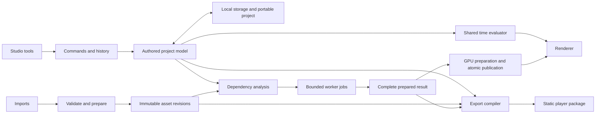

# Landscape presentation and authoring studio: research

Research snapshot: **15 October 2026**. Status: **research and recommendations; not implemented or qualified**.

This saves the research from the browser-graphics, computational-geometry and editor-architecture investigation. The subsequent [presentation-only MVP plan](README.md) records the user's decisions and narrows the first delivery. Broader planting and terrain proposals below remain future research, not authorization to implement them.

The recommended direction is a separate Three.js authoring studio and a small exported player, with a shared presentation evaluator. Start with prepared landscape scenes, camera authoring, layers and export. Add procedural planting only after that complete workflow works. Keep the existing website available and independent.

## Evidence and limits

The original investigation examined public documentation and source repositories. It did not run the local prototype, profile a physical device, inspect its local implementation, or establish capacity. Package versions and repository activity below are dated observations, not promises about future maintenance. Links to moving branches must be pinned to commits during implementation.

The user supplied these limited prototype observations:

| Observation | What it establishes |
| --- | --- |
| 1,949 plants, 21 instanced vegetation batches | One scene's population and batching |
| About 2.47 million rendered triangles and 95 draw calls at one final view | One view's submitted workload |
| No extra renders during a 1.5-second idle check | A short idle observation |
| Four photographic PNGs totalling about 15.9 MB | An image-delivery problem worth addressing |

These are not presented-FPS measurements, thermal tests, browser-memory limits or capacity guarantees. Reported source concerns were linear scanning of accepted placements, disabled vegetation frustum culling, coupled camera/appearance updates, and fixed-per-frame scroll smoothing. They were supplied context, not independently reproduced defects.

## 1. Product boundary and useful first delivery

A separate studio plus exported player is the right boundary. The studio owns editable state, imports, preparation, undo and validation. The player consumes prepared scene data and an authored presentation; it should not contain planting generation, repair tools or editing controls.

There are two distinct import workflows:

1. **Present a completed landscape.** Import GLB geometry, assign presentation layers, align a plan, author the reveal and camera stops, attach photographs, save and export.
2. **Construct a landscape.** Import terrain and individual plants, define regions and masks, generate placements, edit overrides and then present the result.

The first is a useful end-to-end MVP. The second requires considerably more geometry, persistence and stability work. A GLB can preserve nodes, transforms, meshes and metadata, but cannot recreate discarded planting rules or the original editor's layer semantics. Merged geometry cannot automatically become independently editable plants.

The studio should have a central plan/perspective viewport, a layer and scene hierarchy on the left, an inspector on the right, and a camera-stop timeline below. Keep an asset shelf and visible import/save/export status. Distinguish three modes: **Explore** changes a temporary navigation camera, **Edit stop** changes a selected authored camera through explicit capture/update actions, and **Playback** evaluates the timeline. A drag is one undo transaction, not hundreds of history entries.

Transferable examples include the [Three.js editor](https://threejs.org/editor/), its [history](https://github.com/mrdoob/three.js/blob/r186/editor/js/History.js) and [storage](https://github.com/mrdoob/three.js/blob/r186/editor/js/Storage.js), and the [PlayCanvas editor workflow](https://developer.playcanvas.com/user-manual/editor/). The [PlayCanvas editor repository](https://github.com/playcanvas/editor) illustrates hierarchy, inspectors and preview, but its frontend depends on the wider platform; it is not a ready-made self-hosted application backend. Borrow interaction patterns instead of forking an entire editor.

Defer arbitrary terrain reconstruction, CAD interpretation, animated plant assets, multiplayer collaboration, advanced collision, GPU placement, automatic generated-image production and a generalized node editor.

## 2. What Casa Serra actually demonstrates

The [Casa Serra repository](https://github.com/Sam1983Aing/casa-serra) is a useful storytelling reference. The inspected [entry page](https://github.com/Sam1983Aing/casa-serra/blob/main/index.html) referenced Three.js 0.160.1, GSAP/ScrollTrigger 3.13.0 and Lenis 1.1.14. Its [scene code](https://github.com/Sam1983Aing/casa-serra/blob/main/scene.js) used procedural geometry and shader customization, including `onBeforeCompile`. Its [experience code](https://github.com/Sam1983Aing/casa-serra/blob/main/shared/fx-experience.js) organized travel, holds, camera behaviour and reduced motion.

It demonstrates an authored reveal, controlled camera journey and photographic composition. It does not demonstrate a reusable scene-import pipeline, a planting editor or a portable project format. The inspected public history was small, with three commits and last push recorded on 13 October 2026; a reuse licence was not found during the investigation. Treat it as visual and behavioural reference, not a source package to copy wholesale.

Assumptions to reject:

| Assumption | Correction |
| --- | --- |
| Any GLB can become editable planting | Geometry may lack identities, regions, species and rules |
| An automatic ink shader produces architectural plans | Silhouette/normal edges lack architectural meaning |
| Few draw calls or a triangle count prove performance | Overdraw, shadows, bandwidth, CPU and thermal limits remain |
| Stable random IDs guarantee identical accepted planting | Collision priority and changed neighbours can change acceptance |
| Constant path speed guarantees comfort | Angular speed, framing, acceleration and occlusion also matter |
| A photographic overlay remains correct while navigating | It has one viewpoint and no true parallax |
| WebGPU fixes an inefficient placement algorithm | Algorithmic work and transfer costs still apply |
| Browser autosave is a portable backup | Origin data can be cleared, evicted or become unavailable |

## 3. Architecture and ownership

Separate authored records, immutable source assets, derived preparation and published render resources. Use stable project identities rather than mutable UI row positions, mesh names or GPU instance indices. The public player receives only what it needs to render and navigate the authored presentation.

Commands should update the model, record reversible changes and invalidate explicit dependencies. The renderer consumes evaluated state; it should not silently mutate authored camera stops or planting recipes. Browser workers receive owned numeric/binary inputs. Scene graph mutation and WebGL resource publication remain on the renderer's thread.

These are design recommendations. They do not imply browser code already shares the native Scatter implementation or its qualification.

## 4. Technology and reusable libraries

### Engine choice

Retain **Three.js**, use TypeScript for the growing application model, and retain an imperative renderer. The existing prototype already uses Three.js; a change of engine adds migration work without evidence of a necessary capability gap.

| Option | Dated research snapshot | Assessment |
| --- | --- | --- |
| [Three.js](https://github.com/mrdoob/three.js) | 0.186.1; MIT; npm release recorded 24 September 2026 | Best continuity; build the domain-specific studio around it |
| [Babylon.js](https://github.com/BabylonJS/Babylon.js) | `@babylonjs/core` 9.31.0; Apache-2.0; 15 October 2026 | Credible integrated alternative; thin instances and tooling do not eliminate asset/performance work |
| [PlayCanvas engine](https://github.com/playcanvas/engine) | 2.23.2; MIT; 9 October 2026 | Strong engine/editor ecosystem; migrating does not provide this product's authoring contracts |
| [React Three Fiber](https://github.com/pmndrs/react-three-fiber) | 9.8.2; MIT; reviewed React 19 and Three peer constraints | Optional UI integration, not a rendering-performance upgrade |

React could be useful for a complex studio UI later. It is not necessary for the first slice. If using R3F, keep continuous render updates out of React state; the [performance guidance](https://r3f.docs.pmnd.rs/next/advanced/pitfalls) reinforces this distinction. The cited `next` documentation must be checked against the selected release.

Start with WebGL2. Three's [WebGPU renderer documentation](https://threejs.org/manual/pages/webgpurenderer) describes a WebGL2 fallback, but migration still affects custom shader and postprocessing paths. `ShaderMaterial`, `RawShaderMaterial`, `onBeforeCompile` customizations and traditional `EffectComposer` integrations require compatibility review and often TSL/node rewrites. WebGPU is a later measured experiment.

### Candidate components

These are research candidates, not an instruction to install every dependency. Recheck package metadata, exported APIs, licences and exact commits when selecting the implementation lockfile.

| Component | Snapshot and source | Use or caution |
| --- | --- | --- |
| camera-controls | 3.1.2, MIT; package release 17 November 2025; [source](https://github.com/yomotsu/camera-controls/blob/dev/src/CameraControls.ts) | Studio navigation; not the authored cinematic evaluator. Collision raycasts have a cost. Recorded Node requirement was 22+ |
| three-mesh-bvh | 0.9.16, MIT; 8 October 2026; [extensions](https://github.com/gkjohnson/three-mesh-bvh/blob/master/src/utils/ExtensionUtilities.js) | Mesh picking and geometry queries; does not replace an instance-level broad phase |
| glTF Transform | 4.5.1, MIT; 28 September 2026; [CLI](https://gltf-transform.dev/cli) | Reproducible offline preparation. CLI/native image-processing dependencies differ from browser availability |
| meshoptimizer | 1.3.0 npm, MIT; 25 September 2026; [source](https://github.com/zeux/meshoptimizer) | Mesh compression and simplification; geometric error and foliage topology require inspection |
| glTF Validator | 2.0.0-dev.3.10 npm, Apache-2.0; 22 October 2024; [repository](https://github.com/KhronosGroup/glTF-Validator) | Validate bytes and report errors; resource validation needs supplied external resources |
| PlayCanvas Editor / PCUI | Editor 2.34.0, 7 October 2026; PCUI 6.1.4, 14 May 2026; MIT; [editor source](https://github.com/playcanvas/editor) | Inspect UI patterns. Editor curve controls have service dependencies |
| Theatre.js | core/studio 0.7.2, 19 May 2024; repository activity recorded 14 August 2024; [source](https://github.com/theatre-js/theatre) | Core Apache-2.0; Studio AGPL-3.0-only. Useful reference, avoid assuming a permissively licensed complete editor |
| animation-timeline-js | 2.3.5, MIT; 21 July 2024; [timeline source](https://github.com/ievgennaida/animation-timeline-control/blob/master/src/timeline.ts) | Timeline widgets, not a project model, history system or full curve editor |
| dollycurve | 0.3.0, declared MIT; npm 27 June 2026; repository activity recorded 11 May 2026; [package/source](https://github.com/jtydhr88/dollycurve/blob/main/package.json) | Interesting camera/graph prototype; qualify provenance, API and numerical quality before adoption |
| Earcut | 3.2.4, ISC; 28 September 2026; [source](https://github.com/mapbox/earcut/blob/main/src/earcut.js) | Triangulate validated polygons; triangulation is not polygon repair |
| polygon-clipping | 0.15.7, MIT; 18 December 2023; activity recorded 19 April 2024; [source](https://github.com/mfogel/polygon-clipping/blob/main/src/operation.js) | Boolean region operations; test degeneracies and work bounds |
| Clipper2 | 2.0.1, BSL-1.0; 19 December 2025; [documentation](https://www.angusj.com/clipper2/Docs/Overview.htm) | Robust alternative worth evaluating if needed; native/WASM integration adds work |

The dollycurve investigation found an [arc-length lookup](https://github.com/jtydhr88/dollycurve/blob/main/src/spline/arc-length.ts) using a fixed default of 32 samples per segment and binary search, rather than an adaptive error guarantee. Its separate change/commit callbacks were a useful undo pattern. A [README](https://github.com/jtydhr88/dollycurve/blob/main/README.md) claim that Three only supports linear tracks was too broad: [Three keyframe tracks](https://threejs.org/docs/pages/KeyframeTrack.html) expose multiple interpolation modes. Do not adopt claims from a project's marketing text as verified engine limitations.

Own the project schema, stable identity, dependencies, placement semantics, camera evaluator, photo validity and export compiler. Libraries can provide navigation, decoding, BVHs or widgets underneath those contracts.

## 5. Rendering, foliage and architectural appearance

Instancing reduces repeated submissions and CPU overhead; it does not remove fragment overdraw or shadow-map work. Prefer a batch key of **asset primitive × material × spatial chunk × LOD**, with layer ownership also preserved. Each choice trades batching against culling and edit isolation.

| Technique | Benefit | Cost or limit |
| --- | --- | --- |
| Instancing | Fewer submissions for repeated geometry | Shared geometry/material; poor chunking can draw many invisible plants |
| Spatial chunks | Coarse view culling and bounded update scopes | More draw calls; chunk size must be measured |
| LOD | Less distant geometric and shading work | Popping, memory for variants and authoring effort |
| Geometry/material merging | Fewer calls | Coarse culling, lost identities and harder layer toggles |
| Alpha testing | Avoids blended sorting for many foliage cards | Aliasing and alpha-coverage changes through mip levels |
| Blended foliage | Soft edges | Overdraw and sorting limitations |
| Shadows | Depth and grounding | Extra render passes, geometry and alpha tests |
| BVH picking | Faster mesh intersection | Separate broad phase needed for many instances |

Three's [InstancedMesh API](https://threejs.org/docs/pages/InstancedMesh.html) requires bounds to stay consistent with transforms. Its [raycast implementation](https://github.com/mrdoob/three.js/blob/r186/src/objects/InstancedMesh.js) traverses instances; a geometry BVH alone does not make all-instance selection cheap. [BatchedMesh](https://threejs.org/docs/pages/BatchedMesh.html) offers per-object culling and sorting, with their own CPU work. Benchmark it rather than assuming it is always superior.

Test chunk sizes such as 5, 10, 20 and 40 metres on representative scenes. Chunk boundaries must not affect persistent plant IDs or placement results. Camera motion should select existing chunks and LOD resources without regenerating placements or uploading unchanged matrices.

For foliage, inspect alpha-card overlap, double-sided materials, texture resolution, mip coverage and shadow casters. Simplified shadow geometry and restricted shadow distance can matter more than a modest triangle reduction. Shader wind should not force full CPU transform uploads, but animation is unnecessary in the first presentation MVP.

Preserve original PBR materials and build a separate presentation style: light fills, selected feature edges, restrained depth/normal contours and authored plan graphics. [EdgesGeometry](https://threejs.org/docs/pages/EdgesGeometry.html) uses geometric edge criteria, not architectural interpretation. Avoid wireframing every leaf; use authored planting-region outlines, points or simplified crown proxies. Clipping does not automatically create convincing caps, and screen-space contours need alpha-aware handling. A stylized reveal is feasible; automatic CAD-quality plans are not established.

## 6. Future planting: algorithms, identity and collisions

This section is deliberately beyond the presentation-only MVP.

Scanning every accepted point for each candidate costs approximately `O(C × N)` for C candidates and N accepted plants. A spatial grid can make neighbour queries local under explicit radius and occupancy assumptions. [Bridson's Poisson-disk method](https://www.cs.ubc.ca/~rbridson/docs/bridson-siggraph07-poissondisk.pdf) supports linear work for its fixed-radius, fixed-dimension, bounded-attempt setting. Variable radii, disconnected domains, priority rules and persistent edits require additional design; they do not inherit a universal linear-time guarantee.

For predictable edits, generate a persistent candidate pool in receiver-local cells, identify candidates independently of array order, and use keyed random channels for density, species, scale, rotation and priority. Apply masks and species choices before collision evaluation when those choices determine footprint size. Sort deterministic priorities, then query a spatial hash or radius-class hierarchy. A sorted pool introduces `O(C log C)` work unless the priority representation allows another bounded method.

Suggested random key: project seed, layer ID, receiver ID, candidate ID, channel ID and solver version. IDs must not depend on GPU slots, current chunking, worker completion order or unstable imported triangle indices. Preserve user overrides for temporarily rejected candidates as dormant records.

Stable IDs do not mean stable acceptance. Adding a high-priority plant, changing its footprint or changing an exclusion can invalidate neighbours and propagate through a priority chain. Start with a complete recalculation of the relevant scope in a worker. Later incremental evaluation must match a full-solve oracle; a fixed dirty halo is not generally sufficient for arbitrary dependency chains.

Define density explicitly: plants per horizontal square metre differs from plants per surface square metre. For a heightfield the area factor is `sqrt(1 + hx² + hz²)`; general mesh sampling uses world-space triangle area and uniform barycentric samples. Nonuniform transforms change area and normals; reject singular transforms. A plane-projection workflow also needs an explicit hit policy.

Define collision as a product rule. A horizontal disk test such as `distanceXZ >= radiusA + radiusB + clearance` is useful spacing, not exact leaf/branch collision. Specify whether a boundary requires the centre or the entire footprint inside. Cross-layer collision uses explicit groups and priorities; ground cover may coexist under trees. Visibility and collision participation are separate settings.

## 7. Maps, coordinates and terrain

Use metres, Y-up and an XZ plan plane, consistent with the [glTF coordinate conventions](https://registry.khronos.org/glTF/specs/2.0/glTF-2.0.html). Preserve a double-precision authoring origin and use local GPU coordinates. Rebasing cannot recover precision already lost when an upstream exporter quantized large world coordinates.

Calibrate a plan using two points with a known distance and orientation, then check a third point's residual. Affine or perspective correction must be explicit; a photograph of a plan is not automatically an orthographic map. Preserve the original and calibration transform.

Validate vector rings before triangulation: finite coordinates, duplicate vertices, holes, self-intersections, winding/fill rule and tolerances. Keep repair explicit and undoable. SVG is a document format, not a trusted geometry schema; [SVGLoader](https://threejs.org/docs/pages/SVGLoader.html) is neither a CAD interpreter nor a complete security validator. GeoJSON/WKT need coordinate reference systems. DXF and PDF interpretation can wait.

| Input | Meaning and sampling |
| --- | --- |
| Plan image | Visual registration reference; no inferred species or height |
| Density map | Scalar field with an explicit transfer function and units |
| Exclusion mask | Defined forbidden/allowed region and threshold |
| Species map | Categorical IDs or separately defined weights; categorical sampling normally nearest |
| Height map | Numeric height, extent, bit depth, scale and offset |
| Base colour | Colour texture with appropriate sRGB handling |
| Normal map | Directional shading data; does not displace geometry |
| Roughness | Linear material parameter |
| Environment image | Lighting/reflection radiance and orientation |

Three's [colour-management guidance](https://threejs.org/manual/pages/color-management.html) distinguishes colour from numeric data textures. Fix UV orientation, wrap, filter, outside-domain behaviour and world pixel size. CPU placement sampling should use canonical data, not view-dependent GPU mip levels. Do not reduce a 16-bit height map to an 8-bit canvas accidentally.

For terrain, rendering, placement and picking should share one canonical triangulated surface. A bilinear CPU height sampler and a triangulated GPU mesh can disagree even if they share vertices. Shader displacement must match the CPU surface contract. A heightfield cannot represent overhangs; arbitrary meshes need explicit selected-surface and ray-hit semantics.

## 8. Scheduling, invalidation and publication

Keep interaction, commands and final scene publication on the main thread initially. Workers can prepare geometry, masks, BVHs and future placements; heavyweight image/asset conversion can run in a repeatable local build tool.

Every job needs a project revision, dependency fingerprint and algorithm version. Reject a result if any expected input changed. Cancellation must be cooperative and bounded. Transfer buffers only when ownership is safe: [transferable objects](https://developer.mozilla.org/en-US/docs/Web/API/Web_Workers_API/Transferable_objects) detach the sender's buffer. The [BVH worker implementation](https://github.com/gkjohnson/three-mesh-bvh/blob/master/src/workers/GenerateMeshBVHWorker.js) makes this particularly relevant for geometry already in use.

Prepare a complete successor, admit its peak memory, create compatible resources and publish together. On failure retain the previous complete result. Budget the overlap of old and new CPU/GPU resources; limiting the final scene size alone does not bound peak memory.

| Change | Required work | Work that should remain unchanged |
| --- | --- | --- |
| Camera navigation | View evaluation, culling and LOD selection | Placement and unchanged instance buffers |
| Camera path/pose | Path lookup rebuild; photo validity | Planting |
| Timing/holds | Timeline evaluation | Geometry and placement |
| Reveal or visibility | Presentation state; relevant shadows | Placement, unless an explicit collision rule changed |
| Collision priority or footprint scale | Affected collision scope | Independent scopes |
| Region/mask | Affected receivers and dependent scopes | Unrelated layers |
| Receiver geometry | Geometry preparation, BVH and affected placement | Unrelated receivers |
| Receiver transform | World metric and dependent queries | Independent sources |
| Material-only edit | Material resources; photo validity | Placement if footprint is unchanged |
| Plan image | Image display | Placement unless its calibration/map role is used |
| Calibration | Registered consumers | Unrelated assets |
| Chunk size/display quality | Rendering preparation | Candidate identity and authored planting |
| Selection or panel browsing | UI/overlays | Scene evaluation and unchanged GPU buffers |

## 9. Camera journey and photographs

Build a pure `evaluate(project, time, viewport)` function. It must support arbitrary seeking and reverse playback without depending on previous frames. Separate path shape, distance along the path, time mapping, orientation, field of view and holds.

Use an arc-length lookup for approximately constant travel speed. Apply easing only in defined arrival/departure intervals, leaving a linear middle section when requested. [Centripetal Catmull-Rom research](https://www.cemyuksel.com/research/catmullrom_param/) provides useful segment-level properties, not global obstacle avoidance or a complete camera solution. Manual Bézier handles are another reasonable authoring choice. An adaptive lookup should be checked against a dense numerical oracle and a declared speed-error tolerance.

Normalize quaternions and handle hemisphere continuity. SLERP avoids many Euler interpolation problems, but angular velocity still needs inspection. Look-target paths require defined behaviour for coincident targets and near-parallel up vectors. Eye-level travel can reference a canonical terrain surface; obstacle checks belong in authoring/preflight, rather than history-dependent runtime steering that changes exported framing.

Scroll defines a position in the authored sequence. A user can scroll across a hold immediately; it is not a guaranteed wall-clock pause. Autoplay uses real elapsed time. If smoothing is used, make it time-based, such as exponential damping based on `deltaTime`, and apply it to input progression without making the evaluator stateful.

Responsive framing needs a chosen policy: authored aspect ratio with letterboxing, approved mobile compositions or explicit crop/FOV rules. A narrow viewport should not silently lose the building that was the purpose of a stop.

Photographs are viewpoint-bound overlays. Record a fingerprint of pose, FOV, framing, scene/plant visibility, materials and lighting. Timing-only changes should not invalidate an otherwise identical image. Fade in only while stationary and remove before travel. An artistic/generated image can intentionally differ from the model; label it as an interpretation, not a geometrically verified render. A visibility change must not leave a contradictory photo covering the 3D scene.

Provide a static stop-navigation experience for [reduced-motion preferences](https://developer.mozilla.org/en-US/docs/Web/CSS/Reference/At-rules/%40media/prefers-reduced-motion), and keyboard/touch controls that do not depend on scroll effects alone.

## 10. Asset preparation, persistence and export

Compression techniques solve different problems:

| Operation | Primarily reduces | Does not automatically reduce |
| --- | --- | --- |
| Meshopt/Draco compression | Download bytes | Rendered triangles or fragment work |
| Quantization | Storage/bandwidth | Error from lost precision |
| Mesh simplification | Geometric work | Material/alpha overdraw |
| Texture resizing | GPU memory and sampling bandwidth | All visual artifacts |
| JPEG/WebP/AVIF | Transfer bytes | Decoded RGBA GPU allocation |
| KTX2/Basis | Suitable compressed texture allocation after transcode | Every device's identical memory usage |
| Atlasing | Material switches/draw opportunities | Culling or stable layer ownership |

Use [glTF Transform](https://gltf-transform.dev/cli) for repeatable asset preparation when needed, with inspected simplification error and preserved originals. Use [KTX2Loader](https://threejs.org/docs/pages/KTX2Loader.html) with locally packaged decoder assets and device-qualified settings. A 4096² RGBA8 texture is about 64 MiB before mipmaps and about 85 MiB with a full mip chain, independent of a small compressed download; see the [Three texture guide](https://threejs.org/manual/pages/textures.html).

Import validation must include resource availability, unsupported required extensions, supported materials, bounds, counts and decoded-memory estimates. The [GLTFLoader documentation](https://threejs.org/docs/pages/GLTFLoader.html) also calls out resource-lifetime concerns such as image bitmap disposal. A valid glTF can still exceed a device budget or require features the presentation style cannot reproduce.

A portable editable project should contain a versioned manifest, immutable source assets and hashes, stable IDs, import/calibration metadata, layer and rule records, seeds/algorithm versions, overrides, camera tracks, photographs and their validity fingerprints. Derived caches are optional and rebuildable. Keep the original separate from each prepared derivative and its preparation recipe.

Use IndexedDB for transactional metadata and, where supported, [OPFS](https://developer.mozilla.org/en-US/docs/Web/API/File_System_API/Origin_private_file_system) for large blobs. Commit a new revision pointer only after referenced blobs exist. [Browser quotas and eviction](https://developer.mozilla.org/en-US/docs/Web/API/Storage_API/Storage_quotas_and_eviction_criteria) mean autosave cannot replace an explicit portable archive. Offer missing-resource placeholders and deliberate relinking. Undo stores bounded changes and asset references, not repeated copies of whole GLBs.

The public export contains prepared assets, presentation data, photographs, required decoders and the player. Keep relative URLs, test under a nested HTTP path, and use the same evaluator as preview. A static website is not guaranteed to run from `file://`. Previewing editor state is insufficient evidence: test the unpacked compiled artifact itself. Dispose resources by ownership/reference count and recover from [WebGL context restoration](https://developer.mozilla.org/en-US/docs/Web/API/HTMLCanvasElement/webglcontextrestored_event).

## 11. Risks and staged development

| Risk | Mitigation and evidence needed |
| --- | --- |
| Large scene fails on a typical phone | Asset admission, prepared quality profiles, physical-device traces |
| Ink effect breaks imported materials | Narrow supported subset, authored overlays, visual fixture coverage |
| Plant edits unexpectedly reshuffle results | Keyed randomness, stable IDs, explicit acceptance semantics and solver version |
| Rendered terrain and placement disagree | Shared canonical surface and numerical tests |
| Old job overwrites newer edits | Revision/fingerprint rejection and failure injection |
| Export/import creates memory spikes | Peak-memory admission, limited concurrency and immutable blob references |
| Studio and player differ | Shared evaluator and actual-artifact parity tests |
| Photograph hides changed geometry/layers | Dependency fingerprint, stale status and 3D fallback |
| Optimizer changes the authored design | Never substitute density/species/position as adaptive quality |
| Browser save is mistaken for backup | Explicit portable archive and cold-reopen test |

Recommended stages from the original investigation were: contracts and representative assets; a presentation vertical slice; narrow planting; typed maps/terrain; rendering and asset optimization; persistence/publication resilience; then measured incremental/GPU experiments. The [MVP plan](README.md) brings persistence and export into the first delivery and defers the planting stages. These are proposed gates, not completion receipts.

## 12. Benchmark and correctness protocol

Use deterministic, redistributable fixtures with hashes and exact settings. Start with a scene comparable to the supplied 1,949-plant baseline when available. Future planting stress fixtures can include 25,000–50,000 foliage instances, a 200,000-instance ground-cover stress case and a dense terrain around two million triangles. Those are stress inputs, not advertised capacities or first-MVP requirements.

Record exact hardware, OS, browser, viewport, DPR, scene/package hashes and quality settings. Include an integrated-GPU Windows laptop, an Apple laptop in Safari/Chrome, a mainstream Android phone and an older supported iPhone. Test cold/warm loads and a ten-minute session. Automated desktop emulation is not physical mobile qualification.

Measure frame pacing, CPU work, available GPU timings, interaction latency, candidate/neighbour counts for future placement, uploaded bytes, texture decode and peak memory. JS heap is not total process memory or VRAM. [WebGL disjoint timer queries](https://registry.khronos.org/webgl/extensions/EXT_disjoint_timer_query_webgl2/) require asynchronous collection and disjoint checks. [WebGPU timestamps](https://developer.mozilla.org/en-US/docs/Web/API/GPUQuerySet) are an optional future diagnostic. `requestAnimationFrame` counts are not proof of presented FPS; inspect dropped/partially presented frames with [browser performance tools](https://developer.chrome.com/docs/devtools/performance/reference).

Initial proposed budgets, to be calibrated on selected hardware:

| Measure | Desktop target | Mobile target |
| --- | --- | --- |
| Frame cadence | 60 Hz, p95 frame interval ≤16.7 ms | 30 Hz, p95 ≤33.3 ms |
| Per-frame application CPU / measured GPU work | ≤6 / 10 ms | ≤8 / 20 ms |
| Camera input latency | ≤50 ms | ≤100 ms |
| Selection response | ≤100 ms | ≤150 ms |
| Estimated steady GPU allocations | ≤384 MiB | ≤192 MiB |
| Working CPU allocation target | ≤768 MiB | ≤256 MiB |
| Static idle | Zero extra renders, placement solves and uploads after settling | Same |
| Camera-only motion | Zero placement solves and unchanged matrix uploads | Same |
| Critical initial payload | ≤4 MB compressed | ≤4 MB compressed |
| First usable view | ≤5 seconds at 10 Mbps and 80 ms latency | Same controlled network profile |

These are engineering hypotheses, not measured browser caps. CPU/GPU timings overlap and cannot simply be added as a proof of frame rate. Use 200 calls/3 million visible triangles on desktop and 100 calls/1 million on mobile as investigation triggers, not universal pass criteria. Foliage overdraw can fail much earlier. Aim for roughly 0.5–1 MB per mobile photograph and load only the current/next needed image.

For future placement, a 100,000-candidate desktop case within one second and cancellation acknowledgement within 100 ms are useful initial targets. Validate spacing against brute force on small inputs, holes, boundary policies, nonuniform transforms and deterministic output across worker counts. Compare incremental results to full solve, prove chunk-independent IDs, and inject stale-result/publication failures.

For cameras, verify arbitrary-time and reverse seeks against direct evaluation and target ≤2% speed variation in the intended constant-speed interior. Test holds, zero-length segments, quaternion degeneracy, responsive framing and photo invalidation. Repeated import/replace/undo/export/reopen must not show unbounded resource growth.

Adaptive quality should use measured, hysteretic thresholds: reduce expensive display settings after sustained misses and raise them only after a longer stable period. Adjust resolution, shadows, postprocessing and LOD. Do not silently change authored density, species, positions, layer meaning or timing.

## Follow-up decisions

The original research left open the asset workflow, minimum hardware, typical site size, density semantics, author/player editing boundary, replacement rules, photographic fidelity, collaboration and commercial licensing. The user subsequently selected medium-first scenes with some large sites, broad middle-range device support, layered GLBs and reusable asset sets, studio-only editing, player layer toggles, artistic photos, one admin and deferred commercial licensing. Replacement and photo policies are resolved in the [MVP implementation plan](README.md).

No source implementation, package installation, native build, website build or runtime acceptance is established by this research document.
