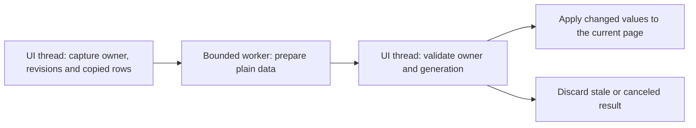

# Panel loading and threading investigation

20 October 2026, Asia/Tehran. Investigation and recommendation only; no plugin
implementation, version bump, installer replacement or artist installation.

## Finding

Panel responsiveness can improve, but assigning one worker thread to each panel
is not a supported solution. Creation and manipulation of Max rollouts, their
WinForms children and command-panel layout belong on the owning UI thread.
Workers are suitable for sufficiently expensive preparation over copied data.

The current code already loads panel bodies lazily. Its main remaining costs are
constructing many controls when sections are open and repeatedly binding/layouting
open sections. A small fresh Max 2027 experiment found substantial UI latency
even with an empty controller and no plant geometry. This supports reducing UI
work first, then introducing workers for measured eligible preparation.

## Scope, identities and evidence

The shared checkout is branch `codex/workflow-0.75`, HEAD
`3ec1cbc2b725912e39c2625ceecb648970054050`, with substantial uncommitted changes.
Concurrent 0.86.7 thumbnail/material/compatibility work is present; this
investigation neither modifies nor qualifies that work.

Two baselines are deliberately separate:

1. **Current source snapshot:** panel templates/generators and native layout
   helpers copied into
   `build/panel-threading-research-20261020-01/source-snapshot/`, with hashes in
   `SUMMARY.json`. The main panel template now says 0.86.7; its diff against
   HEAD is version wording. The lazy/layout/colored-list generators and native
   rollout helpers inspected here have no tracked diff against HEAD.
2. **Measured executable baseline:** the exact delivered **0.86.6.2 / Max 2027**
   script/native/managed files extracted from its MZP and hash-checked against
   `dist/CyrusScatter-0.86.6.2-20261020/RUNTIME-IDENTITY.json`. This avoids mixing
   an in-progress script with a different native pair.

The measured script SHA-256 is
`3a5db6ace320e9a6dfd6ca24ef04845c1717c390e512b75119e3bc8238a88de6`.
Native hashes and loaded paths are in the private launch metadata and
`loaded.tsv`. The owned profile is
`build/individual-model-library-20261020/hosts/panel-research08662-01/`, PID 50716
during the run. It exited normally. No artist or other task's host was targeted.

Raw evidence and repeatable drivers live under
`build/panel-threading-research-20261020-01/`:
`launch_probe.py`, `probe_host.py`, `launch.json`, `PROBE.json`, `SUMMARY.json`,
`CONTROL-INVENTORY.json`, and `source-snapshot/`. Build evidence is local/ignored,
not included in a Git clone. No model files, Corona rendering or new builds were
needed. Other artist/test/build activity overlapped on this machine, so timing
samples are exploratory observations, not a controlled benchmark.

Knowledge status was checked. The selected generation
`c14f3d16e81bcf39ebd488d53bcec1239b522a0de37dcc8a81738bffdcf9be3e`
does not establish current working-tree freshness; full verification was not
requested. The panel behavior search reported stale evidence. Current conclusions
therefore use direct source inspection and the separately frozen host experiment.
No index refresh occurred.

## What happens when the controller is selected

The authoritative path is
[approved-main-ui.ms](../../../AminScatter/tools/ui/templates/approved-main-ui.ms),
generated by [approved-layout.cjs](../../../AminScatter/tools/ui/approved-layout.cjs)
and [lazy-pages.cjs](../../../AminScatter/tools/ui/lazy-pages.cjs). Edit those
sources for any later implementation, not only the generated script.

| Step | Existing behavior | Thread / lifetime |
| --- | --- | --- |
| Select controller in Modify | Max creates the plugin-level main rollout and twelve lightweight slots | Host UI thread; Max owns the controls |
| Main rollout opens | A 1 ms timer queues initialization | Deferral on the same event loop, not a worker |
| Mount timer | Invokes all twelve rollout factories and restores open/closed presentation state | Serial MAXScript on the UI thread |
| Bind sections | Visits applicable sections; open bodies are mounted with addSubRollout | Actual controls are created only for open sections |
| Bind data | Assigns owner/context and control values, prepares lists/status | Host/UI work; repeated for every open section on a full bind |
| Layout | Calculates row geometry, text wrapping, control positions and hosted visibility | UI-thread HWND/font operations |
| Warm owner switch | Reuses bodies while the Modify view remains mounted | Binding/layout still run; it is not full construction |
| Deselect/unmount | Stops timers, releases scroll hooks and clears editor/root references | Max controls are destroyed according to its ownership |

All twelve factories running does **not** mean twelve complete native control
bodies are created while collapsed. Conversely, an open section creates its
Advanced/hidden controls as part of that body: laziness is currently section-level.
Restoring twelve open sections therefore defeats most initial construction savings.
The code does not implement an asynchronous panel-preparation pipeline.

The current source manifest has 387 authored component controls, 77 flagged
Advanced: Layers 14, Surfaces 12, Models 29, Containers 8, Layout 74, Amount 54,
Painting 32, Include/exclude 43, Transforms 57, Spacing 30, Display 23 and
Statistics 11. These are source metadata counts, not HWND counts or the exact
inventory of the measured frozen package. Generated captions/grips/colored-list
hosts add controls; compound native controls can contain several HWNDs.

## Fresh timing observations

The probe used one empty controller with one logical layer, Manual mode, no
receivers, no sources and no plant import. It selected the node once per sample;
it did not also call modPanel.setCurrentObject and accidentally count a second
mount. Actual mountTimer initialization ran through the host event loop rather
than being invoked manually.

| Sample | Synchronous select call | Observed panel-ready time | Mounted bodies | Explicit warm full bind |
| --- | ---: | ---: | ---: | ---: |
| First selection, Layers + Surfaces open | 645 ms | 1,605 ms | 2 | 69 ms |
| Reselect, same two sections open | 531 ms | 1,407 ms | 2 | 68 ms |
| Reselect, all sections restored open | 585 ms | 12,352 ms | 12 | 1,350 ms |
| Repeat all-open reselection | 1,149 ms | 9,227 ms | 12 | 820 ms |

Panel-ready time includes the select call, queued mount and subsequent readiness
observation. A 10 ms observer timer, event-loop scheduling and concurrent machine
activity add noise. Readiness is control binding completion, not measured first
paint or presented FPS. There are only two observations per open-state condition;
they are not p95 statistics or an all-scene performance promise.

Existing native diagnostic stages recorded these inclusive totals:

| Sample | ui_create | ui_bind | ui_layout | ui_lists |
| --- | ---: | ---: | ---: | ---: |
| First two-section mount | 452 ms | 284 ms | 294 ms | 53 ms |
| Two-section reselection | 442 ms | 274 ms | 306 ms | 64 ms |
| First all-open mount | 7,249 ms | 3,485 ms | 3,038 ms | 206 ms |
| Repeat all-open mount | 5,046 ms | 2,398 ms | 2,075 ms | 267 ms |

**Do not add these columns:** bind includes layout, layout can include lists,
and resize can cause additional layout calls outside bind. ui_create covers
addSubRollout/body mounting, not the entire earlier native selection or script
factory work. Unattributed time is not proven CPU computation or proof of a
particular Max internal bottleneck.

In the first all-open sample, the largest recorded body creations were Include/
exclude (1,300 ms), Amount (1,151 ms), Layout (1,110 ms) and Transforms (782 ms).
Some already-created page binds remained expensive: Transforms 336 ms and
Include/exclude 239 ms in that sample's warm bind. These observations justify
targeting body size and repeated UI work, not just background file operations.

All non-UI recorded stages had zero calls during the measured samples:
geometry extraction, candidates, masks, attributes, spacing, preview preparation,
GPU upload, publication and map baking. The recorded calculation epoch stayed
at 1 before/after each warm bind. This is evidence of passive presentation in
this empty fixture, not arbitrary-scene lifecycle qualification. Per-thread CPU
usage, core affinity and OS wait stacks were not captured; ownership conclusions
come from source and API contracts, while these are wall-clock durations.

### Existing historical evidence

[I01/I02, 0.82.6](PROGRESS.md) already implemented the lazy body lifecycle,
retained unchanged list rows/styles, actual-font text metric caching and scoped
diagnostics. Its eight-layer witness reduced reselection from a 10.11 s median
to 1.41 s. Those are historical pair/fixture results, not a new improvement
claimed by this investigation. B21 already tracks residual controller-selection
latency. The older [0.82.3 investigation](../eleven-phase-roadmap/PERFORMANCE_0823.md)
also separated native construction from binding and documented a double-mount
measurement mistake. Preserve those lessons and original receipts.

## What can run on other threads

Autodesk's [Max 2027 threading guide](https://help.autodesk.com/cloudhelp/2027/ENU/MAXDEV-Python/files/MAXDEV_Python_threading_html.html)
prohibits worker access through pymxs/MAXScript while allowing independent
background work such as file I/O. Its [Max 2027 C++ API guidance](https://help.autodesk.com/cloudhelp/2027/ENU/MAXDEV-CPP-API-REF/class_max_s_d_k_1_1_rendering_a_p_i_1_1_i_rendering_process.html)
also says most SDK scene operations require the main thread. Specific renderer
worker interfaces do not grant general permission to manipulate the command panel.

[Qt's GUI rules](https://doc.qt.io/qt-6.8/threads-qobject.html) restrict widgets to
the GUI thread. [WinForms guidance](https://learn.microsoft.com/en-us/dotnet/desktop/winforms/controls/how-to-make-thread-safe-calls)
likewise requires controls to be accessed on their owning thread; dispatching a
callback back to that thread does not make control creation parallel.

The native project already enforces this in `rollout_flow.cpp` and
`rollout_scroll.cpp`: window-owner-thread checks guard text measurement,
show/hide/layout and scroll binding. `cyrusSetRolloutVisible` calls Max's
UpdateLayout. Adding a mutex does not remove that ownership requirement.

| Operation | Worker suitability | Recommended approach |
| --- | --- | --- |
| Max rollout/HWND creation; control assignment; font/position measurement | Host/UI only in this integration | Create fewer controls and avoid unchanged assignments/layout |
| Reading live nodes, ParamBlocks, MAXScript values, selection or Analyzer freshness | Host only | Capture bounded data or use existing valid caches |
| Pure sort/filter/label preparation over copied rows | Eligible if sufficiently costly | Native or managed bounded worker, followed by validated UI publication |
| File metadata, JSON parsing, hashing, image decode on independent data | Eligible | Existing bounded worker/cache pattern; separate library work from Modify-panel work |
| Layout decisions using immutable numeric descriptors | Potentially eligible | Only worthwhile if copying/dispatch costs less than saved computation; HWND application remains serial |
| Applying prepared rows to lists or setting widget positions | Owning UI thread | Coalesce changes and update only differences |
| Scatter placement computation and GPU drawing | Separate existing systems | Do not trigger or rewrite them merely to open panels |

Replacing MAXScript with C++ does not allow concurrent Max control creation.
Task.Run around a MAXScript bind is unsafe. Async callbacks/1 ms timers can
improve scheduling but remain on the same thread unless work is explicitly
offloaded. A separate external UI process is technically a different architecture
with its own UI thread and state/IPC bridge; it still needs serialized Max scene
access and is not justified as the first response to these measurements.

## Specific source opportunities

Preserve what is already optimized: lazy addSubRollout, retained list items,
one-time styling/grip setup, wrapped-text metric caches and guarded width changes.
Do not reinstate eager construction as a threading experiment.

| Source / operation | Finding | Concrete next step |
| --- | --- | --- |
| approved-main-ui.ms: bindNativeUI path, bindEditors / bindSection | Full binds revisit every applicable open body; there is no whole-page revision shortcut | Merge repeated requests and bind only pages whose model/owner data changed |
| approved-layout.cjs: generated bind/layout | Every bind finishes with layout; repeated row positions and hosted visibility work remain | Separate value synchronization from layout; use a layout dependency key and skip unchanged writes |
| lazy-pages.cjs and page row definitions | Opening a body creates its hidden Advanced controls too | Prototype deeper lazy subsections for expensive optional content while preserving saved disclosure state and normal SDK ownership |
| unified-core.ms: source updateList, sourceLabel/sourceVisualIndex/sourceBandRows | Strings/palettes and nested identity/Band lookups can repeat before retained-item comparison | Cache prepared labels/colors by stable source-row ID and actual presentation revisions |
| colored-lists.cjs: syncColorLists and DrawItem | All item/color/selection comparisons run during layout; some draws ask sourceLabel again | Keep an immutable prepared row presentation table; invalidate only changed labels/colors/selection |
| main UI refreshTitles / container-node.ms | A full bind refreshes tracked source-container contexts/labels | Refresh only when membership, name or color dependencies change |
| Layout updateAnalyzerStatus | Assigned guides can call analysisCurrent, which flushes queued host events | Measure and defer irrelevant/hidden freshness queries where semantics allow; never run that call on workers |

Do not assume every binding helper evaluates meshes. `sourceCanAuto` checks
base-object ClassIDs; simple layer statistics use cached counters; the Amount
preview accesses an existing Bitmaptexture bitmap rather than rendering a map.
Any claim that these are the bottleneck needs measurement.

## Recommended implementation order

1. **Use the existing diagnostics to establish a small repeatable baseline.**
   The new empty-controller probe is a starting point. Add only the relevant
   populated source-list/owner witness needed for a suspected data hotspot.
   Keep initial selection, queued mount, actual page creation, warm bind and
   first paint separate. Compare open-section state and DPI explicitly.
2. **Reduce repeated warm work.** Coalesce requests, add per-page data revisions,
   and separate values, lists, titles/status and geometry layout. A scalar edit
   should not force every open page's geometry to be assigned again. This can
   improve responsiveness without introducing concurrency.
3. **Reduce initial control construction.** Extend existing lazy behavior to
   costly optional subsections; prototype on one expensive page first. Investigate
   supported rollup layout batching instead of repeated broad show/reflow calls.
   If needed, schedule one complete section at a time between host event-loop
   turns, with clear loading/disabled state. This can reduce the longest freeze;
   it is cooperative UI scheduling, not multicore execution, and may not reduce
   total completion time. Do not forcibly collapse the artist's saved panels.
4. **Move only a measured eligible hotspot to a bounded worker.** This is useful
   for large copied row preparation or file/image work. The empty fixture shows
   that background preparation alone cannot remove the dominant creation cost.
5. **Consider a broader UI framework/virtualization change only if the smaller
   prototype remains dominated by unavoidable per-widget construction.** Fewer
   live widgets/visible-row virtualization may matter more than language choice.
   Compare real lifecycle, memory, DPI and binding costs before choosing a rewrite.

There is no measured speedup estimate yet. For intuition only, if 80% of an
operation must remain serial, infinitely fast parallel preparation of its other
20% yields at most 1.25× speedup. That example is not a fitted ratio for this
probe. Reducing the serial work itself can improve that limit.

## Safe asynchronous design, if measurements justify it

Capture controller/layer/source-row identities, input revision and a panel
generation. Cancel/discard on selection change, close, deletion, reset/load and
relevant Undo. Workers must not hold scene nodes, MAXScript Value pointers,
ParamBlocks or UI handles. Never synchronously block the UI waiting for a worker
whose completion needs that UI thread. Use a bounded pending queue/cache and
release copied buffers when work is canceled or the plugin unloads.

UI data revisions cannot rely only on `procEpoch`: pending Manual changes can
change displayed values while the published scatter epoch stays unchanged.
Layout cache keys need actual width, DPI/font state, disclosure/mode visibility,
wrapped text and list-height changes. Names/colors/source membership/Band
assignments need their own presentation invalidation. Some existing helpers
repair missing source IDs; that stays a host initialization operation, not an
unnoticed worker mutation.

Apply results with binding-event guards so setting controls does not write stale
values into the newly selected owner. Keep existing authored Undo semantics.
Never retain dead HWNDs across Max's unmount/destruction just to claim reuse.
Cache immutable data across selections; keep UI-resource reuse within supported
valid lifetimes. Publish only a complete consistent page or a clearly marked
loading state, and retain the last valid same-owner presentation on preparation
failure. Follow F01, F04–F08 and F11, especially Manual pending-state retention
and zero extra static solve/preparation/upload during passive UI work.

## What remains to be decided or measured

- First-paint and OS wait-stack/per-thread traces were not captured. There is
  no claim that every elapsed millisecond saturated one CPU core.
- Large source lists, assigned Analyzer guides, containers, many layers,
  high DPI and actual artist-scene owner switching remain separate witnesses.
- No worker prototype, changed layout cache, deeper lazy section or virtualized
  replacement has been implemented or benchmarked.
- B21 remains open. The concurrent B33/B34 library/material work is separate.
- This investigation ran **Max 2027 only**, built no binaries, touched no artist
  profile and did not commit/push, install, restart or select a release version.

The next concrete engineering step is a scoped revision/layout-cache prototype
and one expensive-page lazy-construction prototype, measured against this same
selection procedure. Add background computation only after identifying data
preparation large enough to justify its capture/copy/dispatch/lifecycle costs.
