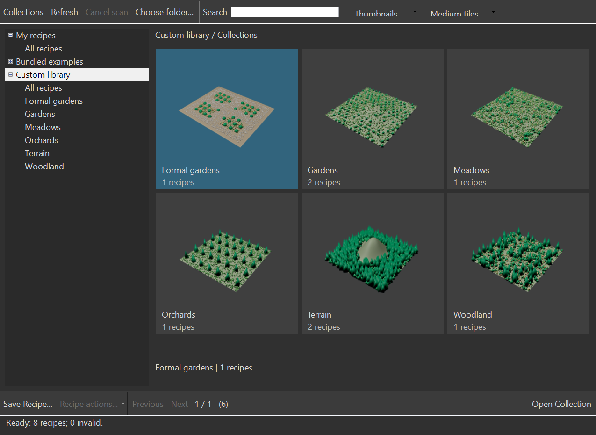

# Gallery layout — user reference and implementation direction

16 October 2026. The user supplied two Forest Library Browser screenshots while the 0.85.1 implementation was in progress. They clarify the intended primary workflow: browse collections and large image tiles, then load the chosen content. This steering supplements the PG01–PG10 scope; it does not cancel persistence, Paint, performance or testing work.

The current 0.86.2 Cyrus library window retains the 0.86.1 navigation and provides:

- A collection tree on the left, with user, bundled and chosen custom libraries and their collections.
- A large central thumbnail area for collections/recipes, with clear captions and selection.
- A compact toolbar for search, view mode, thumbnail size and explicit refresh/navigation.
- **Load onto surface**; double-click/Enter opens a collection or loads onto the captured selected terrain, creating a setup only when needed.
- Separate Save Recipe and Edit Details dialogs. Save/Style/export need a valid setup; file browsing and details do not. No binding review interrupts the default ready-load workflow.
- Explicit dark enabled/hover/pressed/dropdown backgrounds with readable text and arrows, disabled colors and system high-contrast colors.
- Responsive resizing and scoped 100%/150% Max 2027 tests. Physical 4K/mixed-monitor behavior still needs its own witness.

The initial PG02 prototype demonstrated the catalog/image service and passive browsing, but devoted too much space to the save form and binding controls. Its screenshots and receipts remain prototype evidence. They do not qualify the revised layout. Reuse the bounded image control, metadata service and persistence logic; replace the main presentation around those services.

Forest's displayed duplicate-material and Merge/XRef choices show useful future workflow locations. Cyrus will expose those policies only with the corresponding PG07/PG09 supported adapters. A matching-looking button must not imply an unimplemented asset import operation. The design adopts the browsing structure without copying vendor branding or library assets.

The default loader imports independent packaged sources. Typed explicit-reuse review remains internal; the normal browser does not expose a second binding-heavy load route. Earlier bounds and captures retain their original scope in [the historical ledger](PROGRESS_0851.md) and [0.86.1](DELIVERY_0861.md). The [0.86.2 qualification](DELIVERY_0862.md) records current readiness details, compact image controls, 100/150/200% Modify-panel bounds and owned-window navigation. Physical mixed-monitor transitions remain separate acceptance.

All ordinary browsing remains file/metadata/image work only. Save and load dialogs capture their owner and document identity independently, so changing a selected gallery tile cannot redirect an already reviewed scene operation. Collections, tile controls, image workers/cache and metadata pages remain bounded. No filesystem polling, scene solve or unchanged-buffer upload is introduced by the new layout.

Async view updates also capture a **per-open session token**. Owned 2026/2027
qualification found that a MAXScript rollout value can survive close/reopen, so
rollout equality alone cannot identify the original browser session. A completed
load may rebind controls only when its captured token still matches. Reopening
onto another surface leaves both operations' captured owners and terrain intact.

## Retained 0.85.1 implementation captures

These are direct renders of the actual owned Max 2027 gallery control, after its resize/reopen event loop settled, using script `f695bf51…`. They are not mockups or physical-monitor qualification. The source files and bounds receipts remain under `foundation-roadmap-gallery0851-reopen-20261016-01`.

[100% compact gallery](images/library-0851-100.png) and [150% compact gallery](images/library-0851-150.png).

