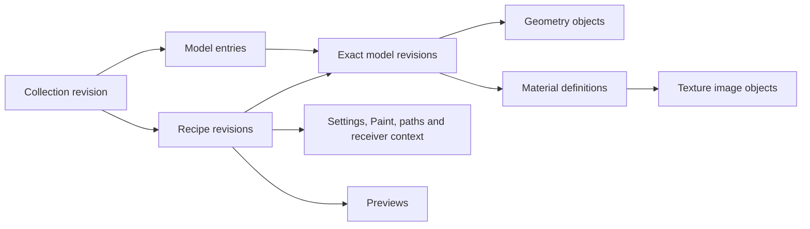

# Shared library system — implementation plan

**26 October successor:** the user subsequently authorized implementation, tests and 0.87.1 installers. [Delivery and exact acceptance](DELIVERY_0871.md) supersede the planning-only status for the implemented static scope. Original future-tense requirements and the wider T01–T14/A01–A26 matrix below retain their planning provenance; they are not all claimed passed.

23 October 2026. **Planning complete; implementation and qualification pending.**
The user requested this plan and explicitly said not to start coding. All work
packages and acceptance cases below describe future work. No plugin code, asset
files, registrations, installations or release versions are changed by this plan.

The intended result is **one configurable asset store, reusable model revisions,
lightweight recipes and collections, and a portable collection archive**. Saving
ten looks with the same tree, grass and flowers stores their unchanged geometry
and texture image bytes once in that store. Each look preserves its own settings
and exact asset revisions. A recipient imports the collection and its required
assets without locating the author's original model folders.

This extends the personal-content part of the existing
[shared content plan](UI_AND_CONTENT_IMPLEMENTATION_PLAN.md). It does not replace
the delivered installer work or the program roadmap. The
[execution ledger](../improvement-program/PROGRESS.md) remains the status owner;
SL01–SL09 below are local work-package identifiers, not P/I/PG/N phases or releases.

## Readiness update — 25 October 2026

The [current source readiness review](SHARED_LIBRARY_READINESS_20261025.md)
confirms that the storage architecture remains applicable after 0.87.0.
The host target is now **scene schema 60**; portable static recipes still use
**recipe 8 / portable sceneSchema 59**. Keep these contracts distinct.
The original source baseline below is historical and must not override this update.

Preserve the new independent recipe/preset readers, prepared-package lease
ownership and immediate created-node tracking. Integrate the new store through
shared providers without replacing another consumer's catalog or weakening its
admission/local-grant policy. Retained package handles are not persistent asset IDs.

The first supported ten-look case remains ordinary static planting. Current
recipe capture rejects Collider/React roles and retained reviewed plant
definitions, even when those roles are switched off. Complete Interactions
sharing needs a versioned preparation-definition adapter and authored role/settings
codec. Preserve source-revision binding and review acceptance; derived instance
poses/guides/render helpers are not reusable authored assets. Exclude timing and
diagnostic report fields from canonical model/preparation identity. Keep the
current rejection until that adapter is implemented and qualified.

The existing native `.max` model import has the open B38 Undo-history defect.
SL03/SL04 must preserve the native owned staging path and explicitly address or
exclude the unsafe route before claiming transactional model import. A24–A26
below record the added acceptance. No implementation starts through this update.

## 1. Evidence, scope and decisions

### Source baseline

Source inspected on branch `codex/workflow-0.75`, HEAD
`7d5fd264f8c39e306389977d1eda7c4f358bd3c8`, including substantial existing working
changes. README points to [0.86.9](../edit-instances/DELIVERY_0869.md), schema 59,
recipe 8, and independent content revision 0.86.7. A clean HEAD alone would not
represent the inspected working tree. Implementation must recheck the relevant
files and integrate the existing changes.

The [asset foundation research](ASSET_FOUNDATION_RESEARCH_20261023.md) records
official Forest Pack/Cosmos sources, limited installed-file observations and
source hashes. It distinguishes catalog reuse, scene reuse and physical file
reuse. Vendor evidence does not establish universal automatic deduplication.
That uncertainty does not block this explicit Cyrus design.

Earlier knowledge retrieval reported stale evidence. The planning path query
returned no enrolled result for the existing shared-content plan; that is not a
freshness pass or evidence of absence. This plan relies on direct originals.
No knowledge generation was refreshed or activated.

| Current implementation | Consequence for this plan |
| --- | --- |
| `asset_package.cpp::writePackage` deduplicates within one output directory using a local set | Different recipe packages still copy identical payloads; replace the new-save storage path with shared-object references |
| `CyrusPresetReviseReady` prepares and writes another package for a revised recipe | Metadata edits must become reference/metadata updates without mesh or image copying |
| `InstallEngine.cs` already verifies `objects/<full SHA-256>` and makes same-volume hard-link pack views | Extend this storage foundation; do not create a competing personal blob store |
| `preparePackage` copies images into host-profile `ImportedAssets` | New shared-library imports bind stable paths in the shared store; retain existing cache paths for older scenes |
| Recipe entry save can precede ready-package failure | A complete recipe save needs one visible publication boundary; a failed successor must not expose a settings-only replacement |
| The individual-model gallery assumes the delivered 104-card catalog | Add a bounded personal model catalog alongside the installed-pack adapter |
| Mesh encoding separates geometry from graph node identity, transforms and material binding | Reuse that boundary, but prove capture stability and make encoding selection independent of the material |
| New Edit persistence exists in 0.86.9, while recipe capture still rejects authored Edit/radius data | This storage project must preserve that explicit recipe limitation |

Relevant source anchors are listed in section 12. These are source conclusions,
not new execution results. B29's incomplete-save/readiness concern is relevant;
B35's delivered shared installation is a foundation, not an unimplemented item.

### Product decisions

1. One active writable local store per user. Multiple named libraries are
   collections within it; adding an item to another collection adds references.
2. Reuse exact immutable bytes by full SHA-256, verified size and supported type.
   Filenames, original folder paths and model names never establish equality.
3. Store geometry, image bytes, material definitions and placement settings as
   separate dependencies. A tint/UV/gamma change can reuse geometry and images.
4. Give models and recipes stable catalog identities and immutable revisions.
   Recipes pin revisions; an asset update never silently changes older looks.
5. Save supported scene assets automatically with a complete recipe. Saving a
   model separately is optional and exposes the same reusable model entry.
6. Share a chosen collection/selection as one self-contained archive containing
   the union of its dependencies. Import installs only missing verified bytes.
7. Make migration explicit, resumable and reversible. Preserve original recipes,
   packages and saved-scene paths; report retained duplicate space honestly.
8. Separate deleting catalog references from removing physical data. Initial
   delivery has no automatic purge of published asset blobs.
9. Keep local save/load/share usable offline. A cloud account, resident service,
   marketplace and network multi-writer store are not prerequisites.
10. New development and qualification use Max 2027. Existing older-host receipts
    remain historical; this planning request does not extend qualification.

### Meaning of “saved once”

The promise applies to identical supported payload bytes within one managed
store on one local NTFS volume. Multiple logical filenames may be hard links to
one physical file. Different compression, mesh ordering, codec versions or image
file metadata can produce different bytes and therefore distinct objects.
There is no approximate geometry matching or lossy image conversion for deduplication.

Original source files, export archives, backups, independently usable stores on
other machines, retained cross-volume legacy paths and geometry embedded in
separate `.max` scenes are separate allocations. Their existence must be visible
in storage reporting, not counted as a failure of recipe-to-recipe reuse.

### Content boundary

The first delivery supports a **reusable Scatter look**: the current supported
static model/material/map adapters, source settings and weights, ordered layers,
spacing relationships, seeds, masks, compatible Paint, paths and receiver context.
Keep current geometry, renderer-version, colour-management and admission guards.

It does not automatically become a complete `.max` scene archive. Cameras,
lights, arbitrary modifiers/hierarchies, animated sources, native proxies, plugin
executables and authored Edit/radius/effect records require their own adapters.
Current selected-terrain loading stays authoritative: one supported saved
receiver role set binds to a compatible selected surface, with Paint/path checks.
Do not silently substitute saved terrain when transfer is incompatible.

Installed native `.max` model packs retain their existing adapter. A captured
portable mesh and the `.max` container it came from are different representations.
The store cannot deduplicate geometry hidden inside arbitrary containers.

## 2. Artist workflow

| Artist action | Required result |
| --- | --- |
| Import a tree from `F:/New Folder`, scatter it and save a complete look | Capture supported geometry/materials/textures into the managed store; save references and settings; original files remain untouched |
| Save nine more looks using that tree | Reuse verified geometry/images; store each look's settings and preview separately |
| Save a selected model to My models | Create or reuse its model revision; optionally add it to a collection; no second mesh/image allocation |
| Make a material variation | Add a material/model revision as needed; reuse unchanged mesh and image bytes |
| Rename, tag or move an item between collections | Update catalog metadata only; preserve content revisions and scene results |
| Load a look into a fresh scene | Resolve its exact dependencies, create independent scene objects/materials, bind the chosen terrain and add layers in the existing authored transaction |
| Update a tree in the library | Retain older revisions. Only an explicit recipe-update action changes which revision a recipe uses |
| Export ten looks | Write one archive with ten recipe roots and each distinct required payload once |
| Import that archive elsewhere | Verify and add all required assets and collection metadata. The original drive path is unnecessary |
| Import the same archive again | Reuse the same payloads and imported identities; report already present rather than create duplicate cards |
| Remove a collection | Remove membership references; keep models/recipes used elsewhere and retained revisions |
| Change library location | Run a verified copy/adoption workflow; old scene paths stay available until separately handled |

Keep ordinary workflows simple: **Save Model**, **Save Recipe**, **New Collection**,
**Add to Collection**, **Export Collection**, **Import Collection**, and
**Manage Storage**. Save Recipe defaults to the complete supported look. Keep an
explicit settings-only choice with a different readiness label. A failed complete
save does not silently change that choice.

Report useful outcomes, for example “10 looks imported; 3 models reused; 0 new
model or texture bytes.” Show compatibility or missing-dependency reasons before
Load. Hashes, locks and transaction journals belong in expandable diagnostics.
Creating/selecting a collection must not create scene geometry or calculate Scatter.

## 3. Data model and identity



### Records

| Record | Identity and required content | Mutation rule |
| --- | --- | --- |
| Stored object | Full SHA-256 of exact bytes; byte length; references carry kind, codec/version and interpretation constraints | Create once, verify before reuse, never overwrite with different content |
| Model revision | Hash of canonical definition: geometry refs, material assignments, supported local frame/pivot data, adapter/compatibility requirements | Immutable; a material-only variant may reuse all mesh/image objects |
| Model entry | Stable UUID, name/tags/category/provenance, retained revisions and chosen current revision | Metadata/current pointer changes explicitly; recipes do not follow it automatically |
| Material definition | Canonical supported graph, parameters, image refs, colour/UV settings and renderer/map requirements | Immutable; raw images stay independent of their interpretation |
| Recipe revision | Authored recipe payload plus exact model revision refs, source-role bindings, context/Paint/path refs and capability requirements | Immutable; revise settings or bindings by publishing a successor |
| Recipe entry | Stable UUID, retained revisions, display metadata and thumbnail reference | Metadata edits do not recapture assets or change pinned model revisions |
| Collection revision | Stable collection UUID, name, ordered model/recipe membership; exported recipes pin exact revisions | Immutable snapshot; local latest-entry views may resolve the explicit current pointer |
| Catalog generation | Bounded snapshot of entries/current pointers, memberships and retention roots | Publish by replacing one generation pointer after all dependencies exist |
| Scene provenance | Store ID, model/recipe revision IDs and dependency references, plus capture-validation data where supported | Diagnostic/recovery hints; never a substitute for content verification |

Image descriptors preserve original encoded bytes and validated file type.
Colour space, input gamma, UVs, mapping and output settings belong to the
material/map definition. Two maps using one image in different ways share that
image while remaining different map definitions. Preserve intentional map/material
sharing topology inside a captured graph; disk sharing alone does not merge
independently authored scene material objects.

Model definitions exclude node names, selection, timestamps and world placement.
Per-use source transforms and scatter weights stay in recipe bindings. Preserve
the existing object-offset, stored-normal, face-material and units contracts;
do not normalize away a real pivot or geometry difference to increase reuse.

### Canonical capture and deduplication gate

SL01 must settle and demonstrate the following before the new save path is enabled:

- Canonical UTF-8 definition serialization has fixed field ordering and numeric
  rules, explicit schemas, no transient IDs/timestamps/absolute paths, and bounded
  depth/counts. Preserve meaningful array order and reject non-finite numbers.
- New shared-store mesh captures use one deterministic representation selection
  independent of the shader. Recommended target: the existing `CYRUSM02` encoding
  for new captures, with an explicit resource profile and existing limits. Keep
  old `CYRUSM01` bytes readable through migration; never rewrite old data merely
  to make its hash agree. Confirm this target against stored normals and supported
  source classes before freezing the format.
- Mesh order and authored channels remain exact. No arbitrary vertex sorting,
  quantization or renderer-dependent header changes. A material change must not
  change the geometry key. The current renderer-gated large-mesh export needs a
  targeted separation of geometry admission from shader admission.
- Capture identity includes units/frame, object offsets, supported channels and
  normals. A node name, handle, source file path, modification time or saved UUID
  alone cannot bypass content verification.
- Test unchanged capture in the same scene, after scene reopen, and after library
  import/resave. SDK float/metre conversions can affect the last case. If needed,
  retain the original canonical object only when a complete current host snapshot
  fingerprint matches the verified post-import snapshot. Never trust provenance
  alone or round changed geometry back to an old hash.
- If that stability cannot be achieved within the supported representation,
  resolve the codec/capture issue before claiming the ten-look acceptance. A
  different representation remains a distinct asset, with an explicit reason.

Hash exact payload bytes with SHA-256. On a matching key, verify size and bytes
against the digest under the read/reuse contract. Conflicting metadata or corrupt
existing content is a repair failure, not permission to overwrite. Image suffixes
come from validated codecs, not untrusted filenames.

`ensureModelRevision` resolves verified unchanged content before creating a new
entry. Repeated automatic saves reuse the existing revision. Explicitly distinct
catalog entries may reference the same revision without duplicating its payload.
Never merge different models just because their display names match.

### Format boundaries

Define versioned `cyrus.asset-store/1`, model/material/recipe-reference/collection
definitions and `cyrus.library-bundle/1`. These are proposed independent data
formats, not changes to Scatter's product version or scene schema.

Preserve recipe 8's supported authored semantics. Use a versioned library envelope
to bind its roles and attachments to shared objects; native preparation resolves
them through an explicit provider into the existing typed validators. Do not put
hash URIs into existing path fields and hope old readers accept them. Avoid a
temporary complete package per save/load just to reuse a directory-only API.

The implementation should preserve the current host scene schema 60 unless
actual authored scene data requires a separately reviewed schema change. The
existing static recipe-8 payload retains its portable sceneSchema 59 contract;
a version-number edit alone cannot add Interactions serialization. New provenance
is optional metadata with a versioned reader. Preserve current supported scene
loading and the explicit schema-58 upgrade; this project does not restore earlier
development scene schemas.

## 4. Store layout, resolver and ownership

Use an existing compatible `ManagedRoot` when configured and writable. Otherwise
offer a short local NTFS location, with a user Documents location as a default;
the user can choose `F:/CyrusLibrary`. Record one store ID and path in small
per-user configuration. Bulk files live outside plugin release and Max-year
runtime directories. Preserve the current bundled-content registration for
older consumers; add a versioned personal-store binding rather than rewriting
their catalog to resemble a personal library.

```text
<chosen root>/
  store.json                         identity, schema and writer capabilities
  objects/<full-sha256>               existing immutable byte-store convention
  resolved/<full-sha256>.<extension>  stable same-volume links for file consumers
  packs/<existing-pack-key>/          retained installed-pack views
  catalog/snapshots/<hash>.json       compact immutable catalog generations
  catalog/current.json               atomically replaced current pointer
  pins/                              retained revisions, projects, operations
  receipts/                          committed operations and migration maps
  staging/<operation-id>/             owned temporary files and journal
  content.lock                       shared writer lock with the installer
```

Canonical definition bytes and previews are also objects. Catalog snapshots
contain small references, not embedded meshes/images or copies of whole recipe
graphs. An index/cache may accelerate lookup but is rebuildable from manifests;
it is not the sole source of asset identity or reachability.

The resolver maps `(store ID, object digest, validated type)` to immutable files.
Native mesh readers can read the hash filename directly. Image consumers that
require an extension receive a validated `resolved` path hard-linked to the
object. Repeated imports use the same stable path. Hard-link failure is an
explicit operation failure; no silent full-copy fallback that breaks the storage
promise. NTFS links are not directory junctions or symlinks.

Only adopt links from verified, owned immutable library files on the same volume.
Copy/hash mutable external sources into owned storage; hard-linking a texture
from the artist's original folder would allow an external edit to mutate saved
looks. Never modify an object, linked map or linked pack file in place.

### Implementation boundaries

| Owner | Responsibility |
| --- | --- |
| Native C++ mesh/material/recipe codecs and host bridge | Supported capture, canonical definitions, graph validation, geometry storage/admission, detached preparation and host scene transaction |
| Shared managed content component extracted from `InstallEngine.cs` | One byte-store writer: verified streaming ingestion, locks/journals, immutable files/links, catalog publication, bundle I/O and migration |
| Installer adapter | Existing pack/runtime planning and registration, using the same byte-store writer and lock; plugin-only updates remain content-free |
| Managed gallery | Bounded catalog pages, previews, status and explicit operation requests; UI-thread control ownership |
| Generated MAXScript templates | Capture valid owners, present authored choices, coordinate native/managed jobs and existing Undo/apply operations |

Keep bulk host geometry and prepared mesh ownership native. Managed streaming
file I/O is chosen because the installer already owns this foundation and ZIP
transport is file work. Pass only bounded descriptors, paths and operation tokens
between layers; never marshal vertices or image bytes through managed/script
object arrays. One store writer avoids two implementations of publication and
recovery. Native package APIs remain adapters for supported old packages and
typed preparation; they do not become a second new-store commit engine.

All SDK access, node/material creation and publication stay on the host thread.
Workers own detached bytes/files and immutable descriptors. Poll bounded progress;
do not invoke Max from file workers or block the UI waiting for a running worker
while holding scene/control references. Release jobs on scene reset/close with
explicit lifetime ownership and stale-token rejection.

## 5. Save, load and publication transactions

### Save Model / Save Recipe

1. Capture the requested owner, selected layer IDs, destination store and expected
   entry revision. Preflight supported classes, renderer/maps, units, Paint/path
   bindings and resource limits. Resolve all enabled and retained authored
   dependencies, including sources temporarily assigned zero weight.
2. Capture one coherent authored snapshot on the host thread. Revalidate owners
   and relevant dependencies if capture yields between objects. Never combine
   settings from one scene revision with geometry from another. Once detached,
   subsequent scene edits do not alter this saved snapshot; the UI can show that
   the scene has newer unsaved changes. Source deletion during capture fails cleanly.
3. Encode/fingerprint geometry and canonical material definitions; hash supported
   external image files from stable read handles. Validate in-memory image/colour
   interpretation against saved bytes using the existing adapter contract. Refuse
   unsaved or changing image data instead of copying a mismatched file.
4. Resolve model entries/revisions, collect the complete dependency graph and
   calculate existing, missing and temporary bytes. Stream missing objects to
   owned staging, verify hashes/readback and create stable file views. Same-volume
   promotion must not need an additional full payload copy.
5. Build immutable model/recipe definitions and catalog changes. A new model
   automatically discovered during recipe save becomes visible in My models in
   the same catalog transaction. Keep user-created aliases and collection names.
6. Acquire the shared writer lock, revalidate the expected catalog/entry state,
   adopt any identical objects a competing operation has published, and verify
   the complete closure. A conflicting update to the same entry returns a conflict
   with retry/save-copy choices. Never use silent last-writer-wins.
7. Flush verified files and the successor catalog, then atomically replace
   `catalog/current.json` on the store volume. This is the visible commit point.
   Publish one success receipt and refresh the affected catalog page.

Implementation may commit verified immutable blobs before step 7 to avoid holding
all missing bytes in staging. They remain unreachable/orphan objects until a
complete catalog references them. A cancelled save can leave verified reusable
blobs, but never a visible incomplete model or recipe. Report these bytes separately.

Full-save failure retains the prior ready revision. A new failed save creates no
ready card. An explicitly requested settings-only save is a separate valid
operation, with external roles and its own readiness state. It is never the
fallback result of a failed complete save.

Metadata edits copy only bounded metadata and reuse the existing thumbnail unless
the user replaces it. Saving a new look copies changed settings/preview data only
when every asset dependency is already present. No capture/solve occurs for names,
tags or collection membership.

Saving reads authored settings; it must not consume pending Manual changes or
recalculate placements. A thumbnail of the last published plants is not proof of
pending settings. Preserve the current capture/settings identity check: update
explicitly or omit/mark the stale preview before publishing a misleading image.

### Load into a scene

1. Pin a catalog generation and exact recipe/model revisions. Resolve the complete
   closure and compatibility requirements, verify files and admit decoded memory.
   Browsing does not perform this work; Load is the explicit boundary.
2. Prepare detached typed data natively, with shared immutable decoded geometry
   within the operation and stable texture paths from the store. Do not create a
   per-recipe package or copy textures into a new Max-profile cache.
3. Revalidate the captured destination setup, selected surface, units, shader
   availability, layer capacity and Paint/path transfer. Changed selection must
   not retarget a pending operation; deleted/incompatible captured targets fail.
4. Create independent scene source/material instances by default. Preserve
   intentional within-definition sharing, source-row identities/remapping and
   ordered layer/receiver ownership. Add the layers and perform the existing
   explicit load calculation in one authored Undo transaction.
5. Publish complete scene state/result together. A failure after partial host
   mutation or at a late display/publication boundary restores the previous
   sources, settings, result and ownership, with a useful error.

Disk sharing does not imply shared editable scene materials, automatic XRefs or
shared placement buffers. Scene edits cannot mutate stored objects. Loading a
model/recipe again can reuse disk files while producing independent scene nodes.

Keep the normal “new variation” preset-load default. Saved seeds remain stored;
the existing explicit original-variation path is used for reproducibility
acceptance on a compatible identical receiver. Do not claim identical placements
on a different terrain or under a new variation.

Library import/save is a file transaction; scene Undo does not delete shared
files. Scene Undo/Redo retains the necessary authored/native snapshots and asset
retention. Redo must work after the transport archive and original source folder
are unavailable. Saved scenes carry enough provenance to diagnose and explicitly
resolve missing assets; provenance does not replace ordinary Max texture paths.

### Concurrency, recovery and repair

- All store mutation uses the installer-compatible `content.lock` convention.
  Stage slow capture/encoding outside the critical section; serialize final file
  adoption and catalog publication. No UI callback waits synchronously on this
  lock. Report busy work and allow cancellation.
- Use operation IDs, expected generation hashes and a bounded journal state
  machine: planned, staging, verified, catalog-published, complete. The lock is
  OS-owned; the existence of the lock file alone does not mean a writer is alive.
- Unrelated concurrent entry edits may be rebased under the lock. Same-entry
  successor conflicts need an explicit resolution. Concurrent saves of the same
  blob verify and reuse the winner's bytes; one never deletes another's staging.
- A failure before the catalog pointer switch leaves the previous generation
  visible. A failure after it is a committed operation with incomplete housekeeping;
  recovery finishes the receipt and must not report “nothing was saved.” Retain
  the previous complete pointer and validate both pointer and closure on recovery.
- Readers pin immutable generations and leases. Import, export, repair and future
  cleanup respect leases. Lock order is store before any per-entry lock; do not
  acquire a store lock while holding a host scene/Undo/UI lock.
- Restart recovery validates owned journals and files before resuming or deleting
  abandoned staging. Never scan arbitrary folders or treat an unrelated `.tmp`
  file as owned. Cancellation checks occur between bounded stream chunks/stages.
- Corrupt content never passes as reused. An explicit repair uses a verified copy
  with the expected digest, coordinates active readers and recreates every owned
  hard-link view needed for that object. Replacing only the hash filename would
  leave existing hard links on the corrupt file and is insufficient. Journal any
  alias replacement; unknown external paths are preserved and reported.

F05–F07 apply to file and host publication independently. Fault testing must cover
both sides of each commit boundary; a preflight rejection alone is insufficient.

## 6. Collection sharing

### Archive contract

Proposed extension: `.cyruslib`, a bounded ZIP container with a versioned manifest.
The extension is a format decision, not a requirement for a new compression
library. Reuse the existing managed ZIP/streaming foundation.

```text
library.json                 schema, export identity, roots and requirements
objects/<full-sha256>        unique definitions and binary payloads
```

The root manifest identifies exact collection/model/recipe revisions, dependency
object descriptors, counts, sizes, compatibility and redistribution/provenance
metadata. All relationships use digests and logical roles. Local registration,
original drive paths and machine/account identifiers are excluded by default.
Keep the existing explicit redistribution declaration in the export workflow.

Resolve the complete dependency union, including materials, images, masks, Paint,
paths, receiver context and selected previews. Traverse authored references rather
than only currently visible instances. Graph sharing must not omit a dependency
used by an inactive source or a retained authored setting.

The first bundle format is self-contained. Do not silently omit files because
the sender assumes a recipient has a bundled pack. Future delta/reference-only
bundles require an explicit separate contract. Export only supported portable
asset types; unsupported native containers or shader dependencies get a clear
preflight result, not a falsely complete archive.

### Export

Pin the selected revision set and leases, validate the closure and rights metadata,
then stream each distinct object once into an owned temporary archive on the
destination volume. Verify archive entries against manifest digests and counts.
Publish by same-directory rename only after the full archive is readable and
complete. A failed/cancelled export preserves an existing destination; use a new
name or an explicitly selected replacement transaction. Do not extract a second
full library merely to build the archive.

Archive timestamps/order should be deterministic where the ZIP API allows it;
correctness and deduplication depend on object identities, not equality of the
whole compressed archive. Compression of already-compressed images is optional.

### Import

Read a bounded manifest and preflight paths/counts/sizes/types before writing.
Reject duplicate or case-colliding members, traversal/absolute/ADS paths,
links/reparse entries, unsupported codecs, inconsistent hashes/sizes, cycles in
required acyclic graphs and compressed data that exceeds expanded bounds. There
is no script execution or automatic renderer/plugin installation.

Plan the selected roots and missing objects. Verify every selected payload in the
archive while streaming; verify existing local objects before counting them as
reused. Preserve incomplete transport results as non-visible staging only. Native
data validators check supported payloads without loading them into Max. Missing
renderer runtime can be shown as incompatible for Load while allowing verified
supported data to be stored; unknown data schemas cannot be imported as ready.

Commit all selected imported roots in one catalog generation. A full collection
import is all-or-nothing for visibility; an artist may explicitly choose a subset
before starting. Source archive changes, disk full and cancellation leave the
prior catalog complete. Delete the archive only at the artist's discretion; the
new library must work without it immediately after success.

### Collision and update rules

| Incoming content | Result |
| --- | --- |
| Same object digest and verified bytes | Reuse the stored object |
| Same entry ID and same revision | Reuse; repeated import is idempotent |
| Same entry ID, legitimate new revision | Retain both; show the imported revision. Do not silently repoint existing recipes or local edited entries |
| Same entry ID/revision label but different definition bytes | Reject inconsistent identity or import under a new explicit local identity; never overwrite |
| Same display name, different identity/content | Keep both with origin/revision detail; no content merge based on name |
| Artist chooses Import as copy | New catalog identities can share the same underlying definitions/payloads |

Record origin IDs and any local remapping in a receipt so a later identical import
does not create another copy. Resolve recipe references consistently within the
imported collection. Local names/tags do not alter the immutable payload identity.

## 7. Resource, performance and retention contracts

### Initial bounds to freeze in SL01

These are proposed first-format bounds, not measured performance claims. Retain
stricter existing codec/host limits. Adjust only with a recorded reason and
corresponding failure/admission acceptance before the format is delivered.

| Area | Initial bound / rule |
| --- | --- |
| Gallery catalog | Existing 10,000-entry and 32 MiB metadata admission; bounded pages and thumbnail cache |
| Recipe payload | Existing 8 MiB manifest, existing Paint/aggregate bounds and scene population limits |
| Single supported asset graph | Existing 2 MiB graph, 128 objects, 256 files and supported shader/map limits |
| Mesh payload | Preserve legacy/plant bounds; current plant ceiling 1M vertices, 1M faces and 224 MiB encoded per mesh |
| Prepared one-look assets | Existing profile admission, including 640 MiB plant package/preparation ceiling where applicable, plus separate full host-memory admission |
| Portable archive | At most 100 recipe roots, 1,000 model roots, 4,096 unique payload objects, 16 GiB expanded, 2 GiB outer per-object cap; type-specific lower bounds still apply |
| Bundle manifest/graph traversal | 32 MiB aggregate metadata, 65,536 dependency edges and depth 64; checked integer arithmetic and actual streamed-byte enforcement |
| File work | Initially at most two streaming workers, at most 1 MiB buffer each; one admitted large mesh capture/encode at a time |

Ten stored looks do not require ten scenes decoded at once. Library export/import
is file work; scene loading hydrates only the selected look. Ten three-layer looks
in a library do not authorize thirty layers in a ten-population scene setup.

### Peak memory and disk accounting

For capture/scene load, account for the host source/evaluated mesh, detached mesh,
encoded buffer, decoded vector capacities, bitmap decode, old/new publication,
created SDK objects and Undo/Redo retention. Count genuinely shared allocations
once. Free encoded scratch promptly after promotion. A 224 MiB file cap is not a
224 MiB process-memory promise. Use the existing viewport/native admission
framework where applicable; record the separate host allocation uncertainty.

For each destination volume, report missing unique payload bytes, new metadata,
largest capture scratch, export archive allocation, journal allowance and retained
old data. Same-volume staging-to-object rename must not double-count or duplicate
the full missing payload set. External sources are hashed/streamed without full
folder extraction. Space preflight is advisory; handle exhaustion during writes.

Required counters include objects discovered/reused/written, payload bytes
written, verification bytes read, metadata/preview bytes, staging high-water mark,
decoded-memory admission, host capture time, file-worker time and UI blocking
intervals. Measure solve/preparation/upload counters independently. Zero new
payload bytes does not imply zero verification I/O or zero save time.

Distinguish persistent object writes from temporary capture/encoding writes.
Repeated saves must add zero persistent bytes for unchanged objects; bounded
temporary work, if needed to establish identity, is measured and released. Prefer
hashing the native encoded buffer before staging an already present mesh.

Warm browsing, search, selection, collection changes and unrelated animation
must produce zero mesh capture, placement solve and unchanged-buffer upload.
Metadata-only edits must produce zero mesh/image capture and payload writes.
Do not hash the entire library on each browser open or plugin-only update.

### Deletion, backup and offline scenes

Deleting a card/collection removes catalog references and records a tombstone or
retained revision for recovery. It does not immediately delete shared objects.
Reachability includes retained recipe/model revisions, collection snapshots,
installed packs, active jobs, known scene/project pins and rollback state.
Reference counts are derived accelerators and cannot prove offline scenes unused.

First delivery includes a read-only storage report and owned-staging recovery.
General published-blob garbage collection is deferred. No automatic eviction of
images used by saved scenes, and no scheduled purge based only on age/refcount.
An explicit same-volume duplicate-consolidation operation is different: it may
retain every old filename as a hard link to verified identical immutable bytes.

Back up manifests/catalogs and their full dependency closure together. Backing up
only a recipe JSON is insufficient. Portable collection export is a supported
share/recovery route for its selected roots, not a backup of unselected history.
A full-store backup must preserve the store ID and required files; restoring to
a different root also needs the scene-path relocation rules below. Report live
allocation separately from a backup utility's expanded hard-link copies.

## 8. Migration and location changes

### Supported migration inputs

| Input | Adoption rule |
| --- | --- |
| Existing managed installed-content root | Reuse verified `objects` and pack views in place; retain pack identity/compatibility and existing registration semantics |
| Existing personal recipe plus ready package under `Presets/<recipe hash>` | Verify recipe, graph and every attachment; map supported roles to shared definitions and reuse exact payload hashes |
| Multiple revisions/packages containing the same bytes | Ingest once; retain original recipe identities/history and migration provenance without merging distinct settings |
| Settings-only recipe | Preserve as settings-only; do not fabricate missing models or label it ready |
| Existing `ImportedAssets` cache | Record/retain old paths; adopt verified owned files only where relevant to a known migrated dependency |
| User-selected custom library | Verify the supported descriptor/closure; report missing or unsupported content without altering the source |
| Original external model/texture folder | Import selected supported data as mutable source input; do not manage, move or deduplicate the original folder itself |

Freeze the exact supported old recipe/package/graph reader versions and fixtures
in SL01 from current code. Reuse the current explicit recipe conversions where
supported; do not introduce a broad legacy scene-format framework. Preserve
original bytes and historical qualification labels even when a new library
envelope contains a supported converted recipe representation.

### Migration transaction

1. Discover only configured personal/installed roots and explicitly selected
   directories. Read descriptors without launching Max or scanning whole drives.
2. Produce a reviewable inventory: ready/settings-only/missing/corrupt/unsupported
   entries; unique and duplicated bytes; previous recipe revisions; scene/cache
   paths; store/volume compatibility; peak new allocation; retained originals.
3. Freeze selected source manifests/digests and journal the mapping from old entry
   and package identity to new immutable definitions. Preserve names, ordering,
   metadata, previews, Paint and compatibility constraints.
4. Stream/verify missing data into the destination store. Same-volume verified
   owned immutable files may be linked without a new payload allocation. Across
   volumes, copy and verify before publishing; keep originals in place.
5. Validate the entire selected migration group and publish one catalog generation.
   Interrupted work is resumable by hashes and receipt mappings. A changed source
   is a conflict, not permission to accept a mixed snapshot. Re-running the same
   migration adds no duplicate content or duplicate entry identities.
6. Mark successfully adopted entries in the new browser with their provenance.
   Keep the old readers/locations available for unmigrated entries. Avoid showing
   the same migrated identity twice by applying the explicit receipt mapping;
   do not suppress unrelated same-name entries.
7. Leave original source files and registrations recoverable. Source retirement
   or physical duplicate consolidation is a separate explicit operation.

Default migration is all-or-nothing for the selected group. If preflight finds
invalid entries, offer an explicit smaller valid selection and report exclusions.
Do not silently skip a broken tree and call its ten-look collection migrated.

### Reclaiming legacy duplicates

Same-volume consolidation can replace a verified owned duplicate filename with
a hard link to the immutable canonical object, preserving the filename used by
old packages/scenes. Hold appropriate locks, validate that no active writer can
change the file, journal a temporary backup/rename, create and verify the alias,
and only then release the old allocation. Interruption must restore the old
filename or finish the verified alias. Check NTFS volume identity, not merely
drive-letter equality. Do not apply this to arbitrary external source files.

The storage preview distinguishes logical duplicate bytes from physical allocation
actually reclaimable after link consolidation. An old path that already links
to the canonical object does not consume another payload allocation.

Across volumes, retaining old scene paths requires retaining those bytes. A
shortcut, junction, changed registration or background “move” is not a reliable
texture migration. Report the retained space. Release it only after a separately
reviewed scene-relink/retirement action; unknown offline scenes remain a reason
to keep their paths.

### Relocating the active store

For an explicit change of root, acquire source/destination writer locks in a
deterministic canonical-path order, pin the source generation and use a journaled
copy/verification plan. Long file work stays off the UI thread. Recreate internal
hard links on the destination volume and compare the full required closure.
Switch the per-user active-store registration only after the destination is
complete. Failed relocation leaves the previous active registration intact.

A location change preserves store identity and records the previous root as a
retained origin. Only one root accepts new personal writes after the switch;
updated writers reject writing through a relocated origin. Check concurrent
installer/older-client behavior before enabling this operation. The old root is
not automatically deleted, and the new registration cannot repair absolute paths
already embedded in saved scenes.

Provide explicit relinking for the current owned scene or user-selected scene
copies: resolve expected image hashes, validate renderer interpretation, rewrite
supported paths in one Undo transaction and save a new scene copy. Reopen and
validate before marking that scene's path migration complete. Never batch-open,
rewrite or restart arbitrary artist scenes automatically.

## 9. Implementation work packages

Every row is **planned, not started**. Establish source identities again before
coding. Order follows data dependencies; there is no authorization here to start
an implementation, a host session or the wider roadmap.

| ID | Work and principal touchpoints | Exit criterion / dependency |
| --- | --- | --- |
| SL01 | Freeze schemas, capture identity, content boundaries, capability matrix, locks, bounds and old-reader fixture list. Inspect `asset_mesh`, `asset_package`, recipe codecs and renderer adapters | Canonical-capture and SDK-roundtrip risks resolved with scoped evidence after coding/testing authorization; no unresolved identity/storage decision passed downstream |
| SL02 | Extract shared managed byte-store primitives from `InstallEngine.cs`; extend `shared/LibraryLocation.cs` with personal-store registration, stable views, journals and catalog publication | Hash reuse, same-volume links, corruption, concurrency, crash recovery and plugin-only preservation verified; existing installed-pack semantics retained; depends on SL01 |
| SL03 | Native canonical model/material capture and typed dependency definitions; automatic model reuse and Save Model; personal catalog provider in `LibraryGallery.cs` | Same model and material variants have correct independent hashes/refs, supported large static tree admission is shader-independent, personal cards load correctly; depends on SL02 |
| SL04 | Shared recipe envelope/resolver and atomic Save/Update/metadata transactions in `recipes.ms`, `preset-loading.ms`, `assets.ms`, native preparation and library browsing; collections with multiple membership | Complete save never leaves a settings-only successor; metadata and repeated saves reuse payloads; additive load/Undo/Manual contracts retained; depends on SL03 |
| SL05 | `.cyruslib` dependency-union export/import, identity conflict policy, integrity and idempotent receipts | Ten-look archive works on a clean recipient and adds only missing bytes on repeat/partial-store import; depends on SL04 |
| SL06 | Existing package discovery/adoption, migration previews, resumption, path retention and optional same-volume duplicate consolidation | Supported old recipes are preserved and equivalent through new storage; crash/retry and space accounting pass; depends on SL02/SL04 and uses SL05 for recovery fixtures |
| SL07 | Manage Storage, scene provenance/pins, explicit store relocation/relink, deletion/reference behavior, backup guidance and clear readiness messages | Library deletion never breaks retained scenes; relocation/relink preserves original scenes; actual allocation reporting distinguishes links and retained copies; depends on SL06 |
| SL08 | Execute the acceptance matrix below, including the ten-look case, failure boundaries, browser reuse, actual materials and resource measurements in owned Max 2027 profiles | Exact source/native/script/managed identities and results recorded; all mandatory gates pass or delivery scope is explicitly revised by the user |
| SL09 | Update artist/developer documentation and ledger; select delivery version by policy; build and verify matched Max 2027 MZP and applicable EXE/content transport | Runnable exact-qualified installer and checksums delivered with Scripting > Run Script/restart instructions; artist installation remains a separate action |

The first useful internal checkpoint is SL02–SL04 together: create a personal
model, save two complete looks, verify shared storage and load each into a new
scene. It is not the final requested delivery. Sharing, migration and the ten-look
acceptance remain required before this plan's full scope is complete.

Proposed new managed/native modules should be small extensions adjacent to the
existing shared content and asset code. Exact filenames can be chosen during
SL01. Do not introduce a service, database server, generic scene graph framework
or installer invocation from Max to achieve file reuse. Keep generated
`scripts/AminScatterObject.ms` derived from templates/generators.

## 10. Ten-look acceptance case

**Status: designed, not executed.** This is the main end-to-end acceptance gate.
Use owned fixture files and private Max 2027 profiles. “New scene” here means a
separate recipient scene per look, not all thirty populations in one setup.

### Fixture and accounting

Prepare one supported high-poly static tree, one grass model and one flower
model, with known supported materials and six distinct texture-image files.
At least one image is referenced by multiple map uses so image reuse is observed
independently of model reuse. Record mesh/image byte identities, shader/runtime
requirements, units, pivots, normals and compatibility before the run.

Use one compatible saved receiver context and three layers. Make ten recipes
using the same assets/materials while changing supported planting settings such
as amount, seed, source weights, rotation/scale ranges and spacing. Keep the model
geometry/material definitions unchanged in this base case. Put the ten recipes
in one collection and place selected entries in a second collection too.

Let `G` be the union of the three model mesh objects, `T` the six image objects,
`X` the unique receiver/context dependencies, and `M` the actual definitions,
settings, catalog data and previews. Expected final payload allocation is:

```text
sum(bytes in G union T union X) + actual M
```

It is not ten times the geometry/image total. Measure payloads by object hash
and physical `(volume identity, file identity)` so hard-link views are counted
once. Report NTFS allocation rounding, metadata and previews separately. Keep
original input files, exports and retained legacy data outside this measurement.

### Required sequence and results

| Step | Action | Required evidence |
| --- | --- | --- |
| T01 | Save look 1 completely | All supported dependencies verified; one coherent catalog commit; exactly three model mesh objects and six image objects, plus measured context/metadata |
| T02 | Save looks 2–10 | Zero new persistent object writes/allocation for unchanged `G`, `T` and `X`; temporary capture work measured separately; ten recipes with their exact settings and model revisions |
| T03 | Add collection memberships, rename/tag a recipe | Zero model/image capture and payload writes; definitions/pins unchanged; memberships visible in both collections |
| T04 | Save/reopen author scene, resave unchanged model/look | Same supported model/image objects reused; no new large allocation caused only by export/import serialization or transient IDs |
| T05 | Load every look into its own fresh compatible scene | Automatic asset creation, correct models/materials/settings, usable texture paths, no manual model re-import or sender-folder lookup |
| T06 | Exercise normal and original variation routes | Normal load retains its documented new-variation behavior. Original-variation load on identical compatible terrain matches saved settings, source correspondence and expected transforms within the existing codec/host oracle |
| T07 | Export the ten-look collection | Archive manifest contains all ten recipe roots and exactly one member per dependency digest; full closure verifies |
| T08 | Import into an empty recipient store/profile | All ten recipes and required model revisions available; sender source directory, author store and export staging are unavailable; ready Load succeeds for every look |
| T09 | Remove/unmount the transport archive in the owned fixture, save/reopen and Undo/Redo recipient scenes | Scene geometry/settings and supported materials remain usable from retained store paths; Undo/Redo does not need the archive or original sources |
| T10 | Import identical archive again, then import into a store preseeded with the tree | Repeat adds zero payload bytes and zero duplicate cards. Partial-store import writes exactly the missing unique set |
| T11 | Create a tint variant, then replace one image with different bytes | Tint adds no geometry/image payload. Changed image adds exactly one new image object plus definitions; older looks still resolve the original image |
| T12 | Edit one model's geometry, publish a successor, explicitly update one recipe | Only the changed geometry/relevant definitions are new; the selected recipe changes; the other nine remain pinned to their original models |
| T13 | Remove one recipe/collection/model card while another recipe or saved scene uses the asset | Shared payload and required scene paths remain; other looks load correctly; no automatic purge |
| T14 | Run a material/texture edit in one loaded scene | Other loaded scenes and library revisions remain unchanged; disk reuse has not forced scene material linking |

Include a small Standard-material fixture and a supported renderer-material
fixture. The large tree must not receive a lower geometry limit just because it
uses Standard materials. Preserve all unsupported-map/class and memory guards;
this is not permission to admit arbitrary large objects.

## 11. Additional acceptance and release gates

All items below are future checks. Native/offline passes establish data/transaction
behavior only; physical UI, rendering, callbacks and scene persistence need their
own matched host evidence. No such checks were run while writing this plan.

| ID | Scenario | Pass condition |
| --- | --- | --- |
| A01 | Identical images at different original paths/names; same filename with different bytes | Identical bytes share one object; changed bytes never collide or overwrite |
| A02 | One image used with different gamma/UV/colour-space/map values | One raw image object; separate faithful definitions and rendered interpretation |
| A03 | Material-only revision, source world transform change, pivot/channel/normal/geometry change | Only semantically affected stored dependencies change; real geometry/frame differences are never hidden by reuse |
| A04 | Missing dependency, unsupported proxy/animation/shader, rejected Paint/receiver topology | Explicit failure before scene commit; previous ready revision and scene state retained |
| A05 | Settings-only save versus failed complete save | Distinct statuses; complete failure never downgrades a ready entry or creates a falsely ready card |
| A06 | Cancellation, access denial, source mutation and disk exhaustion during copy/verification | No partial visible entry; owned staging/reusable orphan bytes accounted for; retry is safe |
| A07 | Process interruption before/after object promotion, catalog switch and receipt write | Fresh process observes the prior complete catalog or the complete successor; committed work is not misreported as absent |
| A08 | Two saves of one blob, conflicting entry updates, installer plus recipe save | One physical payload allocation; no lost update, deadlock, mixed catalog or deletion of another operation's work |
| A09 | Corrupt existing object, wrong length/hash/type, missing stable image view | Refuse unsafe reuse and show repair state; verified repair restores every required view without accepting different content |
| A10 | Bundle traversal/case aliases/duplicate members/oversized expansion/invalid graphs | Bounded rejection without outside-root writes, code execution or changed catalog |
| A11 | Same-name imports, revision conflicts, Import as copy, repeat import | Apply section 6's identity rules; preserve local changes and recipes' exact bindings |
| A12 | Source/receiver deletion or owner switch while preparation runs | Pending operation does not retarget; safe rejection or complete apply to the valid captured owner |
| A13 | Late host creation/display/publication failure | One authored transaction restores old scene ownership, sources, settings, result and Undo history |
| A14 | Manual pending changes, Live relevant changes and warm browsing/selection | Save/browsing never consume Manual settings or solve/upload unchanged placements; relevant Live behavior remains correct |
| A15 | Paint, spline paths, source weights, masks, layer order, spacing and units | Supported authored roundtrip and terrain-transfer behavior preserved; incompatible topology/unit cases rejected explicitly |
| A16 | Ten duplicated legacy packages; metadata-only revisions; missing/corrupt legacy package | Verify/adopt once, preserve identities/history/bytes, report invalid selection; repeated migration is idempotent |
| A17 | Same-volume legacy consolidation interruption; cross-volume migration/relocation interruption | Old paths remain valid; recovery restores/completes aliases; old registration survives failed switch; space reporting includes retained bytes |
| A18 | Scene using old `ImportedAssets`/library paths, new scene using stable store paths, store temporarily unavailable | Old scenes retain paths; new scenes reopen when store is present; absence gives a precise dependency diagnosis without silent substitution |
| A19 | Explicit scene-copy relink, Undo/Redo and reopened render | Hash/interpretation verified, original scene preserved, new paths persisted and correct after reopen |
| A20 | Plugin-only update, installed pack load and shared-writer extraction | Unchanged content incurs zero payload writes; existing pack/registration protections preserved within Max 2027 qualification |
| A21 | Admission limits and representative high-poly plant plus image graphs | Bounded work, accurate peak/staging metrics, no hidden resource-limit increase; failures retain previous output |
| A22 | Catalog browsing during save/import, owner/control rebuilds, 100/150/200% DPI | Stable selection/captured callbacks, bounded cache, complete-generation views and useful progress/cancellation |
| A23 | Full selected collection backup/restore and lost rebuildable index | Closure can be resolved from manifests; no dependency on transient cache/index or original machine paths |
| A24 | Schema-60 host loading static recipe 8; selected Collider/React or retained reviewed definitions | Static contract remains valid; unsupported contact content is explicitly rejected. Complete contact roundtrip requires its own implemented versioned adapter and source/unit/review checks |
| A25 | Independent MCP catalogs, gallery and retained prepared snapshots during save/import/migration/cancel | No cross-owner invalidation or stale-handle reuse; consumer-specific bounds/local grants preserved; transient handles never become persistent asset identity |
| A26 | Actual model-import route with meaningful prior Undo history, Undo/Redo and post-stage failure | B38's unsafe header/merge path is corrected or explicitly excluded; owned imported nodes and earlier history recover on the actual supported route |

Record codec/transaction tests near the existing asset, recipe and managed-content
test families. Add focused host fixtures for real scene lifecycle and materials.
Use fresh owned run directories; preserve `Test Scene/`, artist profiles and
unrelated licensing/Arrange/Physics work. Fault probes must not target artist data.

Required evidence: exact source diff and hashes, matching script/native/managed
artifacts, fixture identities and units, command/results, object/file identity
inventories, logical/allocated bytes, resource peaks, scene dependency paths,
Undo/reopen/render results and declared omissions. Tests created or read are not
passing tests; thumbnail success is not material fidelity.

### Decision gates and risks

| Gate | Resolution required before shipping |
| --- | --- |
| Capture determinism and codec choice | SL01 resolves repeated/roundtrip identity and renderer-independent mesh admission without altering real geometry |
| Shared writer integration | SL02 proves that the installer and personal saves share one writer/lock contract and preserve existing pack registration; no second uncoordinated CAS |
| Recipe envelope/provider | SL04 proves full supported field/attachment fidelity without rewriting every existing scene or materializing duplicate packages |
| Stable image paths and links | SL02/SL07 prove actual image consumers accept resolved filenames and that repair/relocation handles aliases and existing scene paths |
| Legacy and offline scenes | SL06/SL07 retain unknown dependencies; no automatic asset purge or misleading reclaimed-space claim |
| Compatibility | Advertise exact supported host/material/map capabilities; stored content does not imply every renderer or older Max can load it |
| Real disk and memory savings | SL08 provides physical allocation and peak-memory evidence, separate from logical file counts and timing claims |

No further broad vendor reverse engineering is a prerequisite. Remaining research
is limited to these implementation-critical gates and existing SDK behavior.

Documentation does not bump versions. When implementation is authorized and its
scope is complete, apply [the version policy](../../Release_Versioning.md#choosing-the-next-version)
to the full delivery. This is substantial library behavior and new data-format
work; do not inherit an old patch label or choose one only from this document.
Content revisions, bundle schema, scene schema and product version stay distinct.

The final user-testing delivery must include a runnable Max 2027 `.mzp` made from
the exact qualified script/native/managed pair, integrity/host guards and payload
hashes, plus the applicable EXE and a distributable ten-look fixture collection.
Provide the package path and **Scripting > Run Script**, followed by restart
instructions. Building a package does not authorize installing it or restarting
the artist's Max. Other-host builds, Git publication and deployment need their
applicable user scope.

## 12. Source map and planning completion

| Source | Planned responsibility |
| --- | --- |
| [InstallEngine.cs](../../../AminScatter/setup/InstallEngine.cs) | Extract reusable verified storage/link/lock primitives while preserving installer behavior |
| [LibraryLocation.cs](../../../AminScatter/shared/LibraryLocation.cs) | Shared root/registration validation and additive personal-store binding |
| [LibraryGallery.cs](../../../AminScatter/ui/LibraryGallery.cs) | Personal model provider, collections, readiness and bounded explicit actions |
| [asset_package.cpp](../../../AminScatter/src/asset_package.cpp) and [header](../../../AminScatter/include/asset_package.h) | Preserve old packages; factor typed validation/preparation over an explicit object resolver |
| [asset_mesh.cpp](../../../AminScatter/src/asset_mesh.cpp) and [host capture](../../../AminScatter/src/asset_mesh_host.inc) | Canonical mesh representation, geometry profiles, units/normals/pivot admission and lifecycle |
| [recipe_store.cpp](../../../AminScatter/src/recipe_store.cpp) and [recipe codec](../../../AminScatter/src/recipes.cpp) | Preserve authored payload semantics; share atomicity/identity rules with the new envelope |
| [recipe_library.cpp](../../../AminScatter/src/recipe_library.cpp) and [bridge](../../../AminScatter/src/recipes_bridge.cpp) | Bounded catalog/preparation workers, immutable generation pins and job lifetime |
| [recipes.ms](../../../AminScatter/tools/ui/templates/recipes.ms) | Model/recipe/metadata commands, explicit complete/settings-only choice and browser actions |
| [preset-loading.ms](../../../AminScatter/tools/ui/templates/preset-loading.ms) | Replace per-recipe payload duplication for new entries; retain selected-terrain apply and authored transaction |
| [assets.ms](../../../AminScatter/tools/ui/templates/assets.ms) and [shader adapters](../../../AminScatter/tools/ui/templates/asset-shaders.ms) | Supported dependency capture, persistent asset references and faithful scene reconstruction |

Reconfirmed planning hashes match the research report for `InstallEngine.cs`,
`asset_package.cpp`, `recipe_store.cpp` and `preset-loading.ms`. Additional directly
read file identities are:

| File | SHA-256 |
| --- | --- |
| `asset_mesh.cpp` | `cfcf8b2990ad46e5d129f21b3ed449396bf43ae5a678846e53dfbd5aeb525e5d` |
| `shared/LibraryLocation.cs` | `c80434a501c2640d92bd7abbd4d14ed152191dde7f67316b49d467558ea1fa2d` |
| `templates/recipes.ms` | `0618f448f493d618a9c611b97ae3d9c2cb5db3e1b168211b52f86c26deb14807` |

The [engineering foundation](../../ENGINEERING_FOUNDATION.md) supplies F01
ownership, F04/F08 evaluation/reuse, F05 atomic publication, F06 resource bounds,
F07 host/worker lifetime and F09–F11 geometry/units/persistence requirements.
Their historical evidence limits remain intact. Use the
[agent workflow](../../AGENT_WORKFLOW.md) for future build/host isolation.

Planning is complete when this document is connected to the existing plan/index
and execution ledger, its source links and scope are checked, and the artist can
review the intended workflow, architecture, staged work and acceptance criteria.
**Implementation remains pending authorization; no acceptance result is claimed.**
