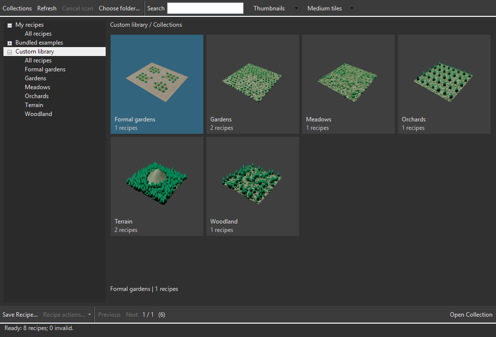

# 0.85.2 — Modify navigation and library scaling correction

16 October 2026. **Ready for Max 2027 user testing as 0.85.2.** The exact MZP and unsigned EXE are sealed; the artist profile was not installed into or restarted.

The user reports that wheel scrolling and click-hold dragging fail in the main
Modify panels, and the preset library is undersized. Scope: restore native
navigation and correct library scaling/layout, compare with 0.85.0/0.85.1, test
owned Max 2027 profiles and package the qualified successor. No artist install
or restart and no later feature work are included.

Baseline `4eed74777e23c4c1c1a6490c80e2e09ded436d37`, branch
`codex/workflow-0.75`, delivered 0.85.1. Preserve the existing unrelated Physics,
landscape/presentation/prototype work and documentation-index rows. Artist Max
PID 25264 was observed with its ordinary command line; recheck before process
actions. Knowledge generation `44bb5752…` is stale; current source inspection is
authoritative and no index refresh is included.

Version decision: **0.85.1 → 0.85.2**, a patch correcting delivered UI behavior.
Scene schema 58, recipe 5, numeric settings 3, native/library capability versions,
calculation policy, Analyzer, MCP and licensing remain independently unchanged.
Contracts F01, F04, F05, F08 and F11 apply: navigation and layout must preserve
owners, authored values, pending Manual state, publication, Undo and work/upload
counters. No global mouse hook or artist DPI preference change is authorized.

## Findings before editing

- The library passes `CustomControlsOptions.UIUserScaleFactor` directly into a
  managed setter that clamps it to 0.5–4. Autodesk defines default `0.0` as no
  custom scaling, equivalent to `1.0`. This is a real missing default case;
  earlier scripted tests forced 1.0/1.5. See
  [Autodesk's interface definition](https://help.autodesk.com/cloudhelp/2017/ENU/MAXScript-Help/files/GUID-AC26099B-60BF-4C99-997B-DF65F8D47DC1.htm).
- The main lazy-panel implementation is unchanged between 0.85.0 and 0.85.1
  except version strings. Each native slot hosts an inner subrollout. Existing
  `rollout_scroll.cpp` forwards nested background gestures to the owning Max
  rollup, but current product templates never invoke `cyrusBindRolloutScroll`.
  Previous fixtures that set a Qt scrollbar directly did not qualify wheel or
  drag handling. Native message reproduction and lifetime checks remain required.

## Acceptance before delivery

- [x] Reproduce default-scale undersizing and nested input failure on 0.85.1.
- [x] Verify wheel and background drag in both directions using actual owned
  window messages, across pages, expansion, reselection and panel widths.
- [x] Preserve ordinary control/list/grip input and captured owners; release
  bindings on unmount and retain lazy construction/performance.
- [x] Verify library default/explicit 100%/150%, resize/reopen, text/tiles/bounds
  and browsing without scene work. Distinguish configured scaling from physical
  mixed-monitor validation.
- [x] Check all main panel layouts, Manual pending edits, Live idle, full
  publication and work/upload counters; compare applicable baseline behaviors.
- [x] Run generated/offline checks appropriate to changed script/managed/native
  inputs, update current help and seal exact Max 2027 MZP/EXE delivery.

## Implemented correction

Lazy sections now call the existing native `cyrusBindRolloutScroll` after their
first mount/bind, using their own outer slot. The existing native handler resolves
the actual parent on every gesture, so it follows Max's current column. Ordinary
buttons, spinners and managed lists retain their input handlers. Main UI unmount
releases those bindings. Construction remains lazy; the fix does not add a timer,
global input hook, repeated scene binding or placement work.

The managed library normalizes Max's default zero scale to one, consistently for
its panel and thumbnail canvas. Existing device-DPI scaling remains; the controls
re-arrange on a parent DPI notification. The plugin does not change the artist's
Max/Windows scaling preferences. At default scale, the observed font changes
from 4.5 to 9 points and Medium tiles regain their intended size.

## Current executed evidence

- Unmodified 0.85.1 owned baseline reproduces zero wheel/drag movement. Explicit
  diagnostic binding restores 90-unit wheel and 200-unit drag movement in both
  directions without changing full placement/work witnesses. A first upward
  drag targeted an offscreen page; the visible-background successor passes.
- Fresh 0.85.2 Max 2027 SDK build: **39/39 suites, 22.23 s**. Generated checks:
  **296 semantic controls**. Python: **166 passed, 25.96 s**.
- Fresh default-zero, explicit-one and explicit-1.5 profiles pass the initial
  input/library matrix. **72 panel/owner layouts** have zero measured clipping
  and overlaps. Library resize/reopen at 1000×680, 850×620 and 1120×760 fits its
  native client area at all three scales, with correctly sized fonts and images.
- Actual native checkbutton and managed list-grip messages pass at default and
  configured 150%; grip capture releases and the artist's foreground is retained.
- The exact copied EXE passes eight Install/layout checks in owned recipient
  `c25417d4`; Max starts through that installed release's native registration and
  startup script. The exact MZP wrapper also passes in that owned recipient.

Default and configured 150% each pass ten remounts, 40 native wheel/drag checks
and at least 120 seconds each of pending Manual and settled Live idle. Across
these 80 gestures, full ordered publication fingerprints, authored amounts,
Undo/Redo, preparation/cache/solve and upload witnesses are unchanged. The
previously failing 13-pixel column moves all 13 pixels in the final visible-window
fixture. The copied installed recipient adds 24 zero-clip/overlap layouts, for
**96 panel/owner layout checks** across the four final profiles.

## Fixture corrections and evidence limits

The first control fixture sent a standard checkbox message to a custom Max
checkbutton; the successor uses its actual mouse-down/up path. A pymxs HWND is
already a Python integer, so its incorrect `ToInt64` call was removed. Neither
repair changed product code.

Showing the owned Max for managed visibility guards can start deferred display
helper work. The successor warms the display before recording the pending-edit
baseline; it never clears Undo. All later history/placement/work/upload comparisons
remain exact. Earlier software snapshots of native rollouts were black and are
not visual acceptance. The library images use its actual managed DrawToBitmap;
main-panel qualification uses native bounds and real message handling.

Max can replace Qt column/scrollbar objects during width changes. Private fixtures
that retained those wrappers, chose a fitting column, or targeted an offscreen
background failed. The successor waits for stable native column mappings, resolves
current ownership before delivery, and checks the actual owning Qt scroll position
after an event-loop turn. It sends real wheel/down/move/up messages to the nested
background; parent scrolling used to expose a page is explicitly preparation only.
No product hold guard, memory limit or calculation assertion was relaxed.

A late default-scale predecessor sent a wheel into a nearly fitting column with
13 pixels of scroll range while the owned window was covered. It did not move.
The same native nested/header/column messages in the visible owned window move
the full 13 pixels. The final default-scale fixture raises only that window without
activation through delivery/observation, then lowers it and checks unchanged
foreground. The failed predecessor is retained under
`build/ui-0852-20261016-01/fixture-predecessors/occluded-default`; it is not a pass.
The copied-recipient native fixture preceding this change is preserved with its
exact receipt SHA. Product code stayed unchanged throughout these fixture repairs.

Configured custom scale is not physical 4K/mixed-monitor or tablet qualification.
The preceding 0.85.1 heavy-memory, renderer, PG09/PG10 and other adapter limits
remain open. This patch does not close general B26 or alter planting algorithms,
scene schema, saved Paint, spacing, recipe formats or model ownership.

## Library appearance

Actual managed control renders, rather than a design mockup:

[Configured 150% render](images/library-0852-150.png). These are owned-host DrawToBitmap images; they do not prove physical monitor transitions.

## Artist check

Save your work. Use the complete **0.85.2 Max 2027 MZP** through **Scripting > Run Script**, or the companion unsigned EXE, then restart Max 2027. Choose one route. Do not load a loose new script over old native modules. The user performs installation; these tests use disposable profiles only.

1. Open several Modify sections. Wheel over empty background, then click-hold and drag vertically in both directions. Repeat after selecting another object/layer and after widening the command panel.
2. Check header collapse/expand, buttons, spinners, list scrolling and list-height grips. Background navigation should not trigger their actions.
3. Open Layers > Recipes. Text and thumbnails should now be normal size. Try all three tile sizes, resize the window, and reopen it. Check your actual monitor scale and monitor transitions.
4. In Manual, make a pending Amount edit and browse/scroll: the published plants should stay unchanged. In settled Live, browsing should not calculate new plants.

The [existing library checklist](USER_TESTING_0851.md) remains applicable to unchanged recipe/asset features. No next roadmap feature is started by this correction.

## Exact delivery

- [Max 2027 MZP](../../../dist/CyrusScatter-0.85.2-20261016/CyrusScatter-0.85.2-Max2027.mzp): **5,090,715 bytes**, SHA-256 `01bb5786546a9feffdcc13aac593bc473eb970bbacc648898c8d2d9558b86919`.
- [Unsigned Windows EXE](../../../dist/CyrusScatter-0.85.2-20261016/CyrusScatter-0.85.2-Max2027-Setup.exe): **5,126,144 bytes**, SHA-256 `f440908d08580ec8ee29db25a8cd0b1df80dae9ef7a5984be8b50496df3efc3c`.
- [Package manifest](PACKAGE_0852.json) and [qualification/receipt hashes](QUALIFICATION_0852.json). Archive membership, every payload hash and Max 2027/version guards pass. Both installers contain the same exact pair and eight examples. Recipe, Paint, scene and thumbnail content remains byte-identical to the previous delivery; library README/inventory distribution metadata changes separately.

Generated script SHA-256 is `b379eda5b00674292e72636e5ee52c7fe0795dca5e98c549a539f50c87a53d16`; native receipt SHA-256 is `05c3fcb02abe83de5064f0de99c22728ac8fbcfdc9658f195b73e1a386703c95`. All **155** native receipt source inputs were rehashed unchanged before sealing. The managed gallery is `219c2ee235a80fb32b55fb2aed050dfb36d22203add26bd2077e97e14bb51b00`. The installer core remains the qualified preceding core08; its bytes were not changed.

Owned baseline PID 39956, explicit-100% PID 33944, default PID 53808, configured-150% PID 22696 and copied-recipient PID 35356 were closed after checks. Closure markers and process absence were verified; artist PID 25264 remained running. Private shutdown requests naturally time out after Max exits; correlated closure markers/process absence establish closure, not a resend. Ignored binaries, raw host receipts, scenes and installers are not backed up by Git.

Documentation verification: **281 local links across 19 documents pass**. Website `docs:sync`, `docs:check` and the TypeScript/Vite production build pass with 78 reviewed sources, 296 semantic controls, 44 generated links and 42 navigation destinations. The existing >500-kB bundle advisory is nonfatal. The first npm invocation used the repository root and failed to find package.json; the website-directory successor passed. Only local sources/output were updated; nothing was deployed.
