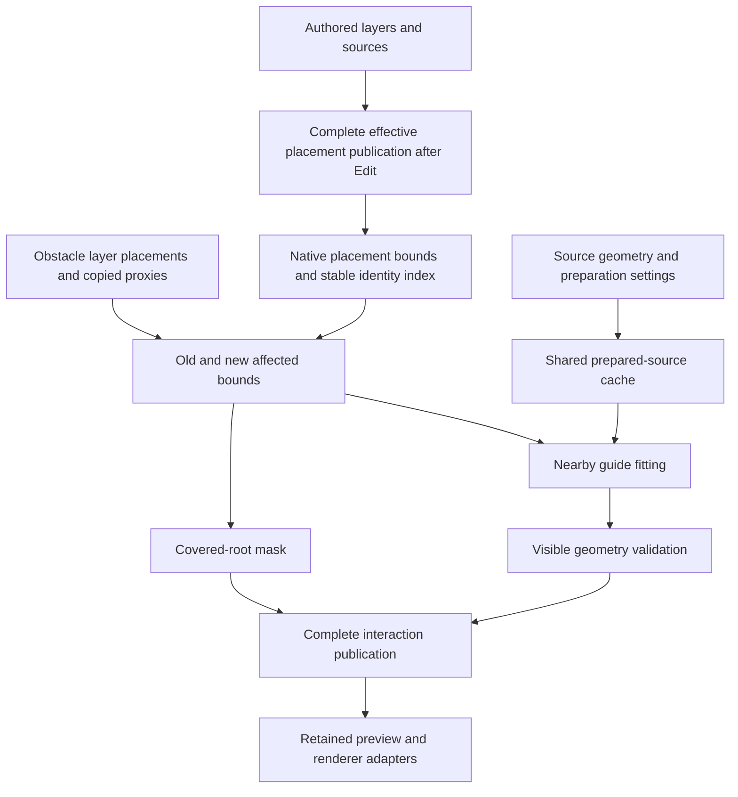

# Proposed native integration architecture

Status: implementation design, not current capability. C++ owns placement-sized data, spatial queries, solver jobs and resource lifetimes. MAXScript/managed controls own bounded authored commands and bind the same native model. Host SDK reads and publication stay on the Max thread; workers consume copied numeric generations.

## Data flow

Root suppression is evaluated before expensive fitting. Source preparation is upstream and independent of obstacle motion. No worker dereferences a Max node or changes a shared source mesh.

Consume the **effective post-Edit placement stream**, including authored moves, copies, deletions and source bindings, rather than the raw candidate stream. A scattered stone is not generally a selectable ordinary mesh node. Its individual move comes through Scatter Edit; moving a hidden source node is a source operation and cannot be mistaken for that instance's collider motion. Follow Edit revisions and stable authored IDs, preserve protected edits, and define explicit override behavior for a plant the artist has manually positioned. Interaction masks/poses must reference the same effective generation as preview and render.

## Owners and identities

| Data | Authoritative owner / key | Invalidated by | Failure and Undo behavior |
|---|---|---|---|
| Source definition | Native cache, geometry/topology + pivot/object-offset frame + units + rig/profile settings + analyzer version | Relevant source geometry, binding/profile edits | Previous reviewed definition retained; new use marked stale; acceptance is Undoable |
| Instance binding | Published root/layer/population IDs + native candidate/authored ID + frozen source cohort | Placement/source correspondence changes | Never substitute accepted array index or a later same-length source list |
| Obstacle definition | Shared proxy/mesh definition + source revision | Geometry/proxy policy changes | Admit complete successor or retain previous generation |
| Obstacle instance | Stable placement ID + transform/geometry epochs | Relevant obstacle pose/shape changes | Moving a collider does not reseed unrelated placements |
| Pose | Instance binding + source definition + instance transform + sorted relevant obstacle revisions + solve settings | Only those dependencies | Cache validated pose or rest; failed fit retains last compatible complete result |
| Interaction publication | Placement-publication identity + mask + pose handles + statuses + render bindings | Any owned successor | Commit atomically; old generation stays visible until replacement is complete |

Shared source IDs and internal registration IDs remain distinct. Cache hashes identify content; native pointers/solver body handles are not saved IDs. Persist authored relationships, accepted rig data with version/hash validation and optional accepted poses; rebuild ephemeral indexes. Reject incompatible cache versions explicitly.

## Analyze once, pose per instance

Store one immutable `PreparedSource` per distinct evaluated source definition. It owns rest guides, branch hierarchy, pinned roots, mesh-part bindings, reusable geometry, support/reach bounds and preview LOD data. Many placements reference it. Obstacle motion does not rerun topology analysis.

Each affected placement owns only a compact `PoseState` and references shared bindings. Unaffected instances use the original shared rest source. Separate source sharing from posed-mesh sharing: different contacts generally yield different vertex positions even when their rigs are identical. Do not quantize or reuse visibly different poses silently. Start with an explicitly bounded CPU pose/preview implementation; consider GPU pose palettes only after measuring real bottlenecks and defining a renderer path.

The lab's eight-row catalog and per-object geometry caches are prototype boundaries, not production source-cache design. Do not allocate a full prepared object, a full mesh or 16,000 foliage-part records again for every scattered lavender instance.

## Units and transforms

Use explicit source-pivot-local coordinates and double precision SI in fitting. Match existing extraction: apply source object offsets in the local definition and apply the final placement matrix once. Preserve the meaning of `sourceFollowScale`, per-source scale, random instance scale and receiver alignment. A source's world parking location must not enter its reusable rig.

Preserve the host/core basis conversion explicitly: the current lab maps Max `(x,y,z)` to core `(x,z,-y)` and converts back on delivery. Keep the frozen contract's material-frame +Z distinct from Jolt capsule +Y alignment. Test endpoint/witness reconstruction and normals after the complete basis/instance transform; a plausible viewport bend does not prove those frames agree.

First qualify translation, rotation and positive uniform scale. Nonuniform scale, mirrored transforms and shear require explicit admission or a later world-metric implementation. Inverse-transforming a world sphere through nonuniform scale creates an ellipsoid; treating it as an unchanged sphere is wrong. Distances, guide lengths, clearance and bending weights must use the actual world metric. Normals require the inverse-transpose relationship; mirrored winding/material frames also need policy. Reject singular/nonfinite matrices without corrupting the previous result. Rebase large world coordinates before numeric fitting and audit float delivery afterward.

The fixture itself caught an object-offset omission in its first footprint generator. Corrected masks apply `objectTM * inverse(nodeTM)` before the placement transform. That is a useful regression case for all preview/render/occupancy adapters.

## Nearby queries and automatic range

Index **reachable plant geometry bounds**, not only root points. A root outside a stone's radius can have leaves touching it. At minimum, transform the prepared source bounds conservatively; include admitted bending reach, foliage offsets, contact gap and a small numeric guard. A source-specific Minkowski expansion or a BVH of those bounds avoids one global maximum radius.

For an obstacle move, query both the old and new transformed bounds. Re-evaluate their union and relevant coupled neighbors. Instances leaving the region must return to rest, regain visibility or revert to the pose required by other remaining obstacles. Keep a reverse obstacle-to-instance dependency map. Multiple obstacles are solved together for a plant; pairwise overwrites create order-dependent results.

Automatic detection range is a broad-phase optimization. It must be conservative and invisible in the final contact gap. A user padding control can enlarge search; a performance clamp must report incomplete coverage rather than silently miss contacts. Long thin rocks, rotated meshes and large plant clumps favor transformed AABBs/BVHs over a single radius. The offline uniform-grid probe tests only current rest AABB selection; it does not establish a production acceleration structure or a swept collision solver.

“Closest” should mean all potentially overlapping instances within admitted reach. A fixed number of nearest root points is unsafe: a distant wide flower clump can touch a stone while closer short grass does not. Use proximity for pruning and scheduling, not as a substitute for complete contact admission.

## Root cover and visible contact

Keep four separate concepts:

1. Existing radius-based spacing controls layout.
2. Covered-root suppression removes instances whose defined root support is occupied by an obstacle under the chosen receiver-aware policy.
3. Broad-phase bounds choose candidates for expensive work.
4. Contact gap constrains the delivered visible geometry against the actual admitted collider surface.

Keep suppressed placement records and IDs so they can reappear when a stone moves away. Mask presentation/render participation without deleting the source, reseeding the scatter or changing the accepted row order. Decide how suppressed roots participate in existing spacing and paint statistics; recommended default is to keep base placement acceptance frozen and expose suppression as a downstream interaction mask. A separate explicit placement Update can refill if the artist requests it.

For a flat upright stone, projected occupancy is a useful initial mode. It is not sufficient for floating rocks, bridges, overhangs, curved receivers or underground geometry. Choose between solid root-point occupancy, a short anchored root segment/support region, and receiver-projected cover; label the chosen mode. Define a small noise guard separately from artistic gap.

Use spheres/boxes or qualified convex proxies as an explicit first collision scope. Arbitrary mesh rocks require a versioned collision extension with triangle acceleration, overlap/witness semantics, sidedness, watertight/solid admission and concave cases. Surface triangles alone do not define inside/outside for an open mesh. Proxy error must be visible; an enclosing sphere cannot be presented as exact rock conformance.

## Pose, mesh delivery and publication

Retain instancing for unaffected sources. Affected plants need pose-aware geometry. First implement a bounded CPU LOD mesh cache keyed by instance/pose for preview, with shared immutable UV/material/binding data where safe. Keep full-quality posed geometry lazy and bounded. Measure cold realization, changed-pose staging and memory peaks before choosing a GPU skinning path.

The renderer currently groups placement transforms by source and uses one PFlow Shape_Instance prototype per source. Integration must either group by exact posed-shape variant within an admitted budget or introduce a dedicated renderer adapter. Include full geometry, normals, UVs, opacity, materials, motion/subframe evaluation and Bake/export parity. A viewport-only solution does not qualify integrated rendering.

Stage masks, pose buffers, source correspondence and renderer references together. Display must not consume a new mask with old incompatible geometry. Cancel superseded jobs, check source/placement/obstacle epochs at commit, and preserve the old complete result on failure. Render reads one complete accepted time-specific generation; viewport timing cannot define simulation time.

## Invalidation and responsiveness

- Stone transform: update its pose/bounds and affected instance poses; reuse source preparation and base plant placements.
- Stone geometry: rebuild only that definition/proxy and its dependent bounds/poses.
- Source material only: update material delivery, keeping guide topology when geometry/bindings are unchanged.
- Plant source geometry/profile: reprepare the changed source and re-evaluate its affected instances; retain stale status until accepted.
- Seed/count/receiver/source membership: rebuild the affected placement publication and rebind by stable identity; never borrow a pose through source ordinal alone.
- Unrelated selection, browsing, camera changes or unrelated animation: no source analysis, no placement rebuild, no unchanged geometry upload.

Preserve current Manual/Live behavior. In Manual mode, authored placement changes wait for Update. If the product needs live obstacle dragging over frozen plants, expose an explicit **Live contact on published placements** option with separate interaction ownership and a pending-placement warning. Do not silently turn Manual into Live.

During dragging, coalesce changes, cancel stale work and publish complete light previews within admitted work. Final validation/refinement can run on release, with clear Pending/Validated status. Sustained held-button input, multiple selected stones, Undo grouping and continued Max responsiveness must be measured physically.

## Resource admission

Budget unique source definitions, total guide nodes/bindings, obstacle proxies, spatial memberships, candidate pairs, concurrent jobs, pose buffers, posed preview vertices, full-render vertices, scratch, history and GPU allocations separately. Peak includes old + staged new publications and Undo/render retention. The 96-byte placement payload is only one component. Query/output caps are not memory measurements.

On exhaustion, retain the previous complete result and name the exhausted budget. Provide affected counts and a preview quality control. Never quietly drop collisions to meet a frame target. Large garden density tests should compare the same authored inputs/build pair at several placement counts, not compare different scenes and call the difference an optimization.
