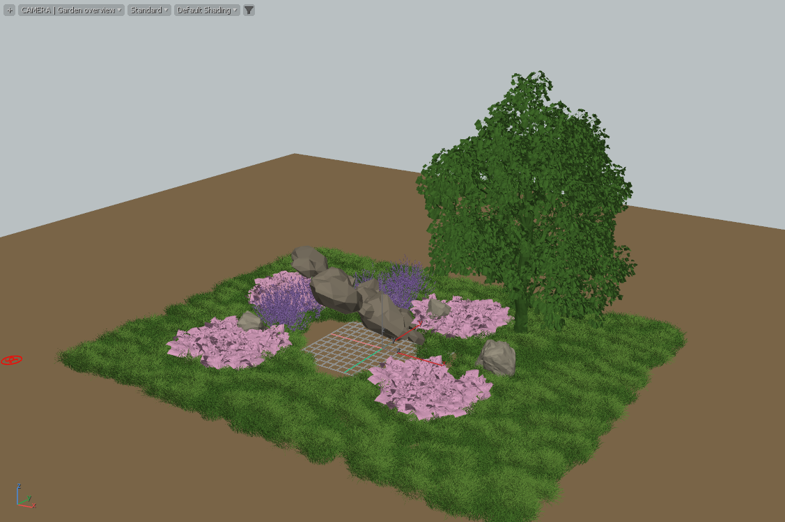

# Investigation results — exact bounded evidence

25 October 2026. **Existing Scatter baseline and integration plan; no integrated rock-mesh bending was implemented.**

## Final actual scene

This is an actual viewport capture using retained Scatter meshes and layer colors. It is not the AI reference, a beauty render or a contact simulation. The slab-like supplied hero stone and conservative projected cover do not reproduce the reference's rounded boulder silhouette or tight contact. Visible clearing beneath an overhang is a known limitation of this static cover approximation.

The scene is [Cyrus_Garden_Baseline_Max2027.max](../../../build/garden-baseline-host-20261025-03/Cyrus_Garden_Baseline_Max2027.max), 119.4 MiB. It uses the exact extracted 0.86.9.2 Max 2027 pair and serialization schema 59. The report's legacy `scatter_version` field contains **schema 59**, not a release number. No new plugin version, installer or artist-profile installation was made.

| Layer | Requested candidates | Accepted |
|---|---:|---:|
| Hero stone | 1 | 1 |
| Small stones | 11 | 11 |
| Small grass | 1,700 | 1,467 |
| Bushy grass | 700 | 635 |
| Lavender | 9 | 6 |
| Geranium | 100 | 77 |
| Small tree | 1 | 1 |
| **Total** | **2,522** | **2,198** |

There are 12 distinct scene sources including six small-rock groups. The accepted placements have an expanded source-triangle equivalent of **16,694,794**. They are shared source instances; this figure is not a measured unique posed-geometry allocation.

Initial procedural evaluation took 0.814 s; evaluation after static masks took 0.691 s. Initial retained display/complete redraw took 0.381 s. These are single-run CPU/wall measurements, not interactive FPS or a benchmark distribution. All seven layer preview errors were empty.

Final process snapshot: working set 3.02 GiB, private bytes 3.83 GiB, process peak working set 3.09 GiB. These include the host and loaded assets; they are not incremental feature allocation or exact total peak RAM/VRAM/history accounting. The placement-record payload alone is 211,008 bytes and excludes source meshes, textures, views, renderer, scratch and GPU resources.

## Spatial and footprint diagnostic

The offline probe consumes the actual exported placements. It indexes transformed **rest source AABBs** in 0.4 m grid cells; reachable deformation/swept bounds remain future work.

- 324 original plant roots lay inside the static rock XY hulls; the final masked result has **0**. Candidate rejection/underfill is expected in this fixture; no automatic refill was added.
- All current stone AABBs overlap the source AABBs of **698 / 2185** plant placements (31.9%). These are potential contacts, not solved contacts or bent plants.
- All 41 shifted-hero samples exactly match the brute-force AABB overlap set. The script also records old/new union and leaving/restoration sets; no Max collider was animated by this offline test.
- Python grid construction took 3.327 ms; median repeated query 0.576 ms; maximum sampled query 0.715 ms. This supports the design hypothesis of localized selection. It does not measure native fitting, Max input latency, publication, upload or frame rate.

Raw data: [spatial-probe.json](../../../build/garden-baseline-host-20261025-03/spatial-probe.json), [placements](../../../build/garden-baseline-host-20261025-03/placements.json), [source metrics](../../../build/garden-baseline-host-20261025-03/source-metrics.json), [footprints](../../../build/garden-baseline-host-20261025-03/footprints.json).

## Source preparation intake

Original-source Lavender 01 and Geranium passed the existing preparation executable when given the correct expected 560/22 guide counts (exit 0); logs and emitted metadata are retained under `build/garden-assets-host-20261025-01/`. The initial diagnostics deliberately passed expected count zero and therefore retained nonzero exits even for admissible models. Do not count those diagnostic exits as successful tests.

Both grass sources are outside the round-tube profile. Phlox found 69 guides but 54 unresolved; preparation remains blocked. The tree exceeded 40,000 connected parts. These are concrete source capability gaps, not integration bugs or evidence that the meshes should be deleted. No per-instance preparation cache or garden-wide contact solve was tested here.

## Cold reopen and warm reuse

The final baseline reopened in a fresh Max 2027 profile with exactly equal source ordinals, IDs and transforms. Cold display realization took 1.502 s. Five ensure/display redraw calls took 145.92, 32.31, 16.48, 16.42, 15.83 ms. Epoch, `procPreparedBuilds` and `previewBuildCount` remained unchanged. Those are existing Scatter placement/display counters, not plant-rig analysis counters. This is read-only reuse evidence, not a held-mouse test.

The final validation preflight enumerated actual loaded process module paths and hashes and checked the loaded script fingerprint before opening the scene. See [loaded identity](../../../build/garden-reopen-host-20261025-02/loaded-identity.json), [reopen result](../../../build/garden-reopen-host-20261025-02/reopen-report.json) and [receipt](../../../build/garden-reopen-host-20261025-02/receipt.json). The source working tree differs from the packaged script; the package scene does not qualify dirty production source edits.

## Earlier attempts retained

1. `garden-baseline-host-20261025-01`: scene composition reached presentation but failed because scripted Targetcamera creation had no target. Corrected by creating an explicit Targetobject. This is a failed fixture attempt.
2. `garden-baseline-host-20261025-02`: saved/rendered and exited zero, but visual inspection caught the footprint generator's omitted source object-offset transform. Its masks, placement totals and 17.8 M triangle figure are superseded by run 03. The full Scanline render completed in 194.6 s but rendered plants black. Sampled private bytes reached 10,602,840,064 bytes during that attempt; this is a sampled observation, not an exact peak. Rendering successfully returning did not qualify material fidelity.
3. `garden-baseline-host-20261025-03`: corrected offset mapping, clear diagnostic layer colors, final saved scene and actual viewport PNG. No beauty render or arbitrary rock contact claim.
4. `garden-reopen-host-20261025-01`: initial successful cold/warm check; repeated as run 02 to add independent loaded-module/script identity preflight. Earlier receipts retain their original hashes/scope.

All completed owned receipts report the original artist INI unchanged. Original asset hashes are rechecked by the evidence collector. No production source/template changes, commit, push, install or artist-session restart were performed by this task. Hash/path/link checks are local artifact checks; broad production test suites were not rerun for this investigation-only change.

## Remaining acceptance

The next work is the source/placement adapter and grass preparation profile, then nearby contact/cover publication and unique pose delivery. Actual mesh-rock fitting, natural tight clearance, strong-bend stem quality, multi-collider interactions, sustained physical dragging, integrated Undo/persistence and final renderer/Bake parity remain unqualified. Follow the phased plan and validation matrix before calling this production integration.
