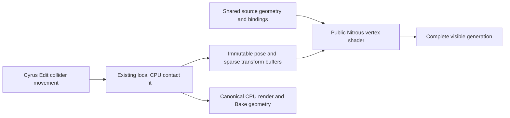

# 0.87.5 shared source and pose display

This integrates the standalone architecture through Max 2027's public Nitrous API.
The existing CPU contact solver, authored preparation, source identities and render
mesh path remain canonical. It is GPU deformation/drawing, not GPU collision solving.
Scene schema 63, prepared envelope 2, intent 1, recipe 9 and Edit/storage 3 remain.
Native interaction capability 12 requires the matching generated script and modules.

## Data and ownership

`interactions_deformation.h/.cpp` contains SDK-independent packing and reference
evaluation. Each selected source triangle has ten float4 words (160 bytes): three
rest positions/bindings/offsets and a whole-triangle root mask. Original face and UV
corner order is preserved. A guide node has a position/visibility flag and quaternion
(32 bytes). Fixed pieces and anchored vertices retain their original positions;
followers use their stem attachment's rigid transform. Shortest quaternion SLERP
and smoothed basal frames follow the canonical CPU delivery.

`deformation_preview.h` holds immutable numeric successors. One rest node block is
followed by blocks for posed instances. A sparse open-addressed table maps original
source-instance slots to pose offsets, visibility and optional transform overrides.
Each table bucket is 80 bytes, at no more than 50% occupancy; misses have an explicit
maximum probe length, including wrapped clusters. Stable raw source slots, not
sampled draw ordinals, identify instances.

`interactions_preview.cpp` retains the original source geometry, material/opacity
atlas, instance matrices and Band ownership. Unchanged source types reuse their
complete deformation state when layout, poses, disabled set and transforms match.
This includes stationary contacts while another source type changes. A weak previous
snapshot must lock before reuse; a missing snapshot causes a safe rebuild.

GPU generations keep the copied rig's allocation reservation alive without keeping
Max node watches. Source bindings, numeric poses, temporary work, SDK system buffers,
device buffers and overlapping old/new generations have separate reservations. The
resource ledger is conservative payload accounting, not measured total VRAM.

## Public graphics path

`mesh_display.inc` retains source vertex/UV streams and a 56-byte instance stream:
four matrix rows, a Band slot and a raw source slot. `deformation_shader.inc` reads
typed `Buffer<float4>` resources using `VertexBufferHandle` and
`HLSLMaterialHandle::SetBufferParameter`. It reconstructs actual triangle corners,
normals and face visibility. Source-local metres convert to Max's axes/world units
before the original instance transform. No Max scene calls or MAXScript execute
inside the shader or draw callback.

Compiled programs can be shared. Every Draw binds that item's immutable buffers
immediately before activation. Sharing a program therefore cannot replace an older
generation's accepted pose. Geometry, UV/texture and instance buffers are reused
independently. F3 rasterizer state and per-view box/triangle quotas remain active.
The shader reconstructs all three corners for the existing flat triangle normal;
this deliberately prioritizes matching the prior display over a cheaper lighting
approximation.

Max's existing CPU render/export path still evaluates `posePoint`; no GPU readback
is needed for rendering or saving. Saved scenes contain source geometry and authored
definitions, not transient GPU buffers. Save retires temporary preview nodes and
the normal post-save path rebuilds them.

## Invalidation and failure

- Collider movement changes nearby CPU poses and sparse instance overrides. It does
  not rebuild placements or copy source triangles for each bent instance.
- Source geometry, preparation, preview percentage or material changes invalidate
  the relevant immutable source data. Ordinary camera movement and F3 do not.
- Manual pending placement edits wait for Update; contact updates do not consume them.
- Allocation, invalid input or resource realization failures preserve the preceding
  complete publication. Numeric data and buffers are never overwritten in place.
- Float-encoded node/table indices stay below 2^24 and coordinates must remain finite
  as floats. Face buffer addresses use shader uints. Work/memory and existing source
  limits remain explicit; this does not promise unlimited instances or geometry.

The `CYRUS_INTERACTION_CPU_PREVIEW` process environment switch selects the preceding
CPU triangle producer only for owned comparisons. It is not an automatic fallback
or a new artist control. Clear it for ordinary use.

## Evidence and remaining costs

The qualification-only `gpu_probe.cpp` compiles the production HLSL math and reads
back its output on its own hardware D3D11 device. It is excluded from the MZP; the
plugin itself has no raw-device or CUDA path. Numeric capture/replay verifies the
same real prepared models against canonical double CPU positions and visibility.
The delivery record identifies the exact package, host, checks and measurements.

CPU exact contact fitting, topology preparation, first uploads, full-surface audits,
and drawing all visible triangles still cost time. A field with many simultaneous
contacts is not equivalent to a single sphere brushing one plant. Viewport budgets
and preview percentage still matter; this change does not create mesh LODs or a
remesher. Other GPUs, renderers and Max hosts need their own qualification.
