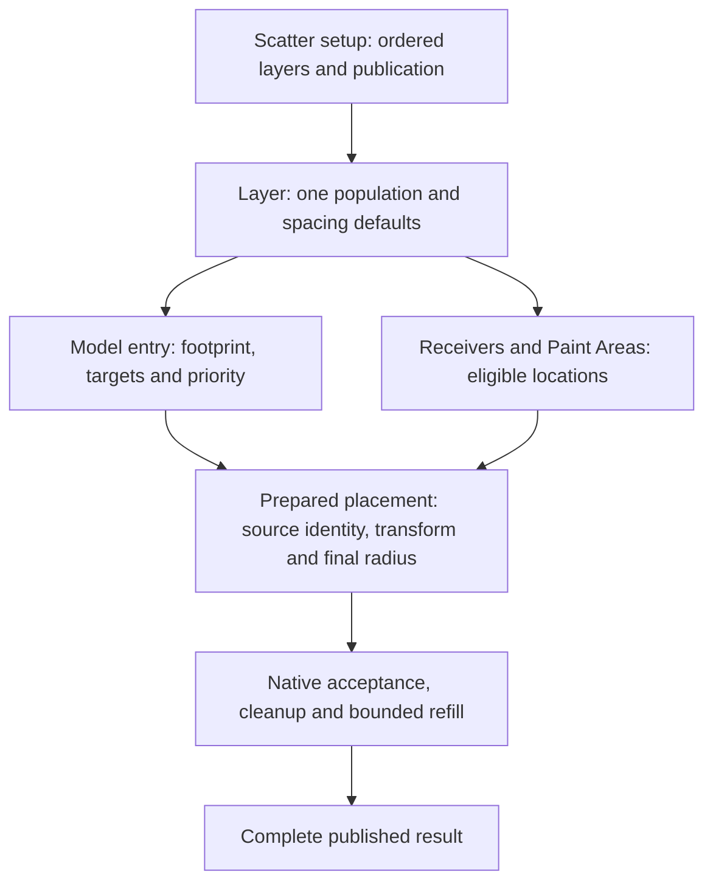

# Source clearance and layer calculation implementation plan

20 October 2026. **Status: implemented in 0.86.8, corrected in 0.86.8.1 with the user's additional Max 2024/2026 compatibility request; see [current delivery evidence and host scopes](DELIVERY_08681.md).** The user authorized code, documentation, packaging and Git backup. RC identifiers below are local work packages, not P/I/PG/N roadmap identifiers. Installation into artist profiles, restarting artist sessions and website deployment remain outside this task.

The intended artist action is: select a model in a layer, give its scattered copies a footprint, choose which placements must respect it, and give that model precedence when desired. A leaf can clear other models in its own layer and selected other layers without changing independent layers. The layer continues to own one population; source clearance does not create another count, density domain or Paint population.

## Authorized implementation update — 0.86.8

The user authorized implementation and Git backup. The 20 October review is accepted: independent scope inheritance, scheduling based on effective rules, and Count admission before conflict preference. These decisions supersede any shorthand “Custom policy” references below: Custom describes an explicit **scope**, never replacement of all scopes. New authored scene schema is 59 / `CyrusUnified2`; recipe format is 8 with data-only import conversion from supported earlier recipes. Existing schema-58 scenes require an explicit Undoable upgrade. Development and qualification target Max 2027 only.

This design document preserves the broader acceptance target. The [delivery receipt](DELIVERY_0868.md) records the completed frozen build, native/oracle tests, scoped cold-host/lifecycle/real-model campaign, installer verification and exact artifacts. The original Between layers failure and correction were exercised in separate owned Max 2027 profiles. The remaining cache/preset/physical-qualification limits at the end of this plan remain explicit; the whole matrix is not certified.

## 1. Baseline and evidence boundaries

Source inspected on branch `codex/workflow-0.75`, HEAD `3ec1cbc2b725912e39c2625ceecb648970054050`, with substantial pre-existing tracked and untracked changes. Recheck the working tree and freeze exact inputs before implementation. The pre-implementation delivery pointer was [corrected 0.86.7.2](../preset-gallery-improvements/DELIVERY_08672_HIDE_CORRECTION.md), saved schema 58 and calculation contract `CyrusUnified1`. The [native foundation](../native-placement/README.md) is already delivered; N01–N09 are not pending work to repeat.

The findings below are grounded in direct current source inspection; retrieved reports do not substitute for source freshness. No knowledge-corpus refresh or activation is part of this feature plan.

| Source at the frozen pre-implementation baseline | Finding relevant to this change |
| --- | --- |
| [Controller template](../../../AminScatter/tools/ui/templates/unified-core.ms), `sourceRadius`, `sourceUsesAuto`, `procRadii`, `procSelfRule`, `procPair`, `evaluateProcedural` | Radius belongs to a source row; same-layer rules belong to the layer and cross-layer rules to the setup. Script orchestrates bounded metadata and native views. |
| [Placement store](../../../AminScatter/include/placement_store.h), `Record` and `View` | Immutable 96-byte records already contain a source ordinal, receiver slot, candidate identity, transform and protection flags. Preserve this foundation. |
| [Source correspondence](../../../AminScatter/include/placement_binding.h), `SourceCohort`; controller `procNativeSources` | Native ordinals address a frozen cohort. Its correspondence IDs come from `procSourceSlots`, not the UI's `sourceRowIDs`. |
| [Procedural model](../../../AminScatter/include/procedural.h), `Sample`, `Population`, `Layer`, `Plan` | Solver samples contain position, two radii, identity, order and protection, but no source policy reference. |
| [Bridge](../../../AminScatter/src/procedural_bridge.inc), native sample construction | Source ordinal exists in the input record but is not carried into the acceptance sample. The new mapping belongs here or in its native plan builder. |
| [Acceptance](../../../AminScatter/src/procedural.cpp), `evaluate` | Current settlement follows owner order, reserves protected edits, resolves self/pair spacing and performs layer-union cleanup with bounded retry. |
| [Spacing](../../../AminScatter/src/group_spacing.cpp), `resolveVariable` | Current distance is factor times both radii plus gap; conflicting ordinary candidates are rejected, not moved. |
| [Recipe template](../../../AminScatter/tools/ui/templates/recipes.ms), [validation](../../../AminScatter/src/recipes.cpp), [field registry](../../../AminScatter/src/recipe_fields.inc) | Complete recipes currently write format 7/schema 58/`CyrusUnified1`; relationship records need explicit serialization and identity remapping. |

The artist's error screenshot identifies `Bad free thunk local member index when accessing local scope` after switching Spacing scope to Between layers. The installed script at the reported line 15995 builds spacing peer rows in `proceduralUI_bindRule`. The inspected script SHA-256 is `b7a53162f376bcd7abbffcc38309e28b7c08749623dae1a951e5fafd01d41dd8`, matching the original 0.86.7.2 script. This identifies the failing UI path, not a proven defect in a particular local variable or the precise compiler/callback lifetime cause. Capture the reproduction in RC01; implement and qualify the demonstrated repair in RC07, or earlier as a separately scoped prerequisite.

Affected engineering contracts are [F01–F11](../../ENGINEERING_FOUNDATION.md): ownership, randomness, explicit collision relationships, Manual/Live, atomic publication, bounds, host-thread boundaries, retained display, geometry, units and persistence. F12 remains applicable to consuming published Analyzer input. F03 requires a documented extension: explicit source priority can outrank layer order; ordinary equal-priority placements retain layer-order precedence. Do not rewrite established behavior as already delivered.

## 2. Scope and exclusions

Included: source footprints and clearance policies; precise layer/source hierarchy; native matching and priority; deterministic calculation schedules; cleanup/refill interaction; scoped invalidation; authored settings, recipes and Undo; source-local UI and shared views; diagnostics, tests and eventual matched packaging.

Preserve existing layouts, receiver-bound Paint, Bands, masks, source assignment, Edit, native storage, retained previews and output mappings. Exact triangle collision, surface-geodesic spacing, object pushing, automatic deletion of scene objects, physics, cross-controller relationships, arbitrary source reordering and a general node graph are outside this design. Existing placed scene nodes outside this Scatter setup are not automatically blockers. Radius remains conservative pivot-based spacing, not a mesh containment guarantee.

Development and qualification for this feature are **Max 2027 only**. Historical three-host installer receipts do not authorize new Max 2024/2026 builds or tests. Leave independently versioned Analyzer, MCP, Licensing and content products separate.

## 3. Ownership and identity



Each model entry belongs to one layer. Cross-layer clearance links those existing populations; it does not move their ownership or create another population.

| Owner | Authored responsibility | Derived responsibility |
| --- | --- | --- |
| Scatter setup | Ordered layers; general layer-pair spacing records; Manual/Live and publication settings | Compile one coherent native rule snapshot and dependency map; atomically publish compatible outputs |
| Layer | Receivers, one population/quota policy, source rows, seed/assignment, transforms, coverage/masks, general local spacing and cleanup | Receiver schedules, prepared candidates and layer-union cleanup |
| Source row within layer | Manual/Auto footprint, Follow Scale, source scale, clearance policy and priority | Effective XY/3D radii and source-policy lookup |
| Paint Area | Coverage plus one receiving-surface binding | Eligibility within the owning layer; no independent quota or source policy |
| Path/Band | Existing field, assignment, scale and provenance settings | Existing prepared eligibility/transform contributions before clearance |
| Placed instance | Stable generated identity or authored Edit identity; supported radius/Edit overrides | Final transform, footprint, acceptance reason and source/receiver provenance |

Use `(layer UUID, source row UUID)` as the authored source-policy key. Use existing owner/receiver/candidate identities for placements. An object name, scene handle, list position, native pointer or publication row index is not a persistent policy identity.

Build a validated mapping from each frozen native source ordinal to both its current cohort correspondence ID and authored source-row UUID. These namespaces must remain distinct. Check the complete source table against the prepared view's cohort; equal lengths are insufficient. A mismatch rejects the successor before acceptance. Replacing a model may preserve its source-row policy while changing native correspondence and geometry revisions.

The same scene model used by two layers has two independently authored source policies. Selection changes only the UI binding. All views of a row edit the same record. Parked/container-inactive sources retain settings; they produce no ordinary blockers until active. Removing an authored source and Undo must restore the exact record and mapping rather than borrowing another row's settings.

## 4. Artist model and defaults

There are three independent concepts: **footprint**, **interaction targets**, and **winning priority**. A radius alone never implies priority. Showing a radius never enables interaction.

| Source setting | Values and meaning |
| --- | --- |
| Inheritance | Independent choices for own copies, other models in this layer, and other layers |
| Footprint mode | Existing Manual/Auto support and qualification restrictions |
| Manual radius | Nonnegative world distance, retained while Auto is selected |
| Follow Scale | Existing Manual behavior; Auto includes final basis once |
| Own copies | Use layer defaults, Off, or Keep apart |
| Other models in this layer | Use layer defaults, Off, or Keep apart |
| Other layers | Use layer defaults, Off, Selected layers, or All other layers in this setup |
| Selected targets | Stable layer UUID set, not names or ordered row indices |
| Priority | `Normal` or `Prefer this model`; independent of radius magnitude |
| Advanced custom rule | Radius factor, typed Extra gap, XY or 3D distance |
| Show Radius | Published-footprint visualization only |

New rows and converted current rows default to `Layer defaults` and `Normal`. Their radius/scale settings remain unchanged. General spacing retains its current defaults; independent layers acquire no implicit interaction.

Each scope starts at `Use layer defaults`. Editing one scope changes only that scope. In particular, a local clearance edit retains inherited external relationships. Explicit Keep apart requests use saved model factor/gap/metric (initially 1, 0, 3D); inherited scopes retain their applicable layer values. Returning a scope to defaults preserves its dormant explicit settings. The UI has no global Custom switch. Changing clearance does not reseed candidates.

`All other layers` intentionally includes future layers in this setup. Selected layers includes only the saved UUIDs. Neither reaches another Scatter controller. Disabled layers do not participate; hidden-but-enabled layers still calculate and block. A missing selected target stays visibly unresolved and inactive; a same-name replacement is not substituted.

Points are valid clearance participants and can reserve space without rendered geometry. Empty source rows remain weighted gaps and contribute no footprint/blocker. Auto remains unavailable for Point/Empty and unsupported geometry. A zero-weight source produces no ordinary candidates, but a valid retained protected Edit still participates under the existing Edit contract.

## 5. Exact pair matching and precedence

For placements A and B, first resolve their stable source/layer keys. Same-source means the same authored source row in the same layer, not merely the same scene mesh.

1. Choose the applicable scope first: own copies, other models within the layer, or other layers. When both endpoints inherit **that scope**, use its existing local spacing or explicit setup layer-pair rule. Missing cross-layer defaults are disabled.
2. If either endpoint explicitly edits the applicable scope, only declarations in that scope replace the default for this pair. An endpoint inheriting that scope abstains. Other scopes are unchanged. An explicit endpoint requests interaction when its Keep apart or selected/all layer target matches.
3. One matching custom request is enough to enable interaction. An unchecked target is not a veto over a request from the other source. No matching request means the pair has no clearance interaction. The UI must expose this distinction.
4. Same-source requests are evaluated once. Matching declarations from both endpoints are constraints on the same pair, not two successive removal passes. Priority is resolved separately.

For each requested metric `m`, let `rA(m)` and `rB(m)` be the final radii. For each matching declaration `q`, the threshold is:

`Dq(m) = factor(q) × (rA(m) + rB(m)) + gap(q)`

The effective threshold for that metric is the maximum of its applicable thresholds. Test every requested metric; violation of either an XY or a 3D constraint is a collision. This is required when two custom endpoints choose different metrics. Do not add gaps twice, sum two requests, or independently maximize factor and gap: `max(f1 × R + g1, f2 × R + g2)` is generally different from `max(f1,f2) × R + max(g1,g2)`.

Use the current strict comparison: a distance strictly below its threshold conflicts; exact tangency is allowed. Radius/gap are world distances; factor and priority are dimensionless. XY uses world XY and ignores height. 3D uses world Euclidean distance. Surface distance is outside this scope. Reject nonfinite, negative or overflowing numeric input before sampling/acceptance.

| A policy | B policy | Effective interaction |
| --- | --- | --- |
| Defaults | Defaults | Existing applicable layer rule |
| Custom targets B | Defaults | A's custom constraint |
| Custom excludes B | Defaults | Disabled for this pair, even if a general layer rule is enabled |
| Custom excludes B | Custom targets A | B's custom constraint; A cannot veto it |
| Custom targets B | Custom targets A | Strongest threshold per requested metric; one winner decision |
| Custom excludes B | Custom excludes A | Disabled |

First delivery targets all other sources in a chosen layer; a full model-to-model relationship editor and explicit pair-veto exceptions are deferred. Show the effective rule origin so the defaults/custom interaction can be understood without an invisible precedence system.

## 6. Deterministic winners

Reserve all valid explicitly protected Edit placements first. They survive clearance and cleanup; conflicting protected placements both survive and produce conflict diagnostics. They can exceed an accepted target and still consume memory/work admission.

For ordinary candidates use one total order, in this order:

1. Source priority: Prefer before Normal.
2. Authored layer evaluation order: earlier before later.
3. Existing candidate schedule ordinal within that population, including receiver scheduling.
4. Stable owner/receiver/candidate or authored identity only as a deterministic final tie break.

Do not use source-list position, hash-table iteration, thread completion, addresses or radius magnitude to select winners. With equal priority, changing layer order intentionally changes winners across interacting layers. Prefer can make a later layer's selected source outrank an earlier layer's ordinary sources. This consequence belongs beside the priority control.

Preference determines clearance winners, not first claim on Count. Admit ordinary candidates to available Count slots in stable candidate order **before** sorting admitted candidates for conflict resolution. A distant preferred candidate cannot displace a normal candidate merely to occupy its slot. Preference does not change candidate positions, random attributes, eligibility, source weights or requested amounts. Prefer is not protected Edit: masks, missing dependencies, the layer's population policy and explicitly enabled cleanup can still remove an ordinary preferred model. Same-priority preferred models compete by the remaining order.

The initial priority choices form a global rank, not directed A-beats-B preferences. Cycles in target relationships are allowed; cyclic precedence cannot be authored. Thus A targeting B and B targeting A does not create a recursive solve or endless pushing.

## 7. Native C++ architecture

Extend the existing procedural engine and immutable placement infrastructure. Keep MAXScript/managed work limited to authored transactions, small metadata capture and UI. Do not marshal one script object or matrix array per placement.

The logical native plan needs the following typed data, with final names chosen during implementation:

| Data | Contents and lifetime |
| --- | --- |
| Frozen source-policy table | Dense snapshot key; authored source-row key; native correspondence; mode, priority, target flags/list, factor/gap/metric and relevant revisions |
| Frozen layer table | Stable ID, current order, active state, local/default pair rules, amount/attempt/cleanup policies and candidate view/cohort receipts |
| Placement access | Read immutable record/source ordinal, final transform, radii, schedule ordinal and protection; reference existing storage |
| Compiled interaction lookup | Sparse source-to-target-layer declarations plus bounded general layer-pair rules; normalize requests without a placement-pair matrix |
| Dependency components | Enabled layer interactions expanded from current policy metadata; conservative groups for acceptance invalidation |
| Mutable solve scratch | Ordered candidate indices, acceptance/reason flags, spatial indexes, prefix state and cleanup suppression; private to the successor |
| Result | Immutable accepted views, both published radii, source/rule metadata revisions, aggregate reasons and bounded witnesses |

Preserve the 96-byte `Record` unless measurements justify a reviewed layout change. Read `Record.source` through the validated snapshot map; use a compact side index only if lookup costs justify it. UUID/string policy data is per source, never per plant. Do not create a million-by-million relationship table or a source-squared authored UI matrix.

Host geometry and parameter snapshots are captured on Max's thread. Workers may use copied immutable data with the existing synchronous executor; all workers join before results escape. Start with deterministic serial acceptance per interacting component. Existing parallel sampling can remain. Parallel acceptance or independent-component scheduling requires measured benefit and equal-output evidence before it is added. C++ execution alone does not establish responsiveness.

### 7.1 Calculation stages

| Stage | Required operation |
| --- | --- |
| Capture/validate | Capture owner and source/receiver cohorts, authored policy snapshot and all relevant revisions; validate schema, mappings, units and work admission |
| Prepare/reuse | Reuse or generate the existing receiver-keyed candidates; apply supported candidate Relax, coverage/masks, Bands, source assignment and transforms/Edit in their established semantic order |
| Footprints | Compute XY and spatial radii after final instance transforms/Edit; apply per-instance absolute/multiplier overrides once |
| Compile | Normalize source requests/defaults, build dependency components and determine deterministic schedule |
| Accept | Reserve protected edits, enforce the layer's remaining target, and reject conflicting ordinary candidates using spatial queries and pair matching |
| Cleanup/retry | Apply each layer's accepted-union cleanup; reconsider candidates/extend permitted prefixes under explicit policy and finite round/work limits |
| Stage/publish | Stage every affected owner, inspection, counts and output mappings; validate revisions; commit one complete setup publication or roll back |

No stage after footprint calculation may silently move an accepted instance. A later movement operation would require recomputing its footprint and acceptance. Spacing rejects placements; cleanup removes isolated plants/islands under its separate controls.

### 7.2 One solver with explicit scheduling

Compile an **ordered settlement schedule** for components whose effective pair constraints match inherited rules and do not require source preference. It must preserve the current owner order, protected reservations, prefix schedule and per-layer cleanup/refill settlement, using shared typed predicates/storage. This is the inherited-output parity gate, not a second placement engine or an old script fallback.

Compile a **ranked component schedule** only when effective constraints differ or preference is needed for an enabled interaction. Identical effective Defaults and explicit settings use the same schedule, including cleanup/refill; the presence of an authored override record never selects a schedule by itself. All relevant prepared candidates and radius metadata are available before ranked acceptance. It cannot finalize one layer independently while a higher-ranked source in another layer still has authorized candidates to supply.

For a ranked component:

0.86.8.1 compiles these schedules once from participating source-policy cohorts.
All metadata is validated; protected placements and the authorized refill pool
contribute, while unused sources and unauthorized cached suffixes do not.
Equivalent cohorts retain witnesses for own-copy and distinct-source rules.

1. Initialize each layer's consumed prefix from its existing budget/receiver schedule, and include valid protected requirements independently of ordinary quota.
2. Freeze the current round's prefixes. Admit Count slots in stable candidate order, reserving protected placements first. Then sort only the admitted ordinary indices by conflict priority and greedily resolve clearance. A rejected candidate waits while its accepted blocker survives; bounded refill can admit later candidates to the vacated slots. If a previous-round blocker disappears during this pass, clear that stale hint and settle the same prefix again before cleanup. Invalid hints are removed monotonically; this does not consume a new retry round or authorize new candidates. Candidate-budget mode considers its consumed pool without a new source quota.
3. Apply cleanup to the accepted union of each layer; preserve protected rows. Mark removed candidate identities suppressed for this evaluation so retry cannot repeatedly resurrect the same cleanup failures.
4. Accepted-target policy may extend its scheduled prefix within its attempt/round allowance. Explicit cleanup repair may reconsider previously rejected candidates from the consumed pool. Candidate-budget mode without repair does not request new work to fill cleanup holes.
5. If permitted retry, changed blockers or extended prefixes require replay, recompute acceptance from the cached pool in the same total order. A newly consumed preferred candidate can displace a lower-ranked provisional placement. No provisional round is published.
6. Stop when no authorized extension/repair makes progress, or the round allowance is exhausted. Publish the final clearance-checked, post-cleanup result with truthful shortfall/limit reasons. Unused free space is permitted; this is bounded greedy acceptance, not maximal packing.

Component replay may revisit a dependent layer whose own attempt limit is already reached; that layer gains no new suffix. Freeze its permitted pool and still apply the current blockers. Bound component rounds by the maximum member round allowance, no greater than the existing 16. Same-prefix settlement and rounds share a fifty-million examined-row ceiling, separate from the fifty-million neighbor-visit ceiling. Cleanup without retry may leave intentional holes. Define per-layer consumed/attempt counts separately from component replay count. Recompute limit status for the latest settled result so later fulfillment clears an earlier provisional shortfall.

The native inherited schedule and ranked schedule share radius evaluation, pair matching, spatial queries, protection, reasons and publication. RC04 must prove inherited parity including cleanup/refill; a failure blocks release until the scheduler is corrected. Do not bypass parity by silently converting old output to a new schedule.

### 7.3 Spatial queries and resource limits

Reuse/adapt the bounded spatial hash for XY and 3D. Query only accepted blockers from interacting source/layer cohorts. Conservative bucket reach must bound both participants' applicable radii and gaps; a large blocker must never be missed by an index sized only for the querying source. Exact predicates perform the normalized per-metric checks after broad-phase filtering.

Start with measured extensions of the existing indexes. Radius bins or a more complex hierarchy require demonstrated extreme-radius costs and an exhaustive oracle comparison. Do not call all-pairs work scalable merely because it is C++.

Retain the existing ten-population, root-wide one-million-candidate admission, attempt-factor up to 32, round limit up to 16 and 50-million-neighbor-visit ceiling unless a separate measured decision changes them. All retries, protected requirements, cleanup and component replays charge the shared limits. Add explicit limits/counters for rule compilation, index construction and sorting so empty neighbor queries cannot conceal unbounded work. Initial compilation is proportional to enrolled sources times at most ten layers, not candidate pairs.

The radius bridge currently accepts at most 512 active radius sources, while saved/native source registration supports 1,024 rows. Preserve and explain the stricter active-path guard in the first implementation; do not accidentally advertise a raised source limit. Policies have at most one authored record per registered source and at most the existing setup layer count in named targets. Duplicate keys/targets, dangling mappings and oversized manifests reject explicitly.

Measure coexistence of old publication, prepared native base/views, radii, successor accepted views, order/source indices, spatial buckets, cleanup masks, staged display/output and Undo roots. At one million rows, one extra uint32 index costs 4,000,000 payload bytes before allocator overhead. Budget actual required arrays with checked arithmetic and count shared allocations once. Release successor scratch on failure; retain required publication/history/render pins. Preserve compaction of sparse accepted views.

## 8. Population, geometry and special cases

Source weights remain candidate-selection weights. Priority can alter final accepted proportions; it must not relabel them as guaranteed percentages. A source radius or priority edit does not reseed the candidate stream. Stable IDs do not promise unchanged acceptance after a relationship edit.

Accepted target remains a layer target, counted across its accepted sources. Protected rows count toward it; if protected rows exceed it, preserve them and report over-target protection rather than deleting artist edits. Points count as placements; Empty gaps retain their existing accepted-target restrictions. Density and fixed-total receiver quota behavior are unchanged.

Candidate Relax remains a pre-acceptance layout operation and does not implement clearance by moving survivors. Grids retain cell-derived population and do not gain count/refill behavior. Analyzer-provided layouts retain their documented constraints. New priorities operate on their eligible placements without changing how layout positions were generated.

Manual footprint without Follow Scale uses its authored world radius. Manual with Follow Scale uses the existing conservative final-basis scale bound. Auto uses finite pivot-local supported source bounds transformed by the final basis once, including source/per-axis/Band/Edit scale already present. Keep both metrics. Do not transform source translation into radius or apply Follow Scale twice. Absolute per-instance overrides set both metrics; multipliers scale the computed pair under the current override contract.

Masks/Paint/Bands define eligibility before clearance; priority cannot resurrect an excluded candidate. Curved Paint remains receiver-bound and independent of XY/3D spacing. Receivers on separate sheets may interact in XY if explicitly connected by a rule; explain this choice rather than promising surface-distance separation. A zero radius can still be affected by another model's radius or Extra gap. Two zero radii with zero gap produce no distance exclusion.

## 9. Invalidation and dependency reuse

Separate candidate/attribute, footprint, compiled-policy, acceptance/cleanup and display keys. Existing combined keys may need splitting; key equality alone does not prove saved computation.

| Edit | Reuse target | Recompute target |
| --- | --- | --- |
| Manual radius / Follow Scale / instance radius override | Candidate positions, source selection and valid transforms | Required radii, interacting component acceptance/cleanup, changed output/inspection |
| Policy mode/targets/factor/gap/metric/priority | Candidates, transforms and valid radii | Compile policy/dependencies, interacting acceptance/cleanup |
| Layer order | Unchanged generation and radii | Relevant interaction winner order and acceptance |
| Count/seed/weight/layout/coverage | Unaffected owners and compatible preparation stages | Existing relevant generation/preparation plus downstream acceptance |
| Source geometry or relevant deformation | Receiver candidates where valid | Existing geometry-dependent preparation, Auto footprints and affected acceptance/display; never mix new geometry with old Manual publication |
| Source scale/transform or Edit transform | Unaffected owners and compatible input caches | Required final transforms, footprints and downstream stages |
| Show Radius/preview cap/color/selection | Published placements and policy snapshot | Display-only data that actually changed |
| Unrelated animation or panel browsing | All warm static calculation and upload state | No placement solve or unchanged-buffer upload |

For the first implementation use conservative layer interaction components, not speculative per-source incremental acceptance. Invalidate the union of affected **old and new** components when a rule is removed, narrowed, enabled or retargeted; otherwise previously blocked layers can retain ghost gaps. Include old/new All-other expansions on layer membership changes. Priority changes invalidate the matching component even when radii are unchanged.

Unconnected layers reuse published native snapshots subject to existing shared admission and root commit. Manual dirty settings wait for explicit Update. Display refresh uses published footprints and published rule metadata, never pending settings presented as current calculation. Live follows relevant dependency revisions and uses the existing held-interaction/coalescing policy. No new timer-based full solve or general background scheduler is introduced.

## 10. Atomic publication, Undo and lifecycle

Capture revisions with the evaluated source/receiver snapshots; revalidate before publication. An owner switch, deletion, changed source cohort or reentrant callback must not install a result against different authored inputs. Retain the prior complete publication on rejection or failure. This is a revision guard, not a claim of general asynchronous cancellation support.

Stage accepted views, radii, source mapping, policy revision/summary, acceptance counts, conflict diagnostics, inspection lines and render/export mappings together. One setup epoch may reference unchanged layer snapshots. If any changed owner's staging/install fails, restore every affected reference/key/epoch and the Edit transaction consistently. A partially successful layer solve must not leak into the viewport or output.

Authored scalar/policy edits use a single native host Undo hold per artist action; multi-source batch edits are one action. Undo/Redo follows Manual/Live rules and does not force publication of pending Manual settings. Store small authored policy/target deltas and shared native generations, not duplicated placement buffers. Existing protected Edit ownership and history are preserved; no Undo flush or broad exception swallowing.

Rename only changes presentation. Removal/parking keeps the existing authored-ownership contract. Deleting a named target leaves the source's target reference unresolved rather than binding a replacement; Undo restores the original identity. Copy within a setup remaps copied source keys and internal layer targets, preserving external named targets under the current copy-relations contract. Incoming Custom named requests from uncopied sources stay on their original target; All-other requests dynamically include the copy. Existing general pair-rule copy behavior is preserved and explicitly tested.

Whole-setup copy remaps all local source/layer/relationship identities; no link escapes to the original setup. Merge/import remaps document-local roles to new owners. Missing external roles are unresolved and require explicit binding. Scene reset/deletion retires native scratch, policy snapshots and display state; render/PFlow pins retain their valid publication lifetime. Source-row replacement, Make point/Pick object and container membership changes must retain the intended policy key while refreshing native correspondence.

## 11. Saved data, recipes and version boundaries

Append a dedicated authored clearance parameter block or equivalent bounded owner record; preserve existing parameter IDs, class IDs and source/receiver histories. Save authored policies and stable references only. Derived indexes, transient source keys, candidates, solver pointers and stale publication receipts are not saved as authoring data.

Recommend a new scene schema and calculation-contract identity because the new records and ranked schedule are meaningful semantics. **Schema 59, `CyrusUnified2`, complete-recipe format 8 and procedural bridge capability 4** are the implementation allocations after the source/branch check. Native placement capability need not change if its record/cohort ABI remains identical.

Verify how an older runtime handles the new scene and recipe records. It must refuse unsupported semantics rather than evaluate a setup after silently dropping clearance policies. A new schema label alone is not proof of this guard: exercise the actual old reader and establish the supported protection mechanism before release. If the existing reader cannot be guarded reliably, that is a persistence design blocker requiring a concrete revised design.

Provide one narrow, explicit conversion for the currently supported schema-58 setup: retain source-row/receiver identities, footprints, layer rules, settings and Edit bindings; initialize source policies to Defaults/Normal and compile the inherited settlement schedule. Inspect and validate before mutation, perform conversion as one Undoable authored operation, and preserve the original scene file. The new runtime must identify schema-58 data and offer that bounded conversion before evaluation; do not make a partially converted setup live. No earlier retired scene schema is restored. If safe Edit/geometry preservation cannot be proved, stop conversion with an actionable unsupported case rather than clearing authored work.

Older complete recipes already supported by the existing reader retain their existing read conversions. Conversion into the new format adds inherited/default policies without rewriting source files or thumbnails. New complete recipes explicitly serialize source keys, custom targets, priority and advanced distances and remap roles transactionally on import. Reject malformed or ambiguous relationships. Partial layer import must report outgoing targets omitted from the export and require explicit rebinding/clearing; never silently attach a same-name layer.

Numeric settings presets must be classified by owner: layer defaults and source-local numeric clearance need separate scopes. Do not place setup-specific layer UUIDs in a generic numeric preset. Add a new numeric-format revision only if the existing closed schema cannot express the new category safely; older categories keep their supported semantics. Complete recipes carry relationship graphs; numeric presets carry settings. Update `recipe_fields.inc`, native closed-key validation, bridge and template capture/import together.

The user selected **0.86.8**. The per-source ownership and priority semantics change the calculation contract, warranting a new scene/recipe boundary under the [version policy](../../Release_Versioning.md#choosing-the-next-version). Analyzer, MCP and content keep their independent versions. Qualification is Max 2027 only.

## 12. UI and interaction specification

### 12.1 Models and Points

Keep the source list and existing source transforms. Add one source-local **Radius and clearance** section with the captured model name and current layer in its context. Arrange the existing footprint controls first, policy/targets next, then priority. Put a mixed/inheritance summary before the scope controls. Show advanced factor/gap/metric on demand. Keep Show Radius visibly a display control.

Example of the authored view, not a plugin screenshot:

```text
Radius and clearance — Green leaf / Layer_01
Radius mode       Manual
Radius            50 mm       Follow Scale [ ]
Own copies        Use layer defaults
Other models in this layer   Keep apart
Other layers      Selected layers…      Layer_02
Priority          Prefer this model
Advanced…         Factor 1 · Gap 0 mm · XY
Show Radius       [x]
Requests clearance with this layer and Layer_02.
Other models may also request clearance with this model.
```

This example deliberately uses XY for a ground-leaf workflow; it does not change the inherited 3D defaults. All-other and Selected are explicit choices. Target selection offers existing setup layers, preserves unresolved targets with a useful label, and disables ambiguous operations. Source multi-selection shows mixed values and changes only fields explicitly edited. Never copy the focused source's complete policy onto other selected sources as a side effect.

### 12.2 Layer spacing and cleanup

Retain general rules under **Spacing & cleanup**, with context **Layer spacing defaults — Layer_01**. Rename the ambiguous scope editor to **Edit default rule: Within this layer / Between layers**, with **Other layer** as the peer label. Explain that it selects an independently saved rule, not an exclusive global mode. Source custom settings override defaults under section 5.

Keep Candidate Relax, accepted-union cleanup and per-instance CS Edit radius overrides separately labeled. A per-instance radius override changes the footprint for that placement; it does not secretly change the source's targets or priority. Keep Show-all/metric visualization separate from calculation metric. Avoid scattering a second editable source policy across these panels.

### 12.3 Binding and the reported exception

Use authoritative templates, generator composition and approved layout metadata. Capture stable setup/layer/source-row keys before a control edit. Re-resolve owners after nested refresh/rebind; do not continue through a retired rollout reference. Validate state when entering deferred events. Perform list binding with an explicit binding guard and immutable peer/summary data. Do not rely on accidentally captured locals surviving nested/generated function scopes.

Reproduce the existing `scope` failure using the actual generated installed handler in a disposable Max 2027 profile. Inspect the generated/lazy-rollout local declarations and callback environments, then implement the demonstrated correction. Moving controls or renaming a local without a causal reproduction is insufficient. Test cold and warm section mounting, Within/Between switching, other-layer selection, quick source/layer changes, nested refresh, Undo/Redo and panel close/reopen. No catch-and-ignore, refresh loop or forced recalculation may conceal it.

### 12.4 Feedback

Show a bounded published summary: requested/consumed/accepted, clearance rejects, cleanup rejects, remaining target shortfall, protected conflicts and retry limit. A source-level summary distinguishes **requested targets** from **effective incoming/outgoing interactions** and says when priority has no enabled interaction to act on.

In Manual mode label changed policies **Pending — plants and radii from last Update**. Existing radius rings show published footprint; Extra gap/factor are not falsely drawn as the source's raw radius. An optional selected-source affected-layer highlight may use cached summaries, but is not required to ship the solver. Full rejected-candidate heatmaps are deferred.

## 13. Diagnostics and explainability

Native reasons distinguish accepted, protected, source clearance, inherited same-layer/default layer-pair spacing, population-target stop, cleanup, unused prefix and invalid input/failure. For each rejection, aggregate which rule origin and winner class caused it; collect only a bounded deterministic witness sample, initially at most 128 entries per setup publication. Each witness can identify rejected and blocker source/layer keys, metric, measured/required distance and winner basis. Never allocate a string explanation per candidate.

Read diagnostics from the published snapshot without solving or evaluating geometry. Track candidate generation, transform preparation, footprint work, rule compilation, component replays, neighbor tests, cleanup visits, display preparation and uploads separately. Report accepted-target shortfall separately from display caps and visible rendered-model counts.

Current public MCP mutation support is not expanded by this plan. If inspection fields change, deliberately update their closed schemas/catalog/hash pins and tests; a catalog entry must not imply a new write API. Private failure/timing probes remain outside release payloads and use owned profiles.

## 14. Implementation work packages and gates

| Work package | Planned work | Required exit evidence |
| --- | --- | --- |
| RC01 Baseline and witnesses | Freeze current source/build identities and dirty scope; prepare procedural three-source/two-layer fixture plus an independent layer; reproduce the UI exception | Exact baseline transforms/IDs/radii/reasons, UI reproduction or precise unreproduced conditions, isolated fixture identity; original artist scene unchanged |
| RC02 Contract and data formats | Lock sections 3–6; define typed policies/mapping, schedules, schema/recipe/bridge changes, bounds and conversion; assess release label | Reviewed tables and truth cases, source-to-native map, closed serialized schema, memory estimator design; no unresolved winner/scope semantics |
| RC03 Native rule compiler | Validate source mapping, normalize custom/default requests, build component map and deterministic priority schedule | Native truth-table and malformed-input tests, stable component expansion, exhaustive matching reference and measured bounded metadata work |
| RC04 Acceptance and retry | Extend source-aware native samples/access; implement ranked component acceptance and inherited settlement with shared primitives; integrate protection/cleanup/refill | Exact inherited-output parity; independent greedy oracle comparisons for new behavior; same-layer/cross-layer priority and bounded replay tests |
| RC05 Integration and recovery | Connect controller snapshots, cache keys, old/new dependency invalidation and complete publication/Undo lifetimes | Unrelated-layer reuse, Manual/Live behavior, staged/install-tail fault retention and memory/history release evidence |
| RC06 Persistence and recipes | Implement current-schema conversion, scene/copy/merge, source replace/Point/container lifecycle, complete-recipe serialization and numeric category ownership | Exact roundtrips and role remapping; unsupported/damaged records fail without partial authored changes; original files preserved |
| RC07 UI and reported defect | Implement source-local controls/default-rule labels; repair demonstrated scope binding failure; regenerate approved views/tooltips | Actual generated-handler tests through callbacks/timers, correct captured owners, multi-select behavior, narrow/high-DPI layout and pending Manual feedback |
| RC08 Qualification and performance | Run full relevant native/offline suite and owned Max 2027 scenario matrix; compare current and successor cost/memory | Reproducible result/counter/timing receipts, no unresolved correctness failure, explicit remaining physical/renderer limits |
| RC09 Documentation and package | Update maintained contracts/artist guide/backlog/navigation and scoped website sources; build exact qualified Max 2027 installer when implementation/delivery is authorized | Matching native/script capability guards, MZP archive/hash receipt, package path and artist checklist; no artist installation or restart |

RC03/RC04 should be exercised offline before UI integration; developer test harnesses can call C++ without putting bulk work back into script. RC05/RC06 may share bounded authored infrastructure but must be coherent before host acceptance. Internal prototypes are not separate user deliveries. Do not implement unrelated roadmap items while this feature is being qualified.

### 14.1 Likely source changes

| Area | Expected files or anchors |
| --- | --- |
| Native data/rule compiler | `AminScatter/include/procedural.h`, `src/procedural.cpp`; a focused `clearance_rules.h/.cpp` only if it improves the existing boundaries |
| Spatial predicates | `include/group_spacing.h`, `src/group_spacing.cpp`; shared validated distance/protection logic |
| Host/source mapping and radii | `src/procedural_bridge.inc`, `include/placement_binding.h`, existing source-cohort APIs; retain `placement_store.h` layout where possible |
| Controller, dirty keys and UI | `tools/ui/templates/unified-core.ms`, `tools/ui/generate.cjs`, `approved-layout-rows.cjs`, tooltips/inventory/approved generated artifacts |
| Serialization | `tools/ui/templates/recipes.ms`, `templates/presets.ms`, `src/recipes.cpp`, `src/recipes_bridge.cpp`, `src/recipe_fields.inc`, `src/presets.cpp` |
| Publication, Edit and inspection | `src/point_publication.inc`, native placement publication files, `src/cyrus_edit_stack.inc`, radius/inspection preparation and controller staging |
| Build/capability guards | `AminScatter/CMakeLists.txt`, build/package metadata, generated capability/catalog checks only where contracts change |
| Tests | Existing procedural/publication/recipe/preset suites; focused compiler tests and disposable host fixtures under ignored build runs |
| Maintained documentation | `docs/ENGINEERING_FOUNDATION.md`, `ARCHITECTURE.md`, `ARTIST_GUIDE.md`, `BACKLOG.md`, version policy and execution ledger after implementation evidence |

These are planned edit locations, not instructions to touch every file. Inspect current definitions and repository-local instructions again at implementation; never fix only `scripts/AminScatterObject.ms`.

## 15. Acceptance matrix

The expanded [validation matrix](VALIDATION.md) supplies edge cases, real-library fixtures and evidence requirements for these release gates. Both documents describe planned checks; no new-feature test is claimed passed.

| ID | Scenario and required result |
| --- | --- |
| RC-T01 | Three sources in one layer, A radius 20 and B/C zero, factor 1/gap 0: enabled interactions require A–B/A–C 20 and A–A 40; B–C has no radius exclusion. |
| RC-T02 | Custom A targets this layer only: configured same-layer clearances hold; unrelated layers' IDs/transforms remain identical. |
| RC-T03 | A targets Layer_02 only: B/C in its own layer remain unaffected unless independently requested; Layer_02 yields when A has Prefer; Layer_03 stays independent. |
| RC-T04 | Own-copy spacing on/off is independent of other-source spacing; identical scene meshes registered in different layers do not share policy accidentally. |
| RC-T05 | Both inherited, one custom, both custom, explicit unchecked targets and reciprocal requests match every row of section 5, with no doubled factor/gap. |
| RC-T06 | Two custom requests with crossing factor/gap values select maximum evaluated thresholds correctly; mixed XY/3D constraints test each appropriate radius pair. |
| RC-T07 | A later-layer Prefer source outranks an earlier Normal source; equal priority follows layer order and candidate schedule; relationship cycles terminate deterministically. |
| RC-T08 | Protected edits in either layer reserve space; two conflicting protected rows both survive with conflicts; zero quota and protected over-target preserve edits. |
| RC-T09 | Manual/Auto, source and per-axis scale, nonuniform/sheared bases, rotation, Band scale, Z offset and per-instance overrides use the final footprint exactly once. |
| RC-T10 | XY/3D behavior differs correctly for stacked receivers; curved Paint/eligibility remain receiver-bound; source radius is not treated as surface-geodesic distance. |
| RC-T11 | Cleanup operates on accepted layer union; Prefer can still be cleaned, protected cannot; repair off leaves holes; repair/target modes obey prefixes and finite limits. |
| RC-T12 | Retry introduces a higher-priority candidate near an earlier provisional low-priority acceptance: final winner follows total order, with correct final blockers and no intermediate publication. |
| RC-T13 | All Defaults/Normal cases match frozen current IDs, transforms, accepted views, radii, cleanup/refill outcomes and reasons under the inherited schedule. |
| RC-T14 | Grid/Analyzer layouts retain their placement and retry restrictions; Paint Areas do not gain populations; source weights remain candidate weights and final counts are reported accurately. |
| RC-T15 | Point reserves clearance without model render output; Empty contributes a gap; inactive/parked sources keep policies; zero-weight ordinary rows do not create phantom blockers. |
| RC-T16 | Remove/narrow/retarget a rule or disable/remove a target layer: recompute old/new affected components and release obsolete blocking; independent owner publications reuse buffers. |
| RC-T17 | All-other follows new layer creation; named targets do not bind new same-name layers; hidden enabled layers still block and disabled layers do not. |
| RC-T18 | Missing/mismatched source-row/cohort mapping, duplicate keys, invalid radius/metric/priority, enormous coordinates or limits fail before partial publication. |
| RC-T19 | Serial/allowed parallel preparation produces equal identities/transforms/radii and winners; shuffled hash storage or worker timing does not change the greedy result. |
| RC-T20 | Extreme mixed radii, sparse/dense layouts and large zero-radius groups agree with an independent exhaustive pair predicate and obey measured work/memory bounds. |
| RC-T21 | Radius/priority edits reuse compatible candidates/transforms; count/weight/geometry changes invalidate relevant stages; compare counters as well as equal output. |
| RC-T22 | Warm Manual pending edits survive Show Radius, source/layer browsing, display metric/caps, UI Undo/Redo and unrelated animation; explicit Update applies them. |
| RC-T23 | Live reacts to relevant source/receiver/field animation and same-time geometry edits; unrelated static animation causes zero solves and unchanged-buffer uploads. |
| RC-T24 | Actual UI handlers exercise cold/warm mounting, scope changes, peer-list rebinding, rapid owner switching, nested callbacks and close/reopen without the reported exception or wrong-owner writes. |
| RC-T25 | Multi-selected source mixed values and batch edits change only requested fields; one Undo restores the batch and all bound views agree. |
| RC-T26 | New schema roundtrip, current-58 explicit conversion, copy/setup clone/merge, Make point/Pick object and container park/restore preserve stable policy ownership. |
| RC-T27 | Complete recipe save/import remaps local source/layer roles; units convert physical radius/gaps once; malformed/missing external roles fail or require explicit binding without data loss. |
| RC-T28 | Failure before acceptance, during index/cleanup allocation, during display staging, and in the publication install tail retains the entire prior complete result and Undo state. |
| RC-T29 | Cached inspection explains representative blockers/reasons without calculation; witness count stays bounded and preview caps do not masquerade as acceptance shortfall. |
| RC-T30 | Repeated edits, Undo/Redo, owner deletion/reset and render/PFlow pins release the expected scratch/generations; peak and retained allocations include old/new overlap. |
| RC-T31 | Actual native preview, render/exact output and bounded Bake agree on accepted source mappings/transforms; material-specific renderer claims remain limited to tested paths. |
| RC-T32 | Final matched Max 2027 package passes archive CRC/member hashes, version/capability/host guards and owned-profile install/load tests; no private diagnostic module is included. |

For the new solver, implement an independently structured exhaustive greedy oracle for small seeded inputs. Compare complete kept/conflict/reason results, not just counts. Include scope asymmetry, both metrics, priorities, protected rows, quota and cleanup/refill schedules. Keep test intent independent of implementation helpers so the oracle can catch a shared-rule bug.

## 16. Validation and measurement procedure

At RC01 record branch/HEAD plus dirty/untracked source scope; script hash, native hashes and paths; Max/SDK year; fixture/settings/seed/geometry identities; and loaded module identities. Use a new owned run directory. Preserve `Test Scene/`, artist installations and unrelated work. Restart only a verified owned test host for changed native modules.

During implementation run the authoritative UI generator/check and approved-layout checks, focused native compiler/procedural/publication/recipe tests, then relevant broader checks. Example commands, with a fresh run name substituted:

```powershell
python tools/procedural_lab/check_generated.py --output build/source-clearance-RUN/generated
build/mcp-venv/Scripts/python.exe -m pytest CyrusMCP/tests tools/tests -q
python tools/procedural_lab/offline_build.py --project scatter --year 2027 --output build/source-clearance-RUN/scatter
ctest --test-dir build/source-clearance-RUN/scatter --output-on-failure
```

Generator checks are not MAXScript compilation. Run the actual matched generated/native pair in an owned Max 2027 profile, through actual UI handlers and subsequent callbacks, for RC-T22–T28. Read completion after timeouts before another mutation of that host. Do not reset or restart the artist's session.

Benchmark frozen inputs at approximately 2,000, 20,000, 100,000 and up to the existing admitted one-million candidate bound, subject to memory admission. Cover one source/many sources, one layer/ten populations, independent versus connected layers, mixed priorities, large radius variation, near-total rejection and refill-heavy cases. Use procedural assets plus an owned permitted leaf fixture; a screenshot alone is not a reconstructable benchmark input.

Compare baseline and successor on equal settings/geometry and distinguish cold/warm generation, transform/radius work, rule compilation, acceptance, cleanup/replays, publication, display preparation/uploads, total Update and peak/retained/history memory. Record timing distributions and the worst cases; do not hide an acceptance cost inside an unchanged generation number. A language change is not a performance result. Inherited behavior must have no unexplained material regression; set numeric budgets from RC01 measurements before optimization. Any relaxation needs a recorded correctness/product tradeoff rather than a claim of automatic speedup.

Warm idle, panel/source/layer browsing and unrelated animation require zero new placement solves and zero unchanged-buffer uploads in the tested static case. Cached display changes may rebuild only relevant presentation. Scripted redraw time is not presented FPS; physical mouse/DPI and renderer-specific acceptance remain separate measurements.

## 17. Delivery and handoff

The authorized implementation and its actual acceptance are tracked in [the delivery receipt](DELIVERY_0868.md) and [execution ledger](../improvement-program/PROGRESS.md). The full matrix remains a broader qualification checklist: passing a focused campaign does not imply every renderer, scene size or physical interaction was exercised.

Implementation refinement: this first delivery conservatively recalculates setup acceptance after a changed key while reusing prepared native candidates. It does not yet cache compiled policy components or bypass all acceptance work for disconnected layers. This avoids stale cross-component output when targets change; no acceptance speedup is claimed. The advanced factor/gap/metric controls use the source record, while existing numeric presets continue editing their layer-owned category. No new generic source-preset category is introduced. These limits are explicit in the artist/architecture docs.

Existing B05/B07/B08/B14/B21 limitations retain their actual status. Website publishing and unrelated roadmap work remain outside this delivery.
