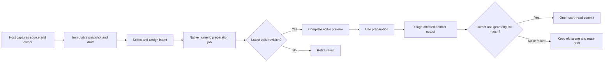

# Technical design

> Original 26 October research/proposal. Implementation was subsequently authorized as 0.87.4. See [current decisions](IMPLEMENTATION_0874.md) and [executed evidence and remaining limits](DELIVERY_0874.md); planned rows below are not all passed.

**Proposed contract, not implemented behavior.** Read the [research](01_RESEARCH_AND_DECISIONS.md) and [UI specification](02_EDITOR_WORKFLOW.md) first. Apply foundation contracts **F01, F03–F11**, particularly source ownership, retained publication, bounded work, host-thread lifetime and geometry identity. Current capability 7 / scene schema 61 / prepared-source format 1 remain the baseline.

## 1. Owners and boundaries

| Data | Owner and lifetime |
| --- | --- |
| Original model and materials | Existing Max scene node; never edited, collapsed, detached, recolored or hidden by the popup. |
| Authored preparation edits | Selected logical layer owner + stable `sourceRowID`. Not the node name, list position, native pointer or scatter instance index. |
| Minimum stem / Branch connection / Stiffness / existing limits | Preserve their current layer-level ownership. The editor displays these values as read-only context; it does not introduce conflicting per-source copies. |
| Captured numeric mesh | Immutable source revision in metres, copied through the existing host capture boundary. Share matching allocations where practical. |
| Selection, camera, isolation, test sphere | One editor session only; never part of a scatter recipe or layer placement. |
| Working overrides and local Undo | Editor draft; released on Cancel/close after outstanding jobs retire. |
| Compiled guides/bindings | Immutable source definition keyed by mesh, settings, authored edits and algorithm versions. Shared by compatible instances. |
| Deformed result | Existing per-instance pose/output pipeline; source preparation is not run per instance. |

Use one editor session per Max host initially. Capture owner, source slot and a weak node reference when opening; display them in the window. Opening another source must not retarget a dirty session. Source-slot removal, owner deletion, scene reset/load and incompatible external definition edits invalidate that session and cancel its jobs.

A source used in two layers can intentionally have different overrides. Cache sharing is allowed only when the complete effective definition matches. Layer copy clones authored records under the new owner and can share immutable compiled data; it must not make future edits cross between owners.

## 2. Source snapshot and identity

Factor inspection from successful rig preparation. A failed inference must still produce enough safe geometry/component information to edit. Existing `capture` calls into `prepareSource` and can retain some failed analysis, but it is not yet this general editor inspection API.

Capture the evaluated supported source mesh on the host thread at an explicit rest time. Preserve its face order, positions, material IDs, map/UV corner indices and explicit-normal correspondence. Use the existing object-offset/pivot treatment. Do not apply the source's world transform and then apply the placement transform again.

- Authoring coordinates: **source-local metres, Max Z-up**.
- Current solver coordinates: `(x, z, -y)` in metres. Convert at the existing boundary exactly once.
- Editor camera: may center the display numerically, but does not change saved positions/pivot.
- Root hints: original source-vertex IDs and supporting base-patch IDs, bound to the captured revision.
- Follow/parent attachments: persistent authored guide key and normalized rest-arc location; resolve to span/u when compiling.

Retain a full geometry/material fingerprint compatible with the existing validation and add a connectivity identity for diagnosis. Equal vertex counts are not evidence of identity. The current fingerprint includes position, face and material-ID bytes. Rename and shader-only edits should not require remapping if the captured geometry identity remains identical; material-ID/topology edits can affect inference and must be checked.

On incompatible source changes, preserve the saved definition/draft and last complete published snapshot, but never decode the new mesh with old indices. Mark authoring stale. The first delivery offers reopening/resetting preparation for the new mesh; arbitrary remapping of prior selections is a later feature. A node move alone must not invalidate source-local region membership when the captured local geometry is unchanged.

Animated/deforming sources and arbitrary modifiers are outside the first editor's qualification. Respect current source admission rather than secretly snapshotting renderer proxies or promising Skin/point-cache support.

Preserve the current instance-transform admission: `Transform::scale` accepts positive uniform scale with orthogonal axes, and rejects unsupported nonuniform/sheared/reflected transforms. Test rotated and uniformly scaled placements and nonzero pivots explicitly. The editor does not expand that solver support merely by displaying the source correctly.

## 3. Authored records and compiled output

Store **intent separately from inference**. Repeated Prepare or an automatic settings refresh must retain artist overrides. Reset selected/all is the explicit way to return those regions to Automatic.

Proposed authoring envelope, version 1:

| Field | Meaning |
| --- | --- |
| `source_fingerprint`, `connectivity_fingerprint` | Exact supported source revision and indexing identity. |
| `authoring_revision`, `authoring_hash` | Canonical revision/hash of committed intent, not of the UI selection. |
| `piece_overrides` | Sparse sorted component IDs → Bend, Follow, Fixed; absent means Automatic. Each referenced piece includes a membership digest. |
| `root_hints` | Piece/guide key, source seed/base-patch IDs and intended base direction. |
| `guide_overrides` | Stable authored guide key, source component, supported rest control points and override kind. |
| `attachments` | Child/detail identity, parent guide key, normalized rest coordinate and validated attachment intent. |
| `authoring_version` | Reader/validation version; unknown formats fail explicitly. |

Component IDs are deterministic within a source snapshot, for example ordered by lowest original vertex ID with a membership digest. They are **not identities across arbitrary remeshing**. Generated guide keys derive from piece identity + generator role; an explicit manual edit gets a saved stable key. Never store a transient vector index as an authored parent reference.

Compile the authored envelope into the existing numeric guide/part/binding representation. The solver may retain compact local guide indices; serialization maintains a verified key-to-index map. Validate every reference, parent DAG, membership range and root patch before publishing the compiled source.

For unchanged sources without overrides, keep the qualified automatic path and compare output parity. For edited sources, factor shared component discovery and apply role/root/attachment constraints **before** the guide candidates and parent forest are finalized. Masking only after the old full analysis would retain its original failure and perform unnecessary inference.

## 4. Geometry semantics

The first editor assigns whole connected components. All vertices of each face belong to one semantic piece. This preserves the current single-vertex-binding decoder and `guideFaces`/`visibleFace` assumptions.

### Automatic

Allow existing inference within the artist's surrounding constraints. Excluded/fixed components cannot silently become new flexible guides. Preserve valid structural parents needed by children; if the artist fixes a parent that a child still requires, mark the child unresolved and request a new attachment or a real root.

### Bend

Force a component to be considered as a guide-bearing flexible piece. This is a request for a supported tube/ribbon reconstruction, not permission to pretend any branching solid has one useful centerline. Honor explicit root hints over height/crown heuristics. If reconstruction fails, retain the entire piece and report why; do not silently change its role to Follow or discard it.

Keep the full snapshot for binding and support checks, but derive guide-candidate scale/crown statistics from eligible Bend/Automatic structural candidates. A tall pot or low decorative tip marked Fixed must not choose a leaf's root through the global source bounds. Explicit valid root patches take precedence; unedited automatic sources retain their existing inference path.

### Follow stem

Bind a whole piece rigidly to the chosen guide's rest frame and arc position. It contributes its full geometry to the guide's relevant collision envelope and exact checks. Moving a parent changes the child/detail attachment in the parent's posed frame. A new guide shape requires attachment/span/envelope recompilation; indices must not be reused by position in an array.

### Keep fixed

Retain all geometry at source rest coordinates, transformed normally with the scatter instance. Exclude it from flexible-guide inference and movable envelopes. Include it in the existing fixed-geometry contact checks. This role does **not** register another Collider layer or suppress grass around the plant.

The current core requires at least one guide and gives fixed parts a valid internal guide index. The first delivery may preserve that internal representation without exposing the arbitrary association. Guard fixed paths in the decoder, guide-preview, root-hiding and audit code. If all parts become fixed, retain the draft and show the documented no-stems message; do not invent a dummy guide merely to pass validation.

### Root and rest invariants

Set root end identifies a seed for a supported endpoint band/tube ring. The resulting anchor patch must be visible and validated. Reverse direction rebuilds frames and dependent bindings. Editing interior guide points must regenerate full rest offsets so **rest decoding reproduces every original vertex** within the declared numeric tolerance. Preserve UV/material/normal corner identities. No source mesh sculpting, destructive remeshing or implicit vertex welding occurs.

Guides currently admit 3–16 nodes. Keep this explicit for first-delivery guide editing; do not silently resample a longer hand-drawn curve. New guide creation and configurable sampling are separate follow-up design work.

### Why partial-face editing waits

A vertex shared by a fixed face and a bending face has only one output position. A shared base may need a pin, a common parent or continuous blend weights; duplicating vertices would change the source. Face roles alone cannot solve this. A later partial-region stage needs semantic boundary extraction, a shared-vertex influence policy, revised per-face contact ownership, rest/strain checks and seam-preserving output. It must not be implemented as a small UI-only checkbox.

## 5. Viewer and selection implementation

Recommendation: a Max-parented C++ Qt window and `QOpenGLWidget` using the matching host ABI. Own the preview camera and buffers. Do not call internal `createGW`, steal/reparent a Max viewport, change application-wide Qt context flags, or load another Qt runtime. Verify the integration in E0 before expanding it.

Render one admitted full source snapshot with neutral two-sided shading, part colors and optional guide lines. The popup is independent of Scatter's sparse foliage preview. No material/opacity engine is required. Maintain exact source IDs for every rendered face/vertex; an eventual display LOD may not invent correspondence or make omitted pieces unselectable.

Recommended selection path:

1. Native BVH ray picking for a click gives an exact triangle/piece hit.
2. A depth-tested integer piece-ID pass supports visible rectangle/brush selection. Use the same geometry, camera, clipping and device-pixel ratio as the display; no blended/antialiased IDs.
3. Through-selection uses a bounded projected-triangle/frustum query. Test triangle coverage, not only piece pivots/centroids.
4. Camera/mesh/isolation revisions tag picking results. Do not apply a delayed readback to a new view or draft. Limit readback to the gesture region and coalesce brush work; avoid synchronous GPU stalls on every pointer move.

Whole-piece semantics are intentional: one visible fragment can select its entire component, including an occluded part. Color the complete selection so expansion is apparent. Separate coincident shells remain separate; surface proximity alone never merges their identities.

Graphics resources are created/destroyed on the UI thread with the proper context current. Explicitly clean up on context loss, dialog close and host shutdown. Construct the view before showing the window; repeated close/open, minimize, DPI movement and docking/reparenting hazards need acceptance. First delivery is floating only.

## 6. Draft scheduler and publication

A session has separate `sessionID`, `draftRevision`, source fingerprint, settings revision, owner/source-slot identity and publication generation. State is Loading, Ready, Updating, Needs correction, Stale, Committing or Closed. Only Ready for the latest revision permits Use.

At most one numeric job runs and one latest pending request exists. Coalesce completed role/root/point gestures and continuous spinners; do not start a job per pointer event. An initial 200 ms idle delay is a tuning proposal. Guide-line feedback can update immediately while the mesh remains the last complete preview marked Updating.

Workers consume numeric copies only: no `INode`, `Mesh`, ParamBlock, MAXScript values, material pointers or Qt widgets. The current host preparation path is synchronous; the editor's asynchronous worker is **new scoped work**, not a capability assumed from the existing Lab. Cancellation checks must cover topology, geodesics, connections, binding and validation. Host capture/publication remain host-thread operations and may still be expensive; measure them separately.

The popup cannot open an Undo hold across worker execution. A late result must fail generation/owner/fingerprint checks before touching UI or scene data. Closing marks the session invalid, cancels work and retires owned inputs when the job exits. No callback dereferences a deleted window. Host shutdown must join/retire the worker before module unload.

Existing layer settings remain outside the popup. If they change, cancel pending draft work and refresh numeric settings while preserving draft intent only when source identity and committed authoring base still match. A conflicting external edit of the source definition makes the draft Stale; do not overwrite it silently. Cancel reverses only the popup draft, never unrelated scene edits made while it was open.

## 7. Commit, Undo and Manual/Live behavior

Use stages the authoring envelope, compiled source, required preview resources and affected contact results against the **last published placements**. Validate actual source geometry and captured owners again immediately before committing. If geometry changed, a contact is impossible or admission fails, retain the old complete scene state and keep the draft editable with a precise error.

Publish persistent definition and compatible derived output together on the host thread under one short Undo transaction. Inject failure before and after individual publication steps during testing; pre-commit validation alone does not prove atomicity. If the post-commit path fails, restore the previous complete owner/output set.

For Manual mode, unrelated pending Count, transform, surface or source-membership edits stay pending. If the new source has no rows in the published layout, store its ready definition without creating placements; display the pending-Update status. Live mode follows the relevant dependency path after commit. Neither mode reseeds or rebuilds unchanged placements merely because preparation changed.

Inside the popup, local Undo/Redo restores role/guide edits without writing the scene. One brush stroke is one entry. Outside it, Max Undo of Use restores previous authored definition, compiled/output references and source association. Redo restores the exact successor. Do not clear Max history or use repeated full-mesh clones as local selection history.

## 8. Invalidation and reuse

| Event | Work allowed/required |
| --- | --- |
| Orbit, selection, window resize, isolate, region colors | Editor display/picking only. Zero inference, placement solve or scene publication. |
| Selection brush | Selection-bitset/delta updates only; no role assignment until requested. |
| Role/root/guide/parent change | Recompile affected authoring dependency closure; initial implementation may recompile one whole source using cached geometry/components. |
| Minimum stem / Branch connection | Reprepare the affected layer's sources with each source's authored intent retained, as dictated by existing ownership. |
| Stiffness / test sphere pose | Contact pose only. No component discovery or guide inference. |
| Foliage preview percentage | Existing display sampling/output path; retain all authored pieces and guides. Editor selectability is unchanged. |
| Scene collider or Cyrus Edit instance movement | Existing local candidate/contact path; no source authoring rebuild. |
| Geometry/topology/material-ID change | Recapture/validate relevant source; reject stale index binding. |
| Save/reopen | Restore authored intent and validated compiled definition; rebuild transient viewer state only on demand. |

First target is **one source per edit**, not a complex incremental compiler. Only introduce finer component recomputation after instrumentation shows a need. All linked children and Follow details must be included when a parent's guide or anchors change.

## 9. Memory and work accounting

Retain existing source/preparation allowances. Add explicit admission for editor buffers, picking, draft history and in-flight successors, integrated with the existing memory reservation owner. Expose any new user-adjustable budget under Preparation limits, not on the primary editor toolbar. Exhaustion retains the draft/old output; it never silently changes piece roles or hides leaves.

Peak is the union of **published data + source snapshot + draft/selection/history + worker scratch + candidate source + candidate poses/output + GPU buffers/readback**. Count shared allocations once, but account for old generations pinned by Undo.

Indicative payloads, not process-memory guarantees:

- Sparse categorical intent can fit in a few bytes per edited piece plus IDs/digests.
- Selection uses approximately `ceil(pieceCount/8)` bytes before containers/history.
- A simple viewer can use about `12V` position bytes, `4V` piece-ID bytes and `12F` index bytes; normals, duplication and driver allocation add cost.
- Integer-ID + depth targets use about `8 × physicalPixelWidth × physicalPixelHeight` bytes; color, multisampling, double buffering and readback are additional.
- Current source capture separately estimates approximately `192V + 128F` bytes plus map channels. Do not count the small viewer formula as the total.

Bound outstanding jobs to one and latest pending metadata to one. Store selection/role command deltas for draft history; reference immutable geometry instead of copying it per gesture. Measure release on Cancel, source deletion, history pruning and repeated sessions. A reduced guide count may reduce inference/fit costs, but full source geometry and exact contact proofs remain necessary.

## 10. Saved formats and release boundary

Research changes no version. Recommended future complete delivery is **0.88.0** because this introduces source authoring, a new editor and persistent intent, following the current substantial-delivery policy. Recheck the policy/current branch before implementation; a later user-selected label takes precedence.

Proposal: authoring envelope 1 inside a new **host prepared-definition envelope 2**, with a distinct nested compiled-source format if its contract changes. Do not confuse the host envelope with the current nested `saveSource` format, both presently named `format:1`. Advance Interactions capability from 7 to at least 8, and advance scene schema from 61 to the next available value (62 if still free) when authored data can be saved. Keep all independent product versions separate.

Support the immediately preceding delivered format deliberately: unchanged format-1 definitions can be loaded as empty-override sources without reinference. Creating authored edits uses the explicit new writer and saves to an upgraded scene copy; older builds must reject unsupported authored data instead of silently treating it as automatic. Unknown/newer envelopes are retained but not executed. Do not add arbitrary historical migration shims.

`.max` save/reopen, source removal Undo, supported layer copy and supported merge are release gates. Prepared-contact recipe/library export is **not** implemented today and stays guarded; a portable asset-preparation package requires a separate asset/hash/import contract. Do not attach the authored edits directly to a shared library model as a hidden global side effect.
