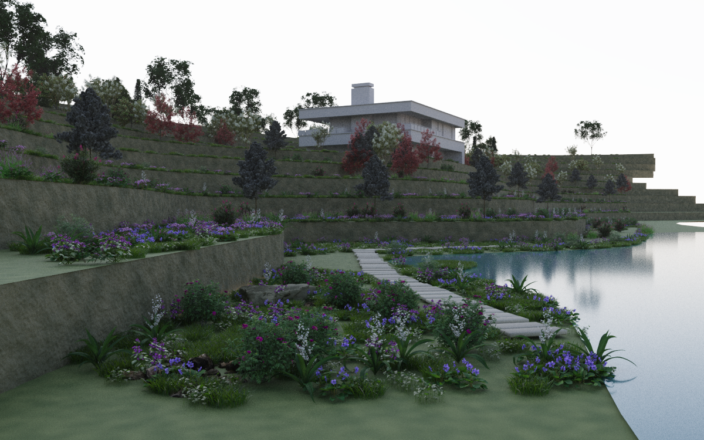

# Cyrus Scatter 0.87.6.1 — Terraces, UI and selective contact work

This patch keeps the endorsed 0.87.5.6 artistic Bend/Trim response and fixes two
UI problems found in 0.87.6. The Point label now refreshes immediately after a
Band assignment. Reopening an unchanged, mounted panel reuses its controls;
changing its settings while it is closed still invalidates that view.

Native contact work skips guides that cannot bend or trim and have no moving
parent. Root hiding remains independent. A branch attached to a moving parent
still follows that parent even when the branch cannot bend locally. No new
physics mode, GPU contact solver or automatic convex conversion was introduced.

## Delivery and qualification

- Version **0.87.6.1**, selected by the user. Scene 65 / Interactions 15 / recipe 9
  / Edit storage 3 are unchanged. Independent products keep their versions.
- One EXE contains separate SDK/native/managed payloads for Max **2024, 2026,
  2027**. Max 2027 also has its matched MZP.
- **62/62 native tests passed** for Max 2027. The exact packaged script/native
  pair passed the recorded Max 2027 UI, movement, settings and landscape checks.
- Max 2024/2026 were built and package checked; they were **not launched**.
- ZIP manifests, payload hashes, host/version guards and the EXE's three embedded
  MZP hashes were verified without running the installer in an artist profile.
- Generated integration checks passed: 378 inventory controls, 245 baseline
  controls accounted for and 32 fixture delimiter checks. Max execution is
  separate evidence; a generator check alone does not compile MAXScript.

See [qualification](QUALIFICATION.json), [measurements and limitations](MEASUREMENTS.md)
and [using the scene](ARTIST_GUIDE.md). Build and test tools are under
[`tools/procedural_lab/terraces0877`](../../../tools/procedural_lab/terraces0877/).
The `0877` directory name is an initial campaign label, not the delivered version.

## Measured result

The controlled real-tree sweep uses the same saved fixture and movement path in
0.87.6 and 0.87.6.1. Its native median contact-fit measurements were:

| Response | Before | After | Interpretation |
| --- | ---: | ---: | --- |
| Fixed base 100%, Bend only | 16.17 ms | 6.32 ms | No contact queries remain |
| Bend strength 0, no Trim/hiding | 13.74 ms | 6.54 ms | No contact queries remain |
| Ordinary Bend | 49.54 ms | 44.62 ms | Guide counts preserved; do not generalize this timing difference |
| Fixed base + Trim | 6.92 ms | 6.82 ms | Trim still evaluates contact |
| Bend 0 + root hiding | 7.65 ms | 6.33 ms | Root hiding remains active |

Warm panel opening medians improved about **8–30%** in the isolated UI replay.
Repeated opens went from 84 binds / 12 layouts to zero binds / zero layouts.
The timings include a requested message-pump delay. Cold opening, native rollout
reflow and physical mouse latency are not covered by that improvement claim.

Adding 10,000 distant reacting tree instances kept the nearby candidate count at
nine, but native fit time increased from roughly 43 to 51 ms in this run. This is
useful locality evidence, **not constant-time scaling**. A 12-face box proxy was
not faster than the tested 84-face stone; it was not adopted as a general policy.

## Landscape

The owned Terraces copy uses 20 real library plant models and the supplied
Rock_10 asset: woodland framing, meadow layers, shrub ribbons, flower pockets,
shoreline boulders, a lake and four cameras. A separate grass layer around the
boulders is prepared for interaction. Its stones are editable with Cyrus Edit.
The original scene and original asset files were not overwritten.

The saved scene has **18,229 placements**. Twelve stone Edit steps produced new
contact generations without layer errors (17.85 ms median native fit). The final
scene was rendered in Corona and reopened with the same counts and a ready
presentation. The image is a 16-pass preview, not a final noise-free render.

The art setup uncovered two asset/setup issues: direct scene merges needed their
relative library texture paths resolved, and Rock_10 has an open bottom. The
scene uses an explicit **140-triangle closed convex proxy** for the visible
752-triangle rock. This proxy is suitable for that rounded boulder; it would fill
important voids in a concave object. It is not an automatic plugin policy.

The initial combined viewport budgets exceeded the existing 2 GiB device-resource
fallback allowance. The final scene uses smaller display budgets while rendering
the complete planting. Three measured display budgets retained unchanged
placement/contact counters and zero geometry/transform/pose upload deltas during
scripted orbit. See the measured triangle counts, rather than treating the
number of placed objects as the amount currently drawn.

## Preservation and remaining scope

The separate 0.87.5.1 Library qualification remains its own evidence. Existing
installation-registration repair is retained. The public website and indexed
knowledge were not rebuilt or activated in this campaign; maintained Markdown
and explicit delivery facts were updated. Unrelated work was preserved.

This delivery does not establish million-instance realtime, physical mouse FPS,
general renderer equivalence, arbitrary plant preparation, unlimited GPU memory,
device-loss recovery or long-session leak freedom. Detailed contact and full mesh
validation retain their separate costs. The six experiments are scoped evidence,
not a claim that every original roadmap item is complete.
