# 03. Parallelism and Data Layout

## 1. Accessible Overview: Where Parallelism Lives (and Where It Breaks)

When a collider moves from $T_{\text{old}}$ to $T_{\text{new}}$ across a field of $N$ scattered plants:

1. **Across Candidate Plants ($K$ plants) — Embarrassingly Parallel:**
   - Because plants only interact with colliders and **not** with neighboring plants **[PROVIDED-FACT]**, each candidate plant $k \in \{0 \dots K-1\}$ is mathematically independent once the relevant colliders are transformed into plant $k$'s local frame.
2. **Across Rooted Groups / Guides Within a Plant ($G$ guides) — Parallel by Hierarchy Depth $d$:**
   - For unbranched grass ($G = 451$ independent blades rooted at $d = 0$), all $K \times G$ guides are 100% independent and can execute concurrently across GPU threads.
   - For bushes and trees with hierarchical branches ($d = 0$ trunk $\to d = 1$ primary boughs $\to d = 2$ twigs), a child guide's root anchor is rigidly/elastically attached to a specific segment $(g_{\text{parent}}, s_{\text{parent}}, t_{\text{parent}})$ of its parent guide **[PROVIDED-FACT]**. Thus, **depth level $d$ must finish before depth level $d+1$ begins** (typically $D_{\max} \le 4$ levels).
3. **Across Nodes Along a Single Guide ($Nn$ nodes) — Sequential Root-to-Tip Chain:**
   - Because roots are fixed anchors and inextensibility (`Follow-The-Leader` / stiff rod constraints) propagates outward from the root ($i = 0 \to 1 \to \dots \to Nn-1$), nodes along a single guide have a **strict serial dependency** per solver iteration. Since $Nn$ is small ($4 \le Nn \le 16$), looping sequentially over $i = 1 \dots Nn-1$ inside a single GPU lane (keeping node positions in registers) is both dependency-free and cache-optimal.
4. **Across Vertices During Mesh Deformation ($K \times V$ vertices) — Embarrassingly Parallel:**
   - Once guide poses are solved, every vertex $v \in \{0 \dots V-1\}$ of every affected plant $k$ reads its bound guide segment $(g, s, t)$ and applies a closed-form frame rotation independently.

---

## 2. Work Decomposition and Scheduling Granularity

### 2.1 Why "One Thread Per Plant" Fails on the GPU

In a warp-synchronous GPU (32 threads/warp on NVIDIA CUDA/OpenCL/D3D11 **[VERIFIED-PUBLIC]**), assigning **1 thread per plant** causes severe execution divergence and low occupancy:
- **Low Parallelism at Small $K$:** When $K = 3\text{--}30$ plants are near the collider, 1-thread-per-plant launches only $3\text{--}30$ threads—leaving 81 of 82 Streaming Multiprocessors (SMs) on an RTX 3090 completely idle (<0.1% GPU utilization).
- **Intra-Warp Contact Divergence:** Within one plant of $G = 451$ guides, perhaps $15$ guides actually touch the collider while $436$ exit at the broad-phase check; if different threads handle different plants with different active guide counts or different species ($G = 12$ vs $G = 451$), threads in the same warp stall waiting for the heaviest plant.

### 2.2 Recommended Multi-Stage Scheduling Hierarchy **[PROPOSED / UNVERIFIED]**

| Pipeline Stage | Parallel Unit ($N_{\text{threads}}$) | Granularity / Mapping | Why This Mapping Is Optimal |
|---|---|---|---|
| **Stage 1: Plant Broad-Phase & Collider Frame Transform** | $K$ candidate plants ($1$ warp = $32$ threads per plant, or $1$ thread per `(plant k, collider c)` pair) | Cooperative warp evaluates plant $k$ vs its $C_k \le 64$ relevant colliders, writing surviving local-frame colliders | Parallelizes across up to $64$ colliders per plant and writes a compact per-plant collider list in shared/global memory. |
| **Stage 2: Root Exclusion (`Inside solid` / `Under collider`)** | $K \times R_{\text{groups}}$ rooted groups ($1$ thread per rooted group) | Each thread tests its root anchor $\mathbf{r}_0$ against the plant's surviving local colliders using `Hide margin` | Root points are single 3D queries; all $K \times R_{\text{groups}}$ queries are uniform in cost and write a compact bitmask (`uint32_t` via `__ballot_sync`). |
| **Stage 3: Guide Broad-Phase & Compaction (Per Depth $d$)** | $K \times G_d$ non-hidden guides at depth $d$ ($1$ thread per guide) | Tests guide swept sphere/AABB against local colliders (`+ Contact gap`); compacts active `(k, g)` pairs via warp-aggregated `atomicAdd` or CUB prefix scan | Eliminates the 80–98% of guides on a candidate plant that do not intersect the collider *before* the iterative solver runs. |
| **Stage 4: Iterative Guide Contact Solver (Per Depth $d$)** | $M_d$ compacted active guides at depth $d$ (**1 thread per active guide** for $Nn \le 12$; **sub-warp of 4/8 lanes** only for long chains $Nn > 16$) | Each thread keeps `r3 p[Nn]` in registers, runs $I_{\text{iters}}$ FTL/XPBD + BVH/SDF projection passes, writes posed nodes | Zero idle lanes: all 32 threads in every warp execute the exact same $I_{\text{iters}} \times Nn$ loop on genuinely colliding guides. |
| **Stage 5: Foliage Surface Envelope Refinement** | $M_{\text{foliage}}$ bound foliage sample points / capsules on active guides ($1$ thread per sample/vertex) | Checks displaced leaf/petal sample points against collider surface (`+ Contact gap`); accumulates twist/lift correction onto guide frame via warp reduction | Guarantees visible leaf surfaces clear the collider without running triangle-triangle intersection on all $22{,}032$ vertices of untouched guides. |
| **Stage 6: Vertex & Normal Deformation** | $K_{\text{drawn}} \times V$ vertices ($1$ thread per vertex in VS or CS) | Reads rest vertex + compact guide segment pose, computes rotated position/normal/tangent | 100% coalesced reads across consecutive vertices $v$; zero divergence. |

---

## 3. Hierarchical Branches vs Independent Rooted Groups

**[PROPOSED / UNVERIFIED]**

Plants in Cyrus Scatter contain both **independent rooted groups** (e.g., 451 grass blades in a clump, all at hierarchy depth $d = 0$) and **hierarchical parent-child branches** (e.g., trunk $d=0 \to$ main branch $d=1 \to$ sub-branch $d=2 \to$ petiole $d=3$) **[PROVIDED-FACT]**.

We evaluated four parallelization schemes for hierarchical branches and within-guide constraints:

| Scheme | How It Works | Pros | Cons for Rooted Quasistatic Vegetation | Verdict |
|---|---|---|---|---|
| **1. Topological Depth-Level Scheduling + In-Thread Root-to-Tip FTL/XPBD** | Partition guides during source preparation into depth buckets $d = 0, 1, \dots, D_{\max}-1$ ($D_{\max} \le 4$). Launch Stage 3–4 once per depth $d$. At start of depth $d+1$, each child guide reads its parent segment's solved pose $(g_p, s_p, t_p)$ to anchor its own root $\mathbf{p}_0$ and base frame $Q_0$. | Exact root-to-tip inextensibility in 1 pass per iteration; zero race conditions; preserves exact parent-child attachment ($0.0$ attachment drift). | Requires $D_{\max}$ kernel launches ($1$ for grass, $3\text{--}4$ for trees). At $5\text{ }\mu\text{s}$ per CUDA launch, 4 launches add only $15\text{ }\mu\text{s}$. | **Selected (Primary)** |
| **2. Pure Jacobi Node Updates** | Update all nodes $i \in \{1 \dots Nn-1\}$ across all depths simultaneously from previous iteration $p^{(t)}$, averaging distance and bending corrections. | Single launch per iteration; paralellizes across nodes. | Extremely slow convergence for stiff inextensible stems ($>100$ iterations needed to prevent $>9\%$ stem stretch or root detachment); causes visible rubbery sag **[VERIFIED-PUBLIC]** (Müller et al., 2012). | **Rejected** |
| **3. Graph Coloring (Red-Black / Vivace)** | Color alternating segments (even/odd) and parent/child junctions so no two adjacent segments share a color; launch one pass per color per iteration. | Parallelizes across nodes within very long strands ($Nn > 64$). | For $Nn = 4\text{--}12$, launching 2–4 kernels *per iteration* ($8 \times 3 = 24$ launches) adds $>120\text{ }\mu\text{s}$ launch/barrier overhead and still converges slower than root-to-tip FTL **[VERIFIED-PUBLIC]** (Müller et al., 2012; Fratarcangeli et al., 2016). | **Rejected for $Nn \le 16$** |
| **4. Direct Tridiagonal / Banded Rod Solve per Strand** | Form the $Nn \times Nn$ tridiagonal compliance matrix per strand and solve via Thomas algorithm inside the thread (Deul et al., 2018). | Unconditionally stable for high bending stiffness. | Inextensibility is linear-approximated per Newton step; under large collider deflection, FTL geometric length projection is simpler and faster per register. Useful as optional bending pass. | **Optional for stiff woody trunks** |

---

## 4. End-to-End Stage Dataflow and Pseudocode

### 4.1 Stage-by-Stage Dataflow Diagram **[PROPOSED / UNVERIFIED]**

```mermaid
flowchart LR
    subgraph Host_CPU["Host CPU (Max Main / Worker Threads)"]
        H1["Collider Drag Event<br/>(T_old -> T_new, Epoch E)"]
        H2["Horizontal Spatial Index Query<br/> B(T_old) U B(T_new)"]
        H3["Partition Affected Plants:<br/>1. K_restore (in B_old \\ B_new) -> Rest<br/>2. K_cand (in B_new) -> Active Batch"]
        H1 --> H2 --> H3
    end

    subgraph GPU_Pipeline["GPU Compute Stream (or CPU Fallback if K_cand < K_thresh)"]
        G1["Upload Delta Input (Pinned H2D):<br/>K_cand Instance Transforms +<br/>Changed Collider Transforms"]
        G2["Kernel 1: Local Collider Transform<br/>& Root Group Exclusion<br/>(Inside Solid / Under Collider)"]
        G3["For Depth d = 0 .. D_max-1:<br/>Kernel 2: Guide Broad-Phase<br/>& Deterministic Compaction"]
        G4["Kernel 3: Quasistatic Guide Fit<br/>(FTL/XPBD + Contact Gap)<br/>& Foliage Surface Refinement"]
        G1 --> G2 --> G3 --> G4
    end

    subgraph Output_Path["Viewport & Publication Path"]
        O1["Path A (Supported Public SDK):<br/>Pinned D2H Readback of Compact Poses<br/>(M_active * Nn * 16 B + Visibility Masks)"]
        O2["Host Epoch Check & O(K) Snapshot Commit<br/>(Discard if Infeasible or Superseded)"]
        O3["MaxSDK::Graphics TextureHandle / VB Lock<br/>Upload Compact Pose Palette + Instance Table"]
        O4["HLSL SM 5.0 Vertex Shader<br/>Instanced Draw + Pose-Pull Deformation"]
        O1 --> O2 --> O3 --> O4
    end

    H3 --> G1
    G4 --> O1
```



### 4.2 Deterministic Ordering & Compaction Pseudocode **[PROPOSED / UNVERIFIED]**

Using `atomicAdd` during guide compaction produces a non-deterministic slot order across runs, which makes debugging and regression testing harder (even though each slot carries its `(k, g)` ID). To guarantee **100% deterministic output ordering by stable `(instance_id, guide_id)`**, we use a 2-pass warp ballot + prefix scan (or sort the compact active queue of `int32_t` keys `tid = k * G + g` before/after solving):

```cpp
// Sketch (NOT EXECUTED in Max): Deterministic Active-Guide Compaction & Solve
// Each candidate plant k in [0..K-1] has G guides. Total guide threads T = K * G.

// Pass 1: Broad-phase predicate + per-warp popcount
__global__ void kBroadphaseFlags(
    const SourceGuideSphere* __restrict__ guideSpheres, // [G]
    const uint32_t* __restrict__ hiddenGroupMask,       // [K * ((R_groups+31)/32)]
    const uint16_t* __restrict__ guideRootGroup,        // [G]
    const LocalColliderList* __restrict__ plantCols,    // [K]
    int G, int K,
    uint8_t* __restrict__ activeFlags,                  // [K * G]
    int* __restrict__ warpCounts)                       // [(K * G + 31) / 32]
{
    int tid = blockIdx.x * blockDim.x + threadIdx.x;
    int total = K * G;
    bool active = false;
    if (tid < total) {
        int k = tid / G;
        int g = tid - k * G;
        uint16_t rg = guideRootGroup[g];
        bool isHidden = (hiddenGroupMask[k * (( R_GROUPS_MAX + 31 ) / 32) + (rg >> 5)] >> (rg & 31)) & 1u;
        if (!isHidden) {
            active = intersectsAnyCollider(guideSpheres[g], plantCols[k]);
        }
        activeFlags[tid] = active ? 1 : 0;
    }
    uint32_t ballot = __ballot_sync(0xFFFFFFFFu, active);
    if ((threadIdx.x & 31) == 0 && (tid / 32) < ((total + 31) / 32)) {
        warpCounts[tid / 32] = __popc(ballot);
    }
}
// Pass 2: Exclusive prefix sum over warpCounts (cub::DeviceScan::ExclusiveSum, < 15 us for 1M guides)
// Pass 3: Scatter active tid = k * G + g to compactQueue[warpOffset[tid/32] + lanePrefix]
// Result: compactQueue[0 .. M-1] is strictly sorted by (k, g) on every run!
```

---

## 5. Buffer Schemas (SoA / AoSoA) and Complexity / Byte-Count Analysis

### 5.1 Concrete GPU Buffer Schemas **[PROPOSED / UNVERIFIED]**

All GPU buffers are 16-byte aligned (`float4` / `uint4`) to maximize 128-bit memory transaction coalescing across warps:

```cpp
// 1. Immutable Shared Source Buffers (Uploaded ONCE per prepared source fingerprint)
struct GpuSourceDeviceBuffers {
    // Guide rest nodes (Node-major SoA for coalesced access across guides):
    // restNodes[i * G + g] = { pos_x, pos_y, pos_z, seg_length_from_parent }
    float4* d_restNodes;          // Size: Nn_max * G * 16 B
    // Guide bounding spheres in source-local frame: { cx, cy, cz, radius + foliage_envelope }
    float4* d_guideSpheres;       // Size: G * 16 B
    // Guide topology metadata: { parentGuideIdx (i16), parentSegIdx (u8), depthLevel (u8),
    //                            rootGroupIdx (u16), nodeCount (u8), flags (u8), parentParamT (f32), pad (f32) }
    uint4*  d_guideTopo;          // Size: G * 16 B
    // Root group anchor positions in source-local frame: { rx, ry, rz, anchorRadius }
    float4* d_rootAnchors;        // Size: R_groups * 16 B
    // Vertex deformation bindings (SoA across V vertices):
    uint2*  d_vtxBind;            // Size: V * 8 B  ({ uint16 guideIdx, uint16 segIdx, float16 t, uint16 flags })
    float4* d_vtxRestPosOff;      // Size: V * 16 B (rest local offset in segment frame + material/UV seam flags)
    uint2*  d_vtxRestFrame;       // Size: V * 8 B  (octahedral snorm16 normal + snorm16 tangent + bitangent sign)
};

// 2. Per-Update Dynamic / Active Neighbourhood Buffers (Sized to K_max admission, e.g. K_max = 16,384)
struct GpuInteractionDynamicBuffers {
    uint32_t* d_candidatePlantIds; // Size: K * 4 B (stable scatter instance IDs)
    float4*   d_candidateXforms0;  // Size: K * 16 B (row 0 / pos + uniform scale s)
    float4*   d_candidateXforms1;  // Size: K * 16 B (unit quaternion q_xyzw for plant rotation)
    uint32_t* d_hiddenGroupMasks;  // Size: K * ceil(R_groups/32) * 4 B
    int32_t*  d_guidePoseSlotMap;  // Size: K * G * 4 B (-1 if rest, else index into d_compactGuidePoses)
    float4*   d_compactGuidePoses; // Size: M_max * Nn_max * 16 B (posed xyz + packed tangent/twist)
    uint32_t* d_infeasibleFlags;   // Size: K * 4 B (non-zero if root violated or squeeze failed)
};
```

### 5.2 Asymptotic Complexity and Byte Counts in Terms of $N, K, G, V, C, P$ **[ANALYTICAL-ESTIMATE]**

Let:
- $N$: total resident scatter instances ($N \le 1{,}000{,}000$)
- $K$: active candidate instances in $B(T_{\text{old}}) \cup B(T_{\text{new}})$ ($K \ll N$ for local drags)
- $G$: guides per source plant ($G = 451$ for baseline grass; $Nn = 8$ nodes/guide)
- $V$: vertices per source plant ($V = 22{,}032$ for baseline grass)
- $C$: total collider instances ($C \le 16{,}384$; $C_k \le 64$ relevant colliders per candidate plant)
- $P$: active guide-collider contact pairs ($P = \sum_{k=1}^K \sum_{g=1}^G C_{k,g,\text{active}}$)
- $M$: total actively deformed guides across the $K$ candidate plants ($M \le K \cdot G$; typically $M \approx 0.05\text{--}0.30 \, K G$)

| Resource / Stage | Naive Duplicate-Mesh Approach (Must Avoid) | Proposed Sparse-Pose + Shader-Pull Architecture | Exact Byte Count at $N=10^6, K=500, G=451, Nn=8, V=22{,}032, M=15{,}000$ |
|---|---|---|---|
| **Shared Source Geometry & Bindings** | $\mathcal{O}(V + G \cdot Nn)$ | $\mathcal{O}(V + G \cdot Nn)$ (Uploaded once) | $22{,}032 \times 48\text{ B} + 451 \times 8 \times 16\text{ B} \approx \mathbf{1.12\text{ MiB}}$ |
| **Resident Instance Placement Table** | $\mathcal{O}(N)$ | $\mathcal{O}(N)$ (`float4` pos/scale + `float4` quat + `int32` poseHandle + `uint32` flags = $40\text{ B/inst}$) | $1{,}000{,}000 \times 40\text{ B} = \mathbf{38.15\text{ MiB}}$ |
| **Per-Drag H2D Upload** | $\mathcal{O}(K \cdot V)$ if CPU deforms all $K$ meshes ($32\text{ B/vtx}$) | $\mathcal{O}(K + C_{\text{changed}})$ ($36\text{ B}$ per candidate instance) | Naive: **336.2 MiB/frame**<br/>Proposed: $500 \times 36\text{ B} = \mathbf{18.0\text{ KiB/frame}}$ |
| **Active Guide Pose Storage** | $\mathcal{O}(N \cdot G \cdot Nn)$ if dense across all $N$ (**68.8 GiB** — impossible!) | $\mathcal{O}(K \cdot G)$ index map + $\mathcal{O}(M \cdot Nn)$ compact active guide nodes | Index map ($K \cdot G \cdot 4\text{ B}$): $0.86\text{ MiB}$<br/>Compact poses ($15{,}000 \times 8 \times 16\text{ B}$): $\mathbf{1.83\text{ MiB}}$ |
| **Deformed Vertex Buffers** | $\mathcal{O}(N \cdot V)$ (**672 GiB**) or $\mathcal{O}(K \cdot V)$ (**336 MiB**) | **$0\text{ Bytes}$** of duplicated vertex buffers when deformed on the fly in the Vertex Shader! | Naive ($K$ copies): **336.2 MiB**<br/>Proposed (VS pull): **0 Bytes** |
| **Solver Arithmetic Work per Drag** | $\mathcal{O}(N \cdot G \cdot Nn \cdot C)$ | $\mathcal{O}(K \cdot C_k)$ root/broadphase + $\mathcal{O}(P \cdot Nn \cdot I_{\text{iters}})$ active guide solve | Evaluates only the $M = 15{,}000$ colliding guides instead of $4.51 \times 10^8$ total guides (**30,000× reduction**). |

---

## 6. CPU vs GPU Division and Crossover Threshold

**[ANALYTICAL-ESTIMATE]**

A GPU kernel dispatch incurs a fixed baseline latency:
- PCIe H2D async copy + 2–3 kernel launches + D2H compact pose readback + stream synchronization takes $\tau_{\text{GPU,fixed}} \approx \mathbf{0.12\text{--}0.25\text{ ms}}$ on Windows WDDM **[VERIFIED-PUBLIC]**.
- On an 8-thread CPU, fitting a single active guide ($Nn = 8$, $I_{\text{iters}} = 8$) against a cached local BVH/SDF takes $\approx 1.5\text{--}4.0\text{ }\mu\text{s}$ per guide core-equivalent ($\approx 0.2\text{--}0.5\text{ }\mu\text{s}$ wall time across 8 threads), plus broad-phase overhead.
- Therefore, when the candidate plant count $K \le 8$ (or total candidate guides $K \times G \le 3{,}600$ with $M < 200$ colliding guides), **the 8-thread CPU finishes the entire solve in $< 0.25\text{ ms}$**—faster than or equal to the WDDM launch+sync round-trip!
- **Dynamic Dispatch Rule:** Keep a runtime crossover threshold $K_{\text{gpu\_min}}$ (default **$K_{\text{gpu\_min}} = 16$ candidate plants** or **$K \times G \ge 4{,}096$ candidate guides**, calibrated per machine at plugin startup). Below $K_{\text{gpu\_min}}$, run the synchronous CPU worker path; at or above $K_{\text{gpu\_min}}$, dispatch to the GPU stream. Both paths emit the **exact same compact pose structure** (`GpuInteractionDynamicBuffers` / CPU equivalent) into the viewport upload stage.
