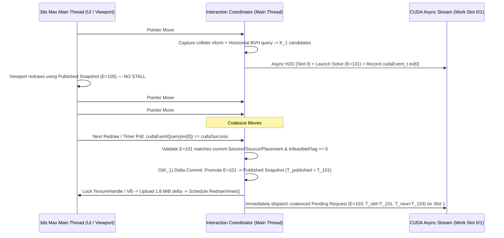

# 08. Asynchronous Publication, State Ownership, and Lifetimes

## 1. Why Current Synchronous Workers Do Not Establish Asynchronous GPU Safety

In Cyrus Scatter `0.87.4.3`, the native interaction engine is **synchronous**: the host thread captures scene inputs, dispatches up to 8 CPU workers on copied numerical data, blocks until `join()`, merges results in stable ID order, and publishes the successor snapshot before returning **[PROVIDED-FACT]**.

If GPU work is launched asynchronously across pointer-move events (or if a background worker thread awaits a CUDA stream while the Max main thread returns to the message pump), new concurrency and lifetime hazards arise:
1. **Stale Successor Overwrite:** An older, larger drag solve ($E = 41$) could finish *after* a newer or undone state ($E = 42$) and overwrite the scene with obsolete poses.
2. **Mid-Flight Scene Mutation:** While a GPU kernel is reading `d_restNodes` for source $S_A$, the artist may delete the scatter object, replace source $S_A$, change Max system units, trigger `Undo`/`Redo`, or reset/close 3ds Max.
3. **Host-Thread Violations:** Background GPU completion callbacks (`cudaLaunchHostFunc`) run on an internal CUDA driver thread that must **never** call `MaxSDK` scene evaluation, `INode` methods, MAXScript, or `MaxSDK::Graphics` `Lock`/`Unlock` **[VERIFIED-PUBLIC] & [PROVIDED-FACT]**.

---

## 2. Event-to-Result Timeline and Bounded Triple-Slot Ring Buffer

**[PROPOSED / UNVERIFIED]**

### 2.1 Strictly Monotonic Revision & Epoch Tuple
Every interaction request is stamped on the **Max Main Thread** with an immutable 64-bit `EpochKey`:

```cpp
struct InteractionEpochKey {
    uint32_t sessionGeneration;     // Incremented on File > New / Reset / Load / Unit Change
    uint32_t layoutObjectId;        // Stable handle of owning Cyrus Scatter object
    uint64_t sourceFingerprintHash; // Combined hash of prepared source definitions + authored roles
    uint64_t placementRevision;     // Incremented when N scatter placements or seeds change
    uint64_t settingsRevision;      // Incremented when Contact Gap / Hide Margin / Hide Mode changes
    uint64_t colliderDragSequence;  // Strictly monotonic counter (++seq) on every collider transform edit
};
```

### 2.2 Bounded 3-Slot State Machine (At Most 1 Solve In Flight)

Never queue an unbounded backlog of pointer-move dispatches. Maintain exactly **three logical state slots** on the host and at most **two ring-buffered dynamic work slots (`Slot 0`, `Slot 1`)** on the GPU:



### 2.3 Why "1 In-Flight + 1 Coalesced Pending" Beats Unbounded Queuing
- **Bounds Latency:** If a GPU solve takes $2.5\text{ ms}$ and the OS delivers mouse move events every $1.0\text{ ms}$ (1000 Hz gaming mouse), queuing every move creates a growing lag tail. Coalescing intermediate mouse moves into a single `PendingRequest` guarantees that the next GPU dispatch always jumps straight to the **latest cursor position** $\mathbf{T}_{\text{latest}}$, keeping input-to-present latency bounded to $\le 2 \times \tau_{\text{solve}}$.
- **Preserves Old-Neighbourhood Correctness Across Coalesced Moves:**
  - Suppose the last *published* collider transform is $T_{\text{pub}}$ ($E = 100$), move $E = 101$ is in flight, and moves $E = 102, 103$ arrive and are coalesced.
  - If $E = 101$ succeeds and is published, the next solve ($E = 103$) uses $T_{\text{old}} = T_{101}$ and $T_{\text{new}} = T_{103}$.
  - If $E = 101$ fails (`infeasible`) or is discarded, the published state is still $T_{100}$, so $E = 103$ uses $T_{\text{old}} = T_{100}$ and $T_{\text{new}} = T_{103}$ (or accumulates the union of intermediate dirty plant IDs `dirtyUnionSet`). This guarantees **no plant brushed by a fast-moving collider is ever orphaned in a bent state**!

---

## 3. Preventing Stale Results Across Undo/Redo, Deletion, Unit Change, and Shutdown

**[PROPOSED / UNVERIFIED]**

| Host Lifecycle Event | Hazard if Unhandled | Mandatory Synchronization & Retirement Protocol |
|---|---|---|
| **`Undo` / `Redo` (`RestoreObj`)** | An in-flight drag solve from before `Ctrl+Z` completes and overwrites the restored undo state. | `RestoreObj::Restore()` increments `settingsRevision` / `colliderDragSequence` and sets `lastCommittedEpoch = newEpoch`. Any in-flight GPU slot with `slot.epoch < lastCommittedEpoch` is marked `CANCELED`; when `cudaEventQuery` completes, its output is silently dropped without touching the published snapshot. |
| **Deleting a Scatter Instance / Collider / Owner Node** | Kernel reads freed source buffers or publishes poses for deleted object. | Never call `cudaFree` directly from a destructor while a stream is active. Move retired `GpuSourceDeviceBuffers` into a **Deferred Retirement Queue** tagged with `retireEvent`. Reclaim memory on the host thread only after `cudaEventQuery(retireEvent) == cudaSuccess` (or call `cudaStreamSynchronize(stream)` once during object destruction). |
| **Replacing a Source Asset or Authoring Override** | Guide count $G$ or vertex count $V$ changes; old compact pose indices `(k, g)` are invalid for the new topology. | Re-computing preparation generates a new `sourceFingerprintHash`. The commit gate checks `slot.epoch.sourceFingerprintHash == currentSource.fingerprintHash`; mismatches are discarded immediately. |
| **Changing Max System Units (`Units Setup`)** | Metre conversion scale changes; cached local-frame clearances are invalid. | Increment `sessionGeneration`, invalidate cached local collider BVH scale factors, and trigger a clean full-active re-evaluation on the new unit scale. |
| **Scene Load / Reset (`NOTIFY_SYSTEM_PRE_RESET`, `NOTIFY_FILE_PRE_OPEN`) or Max Shutdown (`NOTIFY_SYSTEM_SHUTDOWN`)** | Dangling GPU work or driver teardown order crash during `3dsmax.exe` exit. | Register `RegisterNotification` callbacks on the main thread for `NOTIFY_SYSTEM_PRE_RESET`, `NOTIFY_SYSTEM_PRE_NEW`, `NOTIFY_FILE_PRE_OPEN`, and `NOTIFY_SYSTEM_SHUTDOWN`. Inside the callback: set `shuttingDown = true`, call `cudaStreamSynchronize(computeStream)`, release all `MaxSDK::Graphics` handles and CUDA device pools **before** Max tears down the Nitrous D3D11 device, and never call `cudaDeviceReset()` (which would destroy contexts belonging to V-Ray GPU, Redshift, or Arnold GPU in the same process!). |

---

## 4. Handling Hardware Failures, Windows TDR, VRAM Exhaustion, and Remote Desktop

**[VERIFIED-PUBLIC] & [PROPOSED / UNVERIFIED]**

1. **Windows WDDM TDR (`cudaErrorLaunchTimeout` / `DXGI_ERROR_DEVICE_REMOVED`):**
   - By default on Windows desktop (`HKLM\System\CurrentControlSet\Control\GraphicsDrivers\TdrDelay`), if a single GPU dispatch monopolizes the WDDM engine for **$\ge 2.0\text{ seconds}$**, Windows resets the display driver **[VERIFIED-PUBLIC]**.
   - In CUDA, a launch timeout or illegal memory access produces a **sticky error** that corrupts the CUDA primary context for the remainder of the process (`CUDA Programming Guide §Error Handling` **[VERIFIED-PUBLIC]**).
   - **Mitigation:**
     1. **Watchdog Chunking:** Never launch a single kernel over more than $M_{\text{chunk}} = 65{,}536$ active guides at once ($< 15\text{ ms}$ worst-case execution time on any supported GPU—more than **100× below** the 2-second TDR threshold).
     2. **Sticky Error Latch & Automatic CPU Failover:** If any CUDA API returns `cudaErrorLaunchTimeout`, `cudaErrorDevicesUnavailable`, or `cudaErrorIllegalAddress`, latch `gpuBackendState = GPU_DISABLED_STICKY_ERROR`, log a single diagnostic banner for the artist (*"GPU interaction backend encountered a driver reset; switched seamlessly to CPU solver"*), retain the last complete published snapshot, and route all subsequent solves to the CPU worker pool for the rest of the session.
2. **VRAM Exhaustion (`cudaErrorMemoryAllocation`) & Fragmentation:**
   - Because the GPU is shared with 3ds Max's Nitrous viewport (textures/buffers) and potentially GPU renderers (V-Ray GPU, Arnold GPU, Redshift), available free VRAM can drop below $512\text{ MiB}$ at any time.
   - **Mitigation:** Query `cudaMemGetInfo(&freeBytes, &totalBytes)` before growing pools, enforce a hard **VRAM Safety Reserve** (never allocate if `freeBytes < 512 MiB` or if Cyrus Scatter's total compute pool exceeds `256 MiB` by default), and preallocate fixed-size ring buffers at session start rather than allocating/freeing per drag event. If an allocation fails, fall back to the CPU solver for that batch without losing the current scene state.
3. **Headless Sessions, Network Render Nodes, and Remote Desktop (RDP):**
   - Under Windows Remote Desktop or headless batch rendering (`3dsmaxbatch.exe`), either no WDDM display adapter is attached or a Microsoft Basic Render Driver (`WARP`) is active.
   - If `cudaGetDeviceCount` returns `0` or the device fails admission, the plugin initializes in **CPU Solver Mode** with zero error popups.
4. **Keeping Persistence 100% Portable (`.max` Scene & Recipe Schema 63):**
   - **Never** serialize GPU pointers, `cudaMemPool_t` handles, LUIDs, PTX binaries, or transient slot indices into `.max` files or MAXScript recipes **[PROVIDED-FACT]**.
   - On scene reopen, Cyrus Scatter reconstructs prepared sources from source geometry + persisted recipe settings and lazily populates GPU device buffers on the first viewport/interaction evaluation.
