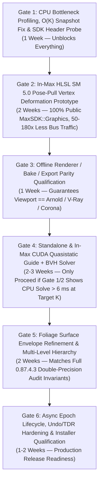

# 13. Phased Implementation Plan and Go/No-Go Gates

## 1. Why We Reordered the Implementation Gates

Per `RESEARCH_PROMPT.md` §13, we reordered the six implementation gates slightly to **front-load the lowest-risk, highest-leverage wins** and **eliminate Max SDK unknowns before any GPU solver code is written**:

**Why Gate 2 (Shader Deformation) and Gate 3 (Renderer Parity) Come *Before* Gate 4 (CUDA Contact Solver):**
1. **Immediate Speedup Across All GPUs (NVIDIA, AMD, Intel):** Moving vertex/normal deformation into the existing SM 5.0 HLSL vertex shader (`mesh_display.inc`) via a compact `TextureHandle` / `VertexBufferHandle` pose palette eliminates CPU mesh cloning and cuts per-drag viewport buffer uploads by **50× to 180×** using **only public `MaxSDK::Graphics` APIs**.
2. **Decouples Viewport Display from Solver Backend:** Once Gate 2 and Gate 3 are in place, both the CPU solver and the Gate 4 CUDA solver simply output the **exact same `CompactPoseSnapshot` struct**—making CPU-to-GPU failover a 1-line pointer switch!

---

## 2. Detailed Gate Specifications

### Gate 1: Workload Profiling, $O(K)$ Snapshot Delta Fix, and Local Max 2027 SDK Probes
- **Inputs:** Existing `0.87.4.3` codebase (`interactions_engine.cpp`, `interactions_source.cpp`, `mesh_display.inc`) and local 3ds Max 2027 SDK headers (`maxsdk/include/Graphics/`).
- **Tasks:**
  1. Execute **Probes P1–P6** from [16_OPEN_QUESTIONS_FOR_LOCAL_CODEX.md](16_OPEN_QUESTIONS_FOR_LOCAL_CODEX.md) (inspect `IVirtualDevice.h`, `VertexBufferHandle.h`, `TextureHandle.h`, and profile `BM-01` through `BM-05` with QPC timers around: (a) neighbourhood search, (b) successor pose-map copy, (c) root classification, (d) guide fitting, (e) surface refinement, and (f) viewport vertex deformation/upload).
  2. Replace full-scene retained pose-map copying (`CURRENT_SYSTEM_CONTEXT.md` §CPU boundaries) with an **$O(K)$ Copy-on-Write / Generational Sparse Table** so updating $K=3$ plants in a $N=100{,}000$ scene touches only $3$ entries instead of $100{,}000$.
- **Resource Budget:** $0\text{ MiB}$ new VRAM; reduces host RAM allocations per drag by $>95\%$ when $K \ll N$.
- **Go / No-Go Criteria:**
  - **Go to Gate 2:** $O(K)$ snapshot commit takes $< 0.2\text{ ms}$ at $N = 100{,}000, K = 10$, and `BM-01` ($N=200, K=3$) passes all 61 existing native tests with bitwise-identical output.
- **Rollback / Fallback:** Pure host data-structure optimization; trivially reversible via feature flag.

---

### Gate 2: Narrow GPU Vertex/Normal Deformation via Public `MaxSDK::Graphics` (`HLSL SM 5.0`)
- **Inputs:** CPU-solved compact guide poses (`hiddenGroupMasks` + changed guide node positions/quaternions $\{\mathbf{p}_{g,i}, \mathbf{q}_{g,i}\}$) from `interactions_source.cpp`.
- **Interfaces & Ownership:**
  - `PointDisplay` / `MeshItem` (`point_display.cpp`, `mesh_display.inc`) owns one immutable shared-source vertex buffer (`d_vtxBind`, `d_vtxRestPosOff`, `d_vtxRestFrame`) per prepared source plus one dynamic **`TextureHandle`** (`DXGI_FORMAT_R32G32B32A32_FLOAT`, width $4096$) storing the compact pose palette.
  - On each committed drag update, `PointDisplay` locks only the dirty rows of the pose texture (`WriteOnlyLockRectangle` / `Lock`), copies the compact pose delta ($< 2\text{ MiB}$ for $M=15{,}000$ active guides), and draws all instances via instanced `DrawInstanced`.
- **Resource Budget:** $\le 48\text{ MiB}$ VRAM for up to $K_{\text{retained}} = 10{,}000$ simultaneously deformed plants ($300{,}000$ active guides).
- **Go / No-Go Criteria:**
  1. Vertex position and normal discrepancies vs CPU reference deformation are $\le 1.0 \times 10^{-4}\text{ m}$ and $\le 0.1^\circ$ across `BM-01`, `BM-03`, `BM-09`, `BM-10`.
  2. Hidden root groups (`Inside solid` and `Under collider`) are 100% invisible with zero stray triangles.
  3. Toggling Wireframe (`F3`) preserves deformed geometry with `0` new collision solves and `0` buffer re-uploads.
  4. Viewport upload + deformation stage (`Stage 4 + Stage 6`) drops below **$1.5\text{ ms}$** at $K = 500$ deformed plants ($11\text{M}$ vertices).
- **Rollback / Fallback:** Retain existing CPU mesh materialization path selectable by internal debug CVar `cyrus.gpuDeform = 0`.

---

### Gate 3: Offline Renderer, Bake, and Export Consistency Qualification
- **Inputs:** Authoritative host-resident `CompactPoseSnapshot` from Gate 2.
- **Interfaces & Ownership:**
  - `interactions_render.cpp` consumes `CompactPoseSnapshot` during `GetRenderMesh()` / `MaxSDK::RenderTimeInstancing` / Bake evaluation.
  - Undisturbed instances ($poseHandle == -1$) are emitted as shared source instances; posed/partially-hidden instances materialize deformed `Mesh` objects on demand using the exact same `deformVtx` math and triangle-visibility filter as the Gate 2 shader.
- **Go / No-Go Criteria:**
  - Pixel/geometry audit between Nitrous viewport and Arnold / V-Ray / Corona render on `BM-01` and `BM-03` shows $< 0.01\text{ mm}$ vertex deviation and identical hidden-group triangle counts ($23{,}497$ visible triangles on the `0.87.4.3` baseline audit fixture).
- **Rollback / Fallback:** Existing CPU `interactions_render.cpp` path.

---

### Gate 4: CUDA Quasistatic Rooted-Guide & Local-BVH Contact Solver (Population 2 & 3 Scale-Up)
- **Trigger Condition:** Proceed to Gate 4 **if and only if** Gate 1–2 profiling shows that CPU Stage 3 (`t_solve_refine_ms` on 8–12 threads) exceeds **$6.0\text{ ms}$** on target interactive workloads (`BM-05`: $K = 500$ plants, or `BM-06`: $K = 1{,}000$ plants).
- **Inputs:** Prepared source guide arrays + flattened collider BVH arrays (uploaded once per unique source/collider fingerprint) + per-drag candidate plant transforms and relative local collider transforms (computed in `double` on the host, uploaded as `float` via pinned H2D).
- **Outputs:** Compact active guide poses (`M * Nn * 16 B`), `hiddenGroupMasks`, and `infeasibleFlags` read back via pinned memory (`cudaMemcpyAsync` + `cudaStreamSynchronize`) into `CompactPoseSnapshot` (Path F1).
- **Resource Budget:** $\le 128\text{ MiB}$ CUDA device pool (`cudaMalloc` ring buffers for 2 slots up to $K_{\max} = 4{,}096, M_{\max} = 131{,}072$).
- **Go / No-Go Criteria:**
  1. End-to-end GPU solve + pinned readback (`Stage 2 + Stage 3 + Stage 5`) is **at least 4× faster** than 8-thread CPU on `BM-05` ($K = 500$) and **$\ge 8\times$ faster** on `BM-06` ($K = 1{,}000$), achieving `< 4.0 ms` p95 at $K = 500$.
  2. Root anchor drift $= 0.0\text{ m}$, max stem strain $\le 0.01\%$ (or matches CPU target), and `Inside solid` / `Under collider` group counts match CPU reference **100% exactly** on the `0.87.4.3` qualification fixtures.
  3. Infeasible root/squeeze cases (`BM-12`) set `infeasibleFlags != 0` and preserve the prior valid publication with zero silent geometry loss.
- **Rollback / Fallback:** Automatic per-dispatch crossover (`K < K_gpu_min` uses CPU) and instant session fallback to CPU if CUDA device is absent or returns any error.

---

### Gate 5: GPU Visible-Surface Foliage Refinement & Multi-Level Branch Hierarchy
- **Inputs:** Stage 4 active guide poses + bound foliage boundary witness vertices (`d_foliageWitnesses`) + depth-level topology (`d = 0 .. D_max - 1`).
- **Tasks:**
  1. Enable depth-level kernel loop ($d = 0 \dots D_{\max}-1$) with exact parent-segment attachment (`EC-15`).
  2. Add Stage 5 witness-vertex BVH clearance check + normal-lift and axial-twist quaternion adjustment (`EC-03`).
- **Go / No-Go Criteria:**
  - `0` penetrating vertex pairs and `0` touching triangle pairs on the double-precision independent surface audit (`0.87.4.3` audit test) and on broad-leaf fixture `BM-10`.

---

### Gate 6: Asynchronous Epoch Scheduler, Undo/TDR Hardening, and Distribution Sign-Off
- **Tasks:**
  1. Activate the bounded 3-slot asynchronous coordinator ([08_ASYNC_PUBLICATION_AND_LIFETIMES.md](08_ASYNC_PUBLICATION_AND_LIFETIMES.md)) with pointer-move coalescing (`1 in-flight + 1 latest pending`).
  2. Qualify all lifecycle hazards (`EC-17` through `EC-32`: Undo/Redo, mid-flight delete, unit change, scene reset, Max shutdown, TDR injection, VRAM exhaustion, AMD/Intel no-CUDA load test).
  3. Package AOT fatbins (`sm_75, sm_86, sm_89, sm_120, compute_120`) and verify signed installer compliance ([15_DISTRIBUTION_FALLBACK_AND_ARTIST_WORKFLOW.md](15_DISTRIBUTION_FALLBACK_AND_ARTIST_WORKFLOW.md)).
- **Go / No-Go Criteria:**
  - Passes all 61 existing native tests + all 32 edge-case matrix tests (`EC-01`–`EC-32`) with zero memory leaks or race conditions under `compute-sanitizer --tool memcheck` and `racecheck`.
