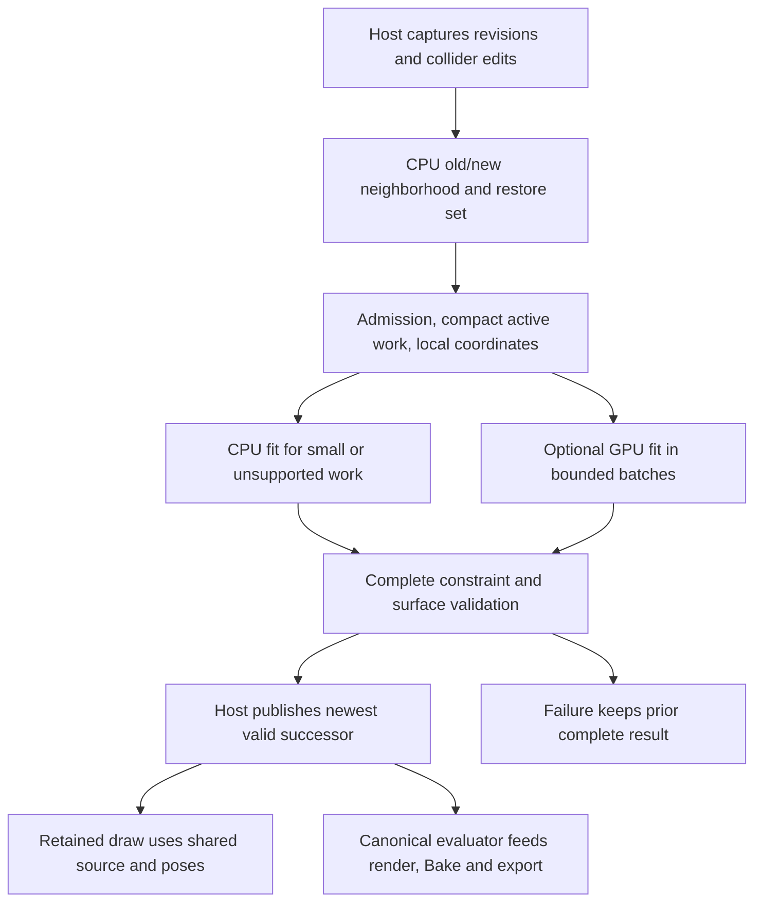

# 03 — Parallelism, sparse work and data layout

[Index](00_README.md) · [Collision](05_COLLISION_AND_GUIDE_SOLVING.md) · [Memory](09_MEMORY_PRECISION_AND_HARDWARE.md)

## Accessible explanation

**[D — proposed architecture]** A GPU helps when many comparable pieces of work are ready together. Independent plants and many independent rooted groups provide that opportunity. Nodes on a single short grass chain are coupled: moving one changes neighboring lengths and bends. A branch also depends on its parent's fitted attachment. Assigning one GPU thread to an entire large plant leaves too little parallelism and very uneven work; assigning one thread to every node without a dependency strategy gives races or a different numerical method.

The intended pipeline first finds a small active neighborhood, then makes compact lists of the guides, spans and vertices that actually need work. It keeps source geometry shared, but records the changing pose explicitly. A graphics vertex shader can use that pose to draw bent vertices. It cannot, merely by drawing them, discover all collisions or certify that broad leaves are clear.

## Definitions and cost accounting

| Symbol | Meaning |
|---|---|
| `N`, `K`, `R` | Resident instances; affected/reconsidered instances; retained non-rest instances |
| `S` | Unique prepared source revisions |
| `G_s`, `L_s`, `V_s`, `T_s` | Source guides, source guide nodes, render vertices, triangles |
| `A`, `Q`, `E` | Active guides, active nodes and active spans in this request |
| `C`, `C_k` | Total collider instances and relevant colliders for plant `k` |
| `P_p`, `P_s`, `P_t` | Plant/collider pairs; span/collider candidates; primitive witness/contact candidates |
| `D`, `I` | Parent depth and bounded solver iterations |
| `M` | Number of collider triangles in a relevant asset/BVH |

Never use `G` or `V` without saying per-source or total. `A≤Σ_{k∈K}G_source(k)`; it is not automatically small. `Q=Σ active guide node counts`. A conservative contact refinement may activate additional guides; its expansion must be budgeted and the final active set reported.

**[E — complexity model]** A maintained CPU index gives a usual output-sensitive neighborhood cost near `O(log N+K)` per queried region, with `O(N)` worst cases for overlapping bounds. A GPU full scan costs `O(N)` even when `K=1`. Grid updates can be local, but dense buckets can still degrade; a newly built global BVH/hash has its own sort/build cost. `P_p≤Σ C_k` under the current relevant-collider admission. A naive expansion `P_s≈Σ spans(k)×C_k` can dominate memory; compact only overlapping span bounds and use bounded tiled enumeration.

Per iteration, structural projection is approximately `O(Q+E)`, plus contact traversal and witness processing. BVH query cost is distribution dependent, not universally `O(log M)` for overlapping/thin triangles. A useful cost expression is `O(I[Q + visited_BVH_nodes + P_t])`. Rebuilding a deformed mesh is `O(Σ changed materialized V_s)`; shader deformation is per drawn vertex per draw pass. Different viewports, shadows and render passes can repeat vertex work. These are algorithmic estimates, not speed claims.

## Stage diagram



A preview proxy lane, if enabled, has a separate explicitly approximate publication and never overwrites the accepted final result. Diagram edges are contracts, not proof of a currently supported zero-copy Max interop path.

## Proposed buffer schema

All sizes below are **[D/E] proposed packed transfer layouts**, not `sizeof` of current C++ types. Serialize fields explicitly, test alignment/endianness/ranges and use 64-bit host arithmetic before any allocation. Device offsets can be 32-bit only inside a capped chunk whose last byte is representable; the global manifest remains 64-bit. Stable 64-bit IDs are not interchangeable with transient compact indices.

| Buffer | Layout and ownership | Update / lower-bound model |
|---|---|---|
| Source registry | fingerprint, preparation/evaluator version, offsets, counts, bounds and CPU owner token | One per unique revision; immutable |
| Rest vertices | float3 position, float3 normal, float2 UV, float4 tangent/sign | 48 B per **render** vertex; seams already split |
| Single-guide binding | guide index, span index, arc coordinate, flags; float3 rest offset plus one reserved/error scalar | 32 B per render vertex; multi-guide/cage bindings need a separate admitted layout |
| Topology | uint3 triangle; uint material-slot and uint rooted-group association | 20 B/triangle model; cross-group triangles require explicit group policy |
| Guide headers | node offset/count, parent guide/span, attachment coordinate, root mode, root group and flags | 32 B/guide model; ancillary rest coefficients separate |
| Rest guide nodes | float4 centre/radius, float4 material quaternion, float4 rest-length/width/auxiliary fields | 48 B/node model; unwrapped twist metadata may require more |
| Instance SoA | affine3×4 local transform, stable ID, source index, pose-directory index, flags and revision token | 80 B/instance model; CPU double-precision transform retained separately |
| Collider asset | shared triangles or analytic parameters, BVH or field, certified bounds and source revision | Reused in collider-local space; rigid motion does not rebuild source geometry |
| Collider instance | transform/inverse, uniform scale, source ID/revision, world-generation key | Upload changed instances; normals and distances transformed explicitly |
| Pose directory | Four uint32 compact fields: instance index, guide index, node offset, node count/flags; per-instance sparse range and rest sentinel | 16 B/active-guide record model; stable 64-bit IDs live in instance/source tables; no `N×G` allocation for rest |
| Node poses | float4 centre/padding and float4 unit material quaternion | 32 B/node; unchanged guide uses source rest |
| Visibility | rooted-group bits and whole attachment ownership | `4 ceil(groupCount/32)` B per allocated mask; sparse default-all-visible where useful |
| Pair lists | two compact indices plus flags/count/range | 16 B/record example; plant, span and triangle pairs are distinct lists |
| Diagnostics | root/length/frame/surface residuals, failed ID, overflow/ambiguity/cancellation, query/work counts | Fixed per-job header plus capped detail ring; overflow is a failure/status |
| Scratch | ping/pong centres, corrections/weights, reduction values, contact records, scan/sort scratch | Query allocator requirements; reserve and count separately from output |

AoSoA tiles of 32/64 nodes can improve locality where guides have comparable size. They are hypotheses, not a reason to pad every small guide to a giant plant-wide block. Immutable source fields and writable pose/correction fields must not alias. Preparation still owns authored roots, rest curvature, width, twist and foliage bindings.

## Scheduling choices to benchmark

| Work | Candidate decomposition | Dependency / likely hazard | Recommended first experiment |
|---|---|---|---|
| Transform and broad-phase candidate test | Thread per instance or candidate pair | Full `N` scan wastes sparse-work time | Keep CPU index first; GPU scans only already compact lists |
| Short independent grass guides | Warp/subgroup per guide, lanes per node/span | Divergence for different lengths and contact counts | Buckets by source, 4/8/16/32-node length and query type; measure utilization |
| Very short nodewise constraints | Thread per constraint | Shared endpoints create write conflicts | Two-color chain edges or Jacobi correction/reduction |
| Branched plants | Level-scheduled groups of independent guides | Parent frame must be finalized or coupled consistently | Root→child depth passes; explicit junction revisits for coupled objectives |
| Large single guide | Workgroup over spans/nodes | Synchronization and long serial projection path | Tiled Jacobi with residual checks; compare colored sweep |
| Whole plant block | Block/workgroup per small uniform plant | Hundreds of long guides exceed shared memory and occupancy | Admit only bounded plant sizes; not universal policy |
| Mesh contacts | Thread per span/collider or primitive candidate | Variable BVH traversal, divergent hit counts, atomics | Compact hit lists; deterministic stable-ID ordering before solver |
| Surface refinement | Thread per candidate triangle pair | Many contacts and wide leaves; complete occupancy required too | Bounded tiles, explicit overflow and CPU robust fallback |
| Vertex deformation | Thread/vertex shader per rendered vertex | Indirect pose fetch, material passes, seams | Shared source vertex stream plus pose texture/buffer lookup |

**[D]** A warp size of 32 is a CUDA-specific tuning assumption. OpenCL subgroup size/capability must be queried, and HLSL shader model 5 does not imply wave-intrinsic availability. Use portable workgroup/local-memory fallback and compare like algorithms. See [04](04_CUDA_OPENCL_AND_GRAPHICS_COMPUTE.md).

### Jacobi, Gauss–Seidel and coloring are different solvers

Jacobi reads iteration `i`, writes independent corrections, and reduces into iteration `i+1`; double buffering makes parallelism clear but can need more iterations. Gauss–Seidel uses the newest local corrections and introduces order dependencies. Coloring partitions constraints with no shared writable nodes; each color is parallel, colors are sequential. Two-color edge constraints are insufficient for all three-node bend constraints or arbitrary branching contacts. A global barrier requires a kernel boundary or a specifically qualified cooperative launch; a workgroup barrier does not synchronize different blocks. These are standard dependency consequences; the proposed comparison is in [10](10_BENCHMARK_AND_VALIDATION_PLAN.md).

Parallel parent-depth passes preserve one-way parent→child attachment if that is the CPU objective. They do not solve a fully coupled rod network merely by traversing a tree once. For this product, keep the current prepared hierarchy and formulate the desired coupling explicitly. Stable sorting makes a reproducible schedule; floating reductions and different precision still prevent a blanket bitwise CPU/GPU equality claim.

## Proposed bounded execution sketch — not compiled

```text
onColliderEdit(edit):                       # host thread
    generation += 1
    replacePendingRequest(captureOwnedSnapshot(edit, generation))

worker(snapshot):                          # no Max scene calls
    affected = uniqueStable(oldBoundsHits, newBoundsHits,
                            previousContactOwners, removedColliderOwners)
    admitInstancesSourcesAndPairUpperBounds(affected)
    prepared = reuseSourceAndColliderAssets(snapshot.revisions)
    work = classifyRootsAndCompactGuideWork(affected, prepared)
    # Whole rooted groups only. root exclusion is not failed-fit cleanup.
    if noContactAndNoExclusionChange(work): return exactRestOrCachedDelta()
    route = measuredPolicy(features(work), deviceState, memoryBudget)
    for chunk in boundedIndependentChunks(work):
        if supersededOrCancelled(snapshot): discardAndRetire(); return
        pose = initializeFromImmutableRest(chunk)
        for batch in boundedIterationBatches:
            refreshAllRelevantSpanAndEnvelopeContacts(pose)
            if incompleteOrAmbiguousQueries: fail(chunk); break
            applyDeclaredStructuralAndContactProjections(pose)
            restoreFixedAnchorsAndAttachments(pose)
            updateFramesWithExplicitTwistConvention(pose)
            if completeConvergenceChecksPass(pose): break
        finalChecks = completeConstraintsAndVisibleSurfaceChecks(pose)
        stageResultOnlyIfValid(finalChecks)
    return ownedCompleteSuccessorOrDiagnostic()

onCompletion(result):                      # host publication boundary
    if result.key != newestRequestedKey: retire(result); return
    if not result.completeValid: retainLastComplete(); showFailure(); return
    publishPoseVisibilityBoundsAndPickingAtomically(result)
```

This sketch deliberately leaves the actual Max resource bridge behind an interface. It does not invent a Max SDK compute command or expose scene pointers to a worker.

## Routing and data residency

**[D]** Fit a crossover policy only after matched measurements: features include `A,Q,P_s,P_t`, chain lengths, hierarchy depth, relevant collider type, field/BVH residency, required surface refinement, retained-map size and transfer mode. A threshold on `K` alone is inadequate. Use a conservative hysteresis band to avoid switching backends repeatedly near crossover; hysteresis may select the implementation but cannot change accepted geometry semantics.

Upload shared preparation once per fingerprint. Upload edited transforms and settings deltas per generation. Read back compact poses/residuals if no supported graphics bridge exists; CPU-visible canonical poses are also needed for final validation/rendering. Changed collider geometry rebuilds only its asset acceleration and dependent neighborhoods. A collider transform changes TLAS/index entries or query transforms, not every source BLAS.

**[D]** Prefix scan/compaction, stable sort and deterministic segmented reductions are building blocks, not free work. Account for temporary bytes and dispatches. NVIDIA CCCL or OpenCL primitives can reduce implementation effort; libraries and current versions are reviewed in [04](04_CUDA_OPENCL_AND_GRAPHICS_COMPUTE.md) and [12](12_PAPERS_AND_REUSABLE_IMPLEMENTATIONS.md).
