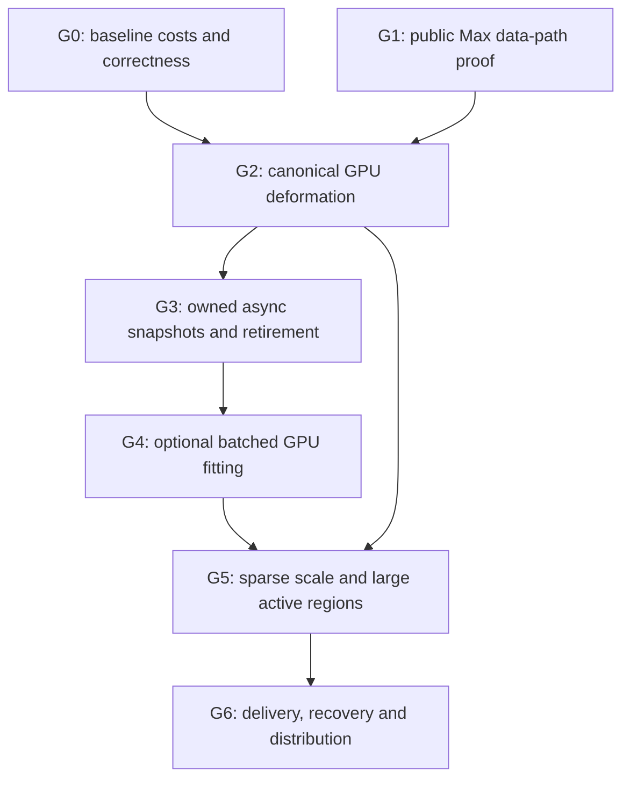

# 13 — Phased plan and rejection gates

[Index](00_README.md) · [Detailed prototypes](14_MINIMAL_PROTOTYPE_SPECIFICATIONS.md) · [Local probes](16_OPEN_QUESTIONS_FOR_LOCAL_CODEX.md)

**[D] All phases are proposals, not delivered code or measured schedules.** Ownership names below describe responsibilities for the local team, not assigned individuals. No person-time estimate is asserted. Budgets are initial experiment caps, to be reviewed before implementation; they are not new product admission limits.

## Sequence and reason

Run baseline instrumentation and the tiny Max data-path probe in parallel. Then reproduce deformation before porting contact. Build revision/lifetime infrastructure before allowing asynchronous compute into Max. This separates numerical, host and graphics failure sources and lets a useful CPU+shader path succeed even if direct compute sharing fails.

G4 is skipped if G0/G2 show no worthwhile solver bottleneck. A field/proxy accelerator is a branch within G4, not the default algorithm.

## Gate table

| Gate / owner | Inputs → outputs and interface | Initial resource budget | Pass criterion | Reject / rollback |
|---|---|---|---|---|
| G0: numerical/performance owner | Actual source/fixtures + current CPU run → versioned snapshots, residuals and stage traces | Existing admissions; bounded trace size; no GPU allocations | Baseline positive controls and adversaries classified; p50/p95/p99 for capture/maps/fit/refine/deform/upload/present; no missing stage attributed to GPU | Fix CPU correctness or dominant invalidation/publication cost before acceleration |
| G1: Max graphics owner | Tiny authored pose packet + installed2027 SDK → public-handle shader path and optional native-device capability record | 256 vertices,2guides,2instances; ≤16MiB test resources; no fitter | I0/I1/I2 separated; exact resource/thread/lifetime evidence; no private casts | Select CPU→public shader or CPU mesh; do not block CPU plugin |
| G2: evaluator owner | Existing prepared bindings + authored poses → identical CPU/GPU evaluator contract and render/Bake materializer | ≤32MiB source test payload, bounded pose pages; first test≤4MiB pose data | [09](09_MEMORY_PRECISION_AND_HARDWARE.md) parity; rest, normals, seams, twist, groups, bounds, picking; zero unchanged uploads; measured end-to-end benefit | Keep CPU normals/materialization or reject shader variant; preserve existing path |
| G3: native runtime owner | Immutable source registry + host change events → snapshot scheduler/retirement service | One in-flight,one pending,≤3pose generations; byte-reserved pools | Inject all key changes at every state; zero stale publication/UAF; bounded cancellation; module can load without backend | Synchronous CPU/qualified graphics lane remains; disable async |
| G4: solver owner | Analytic/closed-mesh world + matched CPU algorithm → optional CUDA and comparison OpenCL standalone fit packets | First cap32,768 guides,262,144nodes,1M64B contact records; ≤512MiB total owned GPU pool including shared fixtures/scratch; report actual reserve | Known-feasible controls converge, adversarial no false acceptance; complete surface checks; whole pipeline beats CPU at measured crossover | No automatic GPU solve if quality or completed latency fails; exact CPU remains |
| G4b: optional field owner | Closed collider asset → certified field/proxy with recorded error/band coverage | Explicit cell/tile/asset cap within G4 budget; no global scene dense field | Error bounded and shown; thin/inside/grazing controls; final exact refinement accounted | Reject uncertified final use; label preview or use exact queries |
| G5: performance owner | B01–B16 and stress fixtures → feature-based routing/admission policy | Current1M/16,384/64/4,096caps retained; per-device measured budget/headroom | Sparse K cost separated from N/R; all-active cost admitted or rejected; p95/p99/correctness/memory go/no-go met | Keep CPU route for small work; reject oversized detailed jobs with useful counts |
| G6: host/render/release owners | Accepted evaluator packets + actual renderer/exporter versions → tested optional feature package | Old/work/retired+renderer copies included; bounded disk kernel cache | Undo/reset/load/delete/abort/device loss/no-runtime install; I3renderer/Bake/export parity; license/CRT/DLL matrix verified | Ship only qualified lane or defer; no broad renderer support claim |

The G4 node cap gives 8 MiB of raw 32-byte poses per version; three versions give24MiB before guide records. One million64-byte contact records gives64,000,000decimal bytes. The512MiB ceiling includes everything the prototype owns, not a guarantee that any arbitrary collider mesh fits. Query overflow may trigger a separately bounded exact fallback; it cannot truncate contacts and report success.

## Interfaces to stabilize before a GPU port

**[D]** Freeze a host-independent snapshot/result schema: preparation fingerprint; immutable source and collider IDs; compact offsets with checked ranges; positive-uniform transforms; root/frame modes; guide/span rest data; bindings; hide settings separate from gap; budget and cancellation token; full generation key; final residuals and completeness flags. Choose an explicit result schema version distinct from persisted scene schema63.

Define the evaluator input/output independently of the backend. CPU validation is a consumer of the same prepared bindings, not a reinterpretation of GPU-generated geometry. Collision queries report complete/overflow/ambiguous status and qualified witnesses; the fitter cannot manufacture a final-clear flag from a bounded list that overflowed.

Expose no Max or C++ allocator objects across an optional compute-DLL ABI. Use fixed-width POD descriptors, opaque service handles, callbacks with clear thread contracts, caller-owned output buffers or module-owned allocation/free pairs. Installed SDK/compiler/CRT qualification is covered in [04](04_CUDA_OPENCL_AND_GRAPHICS_COMPUTE.md), [07](07_MAX_2027_INTEROP_FEASIBILITY.md) and [15](15_DISTRIBUTION_FALLBACK_AND_ARTIST_WORKFLOW.md).

## What would reverse the recommendation

| New local evidence | Decision change |
|---|---|
| Deformation/upload are negligible; source capture/map copies dominate | Optimize CPU invalidation/publication; postpone shader/solver work |
| Public HLSL pose fetch cannot preserve normal/visibility/picking contract within budget | Retain CPU mesh output; consider qualified compute-cached deformation only after its interop proof |
| Supported same-device D3D11 compute and retained-resource bridge are simple and stable | Compare D3D11 compute earlier; it may beat separate-runtime integration cost |
| CUDA wins isolated kernels but loses readback+surface validation+present p95 | Do not enable it automatically; optimize validation/data residency or keep CPU |
| Matched OpenCL has similar/better total latency and meaningfully serves actual non-NVIDIA users | Prefer/retain OpenCL despite CUDA tooling convenience |
| CUDA tools/primitives materially shorten implementation and qualified target fleet is NVIDIA | CUDA can be the first optional compute backend without asserting intrinsic speed superiority |
| Direct sharing unavailable but sparse compact readback is small and total GPU route wins | Retain standalone compute + CPU readback/public-handle upload fallback |
| Detailed all-active memory exceeds practical headroom | Admit smaller explicit request; avoid claiming “millions of plants” based on simple-blade results |

## Definition of done

A release decision needs evidence for a concrete **lane**, hardware/driver/host/compiler/renderer combination and workload envelope. A successful standalone sample, a source-code license, a high-confidence model answer or an existing rigid-body engine is insufficient. The [acceptance checklist](18_ACCEPTANCE_CHECKLIST.md) separates this research package’s completed checks from future implementation qualification.
