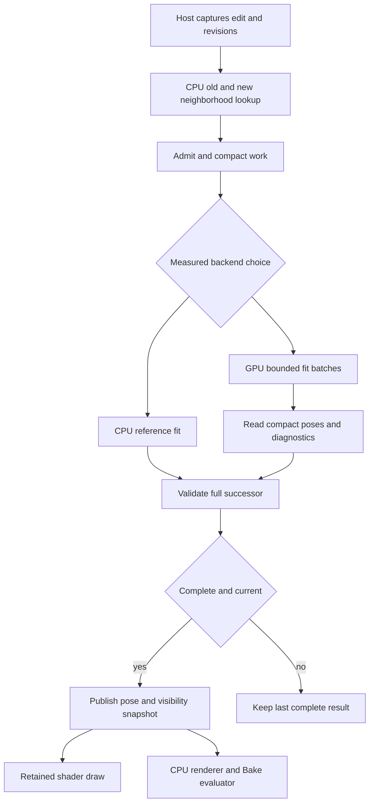

# 03 — Parallelism, resident data and sparse work

[Contents](00_README.md) · [Baseline](02_REQUIREMENTS_AND_CURRENT_SYSTEM.md) · [Memory](09_MEMORY_PRECISION_AND_HARDWARE.md)

**P unless marked otherwise.** This is a proposed data contract and scheduling design, not a description of unseen repository structures.

## Accessible explanation

A GPU helps when many small pieces of work can proceed together. Nearby grass blades can often fit independently. Nodes along one blade cannot all blindly move at once: two constraints can write the same node, and a child branch needs its parent's final attachment frame. Drawing a vertex from an already computed guide pose is much more independent than finding that pose.

Therefore count the **active guides, collision tests and vertices**, not merely the number of objects in the scene. Uploading or scanning a million objects to fit six blades can erase the advantage. A resident shared source saves repeated source uploads; it does not eliminate per-pose state, vertex shader work, surface refinement or renderer geometry.

## Proposed stage graph



Geometry capture and source preparation precede this graph. CPU → GPU transfers are source creation once per source revision, changed instance/collider transforms, compact task lists and pose pages. GPU → CPU transfers are completion status and changed poses when validation/final geometry needs them. A direct-sharing path can remove some copies only after the [interop gate](07_MAX_2027_INTEROP_FEASIBILITY.md); it cannot remove publication dependencies or renderer obligations.

## Decomposition choices

| Unit | Good parallel work | Dependencies and proposed scheduling |
|---|---|---|
| Instance | Bounds, admission, independent rooted groups | Do not make one scalar thread sequentially solve an entire 451-guide plant; retain stable instance IDs separately from compact indices |
| Guide | Short chain solve, frame transport, rest tests | Bucket by node count, topology depth and collision representation; keep difficult guides out of easy-guide batches |
| Span | Capsule–proxy/BVH query and local constraints | Adjacent spans share nodes; use explicit Jacobi accumulation or coloring |
| Node | Projection/application of already reduced corrections | One writer per node; no unsynchronized floating atomics as a deterministic solver |
| Collision pair | Distance/witness generation | Bounded count/scan/fill; overflow invalidates completeness, not just quality |
| Triangle | Visible-surface audit | Broad phase then robust feature tests; source triangle IDs and UV splits survive compaction |
| Vertex | Evaluate bound position/normal/tangent | Gather immutable pose and rest binding; no per-vertex collision solve in the draw shader |
| Parent depth | Children after parents | Separate dispatch/barrier between levels, or block-local chain traversal where all prerequisites fit |

**Thread per node** is simple for Jacobi steps but requires separate correction accumulation and global iteration boundaries. **Warp/subgroup per guide** is a useful candidate for similarly sized short chains: lanes cooperate on contacts/reductions and inactive lanes are masked. It is not portable to assume every OpenCL subgroup is 32 lanes. **Block/workgroup per plant** is useful only for small bounded plants with sufficient occupancy; a complex plant may exceed shared memory/register budgets and strand small plants behind long work. A two-level queue of homogeneous guide chunks avoids that failure.

For branching, parent sockets are hard kinematic dependencies in the first prototype. Process a level's guides in parallel, then update child root positions/frames. If later mechanics permits child forces to bend the parent, one top-down sweep no longer solves the coupled problem: add a documented outer iteration, residual and convergence policy. Independent root groups can execute concurrently because the first profile excludes plant–plant self-contact. Adding self-contact changes both the graph and pair bounds.

## Iteration semantics and races

| Scheme | Benefit | Cost/risk | Initial use |
|---|---|---|---|
| Sequential Gauss–Seidel along one guide | Rapid local propagation; easy CPU reference | Serial within a chain; result depends on order | CPU and cooperative short-guide control |
| Jacobi with old/new node arrays | All constraints read one stable iteration | More iterations and two states; averaging may alter stiffness/convergence | GPU candidate, compared at matched residual |
| Graph-colored Gauss–Seidel | No shared-node writes within a color | Multiple dispatches/colors; branches and multi-node constraints need real conflict coloring | Static source topology can precompute colors |
| Parent-depth schedule | Preserves authored hierarchy | Long thin trees expose little parallelism at upper levels | Attachment evaluation and one-way child following |
| Global sparse/projective solve | Can propagate coupling efficiently | Factorization, contact active-set changes and memory complicate reuse | Later only if local iteration fails quality/cost gates |

Constraint coloring must reflect **all touched degrees of freedom**, including orientation nodes and parent sockets, not merely alternating span indices. Dynamic contact constraints need independent pair reduction or their own conflict treatment. Deterministic contact ordering sorts by `(instance stable ID, guide ID, span ID, collider stable ID, feature ID)` and reduces with a fixed tree. This gives reproducible scheduling; it does not establish bitwise CPU/GPU equality. Floating-point ordering and FMA differences remain relevant. [R01](17_SOURCE_LEDGER.md#r01)

Do not use a global in-kernel spin barrier across ordinary blocks. Iteration/level dependencies become dispatch boundaries or a separately qualified cooperative mechanism. GPU work queues are bounded by pre-admission and explicit counts; they are not permission for an unbounded persistent kernel.

## Concrete buffer proposal

Counts and byte sizes below describe a candidate packed representation. C++ and shader stride tests must verify actual layout. Use explicit-width integers and no serialized pointers, C++ `bool`, virtual objects or `shared_ptr` bytes.

| Buffer | Candidate contents/size | Lifetime and scaling |
|---|---|---|
| Source header | Fingerprint, schema, ranges, counts, metric scale, evaluator/normal policy | Once per unique source revision |
| Source draw vertices | Position 12 B + normal 12 B + tangent/sign 16 B + UV 8 B = 48 B | `48 ΣV_s`; extra UV channels/custom attributes add bytes |
| Source index stream | Three uint32 per triangle | `12 ΣT_s`; shared across poses; material ranges separate |
| Binding stream | Guide, span, root-group, flags: 16 B; rest coordinate: 4 B; local offset float3: 12 B | Candidate 32 B/render vertex; multiple influences or derivative bases need additional streams |
| Guide metadata | Stable source guide ID, parent/socket, first node/count, root-group, rest ranges, authored stiffness/constraints | Source-sized; variable-length CSR ranges |
| Rest or posed node | Local position/radius float4 + material-frame quaternion float4 | 32 B/node; rest values shared, changed values sparse |
| Instance table | double3 translation 24 B; quaternion 16; scale/source index 8; stable ID/revision 16; pose/visibility indices, flags, padding 16 | 80 B/instance; separate SoA in kernels, schema-equivalent transfer records |
| Delta-guide header | Source guide index, pose range, count, flags | 16 B/changed guide |
| Delta-instance header | Stable ID, first changed-guide entry, entry count | 16 B/non-rest instance; deletion/rest sentinel explicit |
| Visibility | Default visible; bitsets or sorted hidden root IDs per changed instance | `D ceil(R/8)` for dense masks, not automatically `N×R` |
| Collider asset | Immutable local proxy/BVH/field and solid-admission metadata | Once per unique collider geometry revision |
| Collider instance | Stable ID, transform/inverse or rigid-scale form, asset ref, revisions, bounds | `O(C)`, independent of asset triangle storage |
| Candidate pair | Compact instance, span/triangle, collider, feature/work flags | Illustrative 16 B/pair; contact outputs are separate |
| Contact result | Witnesses, signed gap, qualified parameter, normal, IDs, status/error | Illustrative 64 B/contact using compact indices into immutable ID tables; align and measure, never alias candidate bytes |
| Diagnostics | Per-instance status, counts, worst errors, overflow flags and reason | Bounded summaries plus separately capped detailed examples |

The 80 B instance transfer record is a scalar-packed schema: translation offset 0, quaternion scalar `float[4]` at 24, scale/source at 40/44, stable ID/revision at 48/56, handles at 64/68, flags/padding at 72/76. Verify `sizeof` and every `offsetof` in C++ plus a shader round-trip. A 16-byte-aligned CUDA `float4` at offset 24 can pad the record to 96 B; it is not this wire layout. Build a separate supported camera-relative graphics instance stream; do not assume double3 is a Nitrous vertex format. A 64 B contact estimate can hold three float3 vectors, gap/u, and five uint32 fields; full stable IDs and larger precision/diagnostics require more bytes.

SoA separates positions, orientations, IDs and flags for coalesced access to hot fields. AoSoA tiles can keep 32/64 nodes together where the measured subgroup/warp policy benefits. Benchmark packed float3 versus float4 rather than asserting universal savings: alignment, fetch width and padding matter.

Use 64-bit checked totals/byte offsets during admission, then split into pages whose local indices are valid uint32. A nominal 1M-instance limit does not make `N×V` fit in 32 bits. Stable IDs are never recycled while any snapshot, Undo record, renderer lease or GPU retirement record can reference them. Sorting moves an index permutation, not identity.

### Sparse lookup during drawing

Maintain a default rest sentinel. For a changed instance, source-guide ID maps to a sparse delta via a sorted list, bounded hash, or a small per-instance dense table. Choose after profiling; a dense uint32 table for **every** one of 1M instances with 451 guides costs **1.804 GB** before a pose node is stored (E). A dense table only for `D=10,000` costs **18.04 MB** and may be a good speed/memory tradeoff. Allocate it deliberately and account for holes/pages. Avoid searching an unbounded list in every vertex shader invocation.

Source/material/shader/pose-page sorting produces bounded draw batches. Distinct instance poses still share source vertex/index streams; neither triangle count nor shader vertex work vanishes. Fixed parts use the instance transform only. Child transforms and whole-group visibility must come from the same completed successor.

## Count, scan, sort, fill

**Pseudocode, not compiled or executed:**

```text
on_contact_edit(host_event):
    dirty_ids |= collider_and_setting_ids_changed_by(host_event)
    token, desired = capture_owned_host_state_for_all_dirty_ids()
    token.base_publication_sequence = current_complete_publication.sequence
    K_ids = union(query_last_published_bounds(dirty_ids),
                  query_latest_desired_bounds(dirty_ids),
                  previous_dependency_ids(dirty_ids))
    K_ids = stable_unique_sort(K_ids)
    plan = count_source_work_and_dependencies(K_ids, token)
    if not admit_bytes_and_work(plan): return keep_last_complete(reason)
    backend = measured_policy(plan, current_device_budget)
    job = snapshot_and_queue_latest(token, plan, backend)

execute(job):
    upload_only_missing_source_generations_and_changed_metadata(job)
    classify_all_required_roots(job)  # complete solid/footprint status
    count_pair_candidates(job)
    scan_counts_checked_64bit(job)
    if counts_over_budget: return Incomplete(BudgetExceeded)
    fill_preallocated_pairs(job)
    stable_sort_and_deduplicate_pairs(job)
    for iteration_chunk in bounded_schedule:
        query_contacts_and_project_constraints_by_color_or_Jacobi(job)
        update_parent_sockets_and_frames(job)
        if cancelled_or_superseded: stop_submitting_more_chunks()
    compact_changed_poses_and_diagnostics(job)
    validate_required_visible_surfaces_and_invariants(job)
    return complete_successor_or_explicit_failure(job)

publish_on_host(result):
    if result.complete and token_matches_live_dependencies(result) and
       result.base_publication_sequence == current_complete_publication.sequence:
        atomically_replace_pose_visibility_bounds_snapshot(result)
        acknowledge_only_dirty_revisions_in_that_publication()
    else:
        retain_previous_snapshot()
    retire_resources_only_after_all_compute_draw_and_reader_dependencies()
```

Coalescing replaces the pending desired state, not the dirty collider/setting set since the last validated publication. An unpublished edit to collider A must survive a subsequent edit to B. The old neighborhood comes from the last published state, not necessarily the previous pointer event. A stale full-map result must be requeued against the new base or explicitly rebased as validated disjoint deltas; it cannot overwrite an unrelated newer result.

A GPU count pass may itself take too much work; count visits, BVH stack depth and classification rays are also bounded. A failed count/fill does not publish partial lists. Prefix scan and radix sorting are reusable infrastructure, not collision algorithms. CUDA library availability and OpenCL alternatives are assessed in [chapter 04](04_CUDA_OPENCL_AND_GRAPHICS_COMPUTE.md).

## Spatial indexes without a full-scene edit penalty

Keep the current CPU index for sparse edits. Its plant influence bounds must conservatively cover rest and currently published deformed geometry plus the admissible fitting reach/envelope. A rest-only box can miss a new collider hitting an already bent leaf. Either index a conservative source reach bound (guide-chain lengths plus binding offsets) or qualify publication-time bound refits with rest/current union and the solver displacement envelope. Keep old bounds/generations leased while jobs are in flight. This broad-phase rule is separate from display bounds. A rigid collider move changes its top-level bounds/transform, not its immutable local triangle BVH or local SDF. Refit changed top-level leaves/ancestors; measure traversal degradation and rebuild when a documented quality threshold is crossed. Source/collider topology edits rebuild affected assets. Persistent scatter placement edits update or rebuild their relevant index revision, not the whole scene on unrelated UI changes.

A GPU grid/hash can outperform per-query CPU traversal for large active regions, but sorting or rebuilding all `N` entries for every local drag is the wrong default. Use static layout pages plus bounded dynamic override cells, or batched refit. Outlier sizes and large objects need a separate list or hierarchy; fixed-cell assumptions cannot be borrowed unchanged from equal-size particles. Historical GPU broad-phase and parallel radix-tree work support the building blocks, not a performance prediction for Cyrus. [R15](17_SOURCE_LEDGER.md#r15) [R16](17_SOURCE_LEDGER.md#r16)

For Under collider, maintain a horizontal projected index and a subsequent vertical/solid rule. Union old/new candidate sets for restoration. For a **teleport with endpoint static semantics**, do not activate every plant along the travel corridor merely because a swept box is easy to build; that is only necessary if continuous interaction is explicitly added. Rotation needs conservative endpoint bounds, and continuous rotation needs a real swept bound if that later mode is requested.

## Complexity and crossover

Shared source preparation/storage is `O(Σ(G_s + Q_s + V_s + T_s))`. Resident placement/index memory is `O(N+C)`. Sparse published deformation is `O(D+H_D+Q_D+visibility_D)`. Typical neighborhood cost is `O(log N + K)` per moved bound, but degenerate overlapping bounds can approach `O(N)`; never claim a guaranteed logarithmic query.

For `I` iterations, a representative solver cost is `O(I(Q+P×query_cost))`, plus hierarchy scheduling and `O(V_A + T_A×query_cost)` visible verification. Sorting can cost `O(P log P)` comparison work or a fixed number of radix passes; scratch is not zero. Deformation costs `O(V_A)` for CPU materialization and `O(V_draw)` per shader draw/pass. Full output is `O(DV)` if stored for every distinct posed mesh, even if `K` is tiny now.

**P.** Fit a routing model from completed measurements: features include `H,Q,P,V_A`, chain length distribution, collider type, cold-cache state, validation mode and transfers. Compare total successor-ready and input-to-present cost, not just kernel time. Find the smallest active-work bin whose GPU p95 is at least 20% lower than the CPU route without higher failure/error or memory overflow; require it in three repeated sessions and add hysteresis around the crossover. The 20% is a proposed adoption margin, not an observed speedup. A threshold in instance count alone is insufficient.

If exact CPU surface validation dominates both routes, GPU solving may never cross over for a particular source. If source upload or JIT is cold, choose CPU until preparation completes. If no supported direct sharing exists, include **pose readback + validation + supported Max upload** in the same experiment.
