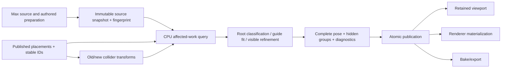

<!--
Researcher: A
Research date: 2026-10-27
Baseline: Cyrus Scatter 0.87.4.3 / native interaction capability 11 / scene schema 63
Scope: Research and architecture only; no production repository modification.
-->
# 02 — Requirements and current system

## Evidence labels

This package uses the following labels consistently:

- **[V] Verified public source** — supported by an official specification, vendor documentation, original paper, or inspected public source repository listed in [17_SOURCE_LEDGER.md](17_SOURCE_LEDGER.md).
- **[P] Provided project fact** — copied from the supplied `CURRENT_SYSTEM_CONTEXT.md` or `BRIEF_METADATA.json`; not independently verified against the private repository.
- **[M] Provided measured observation** — a measurement reported by the supplied context. It was not reproduced by researcher A.
- **[E] Executed here** — an operation actually run in the research environment. These are limited to input-hash checks, analytical calculations, document/link validation, manifest generation, and ZIP integrity checks.
- **[A] Analytical estimate** — derived from explicit assumptions or byte-count formulas; not a benchmark.
- **[R] Recommendation / proposed design** — an engineering proposal to be tested.
- **[U] Unresolved** — blocked on local source, SDK, Max, renderer, driver, or hardware evidence.

A statement may carry more than one label, for example **[P][M]** for a supplied project measurement.

## Baseline and scope

| Item | Supplied value |
|---|---|
| Product baseline | **[P]** Cyrus Scatter `0.87.4.3` |
| Native interaction capability | **[P]** `11` |
| Scene schema | **[P]** `63` |
| Host target | **[P]** 3ds Max 2027, Windows x64 |
| Current GPU interaction backend | **[P]** None delivered; research proposal only |
| Current interaction semantics | **[P]** Static/quasistatic contact fitting during collider editing |
| Current CPU executor | **[P]** Synchronous; owned numerical snapshots; stable merge before host-thread publication |
| Transform admission | **[P]** Positive uniform instance scale; nonuniform/mirrored/sheared transforms not qualified |
| Internal coordinates | **[P]** metres, +Y up |
| Max boundary | **[P]** scene units, +Z up |
| New development authorization | Research only; no repository change, version, installer or support claim |

The supplied files were hash-checked **[E]**:

| Input | SHA-256 |
|---|---|
| `README.md` | `f8584dda7afc02ce1a5fd8fa7c427499ccc710b834ed42001333d53583b9ba75` |
| `RESEARCH_PROMPT.md` | `46de9d169bcab8a0e91a8f16401698fe6bdff353d76359cb5671962b66692650` |
| `CURRENT_SYSTEM_CONTEXT.md` | `3720fd784f2fcb6742300199d3f84282345eecf124ca786478d1b2bf3a4ec861` |
| `BRIEF_METADATA.json` | `4ed3e9ee03b54175d1177666e89104bd39fa731b8e5f1f3f761487f5572a82b8` |

## Product semantics that must not be lost

### Current request

A collider instance is independently edited. Plants near its old or new position receive a collision-dependent successor pose. Leaving the area restores rest geometry. This is not continuous physics and does not require velocity, inertia, wind or history-dependent settling.

### Non-negotiable invariants

1. **Stable population identity.** Deformation does not regenerate placement IDs or silently convert interaction into rejection.
2. **Fixed roots.** Root position remains attached unless a declared root mode explicitly permits otherwise.
3. **Authored preparation survives.** Roles, roots, parent guides, fixed parts and bindings are source-level data reused by instances.
4. **Contact gap and Hide margin remain independent.**
5. **Visible geometry matters.** A clear centerline is not a certificate that cards, leaves or blade width are clear.
6. **Complete atomic publication.** Failed, cancelled, stale or over-budget work keeps the prior complete result.
7. **Manual and Live semantics.** Manual waits for Update; Live reacts only to relevant revisions.
8. **Host isolation.** Max SDK evaluation, references and publication stay on the host thread.
9. **Viewport/render/Bake agreement.** A GPU-only visual trick is not sufficient.
10. **No universal capacity claim.** Admission limits are safeguards, not FPS promises.

## Existing supplied data flow

See [diagrams/01_stage_dataflow.mmd](diagrams/01_stage_dataflow.mmd).

## Current representations and costs

**[P]** Preparation is shared across instances. A posed plant contains source-guide-indexed pose references, hidden-root masks and sparse rigid-part results. Unchanged guides reuse rest definitions. This avoids a full duplicate of every source vertex inside the pose object.

However:

- unique guide state still scales with affected guides;
- unique deformed vertex output still scales with `K×V` if materialized;
- renderer copies, graphics buffers, readback/upload staging, queued generations and Undo/history can overlap;
- the current successor copies retained pose/root-count maps before updating affected entries, so publication/snapshot cost may grow even when contact work is local.

A GPU proposal must therefore profile all stages rather than only the fit kernel.

## Admissions versus workloads

| Supplied admission | Meaning | Not proven |
|---|---|---|
| 1,000,000 interaction-layout instances | native layout safeguard | one million detailed plants bending |
| 16,384 collider instances | layout safeguard | all relevant to one drag |
| 64 relevant colliders per plant | per-plant bound | cheap 64-way exact contact |
| 4,096 transient edited overrides | bounded edit state | sustained 4,096 simultaneous high-detail fits |
| up to 8 CPU participants | current policy | asynchronous task safety or ideal scaling |

## Supplied observed fixture

**[P][M]** Reported, not reproduced:

| Observation | Scope |
|---|---|
| Source | 451 guides, 22,032 vertices, 27,501 triangles |
| Scene | 200 plants + 1 collider |
| Local work | 3 nearby candidates, 6 fitted guides, 62 hidden rooted groups |
| Native contact evaluation | approximately 4.05 ms in one run |
| Independent visible audit | 23,497 visible triangles; zero reported penetrating vertex pairs, zero touching triangle pairs, zero root-anchor error |
| Maximum checked stem-edge change | about 9.145% |
| 5,000-instance footprint test | exactly one affected neighborhood |
| Mixed viewport checks | retained upload counters and wireframe/shaded behavior |

These observations do not establish p95/p99, input-to-present latency, CPU/GPU crossover, physical pointer latency, presented FPS, all-active scale or renderer equality.

## Required workload classes

| Class | Description | Design consequence |
|---|---|---|
| W1 | Millions resident, tiny `K` | avoid touching `N`; CPU often wins submission overhead |
| W2 | Hundreds/thousands affected guides/plants | candidate for batched GPU solve/deformation |
| W3 | Millions of vertices changing | shader/compute deformation likely valuable |
| W4 | Thousands of detailed clumps with hundreds of guides | state, collision divergence and final validation dominate |
| W5 | Large-area/all-active | separate feature tier or offline Update, not local-drag extrapolation |

## Functional requirements normalized

### Scene and source capture

- Capture source geometry/preparation once per source revision.
- Capture collider geometry/assets once per geometry revision.
- Update only changed transforms for a drag.
- Consider old and new collider neighborhoods so departure restores rest state.
- Preserve authored roles and bindings; never infer a new skeleton per event.
- Convert units/axes at explicit boundaries and validate finite positive uniform scale.

### Candidate selection

- Query plant/collider bounds using old and new transforms.
- Include long-guide reach and visible envelope, not root-center distance only.
- Preserve projected-footprint ground-plane locality.
- Produce compact, stable-ID-sorted candidate lists.
- Admit and diagnose bounds, pair-count and memory limits.

### Contact and fitting

- Support analytic and closed-mesh queries.
- Use segment/capsule/visible-envelope contact where required.
- Preserve root position, root orientation policy, rest lengths, curvature and parent attachments.
- Handle multiple contacts and infeasible configurations.
- Never apply Contact gap twice.
- Keep Hide margin/Inside solid/Under collider separate.
- Record exact versus approximate witnesses and unresolved quality.

### Publication and output

- Stage a complete successor privately.
- Verify source/session/request revisions before publication.
- Publish only newest complete valid result.
- Keep prior result after failure/cancel/stale/device loss.
- Update bounds, picking and visibility.
- Provide a single canonical pose evaluator for viewport, renderer and Bake.
- Keep transient GPU handles and caches out of the scene schema.

## Non-functional requirements

| Area | Requirement |
|---|---|
| Latency | Measure input-to-present and stage timings; no kernel-only claim |
| Memory | Bound current + successor + scratch + staging + history + renderer copies |
| Reliability | CPU fallback; no plugin load failure when GPU runtime absent |
| Determinism | stable IDs and merge order; bitwise CPU/GPU equality not assumed |
| Accuracy | scale-aware root, length, attachment, penetration and visible-surface tolerances |
| Distribution | signed installer/runtime discovery/cache invalidation; exact license review |
| Testability | standalone numerical fixtures plus in-Max, renderer/Bake and artist tests |
| Maintainability | avoid a generic GPU framework unless measured needs justify it |

## Acceptance definitions

### Numerical correctness

A result is numerically acceptable only when:

- all finite/frame/index/source revision checks pass;
- root drift and root-mode error are within declared scale-aware tolerances;
- length/strain and attachment errors are bounded;
- no required visible triangle is inside/touching beyond the declared clearance tolerance;
- no stale input revision is used;
- final bounds contain evaluated geometry;
- unresolved cases are explicit, not converted to hidden geometry.

### Visual acceptance

A numerically clear plant may still fail visually because of unnatural folding, excessive curvature, card twisting, temporal popping, repeated variants or discontinuous refinement. Visual acceptance therefore requires curated side-by-side review at relevant camera distances.

### Performance acceptance

Performance claims require:

- complete stage timings and presented latency;
- p50/p95/p99 and worst spikes;
- warm/cold cases;
- active counts and fingerprints;
- CPU/VRAM peaks;
- quality equality;
- recovery/failure results.

The detailed protocol is in [10_BENCHMARK_AND_VALIDATION_PLAN.md](10_BENCHMARK_AND_VALIDATION_PLAN.md).
