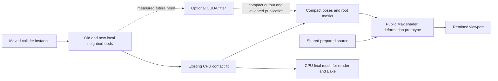

# Decision: sparse interaction first, GPU deformation next

**Status: P — architectural recommendation, supported by scoped E/L/D evidence. No production GPU backend exists.**

## Recommended direction

Keep the existing CPU collision/guide fitter as the semantic reference. First measure where dragging spends time. If deformed vertex generation or upload is material, test shared rest geometry plus compact pose buffers consumed by a Max vertex shader. This targets a regular parallel operation while preserving the complicated contact behavior artists have already tested.

If large active neighborhoods remain dominated by fitting after that change, prototype a **bounded CUDA guide/contact solver** on copied numeric data. Start with analytic spheres/capsules and fixed roots, compare against independent CPU geometry checks, and expand to closed meshes only after accuracy is demonstrated. Maintain a CPU path. Do not commit the product to NVIDIA-only requirements yet.

The public Max SDK exposes shader buffer binding, and it also declares a Direct3D 11 device interface. The remaining question is how supported resources and synchronization connect to our retained draw path. This is an executable integration gate, not a missing-API assumption. See [the exact findings](07_MAX_2027_INTEROP_FEASIBILITY.md).

## What we actually learned

| Evidence | Finding | Consequence |
|---|---|---|
| **L** Current native engine | Old/new collider neighborhoods and sparse pose reuse already exist | Preserve them; moving to the GPU must not turn a local edit into a whole-scene update |
| **E** Matched RTX 3090 surrogate | Larger CUDA/OpenCL deformation kernels were close | No defensible universal CUDA speed claim |
| **E** Transfer-inclusive surrogate | Full output readback cost much more than kernel execution | A fast kernel followed by CPU geometry materialization can lose most of the benefit |
| **E** Owned D3D11 buffers | Both CUDA and NVIDIA OpenCL wrote shared buffers correctly | Platform interoperability is possible on this workstation |
| **L/U** Max SDK | Public device declaration and buffer binding exist; retained-handle import was not found in reviewed APIs | Prove a public in-Max path before designing around zero readback |
| **A** Dense million-clump storage | Per-instance dense poses/full geometry exceed a 24 GiB GPU | Keep active state sparse and distinguish blades from clumps |

The numerical data and methodological limits are in [document 10](10_BENCHMARK_AND_VALIDATION_PLAN.md). These experiments are deliberately narrower than a plugin frame. They establish feasibility of components, not a product speedup.

## Candidate architectures

| Option | Main benefit | Principal risk | Decision |
|---|---|---|---|
| Optimize existing CPU path | Small-neighborhood latency, no interop dependency | Limited throughput for very large active sets | Always measure; keep as reference/fallback |
| CPU fit + public Max shader deformation | Avoid generating/uploading full posed vertices during drag | Shader bindings, bounds, picking, normals must match CPU | **First GPU prototype** |
| CUDA fit + compact CPU pose readback + Max shader | Accelerate fitting without raw shared draw buffers | Readback latency, asynchronous publication, solver parity | Second candidate if fitting dominates |
| CUDA fit/deform + direct graphics sharing | Keep large outputs on the GPU | Max resource ownership and state synchronization unproven | Gate on an owned Max interoperability probe |
| OpenCL equivalent | Wider potential device coverage | Optional extensions and driver-specific behavior | Keep matched comparator; do not build two production backends initially |
| Full dynamic rod simulation | Wind/inertia and two-way physical effects | Different behavior, time dependence, caching, much larger scope | Separate future product decision |

## Stop/go rules

1. **Do not accelerate an unmeasured stage.** Record source preparation, neighborhood work, fitting, pose bookkeeping, vertex construction, upload, host publication, and presentation separately.
2. **Do not ship private-pointer interop.** No `SmartHandle` reinterpret-casts or dependence on undocumented Nitrous object layouts.
3. **Do not trade geometry correctness for a benchmark.** Every relevant guide remains eligible; failed guides cannot disappear silently. Hiding remains a deliberate root-exclusion rule.
4. **Do not make the UI wait on the GPU for every mouse event.** Introduce revisioned bounded work, latest-target coalescing, and atomic publication if asynchronous compute is adopted.
5. **Require end-to-end gains.** A proposed acceptance target is at least 25% lower median edit-to-visible latency in a specified hotspot fixture, with no material p95 regression in small cases. This is a proposed gate, not an achieved result.

## The million-object question

A million resident instance records with a few nearby plants changing is plausible as an architectural target. A million detailed clumps, each with hundreds of guides and tens of thousands of triangles, reacting and drawing fully every frame is a different workload. Instancing saves shared storage and CPU submission; it does not eliminate vertex shading, rasterization, transparency, or contact work. Such scenes need spatial filtering, visibility culling, explicit LOD, and bounded active simulation.

The first implementation should answer one question: **can the public Max draw path consume compact poses without rebuilding full deformed meshes, while preserving all current behavior?** If yes, we gain a useful foundation even if CUDA fitting is never needed.
