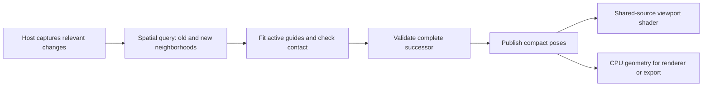

# Consolidated findings and experiment gates

27 October 2026. This is the review's proposed direction, not an implemented feature, a new product contract, or authorization to start every phase.

## 1. The useful scaling model

Separate four populations: resident placements **N**, active nearby plants **K**, retained/drawn deformed instances **D**, and source/render geometry per plant. Count actual guides, spans, contacts, bindings and render corners as well as plants. Millions of resident transforms can be practical while millions of simultaneously solved high-detail clumps are a completely different workload.

Prepare each unique source once. Share its topology, bindings, rest guides and immutable GPU data. Store compact per-instance poses only where needed, restore plants when a collider leaves, and retire unused poses safely. Query the union of the collider's old and new neighborhoods. A global scan or a global N×guides allocation defeats this architecture even if the arithmetic runs on a GPU.

This shared conclusion is stronger than any API preference. A spatially restricted CPU request can beat a GPU job whose launch, compaction, transfer and publication cost exceeds the useful work.

## 2. Separate fitting, surface evaluation and delivery

The diagram describes the initial proposed ownership model. Host SDK calls and publication stay on the host thread; worker/compute stages consume copied immutable inputs. The CPU-readable completed pose is retained for validation, final geometry and recovery. A later direct-sharing route must justify any change to that ownership contract.

Moving viewport deformation into a shader can reduce unique deformed buffers and repeated full-vertex uploads. It **does not automatically remove CPU surface evaluation inside exact contact refinement**. The current source contains both `posePoint` evaluation and detailed geometry refinement; stage measurements must establish which dominates. Shader work also repeats across views and passes, so static camera navigation must be measured alongside drag updates.

## 3. GPU viability is supported; the API winner is not established

The existing LocalCodex probes execute CUDA and OpenCL on the same RTX 3090. Both handle the synthetic deformation quickly, and both share an owned D3D11 buffer. At larger cases, device execution is close while full vertex round trips are much more expensive. Those tests support GPU feasibility for component work, not the speed of the actual collision fitter or Max presentation.

CUDA is a reasonable first *compute prototype* because of its engineering tools and primitives, provided the real workload justifies it. That is a development preference, not demonstrated superiority over OpenCL. Keep a matched comparator and CPU fallback. A public HLSL draw prototype requires neither CUDA nor OpenCL, so its result should precede a product-wide NVIDIA requirement.

## 4. The Max uncertainty is narrower than some reports suggest

Public device access and public shader buffer binding exist. The unproven part is whether the exact retained resources, binding layouts and synchronization we need behave correctly in Max. Native pointer access alone does not establish a supported zero-copy bridge. The primary-source details and installed-header checks are in [SOURCE_CHECKS.md](SOURCE_CHECKS.md).

The first draw experiment should use supported handles and the public HLSL parameter path. Use a texture fallback if that specific buffer route fails; small constants are a control, not an unbounded pose store. Do not reinterpret internal handle pointers or assume standalone D3D11 ownership rules apply to Nitrous.

## 5. Collision correctness remains the hard part

Guide nodes can all be outside a stone while the span between them passes through it. A clear centerline can still leave a broad leaf intersecting a surface. Large leaves, multiple colliders, branches and contained geometry require independent whole-element checks, not only attractive screenshots.

A fixed root inside a solid, or a gap larger than the plant's available reach, can make a requested fit impossible. No faster backend removes that constraint. A failed or incomplete fit must retain the previous complete result and explain the conflict. It must not silently drop guides, erase foliage or present a capped contact list as complete.

Contact gap governs bending clearance. Hide margin governs explicit rooted-group exclusion. Keep their units, applications and controls separate. With hiding disabled, a failed bend is an error/retained result, not permission to keep unchecked penetration or hide an arbitrary percentage of blades.

## 6. Fields and numerical error need a shared budget

SDFs and collision proxies can accelerate queries, but sample spacing alone does not certify exact geometry. Account for construction/sample error, sign, interpolation, band limits, precision and whether a whole segment or triangle was searched. A conditional trilinear bound is not a proof for arbitrary fields or missed minima.

Use one total clearance budget covering contact fitting, field approximation where applicable, CPU/GPU evaluator differences, uploads and transforms. Otherwise a CPU tolerance and an independent display tolerance can each consume the same intended clearance. Local metric/rebased coordinates help precision; nonuniform, mirrored and degenerate transforms require an explicit supported policy.

## 7. Asynchronous correctness includes visible progress

Coalescing inputs is useful only if it preserves every relevant edit since the last accepted publication. For example, moving stone A, moving B, then deleting A cannot be reduced to just the final pointer event. Full-map results also need a base-publication sequence, so an old map cannot replace newer unrelated poses.

Reject stale owners, source/binding revisions and incompatible request generations. Keep completed resources alive until worker, host, draw and renderer readers retire. Undo, source replacement, deletion/recreation, reset and shutdown belong in the same contract.

Strictly discarding every job older than the latest mouse event can starve continuous dragging. Measure displayed pose age and fresh-publication coverage, not only successful-job percentiles. First try a bounded schedule that makes validated progress. Any bounded-lag preview alternative must be coherent, visible as such, and followed by an exact final current-generation update; never merge stale partial deltas into current truth.

## 8. Existing engines supply parts, not the complete feature

Rod papers, TressFX, Jolt hair, Warp, PhysX, NanoVDB and BVH primitives are useful references or prototype components. They do not automatically supply our rooted static fit, broad-leaf contact, prepared bindings, instance editing, Max drawing and renderer delivery together.

Choose narrow reuse after inspecting the exact source pin, selected files, dependencies and notices. Dynamic hair history, inertia and self-collision should not silently change the immediate static interaction model. Future wind/animation can build on prepared guides, but needs a separate state and lifecycle design.

## Proposed experiment sequence

| Gate | Work | Evidence needed to proceed |
|---|---|---|
| G0: current CPU profile | Replay controlled collider edits; separately time capture, neighborhood selection, map copying, guide fit, surface refinement, materialization, uploads and publication/presentation | Stage costs, affected counts, end-to-end p50/p95/p99, displayed revision age and memory; no profiler-only kernel claim |
| G1: public Max draw proof | One shared ribbon source, two instances with different compact poses; extend to grass and fern after the control | Correct indexing, rest reconstruction, normals, bounds, picking, F3/multiple views, device lifecycle; unchanged source buffers reused |
| G2: delivery savings | CPU fit with old mesh delivery versus CPU fit with qualified shader delivery | Same poses/visibility/quality, total latency and static navigation cost; quantify remaining CPU refinement work |
| G3: optional compute crossover | Matched CPU/CUDA/OpenCL fitter on copied arrays at increasing active K and contact complexity | Same admitted constraints, independent surface validation, transfer/scratch/peak memory, sustained dragging and renderer contention |
| G4: host/final-output qualification | Qualified candidate through Max with deletion, Undo, edits, renderer, export and fallback | Complete generations, exact release result, output parity and recoverable failure; no production promotion before this |

Keep diagnostic fixtures small before large scenes. Include B's positive feasible controls, node-clear/span-crossing and broad-leaf counterexamples, multiple colliders, under-root conflicts, units and transforms. Add A's high-poly control: subdivide surface triangles without changing shape or guide anatomy, using each variant's own reference mesh. Keep collider edit history long while the local active set stays small to expose caches or publication work that accidentally grows with history.

A million-resident/small-K case, a large-K case, and a many-view/large-D case answer different questions. Record all three. Use proposed performance targets only after declaring the workload, quality and hardware profile; percentages in the research are not measured improvement commitments.

## Initial artist-facing direction

Keep **Collider**, **React**, **Prepare**, **Contact gap** and **Hide margin** as the main concepts. The accelerator should be an automatic capability decision after qualification. Expose diagnostic backend selection in a secondary panel, with truthful Updating, Ready, Retained after failure and CPU fallback states. Do not turn block sizes or API names into mandatory art-direction controls.

This review supports a staged prototype, not a complete GPU rewrite. The first useful result is a measured answer about where the current CPU path spends time and whether compact-pose drawing reduces it in Max 2027.
