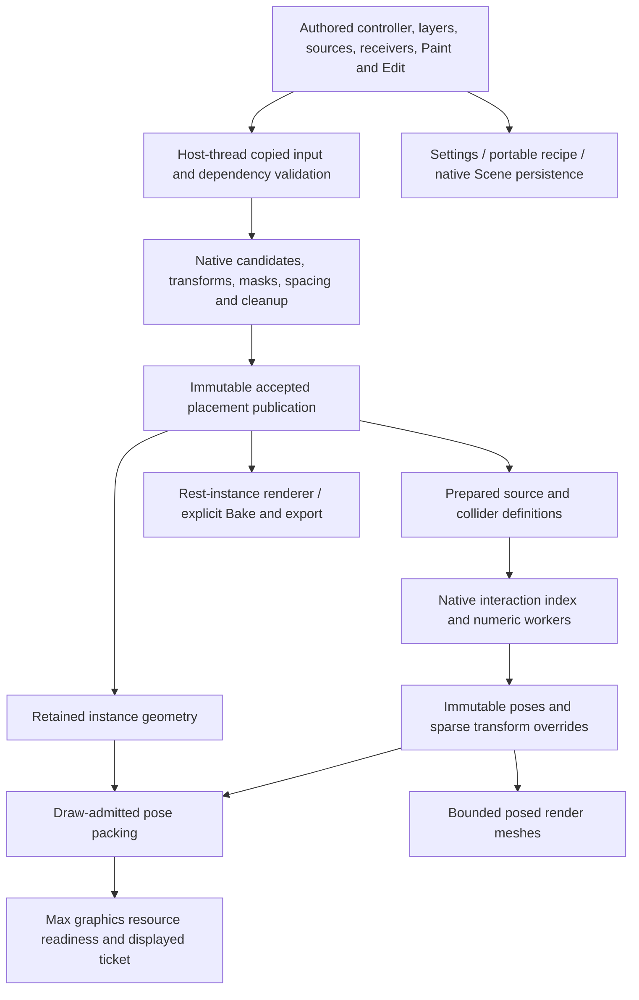

# Architecture and coverage

## What was accounted for

[coverage.csv](coverage.csv) contains **379 current semantic controls plus 176 supplemental template, popup, native Edit and managed Library rows**. Every semantic control matched a current template declaration. 341 inherited descriptions were reconciled with the older 0.87.6 ledger; inherited host claims remain explicitly historical. Supplemental rows can include retained generator inputs and are not a claim of 176 additional visible controls.

Each row records meaning/source text, owner, prerequisites, update/persistence scope, current evidence status, source/line and available handler excerpt. Individual controls without a fresh host witness are marked accordingly. A generated declaration or callback match is not proof that the control mounted, looked correct, or handled every combination. No physical/DPI/all-controls pass is claimed.

The final inventory also records each source's build-time and inventory-time hash. Concurrent changes detected at the final check are explicitly marked; their final callback excerpts are navigation aids, not independently re-reviewed or runtime-qualified successors. Architecture traces and executed witnesses below describe the tested 0.87.6.3 snapshot.

## Ownership map

Candidate identity, accepted row, source-row identity, display-sampled instance, Edit clone identity and rendered mesh are distinct. A viewport budget does not change accepted Count. A changed source definition is not permission to reinterpret old Manual-pending rows. Stable identity does not mean every transform is fixed when coupled spacing inputs change.

## Representative action traces

| Action | Authority, invalidation and publication | Threads, failure and Undo |
|---|---|---|
| Setting → Update/Live | Generated UI writes the existing owner. `markInputDirty`, `evaluateProcedural`, receiver/source revisions, native preparation/acceptance and `procStagePreview` govern evaluation. Manual pending work waits for explicit Update; display edits remain separate. | Max captures and publishes. Numeric workers receive copied data. `procRestoreResult`/native publication keep the prior complete result on failure. Parameter Undo is not the same operation as native Edit history. |
| Collider movement | Scene watcher/transform revision → `interactionsEnsure` and native runtime → immutable old/new `Snapshot` → retained pose changes/render packets → ready/displayed ticket. Source preparation is reusable when geometry/settings remain compatible. | Synchronous workers join before ordered merge. Native failure cannot install half of a pose map. The 12+12 garden replay advances displayed tickets with constant capture/preparation/cook/layout counters. |
| Orbit/pan/zoom | Existing generation, draw quotas and graphics state; no placement solve is needed. | Fresh 24-step scripted camera replay preserves epochs and stream counters. Physical pan/wheel/device behavior was not exercised. |
| Hover/select/Edit move | `viewport_pick.inc` derives pick inventory from the visible generation. CPU triangles/compact pose math identify owner and stable row. Native Edit changes authored blocks and transient overlays. | Host-only Max hit testing. Same ray/ticket reuse; geometry cache admission failure leaves display intact. Point/Centers and rectangle selection have their documented handle/marker behavior. |
| Prepare and reuse source | `interactions_host.cpp` captures mesh, fingerprint, authored guide definition and settings. Instances reference the source rather than reanalyzing it. Roles determine whether a rig or solid collider is required. | Host snapshot first, numerical preparation after. Invalid source/settings diagnose incompatibility and retain the previous result. Serialized definitions are not raw solver pointers. |
| Library browse/import | Managed catalog and bounded image workers; explicit selected actions enter script/native import or Max merge. Hash-addressed objects, immutable revisions and atomic catalog head separate storage from scene authoring. | Workers use files only. Scene graph/merge stays on Max thread. Native Scene merge intentionally clears Max Undo and displays that notice. FS-01 concerns abandoned load staging, not atomic catalog publication. |
| Licensing | Public trust → verified claims → short-lived owner/operation permit → consume at protected native authoring boundary. Inspection/preservation/render decisions are distinct. | Initialization/import/refresh may do storage/crypto. Steady admission uses in-memory state, mutex and clock checks. The maintenance worker uses no Max API and joins on shutdown. |

Relevant contracts are F01–F12: owner/layer ordering, stable random identities, independent spacing scopes, Manual/Live, atomic publication, finite admission, thread ownership, display reuse, geometry bindings, units, persistence and cached Analyzer data. Contract text is a requirement, not proof of universal compliance.

## Subsystem status

| Subsystem | Fresh evidence | Limits / next acceptance |
|---|---|---|
| Enable, Manual/Live, Update, shared controls | Generator tests and real two-controller selection/shared-control fixture; pending Manual budget test | Physical callback/DPI matrix not run |
| Ordered layers and source containers | Current declarations/handlers, copied-state contracts; native procedural tests | All layer reorder/copy/container combinations not rerun in Max |
| Models, Points/Empty, weights, source scale | Native source/weight/measurement tests; 84 selected MCP tests include scale/contracts | Points/Empty cannot be reacting mesh sources; UI replacements and unavailable third-party source families not exhaustively exercised |
| Surface/random/grid/cluster placement | Fresh scatter/grid/orientation/procedural/receiver suites | No million-instance Max rendering claim |
| Spline Bands and Analyzer assignment | Band/export/prepared-field suites and original callback inspection | Analyzer implementation independently versioned; no new Analyzer host qualification |
| Count/density/seeds/image/surface masks | Density, mesh-mask, filtering, sampling suites; native identity and bounded admission | Material-dependent arbitrary textures and all random-domain combinations remain model-specific |
| Paint Areas and brush | Brush surface/atlas/feedback/conversion tests, current authored persistence routes | No physical paint/tablet test; standalone Physics Lab is outside this review |
| Include/exclude, slope/altitude, falloff | Boundary/surface/edge/filter suites, control ownership mapped | Every combined mask/fade setup not run in host |
| Transforms, spacing scopes, Relax, cleanup | Procedural/spacing/radii/source-clearance/native remediation suites | Global acceptance can legitimately change after relevant coupled input edits |
| Edit history and sparse feedback | Binding/state/block/publication tests; 500 overlay property steps; real selection/Edit movement | Complex multi-Edit copy/clone-remapping limitations remain separate; no new full multi-event Undo/Redo campaign on every operation |
| Interactions | Role/hiding regression, 648 settings cases, 288 incremental cases; real garden held replay | One-Edit integration limits, closed-solid requirements, preparation topology and other documented admission limits remain |
| Mesh/textured/wire/points/proxies | Native planner/memory tests; Max budget/picking/navigation fixtures | Fixed-point predicate verified numerically, not screenshots of every mode; alpha picking is a threshold approximation |
| GPU lifetime and atomic display | Source ownership inspected, retained tickets and unchanged-upload checks | No GPU timestamp/FPS, true device loss, forced allocation exhaustion or multi-hour soak |
| Rendering/Bake/PFlow | Render sizing tests, source mapping/normal code inspection; small actual Scanline render | External renderers, render farm, complete UV/normal/material fidelity and large posed output not newly qualified |
| Library and presets | 244 managed checks, supplemental failure/archive tests, native Scene host roundtrip | Actual cross-machine texture/plugin portability and UI cancellation matrix remain historical/unrun |
| Licensing | Fresh policy/local suites, 954 signed assertions, ephemeral-authority host denial/import | Team pilot boundary, not a deployed customer billing/seat service; real grants untouched |
| Installer/startup | Existing archive CRC/hash/version/host guard verified; exact script loaded in private hosts | No artist install/upgrade/restart, other host-year runtime, or clean-machine installer execution |
| Diagnostics and recovery | Native diagnostics tests; immutable-result/error paths inspected; FS-01 reproduced | Actual software crash dumps/device failures not generated |
| MCP | 84 focused mock/service tests; restricted authored surface inspected | Catalog breadth is not write authority. No new live MCP scene-authoring approval/execution |
| Knowledge/docs | Compact status verified: 18 current / 14 stale selected sources; direct source used | No broader index verification or refresh. Historical qualification stays historical |

## Analyzer and automation boundaries

`unified-core.ms:2071–2087` consumes relevant cached Analyzer inputs and rejects enabled stale analysis with an actionable message; it does not run Analyze from a Scatter preview read. Disabled/unconsumed inputs have different dependency semantics. Source inspection establishes this policy; this task did not launch the independent Analyzer payload.

MCP tests cover cached publication, licensing, catalog scope, scale, procedural plans and recipes. They are mock/service tests and do not establish all plugin capabilities advertised by the feature catalog. No network write, installer action or independent-product integration was performed.

## Remaining combination matrix

Fresh evidence is strongest for roles × neighbor preference, response × hiding mode, Bend/Trim/fixed-base combinations, changed/disabled rows, Manual pending × draw limits, and serial/parallel deterministic output. It is weaker for animated materials plus changing topology, physical multi-owner UI switching, renderer callbacks during heavy edits, external material plugins, cancellation at every file boundary and unsupported source shapes. These are recorded acceptance boundaries, not assumed failures.
